# Трос: лізти вгору й униз, звис на якорі, зістрибнути, змотати — кліпи UAL і кадри T6

2026-10-15 · T6 Аполлон · **Статус:** рекомендація для T1. Це крок 3 плану [[2026-10-15-Rope-Climb-Perch-Release]].
Кредитів не витрачено, генерацій не було, код гри не змінено. Тут обрано кліпи UAL для кожного стану троса й позу звису
на якорі. Числа швидкостей, часу й відстаней належать T5. Клавіші визначає T8 у
`docs/GDD/2026-10-15-Rope-Climb-Input.md`.

**Позначки джерела:**
- `файл:рядок` — код на `0986d72`;
- **зонд** — мій скрипт у scratchpad сесії (`scratchpad/t6-rope/probe/`, не в репо);
- **PLACEHOLDER** — число T6 для пози, з причиною; рух і влучання воно не вирішує.

## Коротко для T1

| стан | кліп (файл UAL) | чому | ліцензія |
|---|---|---|---|
| **угору по тросу** | **корпус і руки `Climb_Up` (UAL1), ноги `Jump_Loop` (UAL1) + процедурний затиск ніг, руки IK на мотузку** | `Climb_Up` дає перехоплення рук по черзі: кожна рука ходить від −0,07 до +0,29 м над своїм плечем. Повне тіло не годиться: ноги ступають по невидимій стіні (різниця висот стоп до 0,48 м, ноги врозкид 0,24–0,33 м). `ClimbUp_1m` і `ClimbUp_2m` — вилазка на виступ, не цикл | CC0 1.0 |
| **униз по тросу** | **ковзання: корпус і руки `Climb_Idle`, ноги `Jump_Loop` + затиск, руки одна над одною без перехоплення**. Запасний варіант — корпус `Climb_Down_Loop` + затиск | Santos просив «плавно», T8 у підказці пише «slide down». `Climb_Down_Loop` — це майже `Climb_Up` задом наперед, тобто те саме перехоплення рук | CC0 1.0 |
| **звис на якорі** | **руки `Climb_Idle` (UAL1), IK на дві точки плеча, ноги `Jump_Loop`** | руки над головою, тіло вільно висить. Ноги ті самі, що й зараз на тросі (`SkeletalRig.gd:391-392`), нового змішування не треба. Повне тіло `Climb_Idle` підіймає коліно до стовпа (зазор 0,08 м) і читається як стіна | CC0 1.0 |
| **зістрибнути зі звису** (Space + напрям) | **`WallRun_Jump_L` / `_R` (UAL2) з ≈ 0,35–0,5 кліпу**, далі `Jump_Loop` і чинне приземлення. Сторону вибирати, як для відскоку від стіни (`ParkourMotion.gd:96-97`) | друга половина кліпу — руки врозліт, тіло випрямлене: так читається «відпустив і полетів». `Climb_Exit`, `GetOffWall_2m` і `ClimbUp_*` потребують стіни або виступу під ногами | CC0 1.0 |
| **відпустити** (Z, E без цілі) | без нового кліпу: перехід у `Jump_Loop` за чинні 0,14 с (`AuthoredHookMotion.gd:12`) | — | CC0 1.0 |
| **змотати мотузку** (Ф4) | (а) біля кінця: корпус і руки `Climb_Up` на ногах `Idle`, руки тягнуть мотузку вниз по черзі, у кінці `Fish_Reel` (UAL2). (б) з відстані: `Fish_Reel` | `Climb_Up` уже малює змотування (`AuthoredHookMotion.gd:114-116`). `Fish_Reel` тримає руки разом біля пояса (розкид 0,04–0,08 м), і це читається як «намотує». `Interact` лише тягнеться однією рукою | CC0 1.0 |

**Що з цього мусить зробити T2, щоб трос читався саме як трос, а не стіна:**
1. Під час лазіння мотузка йде на 0,14 м попереду лінії плечей (PLACEHOLDER: ближче — лице впирається в мотузку; далі
   — короткі руки не дотягуються). Зараз фізична мотузка йде по осі тіла (`GrappleHook.gd:50`, `:251-253`).
2. Хвіст мотузки малюється й **під** руками, між стопами. Зараз лінія починається з правої руки
   (`GrappleHook.gd:912`), тож нижче тіла мотузки не видно.
3. Ноги: процедурний затиск. Обидві стопи по 0,05 м з боків від лінії мотузки, на 0,06 м позаду неї. Під час лазіння
   по черзі «коліна вгору» (стопи на 0,46 м над нулем моделі героя, тобто над точкою стоп у спокої) і «ноги випрямлені» (0,24 м). Значення PLACEHOLDER,
   фазу прив'язати до перехоплення рук.

## Як знято

**Зонд** `scratchpad/t6-rope/probe/rope_capture.gd` робить те саме, що `SkeletalRig.retarget` (`SkeletalRig.gd:245-263`):
ставить UAL-манекен у кадр кліпу й переносить повороти кісток і зсув таза на GLB героя. Склейки двох кліпів бувають двох видів. Ряд «як зараз» бере з другого кліпу все, крім рук, — за маскою
`AuthoredHookMotion.gd:42`, з корпусом від ніг, як у місті (`:171-172`). Пропозиції беруть з другого кліпу тільки таз і ноги. IK рук і ніг — копія `AuthoredCombatMotion._solve_chain`
(`AuthoredCombatMotion.gd:209-227`). Камера дивиться ззаду-збоку, як у грі, бокові ряди — збоку. Рендер —
Compatibility / llvmpipe під xvfb, кадри 270 × 360. Це **не M3** і **не кадр гри**: немає фізичного нахилу корпусу
(`AuthoredHookMotion.gd:171-172`), немає HeroGear (годинник, книга, кунаї) і змішувань у часі.

```
SP=/tmp/claude-0/-home-user-nooneisreal/<session>/scratchpad/t6-rope
python3 -I $SP/probe/spec_final.py $SP/probe/spec_all.json && $SP/probe/run.sh $SP/probe/spec_all.json $SP/out 270x360
→ 11 sheets 168 cells · rc=0 errors=0
$SP/probe/run.sh $SP/probe/spec_scan.json $SP/scan 64x64      → 44 рядки SCAN (22 кліпи × 2 героя, по 24 кадри)
list_clips.gd                                                  → UAL1 120 кліпів, UAL2 134
bones.gd → choko_m0 і skea_m1: 24 кістки, пальців 0; UAL1: 65 кісток, пальців 40
ls -la docs/assets/screenshots/2026-10-15-rope-anim-*          → 11 файлів, 62 487 … 244 545 байт (≤ 300 КБ)
```

**Пальців у героїв немає:** Meshy-скелет має 24 кістки, з них 0 пальцевих. Тому хват читається лише з того, де стоїть
кисть, — і тим вимогливіший до точки.

**Руки короткі:** від плеча до кисті 0,382 м у Choko і 0,368 м у Skea (зонд, рядки `HERO`). Плечі на 1,34 / 1,38 м,
голова — на 1,43 / 1,48 м. Звідси обидва головні числа пози: мотузка на 0,14 м попереду плечей і плечі на 0,32 м
нижче хвату.

## Що самі кліпи кажуть

Зонд, 24 кадри на кліп. Герой дивиться на +Z, усі значення в метрах, перше число — Choko, друге — Skea.

| кліп (файл, довжина) | руки врозкид | руки над плечима, середнє двох | ноги врозкид | таз, y | як читається |
|---|---|---|---|---|---|
| `Climb_Up` (UAL1, 1,267 с) | 0,36–0,47 / 0,38–0,49 | 0,04–0,17 | 0,24–0,33 | 0,96–1,07 | драбина / стіна |
| `Climb_Down_Loop` (UAL1, у плеєрі `Climb_Down`, 1,267 с) | 0,37–0,47 / 0,39–0,49 | 0,03–0,16 | 0,24–0,34 | 0,95–1,06 | те саме |
| `Climb_Idle` (UAL1, 2,933 с) | 0,51 / 0,53 | 0,13–0,16 | 0,51 | 0,96–0,99 | звис на стіні |
| `ClimbUp_1m` (UAL2, 0,667 с) | 0,41–0,58 | −0,25…−0,08 | 0,18–0,28 | 0,94–1,24 | вилазка на виступ 1 м |
| `ClimbUp_2m` (UAL2, 1,300 с) | 0,29–0,45 | −0,26…0,28 | 0,18–0,28 | **0,46–1,67** | вилазка на 2 м |
| `Climb_Exit` (UAL1, 1,467 с) | 0,43–0,56 | −0,35…0,16 | 0,33–0,54 | 0,93–1,00 | вихід нагору стіни |
| `GetOffWall_2m` (UAL2, 0,633 с) | 0,46–0,86 | −0,12…0,02 | 0,22–0,41 | 1,00–1,68 | відштовхнутися від стіни |
| `WallRun_Jump_L` (UAL2, 0,733 с) | 0,21–0,86 | −0,15…−0,02 | 0,00–0,34 | 0,83–1,06 | відскок убік |
| `Jump_Loop` (UAL1, у плеєрі `Jump`, 2,5 с) | 0,88–0,89 | −0,10…−0,09 | 0,22 | 0,98 | вільне падіння |
| `Fish_Reel` (UAL2, 2,3 с) | 0,04–0,06 / 0,07–0,08 | −0,17…0,11 | 0,32–0,46 | 0,82–0,99 | руки разом, намотує |
| `Interact` (UAL1, 2,0 с) | 0,27–0,39 | −0,34…−0,20 | 0,34 | 0,99 | тягнеться вперед |

**Окремо для кожної руки й ноги** (зонд, 12 кадрів, Choko):
- `Climb_Up`: кожна рука −0,07…0,29 м над своїм плечем, по черзі. Стопи міняються висотою на −0,48…+0,46 м — це
  кроки по стіні.
- `Climb_Down_Loop` по кадрах збігається з `Climb_Up`, прокрученим назад, з різницею до ±0,05 м. Окремого руху для
  спуску в UAL немає.
- `Climb_Idle`: ліва рука на 0,00–0,03 м над плечем, права — на 0,26–0,29 м. Це вже поза «одна рука над другою», тобто
  готовий хват для мотузки. Стопи стоять на різній висоті, різниця стала — 0,30 м (впираються в стіну).

**Мотузка й тіло.** Сирі кліпи тримають кисті на 0,24–0,33 м від лінії мотузки: лазіння розраховане на стіну завширшки з
плечі. IK доводить кисті до мотузки з похибкою 0,000 м. Виняток — найвища кисть у варіанті Г: там похибка до 0,063 м,
бо руки короткі.

## 1. Угору по тросу

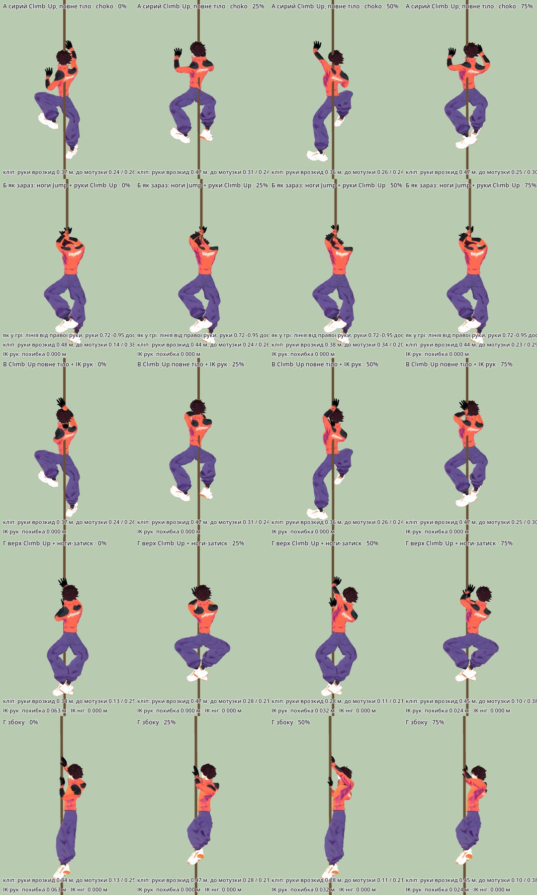

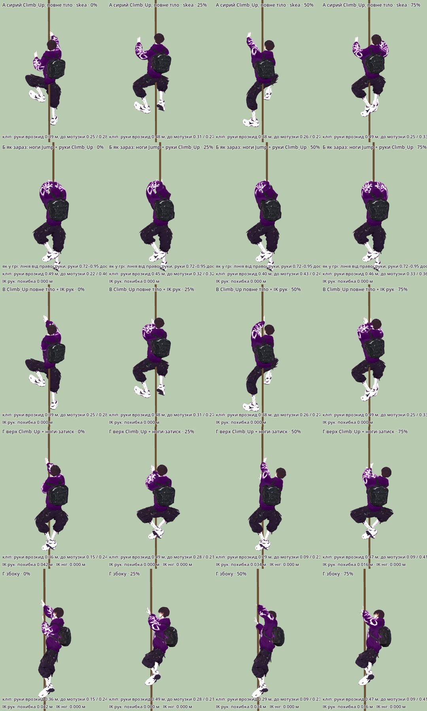

| ряд | що | руки: різниця висот | ноги | як читається |
|---|---|---|---|---|
| А | сирий `Climb_Up`, повне тіло | 0,03–0,39 м, кисті з двох боків мотузки | врозкид 0,24–0,33 м, різниця висот до 0,48 м | **по стіні** |
| Б | як зараз: руки `Climb_Up`, решта `Jump_Loop`, мотузка по осі тіла, кисті на 0,72–0,95 досягу (`AuthoredHookMotion.gd:216-217`) | 0,06–0,12 м (Choko), 0,01–0,04 м (Skea) | ноги висять нерухомо | **висить і їде вгору**, перехоплення не видно |
| В | `Climb_Up` повне тіло + IK рук на мотузку | 0,01–0,31 м | як у А | руки на мотузці, ноги на стіні. Мішанина |
| **Г** | **верх `Climb_Up` + ноги `Jump_Loop` + затиск + IK рук** | **0,03–0,34 м** | стопи разом (0,10 м), мотузка між ними | **по мотузці** |

**Що це означає:**
- Повне тіло `Climb_Up` не годиться: ряди А і В.
- Лишати як зараз теж не можна (ряд Б). Підтяжку в 1,2 м цей ряд витримував, але лізти «доки можливо» з ним не вийде.
  Затиск, який чинний код ставить кистям (0,72–0,95 досягу), лишає руці хід лише ≈ 0,08 м (0,23 досягу, розрах.). Перехоплення з таким ходом
  не видно.
- Підходить ряд Г. Висоти рук із кліпу (−0,07…0,29 м над плечем) переносяться на 0,02…0,30 м над плечем
  (PLACEHOLDER, зонд `REMAP`).
- Повний цикл (два перехоплення) — 0,56–0,72 м підйому (розрах.: 2 × 0,28…0,36 м). Це збігається з чинним `REEL_STROKE = 0,65`
  (`AuthoredHookMotion.gd:11`). Тож кліп можна вести за реальним підйомом, як `reel_cycle` (`:103`). Швидкість дає T5.

## 2. Униз по тросу

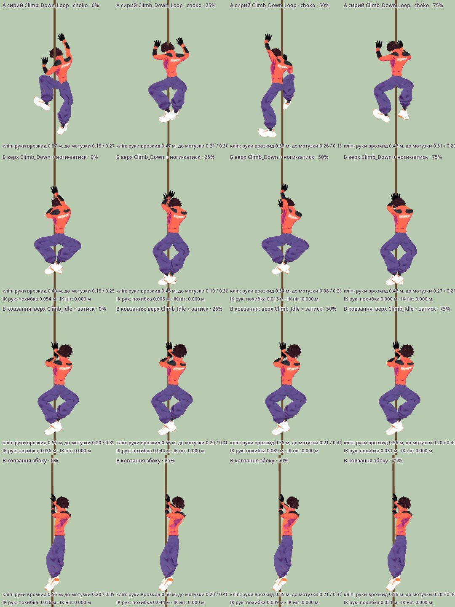

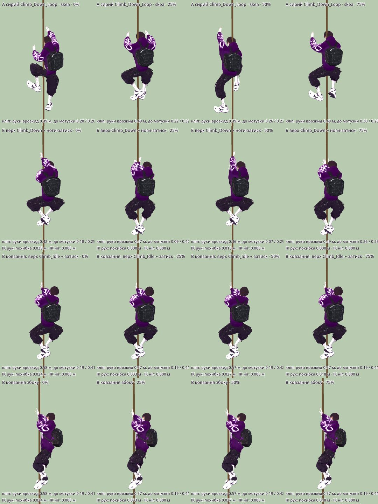

- **А — сирий `Climb_Down_Loop`**: кисті з двох боків мотузки, кроки по стіні. Як у `Climb_Up`, читається як стіна.
- **Б — верх `Climb_Down` + затиск.** Руки перехоплюються вниз (різниця висот 0,01–0,29 м) і читаються як рух по
  мотузці. Але це «драбина вниз», а не «плавно».
- **В — ковзання.** Верх `Climb_Idle`, руки на мотузці одна над одною (різниця 0,11–0,12 м, похибка IK ≤ 0,044 м),
  стопи затиснуті з різницею висот 0,07 м. Кадри майже не змінюються: так і треба, бо рухається тіло, а не руки.
  **Рекомендую В.** Б лишаю на випадок, якщо T5 дасть повільний спуск, де ковзання виглядало б застиглим.

## 3. Звис на якорі — поза й місце

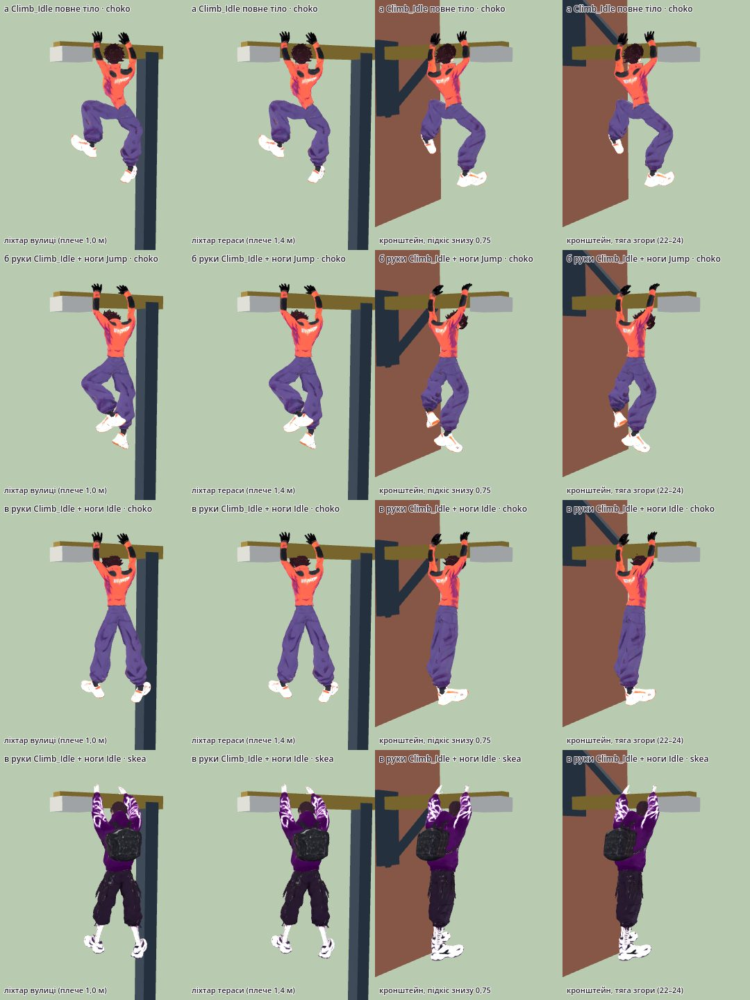

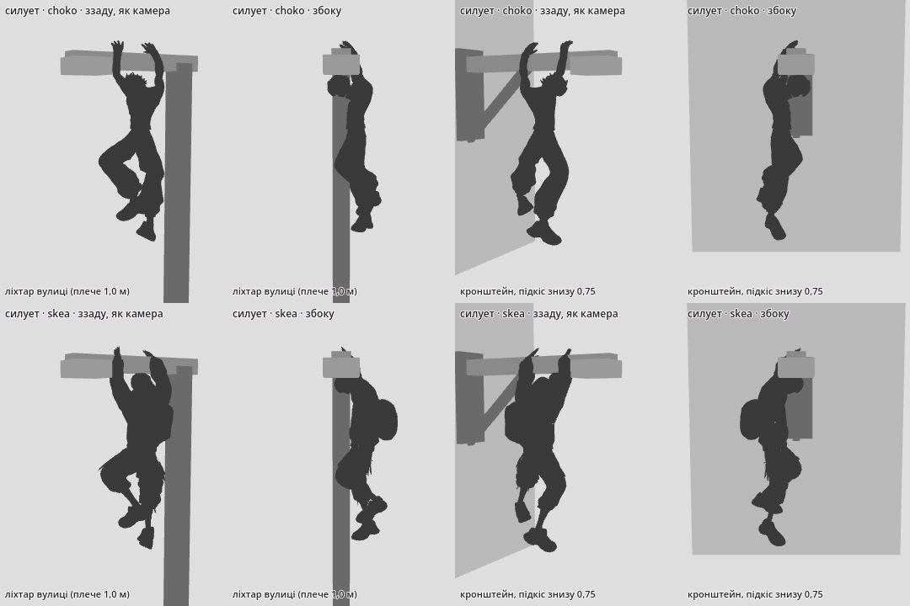

**Де руки.** Правило одне на всі 25 якорів. У всіх плече опори на 0,30 м вище точки якоря:
- ліхтар — `arm_y = point.y + 0,3` (`CityDistrict.gd:171`);
- кронштейн — `mount.y − point.y = 0,30` у кожного з 15 кронштейнів (`CityLayout.gd:56-83`).

| що | значення | джерело |
|---|---|---|
| висота кистей | точка якоря + 0,34 м (центр плеча + 0,30, зап'ястя на 0,04 вище) | розрах. + PLACEHOLDER |
| де кисті вздовж плеча | **0,26 і 0,66 м** від точки якоря в бік кріплення (розкид 0,40 м); рука ближча до якоря — ліва чи права залежно від того, куди дивиться герой | PLACEHOLDER, перевірено на кадрах |
| герой | дивиться на плече (упоперек нього). Плечі — на 0,32 м нижче й на 0,14 м позаду середини хвату | PLACEHOLDER |
| де тоді плечі героя | точка якоря + 0,02 м | зонд |
| найнижча кістка (стопа) | точка якоря − 1,25 м (Choko) / − 1,31 м (Skea). Для ліхтаря вулиці це ≈ 5,2 м над бруківкою | зонд: 5,25 / 5,19 при якорі 6,5 |

**Чи вміщається хват у вільну частину плеча** (від стовпа або вузла підкосу до кераміки 0,35 м,
`CityDistrict.gd:175-190`):
- ліхтар вулиці, виліт 1,0 м (`CityLayout.gd:51-54, 75`) — вільно 0,735 м, руки 0,26–0,66 м вміщаються;
- ліхтар тераси, виліт 1,4 м (`:67-71`) — вільно 1,135 м;
- кронштейн, виліт 1,45 м — вільна зовнішня половина до вузла підкосу (0,725 м) має 0,55 м. У кронштейна 8
  (`:62`) виліт 1,65 м, тож вільно 0,65 м.

На кронштейні герой висить боком до стіни.

**Зазори** (зонд, від центру кістки; шкіра на 0,05–0,15 м ближче):

| опора | до стовпа | до стіни | до підкосу / тяги |
|---|---|---|---|
| ліхтар вулиці, поза б | 0,26 м | — | — |
| ліхтар тераси, поза б | 0,66 м | — | — |
| кронштейн, підкіс знизу 0,75 (4, 5, 8, 10, 19–21) | — | 0,70 м | **0,10 м** (дальня кисть біля вузла) |
| кронштейн, тяга згори −0,75 (22–24, `CityDistrict.gd:16`) | — | 0,70 м | **0,07 м** |
| поза а (`Climb_Idle` повне тіло), ліхтар вулиці | **0,08 м** | — | — |

Кронштейнів 6, 7, 9 (підкіс 0,3) і 16, 17 (0,35) я не знімав. Дальня кисть там біля того самого вузла на 0,725 м, тож
зазор має бути близький, але це не виміряно.

**Чи потрібна видима деталь, за яку тримаються.** Ні. Плече ліхтаря й кронштейна латунне, брусок 0,15 × 0,16 м
(`CityDistrict.gd:178`). На сірих кадрах кисті на ньому читаються з обох ракурсів. Латунь у місті вже означає «тут
хапаються»: тим самим `brass` пофарбовано край-хват `GripLip` на виступах (`CityDistrict.gd:67`).

**Колізія плечу не потрібна.** Звис — це стан: тіло ставиться за точками хвату, які дає `CityLayout.anchor_supports()`,
а не за фізичним контактом. T2 мусить зробити дві речі:
- тримати зазори з таблиці;
- на кронштейнах 22–24 зсунути хват на кілька сантиметрів від тяги. Що саме вибрати, вирішує T2 за кадром приймання.

**Силует** (сірий аркуш) читається з обох ракурсів:
- дві руки вгору на горизонтальному бруску, тіло вертикально під ним;
- ноги в позі б зігнуті, тож поза «висить», а не «стоїть у повітрі». У позі в ноги прямі й виглядають задерев'яніло;
- у Skea збоку рюкзак додає маси спині. Силуету це не ламає.

**Перехід із мотузки на плече.** Звідси T5 бере, де закінчується «угору».

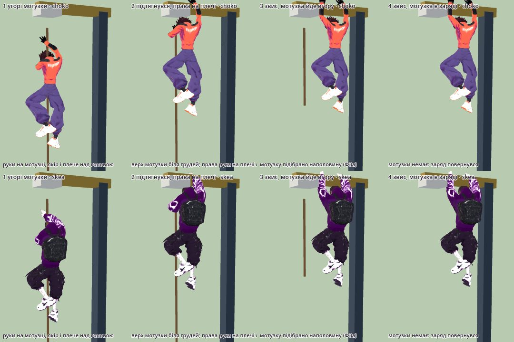

- Кадр 1. Лазіння впирається у верх мотузки: верхня кисть на `anchor.y − 0,26` м, плечі на `anchor.y − 0,52` м.
- Кадр 2. Щоб дістати плече (кисті на `anchor.y + 0,34`), коротким рукам героїв треба підтягнутися ще на 0,5 м, до
  плечей на `anchor.y − 0,0`. Верх мотузки тоді біля грудей.
- Кадр 3. Звис. Мотузка підбирається знизу вгору.
- Кадр 4. Мотузки немає: заряд повернувся.

Це один короткий рух «підтягнувся й перехопився» (PLACEHOLDER: `Climb_Up` один раз + IK; час — T5). Його
висоту 0,5 м треба врахувати, коли рахуватимуть, де стоїть герой, поки висить.

## 4. Зістрибнути зі звису

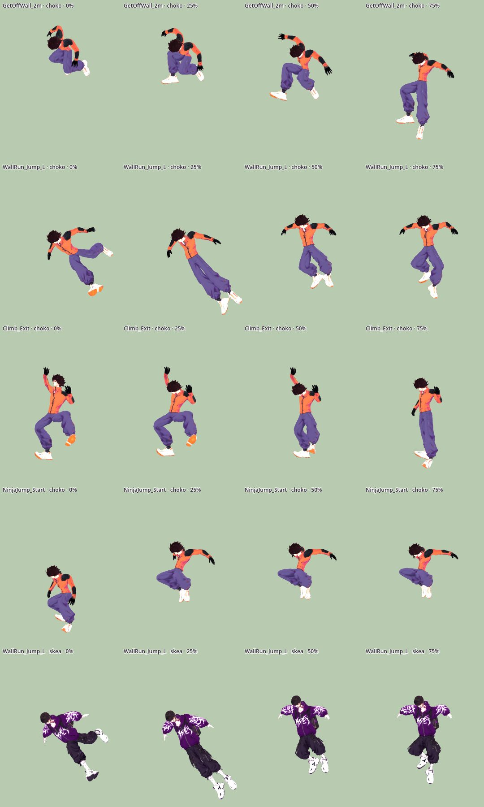

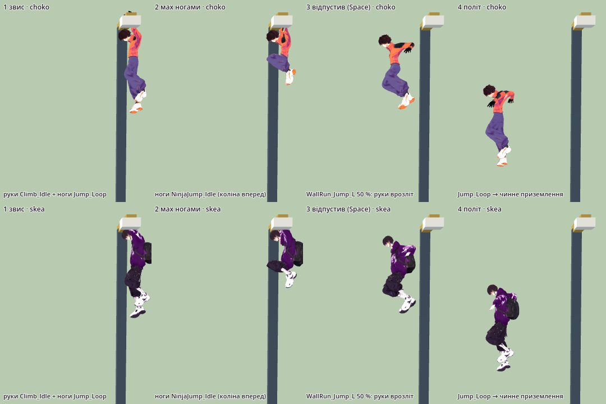

- **`WallRun_Jump_L` / `_R`** — обрано.
  - Перша чверть кліпу — поштовх від стіни, ноги вбік. Її на ліхтарі пропустити.
  - З ≈ 0,35–0,5 кліпу тіло випрямлене, руки врозліт: так читається «відпустив».
  - Сторону вибирати за знаком «напрям стрибка · права рука героя», так само як для відскоку від стіни
    (`ParkourMotion.gd:96-97`).
  - Перед відпусканням — мах ногами: ноги `NinjaJump_Idle` (UAL2), коліна вперед, руки ще на плечі (кадр 2 розкадровки).
- **`NinjaJump_Start`** — запасний для стрибка вперед. З 25 % кліпу герой летить у групуванні, руки відведені назад.
  Але на 0 % він присідає на землі, тож кліп треба різати.
- **`GetOffWall_2m`** — відкинуто. На 0 % стопи впираються в стіну, а таз за кліп опускається на 0,68 м.
- **`Climb_Exit`** — відкинуто. Це вихід нагору стіни, а на плечі ліхтаря стати ні на що.
- **`ClimbUp_1m` / `_2m`** — відкинуто. Це вилазки на виступ: кисті нижче плечей, таз іде вгору до 1,21 м за кліп.

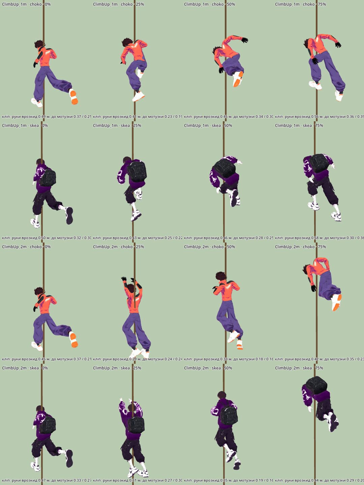

**Відпустити (Z, F / L, X, E без цілі):** нового кліпу не треба. Герой переходить у `Jump_Loop` за чинні 0,14 с
(`AuthoredHookMotion.gd:12`). Для LShift (ухилення зі звису, як із краю — у T8) я кліп не вибирав. Не перевіряв, яка
анімація зараз грає ухилення з краю.

## 5. Змотати мотузку (Ф4)

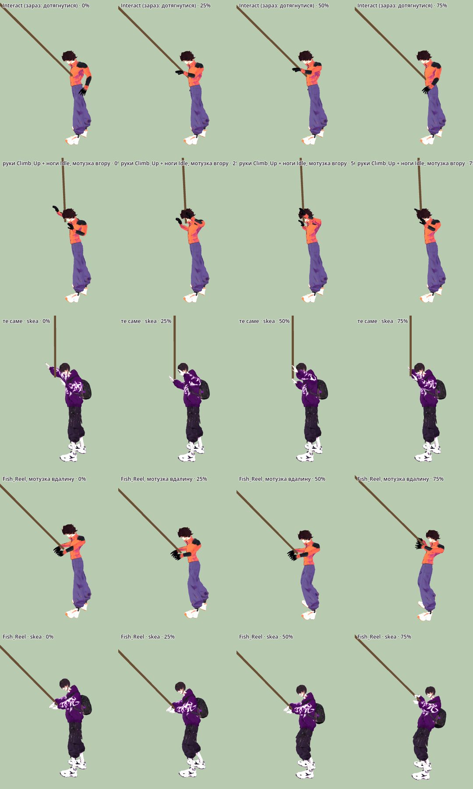

**Анімація:**
- **Ф4 (а), біля кінця, G:** герой під мотузкою.
  1. Ривок: короткий `OverhandThrow` (UAL2, уже в кеші, `AuthoredHookMotion.gd:5`) або хвиля рукою.
  2. Руки по черзі тягнуть мотузку вниз: верх `Climb_Up` на ногах `Idle`. На кадрах це читається як «стягує мотузку».
  3. Останні витки — `Fish_Reel`: руки разом біля пояса, «намотує».
- **Ф4 (б), з відстані:** `Fish_Reel` увесь час, поки мотузка повертається. Мотузка вдалину від рук читається як
  «котушка тягне волосінь».
- `Interact` (зараз `ROPE_REACH`, `AuthoredHookMotion.gd:127-130`) лишити для «дотягнутися», для змотування він не
  годиться: рука одна, жодного циклу.

**Як має виглядати сама мотузка (для T2):**
1. **Лінія не рветься.** Від руки (`GrappleHook.gd:912`) до гака мотузка лишається суцільною до кінця. Довжина
   тільки зменшується, без телепорту.
2. **Ф4 (а):**
   - після ривка гак зіскакує з кераміки якоря й падає видимою дугою;
   - мотузка провисає. Провис уже малюється для фізичного запасу (`GrappleHook.gd:909, 918`);
   - далі довжина зменшується з вільного кінця, і хвіст підтягується до рук.
3. **Ф4 (б):** гак зіскакує, і мотузка повзе назад уздовж своєї ж лінії, як рулетка, з легкою хвилею. Гак не летить
   окремо.
4. **У звисі на якорі (Ф3 а)** обидві руки зайняті плечем. Тому мотузка підбирається сама:
   - нижній кінець підіймається до якоря;
   - гак зіскакує й дугою йде до героя, на пояс.
   Де в моделі пояс чи кобура, вирішує T2. Я цього не перевіряв.
5. **Лічильник гаків на HUD** додає +1 тоді, коли гак торкнувся героя, не раніше. Це тільки вигляд; заряд рахує
   `MatchRopes`.

Час кожної фази й відстань для (б) дає T5.

## 6. Чого бракує в UAL і що з цим робити без кредитів

| бракує | без кредитів | хто |
|---|---|---|
| лазіння по мотузці із затиском ніг | верх `Climb_Up` + ноги `Jump_Loop` + IK стоп до лінії мотузки, фаза від перехоплення рук (ряд Г) | T2 |
| ковзання вниз | верх `Climb_Idle` + затиск + легке тремтіння (ряд В) | T2 |
| звис на перекладині | руки `Climb_Idle` + IK на дві точки + ноги `Jump_Loop` + процедурний маятник | T2 |
| перехід із мотузки на плече | IK-послідовність (кадри 1–4 переходу) + `Climb_Up` один раз | T2 |
| мах і зіскок з перекладини | ноги `NinjaJump_Idle` → `WallRun_Jump_L/R` з середини → `Jump_Loop` | T2 |
| змотування в руки з витками на передпліччі | `Climb_Up` / `Fish_Reel`. Витки — процедурна лінія мотузки, не кістки | T2 |
| хват пальцями | неможливо: у героїв 0 пальцевих кісток. Хват читається з точки кисті | — |

Якщо процедура не пройде приймання (крок 8), можна згенерувати кліп.

**RED: потребує слова Santos.** У Higgsfield є Meshy `meshy_rigging` / `3d_rigging`: `enable_animation`,
`animation_action_id` від 0 до 696, бібліотека на 678 дій (`models_explore search`, 2026-10-15).
- Чи є там лазіння по мотузці або звис на перекладині — **не перевірено**: інструмента `animation_actions` у цій сесії
  немає.
- Вартість не перевірено: `get_cost` не викликав.
- Баланс: 2087,25 кредиту, план ultra (`balance`, 2026-10-15).
- Кліп Meshy ліг би на 24-кістковий скелет героя повз UAL-манекен, тож T2 мав би додати для нього окремий шлях.

Генерації не було, промпта в `docs/Art/Prompts/` немає: ТЗ з'явиться, коли ця потреба стане реальною.

## 7. Ліцензії

Кожен обраний кліп узято з двох файлів, і обидва — CC0 1.0 ([[Textures-Registry]] `:116-117`, `anim-ual1`,
`anim-ual2`):
- **UAL1** (`game/assets/animations/ual/UAL1.glb`): `Climb_Up`, `Climb_Down_Loop`, `Climb_Idle`, `Jump_Loop`, `Idle`,
  `Interact`;
- **UAL2** (`game/assets/animations/ual/UAL2.glb`): `WallRun_Jump_L`, `WallRun_Jump_R`, `NinjaJump_Idle`, `Fish_Reel`,
  `OverhandThrow`.

Файл для кожного кліпу видно в лістингу зонда `list_clips.gd`. Нових ассетів у `game/assets/` немає, тож нових рядків
у реєстрі теж.

## Відкрите

- **T5:** швидкість угору й униз, висота підтягування на плече (0,5 м), час переходу, маятник, змотування.
- **T2:** хвіст мотузки під руками; мотузка на 0,14 м попереду плечей; затиск ніг; хват 0,26 / 0,66 м; зазор до тяги
  на кронштейнах 22–24.
- **Кадри не з гри.** Тут немає фізичного корпусу, HeroGear і змішувань. Приймання — у кроці 8 плану, на кадрах гри.
- **Рядки для 11 кадрів у [[Screenshots]]** за правилом сторінки. За умовою кроку я їх не дописував, тож це лишається
  T1 або T7.
- Не знімав кронштейни з підкосом 0,3 і 0,35. Не перевіряв, який кліп зараз грає ухилення з краю.

## Related

- [[2026-10-15-Rope-Climb-Perch-Release]] · [[04-Grapple-System]] · [[ADR-022-Combat-Control-And-Match-Resources]] · [[2026-10-09-Rope-Pull-And-Jump-Arc-Numbers]]
- [[ADR-011-Diegetic-Grapple-Anchors]] · [[ADR-016-Player-Decides-What-Body-Decides-How]] · [[ADR-019-Audit-And-Many-Views-Before-Decision]] · [[05-Platforms-Input]]
- [[2026-10-09-Animation-Feel-Landing-Rope-Stop-Wall]] · [[2026-10-07-Living-Body]] · [[2026-10-07-Aim-Free-Rope]] · [[2026-10-05-Parkour-Visual-Audit]]
- [[2026-10-07-Tight-Station-Readability-Criteria]] · [[Choko]] · [[Skea]] · [[Screenshots]]
- [[Textures-Registry]] · [[Style-Guide]] · [[ADR-007-Art-Style-Sketch-Cel]] · [[ADR-013-License-Check-At-Release]] · [[state]] · [[constitution]]
