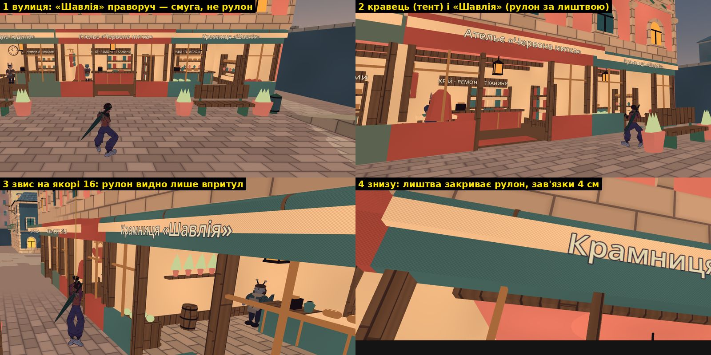
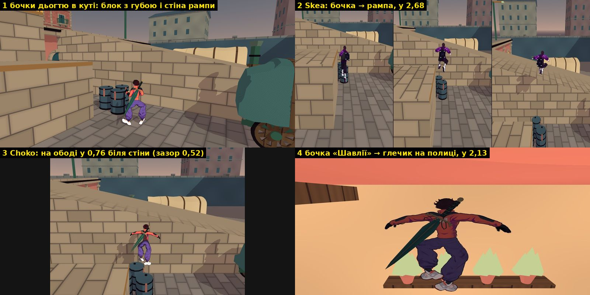
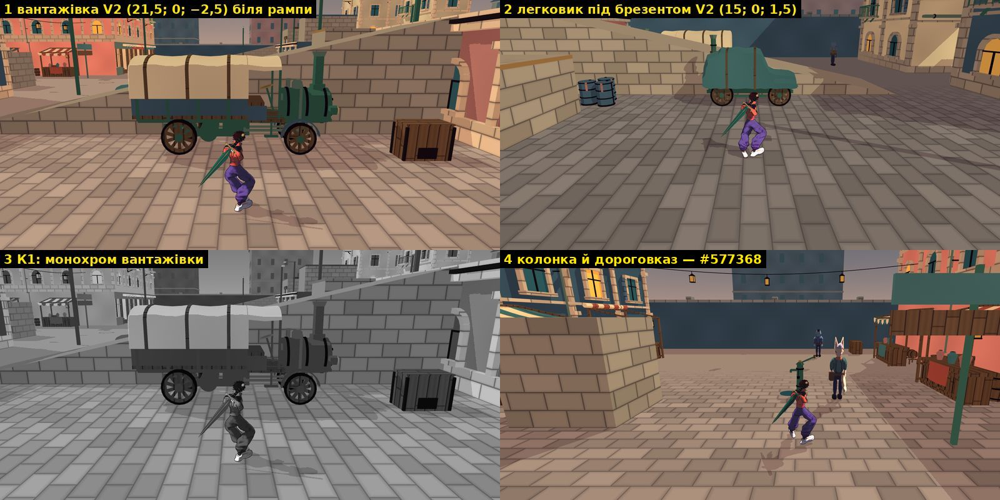
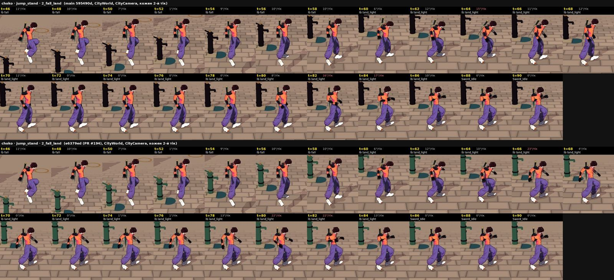
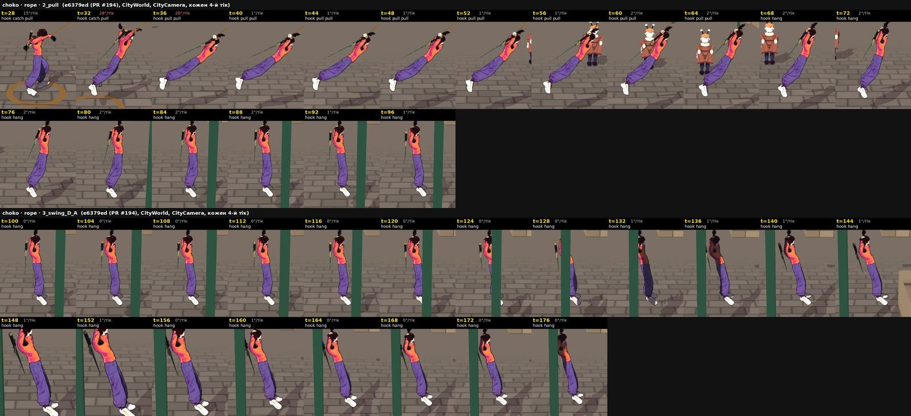
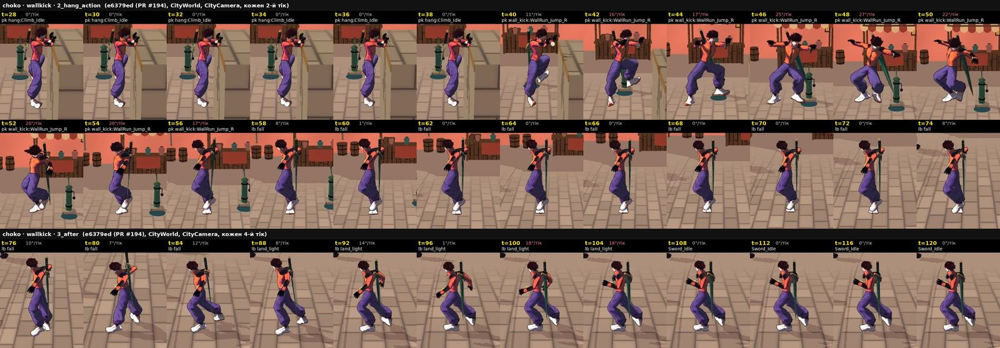

# T6 — приймання: згорнутий тент, 31 «сходинка», паромобілі й чавун, хвиля анімацій

**Дата:** 2026-10-14 · **Роль:** T6 Аполлон · **Крок:** 2 плану [[2026-10-14-T6-Acceptance-Crane-Albedo-AB]] ·
**Дерево:** `scratchpad/t6-tree`, detached `e6379ed` (усе з PR #194; `git log --oneline -1` → `e6379ed Plan T6 acceptance…`) ·
**Кредити:** 0, `generate_*` не викликала. Код гри не змінювала. В основному дереві записано лише цю сторінку й 6 кадрів
`docs/assets/screenshots/2026-10-14-t6-*.jpg`.

## Підсумок

| # | пункт | вердикт | що переробити | хто |
|---|---|---|---|---|
| 1 | Згорнутий тент «Шавлії» під якорем 16 | **YELLOW** | Рулон не читається: він ховається за лиштвою і зливається з перемичкою того самого кольору. Лиштву опустити на 0,06 м під рулон. Рулон — у смугах кремовий/акцент, як згорнутий тент ятки. Зав'язки 0,10 м (П4). Колайдер `RolledAwning` лишити без змін | T2 (0 кр.), кадр приймає T6 |
| 2 | 31 «сходинка» (`STEP_PROPS`) | **GREEN для 25, YELLOW для 6** | Бочки дьогтю (3): зазор 0,52 м між бочкою (15,18; −4,30) і стіною рампи. Бочка «Шавлії» (1) веде на глечик полиці з травами. Верстак двору (1): зазор 0,55 м до `SouthWall`. Стілець кравця (1): герой лишається на ободі. Що правити — § 2 | T2, стілець — клас § 2.3 (T2 із числами T5); правило «сходинки» в К7 — T6 |
| 3 | Паромобілі (місце V2) і фарбований чавун `#577368` | **GREEN** | Місце V2 і колір приймаю. Окремо YELLOW: камера, коли герой відходить від машини (§ 3.4) | рішення про камеру — T1, виконання — T2 |
| 4 | Хвиля анімацій (посадка, зупинка й розворот, трос, стіна й край) | **YELLOW** (з 13 дій 9 GREEN, 4 YELLOW, RED немає) | Звис на тросі й на краю — статуя. Власний стовп у кадрі. Посадка після кіка починається на 6 тиків пізніше. Ноги на повороті 90°. Зайва посадка після підтягування. Що правити — § 4 | T2; поріг «застиглого» — T1 вносить у план |

Кадри, які вирішують кожен пункт, — у розділах. Усі шляхи `scratchpad/…` — у scratchpad головної сесії.

## Як знімала й чим обмежено

- Godot `4.7.stable.official.5b4e0cb0f` (`godot --version`), Compatibility, **llvmpipe без GPU**. Рядок кожного прогону:
  `T6_INFO renderer=gl_compatibility adapter=llvmpipe (LLVM 20.1.2, 256 bits) window=(1920, 1080) scale3d=1.00 msaa=2`.
  Forward+ на M3 не бачила. Через подвійне множення альбедо кольори на екрані темніші за палітру. Це крок 5 плану, тут
  я його не виправляла.
- Сцена — справжній `CityWorld` дерева `t6-tree`. Камера — `CityCamera` за героєм (плече 6 м) або камера на висоті очей.
  HUD прихований, мешканці на час кадру заморожені. Це кадри зі станцій, а не суцільне ручне проходження.
- Інструменти (усі в `scratchpad/t6-accept/`):
  - кадри — `accept_frames.gd` через `run_t6.sh` (xvfb 1920×1080);
  - К7 для 31 сходинки — `k7_steps.gd`, на основі зонда T4 `t4-1009/probes/k7_vault.gd`;
  - зонди — `what_under.gd` (чого торкається капсула), `chest_jump.gd`, `cam_vehicle.gd`;
  - кольори — `py/de76.py` (ΔE76, CIELAB D65) і `py/mask_stats.py` (колір матеріалу в кадрі через маску);
  - анімації — мій зонд 2026-10-09 `anim_probe.gd` без змін, `anim/run_case.sh` (1280×720, кожен 2-й тік), порівняння
    `anim/probe/compare.py` з кадрами `scratchpad/anim-review/` (`main` `595490d`).
- К1 вимагає «3 з 3»: T6, T8 і людину, яка не бачила каталогу. Тут є лише мій погляд, тобто 1 з 3. T8 і сторонню людину
  не питала.
- Числа батареї беру з логу T1 `scratchpad/t1-battery-final/` (2026-10-14 13:49): `grep "PLAYABLE CHECK"
  check-playable.log` → `351 scenarios, 0 failures`. Батарею сама не переганяла.

## 1. Згорнутий тент «Шавлії» — YELLOW



**Що в коді** (`CityInteriors.gd:93–113` у `t6-tree`, локальні осі крамниці; фасад на z 0, вулиця в бік −z):
- рулон — циліндр Ø 0,24 м на висоті y 3,73–3,97, z −0,40…−0,16;
- три зав'язки — кільця шириною 0,04 м, `wood`;
- кремова лиштва з назвою — y 3,53–3,79, z −0,455…−0,345. Вона стоїть перед рулоном і на 6 см заходить на нього знизу;
- перемичка — того самого акцентного кольору, що й рулон (бірюза), y 3,2–4,0.

**Що бачить гравець:**
- **з вулиці** (`aw1_front`, `aw2_oblique`, `st9_planters_urns`, плече 6 м). Над кремовою лиштвою видно лише смугу рулону
  ~0,18 м. Вона пласка, без тіні циліндра, і зливається з бірюзовою перемичкою. Три фасади поруч читаються однаково:
  кремова вивіска на кольоровій смузі. Що тент «Шавлії» згорнутий, а в сусідів розгорнутий, видно тільки збоку
  (`aw3_pair_eye`: тент кравця виступає на 1,15 м);
- **знизу впритул** (`aw4_close_eye`). Від рулону видно бірюзову смужку над лиштвою і одну зав'язку;
- **у звисі на якорі 16** (`rp1_anchor16`, кадр t060). Рулон і зав'язку видно як рулон лише з відстані ~2 м, згори й
  під кутом;
- **трос працює.** Лог `T6_ROPE`: t30–t80 — `phase=3 attached=true anchor=(-24.0, 6.8, 10.6)`, t110 — відпущено.
  Обриву немає, як і в журналі [[2026-10-14-Lamp-Posts-Awning-Anchor-5-Fix]] § 2.

**Вердикт.** Це не балка і не порожній фасад: вивіска, вітрини, товар і ліхтар на місці. Але **згорнутий тент не
читається**:
- силует рулону з камери міста не впізнати, тобто К1 не виконано;
- зав'язки 0,04 м — це ~6 px на 1080p з 6 м, а П4 вимагає ≥ 0,1 м (~14 px).

Тому YELLOW, не RED.

**ТЗ T2** (0 кр., поведінка гри та сама: у лиштви колайдера немає, колайдер рулону не чіпаємо):
1. Опустити лиштву разом із назвою на 0,06 м, щоб її верх збігся з низом рулону (центр 3,66 → 3,60, верх 3,79 → 3,73).
   Лиштва висить **під** рулоном, і з вулиці видно весь рулон Ø 0,24 м.
2. Рулон — у поперечних смугах `cloth_cream` / акцент, як згорнутий тент ятки Н6 (`CityMarket.gd:169–182`: 8 смуг по
   0,445 м). Тут вийде ~14 смуг по ~0,46 м. Так рулон відділяється від однокольорової перемички і в сірому (К1), і місто
   говорить про «згорнуте полотно» однією мовою.
3. Зав'язки — 0,10 м завширшки, той самий `wood`.
4. Перевірити: `city_tidy_check` (C3 — немає спільних площин), `rope_choice_check` / `rope_pull_check` (тих самих
   чисел достатньо: колайдер не мінявся).
5. Кадри з тих самих станцій `aw1`–`aw4` (`accept_frames.gd --groups=awning`) — на приймання T6. Мірило: на `aw1` і `aw2`
   рулон видно окремою смугастою формою з трьома зав'язками.

## 2. 31 «сходинка» — GREEN 25, YELLOW 6



**Зонд К7.** `k7_steps.gd` знаходить тіло кожного ключа `STEP_PROPS` і запускає героя справжніми W + Space з кожного
боку, де розбіг ≥ 2,5 м рівний і вільний. Прогони:
- headless, обидва герої: `rc=0`, 48 с, `grep -c '^T6_K7 ' logs/k7_steps.log` → 90 рядків;
- три випадки ще раз нативно з кадрами (`k7_tar/`, `k7_grocer/`, `k7_urn/`). Усі 8 рядків збігаються з headless, крім
  автоімен тіл (`@StaticBody3D@…`).

Список тіл збігається з гардом:
- `CITY_TIDY_INFO V+ candidates=35 vaults=4 steps=31 listed=31` (`t1-battery-final/playable/city-tidy.log`);
- жодного `NOT_FOUND` у моєму лозі.

### 2.1 Правило «сходинки» — доповнення до К7

У К7 каталогу ([[2026-10-08-City-Modern-Realism-Props]] § Критерії приймання T6) є два чесні варіанти: «перешкода для
перескоку» і «нехватальний верх». Гард V+ додав третій — «сходинку». Пишу, що я під нею приймаю.

**К7-а.** Проп 0,6–1,3 м із пласким верхом чесний як сходинка, якщо виконано три умови:
1. Позаду нього немає вільного приземлення: він стоїть упритул до стіни, прилавка, ятки чи іншого пропу, у куті або
   всередині крамниці. Проп на відкритому місці з вільним приземленням — лише перескок (родина V).
2. Герой опиняється **на** ньому, а не в повітрі поруч: наприкінці проби він стоїть не нижче за верх більш ніж на
   0,05 м або на підлозі. Дві типові причини провалу:
   - зазор 0,05–0,75 м між пропом і стіною, у якому заклинює капсула r 0,35;
   - кругле дно капсули на вузькому верху.
3. З його верху можна дістати лише те, на чому задумано стояти. Не декоративну полицю, глечик чи вивіску.

Текст К7-а внесу в каталог наступним заходом. Ця сесія пише тільки цю сторінку.

### 2.2 Вердикти за групами

| група (з 31) | що бачить гравець | К7 (рядки `T6_K7`) | вердикт |
|---|---|---|---|
| **Товар яток за прилавком** — 7: 2 стоси ящиків 1,27, 2 пивні бочки 0,90, бочка на козлах 0,86, 2 ящики 0,72 | товар ятки, група з причиною (К8) | стоси й бочка на козлах — `NO_RUNUP`, бо затиснуті між прилавком і стіною. Бочка W z18, ящик E z18, бочка E z25 — `vault=27` з відкритих боків. Ящик W z25, рух −z — герой стоїть нагорі (`end_y=0.721`) | **GREEN** |
| **Меблі в крамницях** — 7: 3 прилавки 0,96, розкрійний стіл 1,00, верстак 1,00, 2 ящики вітрини 0,80 | меблі. Стіл і прилавок — природна сходинка | прилавки — звичайний стрибок через (`vault=0`, приземлення за 1,25 м). Ящики вітрини — герой нагорі (`end_y=0.800`). Стіл — нагорі під стіною крамниці (`0.975`, `what_under.gd` → `WorkTable` + стіна), верстак — нагорі (`0.997`). Обидва в межах 0,05 м від верху | **GREEN** |
| **Стілець «Червоної нитки»** 0,62 | стілець для очікування | обидва герої, рух −x: `end_y=0.434` / `0.433`, нижче за верх на 0,19 м. `what_under.gd` → лише `WaitingStool`: капсула на ободі, ступні в повітрі | **YELLOW** — клас § 2.3 |
| **Бочка «Шавлії»** (−23,95; 0,90; 15,00) | бочка біля східної стіни під полицею з травами | Choko, рух +x: з бочки на висоту 2,13 м (`end_y=2.130`). `what_under.gd` → `CityInteriors/@StaticBody3D@2041 CylinderShape3D … S: (0.22, 0.27, 0.22)`, тобто **глечик із травами на полиці** (r 0,11, y 1,95–2,22). На кадрі t060 герой стоїть серед горщиків, а камера впирається в ліхтар | **YELLOW** |
| **Вазони лавок** — 4, 0,60 | кінці лавок | `vault=27` уздовж z з обох боків. Уздовж лавки — на лавку (`StreetBench`, `BenchPlanter`) | **GREEN** |
| **Бочки біля фасадів на ринку** — 4: 2 діжки 0,84, 2 пивні бочки 0,90 | бочки під стіною, класична сходинка | обидва герої нагорі: `end_y=0.841` / `0.900` | **GREEN** |
| **Бочки дьогтю** — 3, 0,90 | три бочки в куті між `RoofApproachLow` (2 м, латунна губа) і стіною `EastRamp`: читаються як шлях нагору (кадри `st10`, `st11`) | (15,18; −4,30) — `vault=27` вздовж стіни рампи з обох боків. (14,45; −4,00), рух +x: **Skea** з бочки на `EastRamp@2.67` (`max_y=2.80`). **Choko** — `end_y=0.764`, під ним `Ground@0.00`. `what_under.gd` → капсула торкається `EastRamp` і бочки (15,18; −4,30): герой заклинений між ободом і стіною, ступні в повітрі (кадр t090) | **YELLOW** |
| **Урни** — 2, 0,92 | урни на вулиці | `vault=27` уздовж z. Рух +x — зі стрибка на спинку лавки (`BenchBack@1.31`) | **GREEN** |
| **Двір: скриня на верстаті** 1,18 | верстак під `EastWall`, скриня на ньому: сходи до стіни 2,2 м і до галереї | `NO_RUNUP` (затиснута стінами). `chest_jump.gd` зі скрині: обидва герої через `EastWall` на `NorthWestRoof` (y 4,0) або на `ServiceGallery` (y 6,30). Галерея й так доступна пандусами `OuterServiceRamp` / `InnerServiceRamp` (`CityMaintenance.gd:32–34`), тож це нешкідливе скорочення | **GREEN** |
| **Двір: верстак** 0,82 | верстак уздовж `EastWall` | Choko, рух +z: `end_y=0.760`, нижче за верх 0,825 на 0,065 м. `what_under.gd` → `SouthWall` + `MaintenanceBench`: заклинений між південним торцем верстака (z −11,35) і стіною (z −10,80), зазор 0,55 м | **YELLOW** |

**Бочки дьогтю й «Skea на y 2,68».** Ці 2,68 — не вада, а сходинка, і я її приймаю. Бочки в куті під стіною рампи
обіцяють шлях нагору:
- Skea з бочки (14,45; −4,00) стрибає на рампу (`max_y=2.80`). Звичайний стрибок через прилавок дає 2,20;
- Choko (`max_y=2.43`) край рампи 2,67 не дістає. Це різниця героїв, а не обман.

Вада в іншому: зазор 0,52 м між бочкою (15,18; −4,30) і стіною `EastRamp`. Рахую так: x 16,0 − (15,18 + 0,30) = 0,52.
У цей зазор Choko заклинює.

**ТЗ T2 (бочки дьогтю):**
- поставити бочку (15,18; −4,30) впритул до стіни рампи (зазор ≤ 0,05 м) або відсунути на ≥ 0,75 м;
- у V+ додати правило К7-а п. 2: між сходинкою і стіною немає зазору 0,05–0,75 м, з негативом (T2, аудит — T4).

**ТЗ T2 (бочка «Шавлії»):**
- прибрати колайдер у глечиків на полиці з травами. Полиця, за коментарем у коді, висить вище голови, тобто це декор;
- або поставити бочку не під полицею. Вибір за T2: перше дешевше й нічого не міняє в бою.

**ТЗ T2 (верстак двору):** торець упритул до `SouthWall` (≤ 0,05 м) або на ≥ 0,75 м від неї. Скриня їде разом із
верстаком.

### 2.3 Поза списком: герой «на ободі» (YELLOW, клас)

Той самий зонд кілька разів лишав героя на краю опори, коли вісь капсули вже за межею опори і ступні висять у повітрі:

| де | `end_y` | верх опори | чого торкається капсула (`what_under.gd`) |
|---|---|---|---|
| бочка дьогтю біля рампи (Choko) | 0,764 | 0,90 | `EastRamp` + бочка |
| стілець «Червоної нитки» | 0,434 | 0,62 | `WaitingStool` |
| верстак двору (Choko) | 0,760 | 0,825 | `SouthWall` + `MaintenanceBench` |
| урна → спинка лавки | 1,311 | 1,31 | `BenchBack` 0,13 м завтовшки |

Спільна причина — кругле дно капсули r 0,35. Біля стіни її підсилює зазор. Зазори прибирає перестановка (ТЗ вище).
Обід без стіни (стілець, спинка лавки) лікується лише в русі: T2 з числами T5. Коли — вирішує T1. Решти сходинок це не
блокує. Спинка лавки не входить у 31: вона вища за смугу (1,31 > 1,30 м) і вужча за `FIGHTER_R` (0,13 < 0,35 м).

## 3. Паромобілі й фарбований чавун — GREEN



### 3.1 Місце — V2

- Приймаю **V2**: вантажівка (21,5; 0; −2,5) котлом до тераси, легковик під брезентом (15; 0; 1,5) капотом на вулицю.
  Кадри `ve1`–`ve4` на `e6379ed` і аркуші T2 `city-vehicles/frames/V{1,2,3}_sheet.jpg`.
- **Вантажівка.** Біля рампи вона читається як розвантаження. Силует — тент на дугах, котел із трубою, спицеві колеса.
  Упізнається і в монохромі (`ve1_truck_east_choko_mono.png`, К1 — мій 1 з 3). Масштаб: герой 1,8 м проти 2,84 м
  машини, К2 виконано.
- **Легковик.** Під брезентом він буденний: укрита форма і колеса. Тому в кадрі один «дивний» проп (К8). Легковик і бочки дьогтю за ~3,7 м від
  нього складають групу індустріального краю з причиною.
- **Чому не V1 і не V3.** V1 провалив пробу щілини 0,5 м між машинами: обидва герої там застрягали. V3 біля сланцевої
  межі дає контраст 1,1–1,2 : 1. Обидва висновки — [[2026-10-09-City-Vehicles-And-Iron-Paint-Fix]]. Їх я не
  переміряла, лише подивилась аркуші.

### 3.2 Палітра (К3, К4, К5)

`python3 -I py/de76.py` на hex із `CityMaterials.gd` і на іменах матеріалів у самих GLB:
- **`iron_paint` `#577368`:** L* 46,0, C* 13,0. ΔE76 до контуру `#2B2230` — **38,7**, до К1 — 67,3, до `#711126` — 59,5.
  Калібрування збігається з T2 і T4: `iron`–`ink` 9,8, `cloth_red`–К1 36,5.
- **Матеріали GLB:**
  - вантажівка — `iron`, `wood`, `iron_paint`, `slate`, `cloth_cream`, `brass`, `copper`, `warm_window`, `glass`;
  - легковик — `iron`, `wood`, `iron_paint`, `cloth_teal`, `copper`.
- Найменша ΔE76 до К1 — 48,9 (`wood`), тобто червоного немає. Тексту на моделях немає (К5).
- **Колір у кадрі.** `py/mask_stats.py frames_props 577368` — пікселі поверхонь `#577368`, виміряні через пласку маску:
  - тінь: медіана `#243e32`, L* 23,8, ΔE76 до контуру **25,6**;
  - світло: `#2f5341`, L* 32,2, ΔE76 до контуру **33,8**;
  - обидва ≥ 20 (ADR-027 вимагає це і в альбедо, і в тіні). Чавун не зливається з контуром.
  - Від палітри кадр відходить на ΔE76 22,2 — це той самий квадрат альбедо (крок 5 плану).

### 3.3 Чавун на стовпах, колонці, лавках, урнах і перилах

Кадри `ir1`–`ir7` (`frames_props2/`, `frames_iron3/`). Колонка, стовпи-якорі, дороговказ, рами лавок, урни, перила мосту
й галереї двору — зелено-бірюзові. Чорною плямою ніщо з них не читається. Видно це і на аркушах анімацій: та сама колонка
на `main` `595490d` (`anim-review/sheets/choko_jump_stand_2_fall_land.jpg`) чорна, а на `e6379ed` зелена
(`t6-accept/anim/sheets/` той самий аркуш).

Колір у кадрі — `python3 -I py/mask_stats.py frames_iron3 577368` і `… frames_props2 577368`:

| кадр | що в масці | медіана (тінь · світло) | ΔE76 до контуру |
|---|---|---|---|
| `ir1_pump` | колонка, дороговказ | `#32503f` | 31,7 |
| `ir2_post_anchor3` | стовп якоря 3 | `#243e32` · `#2f5341` | 25,6 · 33,8 |
| `ir3_benches_urns` | рами лавок, урни, стовп | `#243e32` · `#35533f` | 25,6 · 33,5 |
| `ir4_bridge_rails` | перила мосту | `#2c4d3d` · `#2f5341` | 31,3 · 33,8 |
| `ir6_yard_gallery` | перила галереї двору | `#243e32` · `#2f5341` | 25,6 · 33,8 |

Найменше — **25,6**, тобто поріг К3 (≥ 20) виконано скрізь.

Обмеження вимірювання. Злиті меші ринку й інтер'єрів мають `material_override`. Перший прогін маски (`frames_props2`)
його не підміняв і дав 0 пікселів на `ir1`, `ir3`, `ir4`. Після виправлення (`frames_iron3`) пікселі є. Числа таблиці —
з другого прогону.

Карниз-фартух фасадів, віконні імпости й кронштейни якорів лишились `iron`. Перевести їх у `iron_paint` T2 питав
у [[2026-10-09-City-Vehicles-And-Iron-Paint-Fix]] (§ «Що вирішувати T6», п. 3). Моя відповідь: **ні**. Це лінії, а не
плями: вони тримають графіку фасаду поруч із контуром і за К4 як поверхні не рахуються. Ківш колонки (олово, новий ключ)
— не зараз.

### 3.4 Камера біля машин — YELLOW (клас R1)

Гард M8 у `city_tidy_check` ставить героя лише **обличчям до** машини. Я перевірила зворотне: герой відходить від машини,
і камера опиняється над нею. `cam_vehicle.gd`, headless:
- сітка 0,5 м на відстані 1–4 м від сліду машини;
- герой дивиться від центру машини;
- рахується станція, де arm < 3 м **з** машиною і ≥ 3 м без неї (тіла машин вимкнено, ті самі станції).

| машина | станцій | arm < 3 м через машину | мінімум | 1–2 м від машини, медіана | 2–3 м |
|---|---|---|---|---|---|
| вантажівка | 209 | **93** | 0,98 м біля (21,5; −6,4) | 1,67 м | 2,44 м |
| легковик | 183 | **67** | 1,01 м біля (15,1; −1,3) | 1,67 м | 2,59 м |

Кадр `st12_tar_side` (герой між легковиком і бочками, обличчям до бочок): `arm=0.84`, голова героя закриває низ кадру.
Це той самий клас, що й біля будь-якої стіни ([[2026-10-07-Camera-Readability-Iteration-2]] крок 5). Причина в камері, а
не в місці машин: будь-яке місце на відкритій вулиці дало б те саме. Місце V2 я все одно приймаю. Рішення про камеру —
за T1:
- або прийняти як клас R1;
- або гасити машину біля лінзи, як уже гасяться мешканці.

Виконує T2.

### 3.5 Лор і реєстр (К10, К11)

- **К10.** Рядки T7 є: О8 «рудий паровик-фургон» (шофер-рознощик) і О9 «зелений легковик під брезентом» (двірник). T7
  пропонувала інші місця: О8 біля Ринкової площі, О9 на x 24,5–25,5; z 0–8 ([[PROPOSAL-City-Machines-And-Objects]]
  рядки 154–155). Це до відома T7, не вада.
- **К11.** Реєстр збігається з диском:
  - `python3 -I tools/gates/texture_registry_check.py` → `на диску: 185 · у реєстрі: 185 · незареєстрованих: 0`;
  - `sha256sum game/assets/props/city/*.glb` → `2c7ef56a…59a3`, `0e8336af…d530`, як у рядках реєстру.
- **Борг реєстру.** У рядках `prop-steam-truck-v1` і `prop-steam-car-tarp-v1` досі написано «вибір T6 між V1–V3
  відкритий». Тепер має бути «V2 прийнято T6 2026-10-14». Це мій рядок у [[Textures-Registry]], і я впишу його
  наступним заходом: ця сесія основне дерево не чіпає.

## 4. Хвиля анімацій — YELLOW







**Як.** Мій зонд 2026-10-09 `anim_probe.gd` без змін. Ті самі станції й таймінги, справжні клавіші, обидва герої, 19
прогонів, усі `rc=0` (`anim/batch.out`, `anim/batch2.out`). «До» — мої кадри й TSV на `main` `595490d`
(`scratchpad/anim-review/frames/`). «Після» — `e6379ed`. Порівняння — `python3 -I anim/probe/compare.py <герой_дія>`, повна
таблиця — `anim/compare_all.txt`. Аркуші — `anim/sheets/` (53 штуки).

Що означають стовпці:
- поворот кістки — у просторі скелета, як в огляді 2026-10-09. На розвороті й кіку там артефакт обертання вузла риґу
  (~170–179° на одному тику; розбіжність 1 у [[2026-10-09-Animation-Landing-Stop-Turn-Fix]]). Тому для них поряд стоїть
  крок намальованого курсу в світі (лінія стегон);
- ковзання ступні — поставлений носок за тік.

Гейти батареї T1 (`t1-battery-final/playable/`):
- `ANIM_GROUND_COMPLETE checks=108 failures=0`;
- `ANIM_TRAVERSAL_COMPLETE checks=27 failures=0 … open=ledge_land,rope_post`.

| дія | до → після | на кадрах | вердикт |
|---|---|---|---|
| **Посадка з місця** | таз над стійкою після дна: Choko +0,168 → +0,027 м, Skea +0,012 → +0,008. Кістка ≤ 22,9°/тік | «встав — завмер — присів» зник: дно присіду 0,797 м і плавний підйом у стійку. Choko ще ~4 тики тримає присід (t70–t76, 0–1°/тік), потім руки йдуть у гард 22°/тік. Пізно, але плавно | **GREEN** |
| **Важка посадка** (6,5 м) | кістка 66,6 / 63,8 → 26,3 / 24,9°/тік. Ступня 175 / 175 → 33 / 19 мм | коліно до землі, рука, підйом із кроком. Ступня не їде | **GREEN** |
| **Посадка з бігу** | кістка 101,3 → 27,9°/тік (Choko). Ступня 389 / 204 → 45 / 51 мм | приземлення на бігу одразу в біг, коротке згинання колін | **GREEN** |
| **Зупинка** з ходи й з бігу | Choko 112,1 → 24,2°/тік. Ступня 422 → 36 мм (Skea 203 → 38) | ноги сходяться кроком, руки в гард за ~0,2 с | **GREEN** |
| **Розворот 180°** | ступня 408 / 457 → 44 / 51 мм. Курс стегон у світі ≤ 20,6 / 23,4°/тік | півот за ~14 тиків через бічні кроки, задом не тупцює. 51 мм у Skea — на старті бігу (t9), це не розворот | **GREEN** |
| **Поворот 90°** | — | t110–t118 ноги грають `Jog_Left_Loop` убік, тіло ще дивиться по-старому: короткий «краб». Це відоме відкрите питання (87–90°, [[state]] п. 12) | **YELLOW** |
| **Трос: закид, зачеп, відпускання** | кістка 179,9 / 173,1 → 28,0 / 28,0°/тік. Тиків > 30°: 13 / 12 → 0 / 0. Найкоротший arm 0,21 → 4,20 м | руки на мотузці без телепорту. Тіло на тязі йде вздовж мотузки. Відпускання й посадка чисті | **GREEN** |
| **Трос: тяга, звис, гойдання** | нахил у межах 4,7 / 5,4° від мотузки (гейт) | тіло — пряма дошка від кисті до п'ят: на тязі t36–t64 по 1–2°/тік, у звисі й гойданні D/A, W/S t100–t236 по 0–1°/тік. Відставання ніг на око не видно. Зелений стовп власного якоря на t120–t136 і t180–t188 проходить між камерою й героєм, на кількох кадрах закриває його наполовину | **YELLOW** |
| **Відштовхування від стіни** | крок курсу в світі 160,4 / 160,6 → 12,1 / 12,0°/тік | розворот на 160° за тік зник: тіло повертається протягом кіка, руки розведені | **GREEN** |
| **Посадка після кіка** | ступня 157 / 156 → 42 / 44 мм | контакт на t80, але шар посадки вмикається лише на t86, тож 6 тиків герой стоїть у позі падіння. Choko: таз 0,828 → 0,975 → 0,848 м, тобто «встав — присів» на +0,12 м над стійкою (TSV `anim/frames/choko_wallkick/`). У Skea те саме запізнення, без підйому над стійкою | **YELLOW** |
| **Біг по стіні** (Skea) | кістка 150,4 → 28,0°/тік. Застигле падіння 11 → 4 тики | руки не тріпочуть, вихід і падіння живі | **GREEN** |
| **Край: хват, звис, підтягування, посадка** | кістка 137,4 / 137,2 → ≤ 30°/тік на вході й підтягуванні. Підйом ×1,71 / ×1,73 (гейт) | підтягування читається як тяга й жим. Але: (а) звис t28–t38 — 6 однакових кадрів, гойдання 1,5° на цій камері не видно; (б) зайва `land_light` нагорі (OPEN `ledge_land`); (в) зупинка за 2 тики після цієї посадки — `RightUpLeg` 37,1° (Skea) і 30,1° (Choko) на t90 | **YELLOW** |
| **Перекат** | кістка 62,9 / 62,9 → 26,3 / 25,4°/тік | клубок через спину, стійки на голові немає. Меч на спині торкається бруківки — прийнято раніше як стилізація | **GREEN** |

### 4.1 Поріг «застиглого» тику — рішення T6

У [[state]] п. 12 відкрите питання: рахувати застиглим тик із поворотом 0,0 чи < 0,5°/тік. Моє рішення за кадрами:
- **На землі й на переходах — < 0,5°/тік, ≤ 4 тики підряд.** Так бачить око на 60 к/с, і саме так рахував мій огляд
  2026-10-09.
- **Для утримань (звис на краю, звис і гойдання на тросі) поворот за тік — погане мірило.** Живе гойдання з амплітудою
  1,5–3° і так дає менше 0,5°/тік. Ось чому T2-Б отримав «±7° — уже бовтається»
  ([[2026-10-09-Animation-Rope-Wall-Ledge-Fix]] § 3.2). Пропоную мірило вікном: **за будь-які 0,5 с утримання хоча б
  одна велика кістка (таз, хребет, стегно, плече) проходить ≥ 3°** (PLACEHOLDER). Звідки 3°: поворот ноги 0,9 м на 3°
  зсуває ступню на ~4,7 см, а це ~7 px на 1080p з плеча 6 м (141 px/м, каталог). 1,5° дає ~3 px, тобто на межі
  видимого.
- **У вільному польоті — до 15 тиків** (0,25 с, мультиплікаційне зависання у верхній точці). Стрибки дають 8 / 13 тиків
  — прийнято. Довге падіння з 6,5 м дає 19 / 20 тиків — не в межах хвилі, лишаю як спостереження.

Мірило вікном у фікстуру `anim_traversal` вносить T1 у план, виконує T2.

### 4.2 Що переробити (анімації)

- **Звис на тросі й на краю** (T2): видимий рух у межах мірила вікном. Ноги відстають від гойдання і проскакують на
  розвороті так, щоб це було видно з плеча 6 м. Таз і коліна згинаються, а не тримають пряму лінію. Дихання грудьми у
  звисі на краю.
- **Власний стовп якоря між камерою й героєм** (T2, рішення камери — T1): гасити стовп біля лінзи так само, як
  мешканців.
- **Посадка після кіка** (T2): шар посадки — з тику контакту, без 6 тиків пози падіння на землі. Гард `anim_ground` —
  таз ≤ стійка + 0,02 м і для `land_after_kick` (літерал плану).
- **Зайва посадка після підтягування й зупинка одразу за нею** (T2): уже OPEN `ledge_land`. Додати вікно «зупинка ≤ 6
  тиків після посадки» в `anim_traversal`.
- **Поворот 90°**: рішення T1 з [[2026-10-09-Animation-Landing-Stop-Turn-Fix]] § 5 — перезаморозити вікно
  `ground_contact_check` і брати ноги від намальованого тіла. На кадрі «краб» видно.

## Що переробити і хто

| що | де | хто | перевірка |
|---|---|---|---|
| Лиштва на 0,06 м нижче, рулон у смугах як Н6, зав'язки 0,10 м | `CityInteriors._rolled_awning` | T2 (0 кр.) | `city_tidy` C3; кадри `aw1`–`aw4` → T6 |
| Бочка дьогтю (15,18; −4,30) впритул до стіни рампи або на ≥ 0,75 м | `CityProps._tar_drums` | T2 | `k7_steps.gd --only="14.45, 0.90"`: Choko не на ободі |
| Глечики полиці з травами без колайдера | `CityInteriors._grocer` / `_jar` | T2 | `k7_steps.gd --only=-23.95`: з бочки не на висоту 2,13 |
| Верстак двору впритул до `SouthWall` або на ≥ 0,75 м | `CityMaintenance.gd:47–50` | T2 | `k7_steps.gd --only=4.82`: Choko не на ободі |
| V+: «сходинка без зазору 0,05–0,75 м до стіни» + негатив | `tools/world/city_tidy_check.gd` | T2, аудит T4 | новий негатив `rc=1` |
| Капсула «на ободі» без стіни (стілець, спинка лавки) | рух героя | T1 вирішує коли; T2 з числами T5 | зонд `what_under.gd` |
| Камера при відході від машини: прийняти як R1 чи гасити машину біля лінзи | `CityCamera` | рішення T1, виконання T2 | `cam_vehicle.gd` |
| Звис на тросі й на краю; власний стовп у кадрі; посадка після кіка; посадка після підтягування; поворот 90° | `HeroBodyMotion`, `ParkourMotion`, `LivingBodyMotion`, `CityCamera` | T2; мірило вікном — T1 у план | § 4.2 |
| К7-а в каталог; рядки реєстру паромобілів «V2 прийнято» | [[2026-10-08-City-Modern-Realism-Props]], [[Textures-Registry]] | T6 | `make gates-docs` |

## Відкрите

- Forward+ на M3, звук і фізичний контролер не бачила. Кольори — Compatibility/llvmpipe з подвійним альбедо (крок 5).
- К1 «3 з 3» — тільки T6. T8 і людину без каталогу не питала.
- Повну батарею не переганяла: числа гейтів — з логу T1 `t1-battery-final/`.
- Кадри — станції зонда, а не ручна гра.
- Довге падіння з 6,5 м застигає на 19–20 тиків. Це не в межах хвилі, лише спостереження.

## Відтворення

- Кадри:
  ```
  RES=1920x1080 scratchpad/t6-accept/run_t6.sh scratchpad/t6-accept/accept_frames.gd <out> --groups=awning,rope16
  ```
  Те саме з `--groups=steps,vehicles,iron,yard` або `--ids=…` → `rc=0`. У `run.log` є рядки `T6_INFO`, `T6_SHOT`,
  `T6_ROPE`, `T6_MASK`.
- К7 сходинок:
  ```
  godot --headless --path scratchpad/t6-tree/game --fixed-fps 60 --script scratchpad/t6-accept/k7_steps.gd
  ```
  → 90 рядків `T6_K7`, `rc=0`. З кадрами — через `run_t6.sh … --shots --every=3 --only=<ключ>`.
- Зонди — тим самим headless-рядком: `what_under.gd`, `chest_jump.gd`, `cam_vehicle.gd` (394 с).
- Колір:
  - `python3 -I py/de76.py <glb…>`;
  - `python3 -I py/mask_stats.py <dir> 577368`.
- Анімації:
  - `anim/run_case.sh <герой> <дія> 2`;
  - `python3 -I anim/probe/compare.py <герой_дія>`;
  - `python3 -I anim/probe/sheets.py <герой_дія>`.

## Related

- [[2026-10-14-T6-Acceptance-Crane-Albedo-AB]] · [[state]] · [[Style-Guide]] · [[Textures-Registry]] · [[ADR-007-Art-Style-Sketch-Cel]]
- [[2026-10-14-Lamp-Posts-Awning-Anchor-5-Fix]] · [[2026-10-14-Quality-Debt-Posts-Awning-Guards]] · [[2026-10-14-Audit-Guards-And-Summary-Gate-Fix]] · [[2026-10-14-Quality-Debt-Review]]
- [[2026-10-09-City-Vehicles-And-Iron-Paint-Fix]] · [[ADR-027-City-Modern-Props-Style-And-Path]] · [[2026-10-08-City-Modern-Realism-Props]] · [[PROPOSAL-City-Machines-And-Objects]] · [[2026-10-09-Rope-Jump-Momentum-Tidy-Steamcars-Review]]
- [[2026-10-09-Animation-Feel-Landing-Rope-Stop-Wall]] · [[2026-10-09-Animation-Landing-Stop-Turn-Fix]] · [[2026-10-09-Animation-Rope-Wall-Ledge-Fix]] · [[2026-10-07-Tight-Station-Readability-Criteria]] · [[2026-10-07-Camera-Readability-Iteration-2]]
