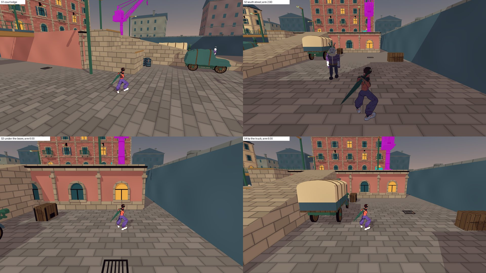
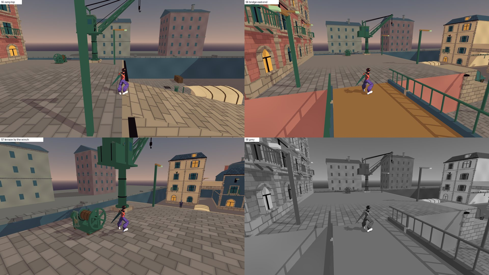
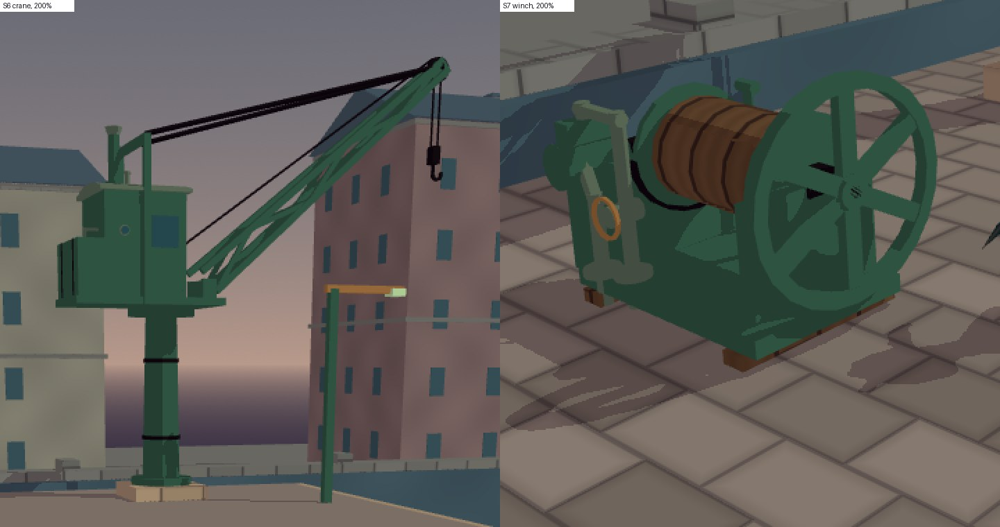
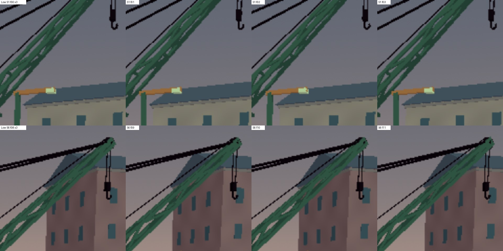
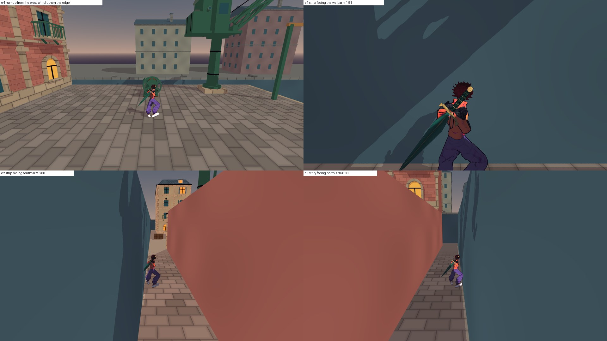
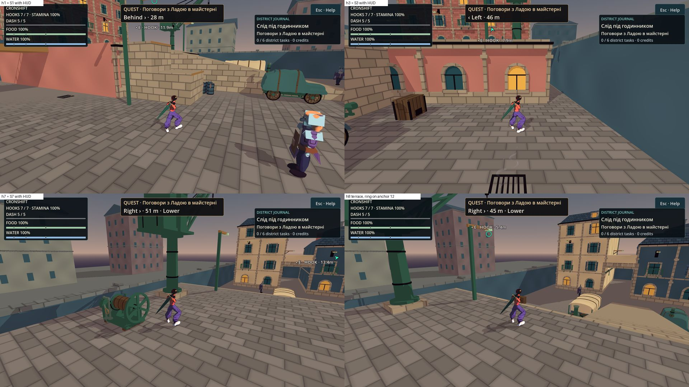

# T6 — приймання: паровий кран № 10 і парова лебідка № 11

**Дата:** 2026-10-14 · **Роль:** T6 Аполлон · **Крок:** 6 плану [[2026-10-14-T6-Acceptance-Crane-Albedo-AB]] («T6 приймає кадри
крана») · **Дерево:** `scratchpad/t6b-tree`, detached `a4b542a` (`git log --oneline -1` → `a4b542a Add a steam slewing crane
and a steam winch on the NE terrace`) · **Кредити:** 0, `generate_*` не викликала (`balance` → 2087.25, план ultra). Код гри не змінювала. У дереві змінено
лише `docs/`: ця сторінка, 6 кадрів `docs/assets/screenshots/2026-10-14-t6-crane-*.jpg`, правило К7-а й габарит № 11 у
каталозі, поправки у формі, рядки паромобілів, крана й лебідки в реєстрі.

**Мої помилки у формі [[2026-10-14-Steam-Crane-Winch-Form]] — першими (R0).**
1. Форма казала, що на S3 крана в кадрі немає. Це хибно. Мій `camera_frame.py` рахував лише частини вище 8 м, а колону з
   цоколем видно над краєм тераси на висоті 4,45…8,15 м. Знайшов T2: `CITY_TIDY_INFO MC7 S3 … seen=1218 seen_y=4.45…8.15`.
2. Габарит лебідки 1,65 × 1,05 × 1,38 м був хибний. Маховик Ø 1,2 на осі Y +0,10 сам займає 1,2 м углиб. Збудовано
   1,69 × 1,26 × 1,38.
3. A4 вимагав, щоб на S2 «трикутник стріли й тяг читався на тлі вікон». З S2 стріла дивиться прямо на камеру, тож трикутника
   звідти не видно взагалі. Моя ж таблиця камер у формі ставила голову на +38°, поза кадр. Критерій суперечив сам собі.
4. «≥ 3 точки на висоті максимуму» реборд — насправді гард бачив 2 (T2, [[2026-10-14-Steam-Crane-Winch-Fix]] § 0 п. 9).

Поправки внесено у форму (закреслено, поруч правильне) і в каталог (№ 11).

## Підсумок

| що | вердикт | коротко |
|---|---|---|
| **Кран № 10** | **GREEN** | Силует «колона — кабіна — стріла під 40° — тяги — гак» читається збоку, з мосту й тераси. На вулиці кран лише у верхніх 20–26 % кадру. Героя він не перетинає на жодній станції (0 px) |
| **Лебідка № 11** | **GREEN** | Головна форма — коло маховика: його видно повним колом з рампи й тераси. Барабан з канатом, станина, обидві труби йдуть у підлогу |
| A1–A14 | **14 GREEN** | таблиця § 1. Окреме спостереження: тяги на Low (§ 1, після таблиці) |
| С-1…С-6 | **GREEN**; С-6 «3 з 3» — поки 1 з 3 | § 2 |
| Три пункти T2 | **приймаю всі три** | A5 — новий критерій; глибина 1,26 — так; місце (27,2; 4; −18,6) — так (§ 3) |
| Край тераси після стрибка через лебідку | **прийнятно** | лебідка нічого не змінює: з нею і без неї числа однакові до сотих (§ 4) |
| Нове поза краном: картка QUEST | **YELLOW, до T8** | з вуличних станцій під карткою 42–62 % пікселів крана (§ 5) |





## Як знімала й чим обмежено

- Godot `4.7.stable.official.5b4e0cb0f`, Compatibility, **llvmpipe без GPU**. Рядок прогону:
  `T6C_INFO renderer=gl_compatibility adapter=llvmpipe (LLVM 20.1.2, 256 bits) window=(1920, 1080) scale3d=1.00 msaa=2
  hero=choko profile=high`. Forward+ на M3 не бачила. Кольори темніші за палітру через подвійне альбедо (крок 5 плану).
- Перед кадрами — імпорт дерева: `godot --headless --path t6b-tree/game --import` → `rc=0 secs=327`, рядків `ERROR` 0.
- Сцена — справжній `CityWorld` дерева `t6b-tree`, камера — `CityCamera` за героєм (плече 6 м). HUD прихований, крім кадрів
  h*. Мешканці на час кадру заморожені. Це кадри зі станцій, не суцільна гра.
- Інструменти — `scratchpad/t6-crane-accept/` головної сесії:
  - `crane_accept.gd` — на основі мого `t6-accept/accept_frames.gd`. Станції й повороти героя ті самі, що в кадрах T2
    (рядки `CRANE_SHOT` у `scratchpad/crane/frames/run.log`), плюс S4. На кожній станції три кадри: колір, маска машин
    (кран — пласка пурпурова, лебідка — блакитна) і маска героя (машини приховані, колізія лишається, тож arm той самий);
  - `run_t6b.sh` — копія `t6-accept/run_t6.sh` на `t6b-tree` (`diff` → 3 рядки: шлях дерева, тека профілю, коментар);
  - `masks.py` — пікселі маски, рамка, найнижчий рядок, перетин із героєм, контраст яскравості до кільця тла 6 px;
  - `glb_stat.py` — трикутники, ключі, габарит і колайдери просто з GLB, без рядків `PROP_*` скрипта;
  - `edge_probe.gd` — потиковий біг V-MC через лебідку з нею і без неї (headless);
  - `pan_flicker.py` — A13: деталі й отвори ґратки в масці на повільній панорамі Low;
  - `sheet.py` — аркуші ≤ 300 КБ.
- Гарди T2 сама не переганяла. Їхні числа — з логів T2 `scratchpad/crane/final_tidy/` і `after_logs/`, команда біля
  кожного числа.
- К1 «3 з 3»: є лише мій погляд, тобто 1 з 3. T8 і сторонню людину не питала.

## 1. Критерії A1–A14

| # | що | чим перевірено | вихід | вердикт |
|---|---|---|---|---|
| A1 | бюджет | `python3 -I glb_stat.py prop_steam_crane_v1.glb prop_steam_winch_v1.glb` | кран `visible_tris=2352` (стеля 5646), лебідка `1508` (стеля 2000). Збігається з `CITY_TIDY_INFO MC … triangles=` | **GREEN** |
| A2 | ключі | те саме | кран — 6: `copper glass iron iron_paint stone warm_window`, `brass_tris=0`, `ink_surfaces=0`. Лебідка — 5: `brass` 96 трикутників (маховичок вентиля), `copper iron iron_paint wood`, `ink_surfaces=0` | **GREEN** |
| A3 | розміри ±5 % | те саме, `size_xyz` | кран 2,080 × 8,560 × 9,250 проти 2,0 × 8,6 × 9,25 → +4,0 / −0,5 / 0 %. Лебідка 1,690 × 1,260 × 1,380 проти 1,65 × 1,05 × 1,38 → +2,4 / **+20** / 0 % | **GREEN** після поправки форми (§ 3 п. 2) |
| A4 | силует К1 | прев'ю `*_cycles_silhouette*.png` (`scratchpad/crane/preview_final/`); сірі S1, S2, S5, S6; контраст `masks.py` | кран збоку — трикутник з колоною, кабіною, стрілою, тягами й гаком; лебідка — маховик і барабан. Контраст крана до кільця тла: S1 1,64, S2 2,14, S5 1,63, S6 1,92 | **GREEN** (1 з 3; критерій S2 виправлено, § 3 п. 1) |
| A5 | вулична камера | `masks.py frames_high choko_high s1 s2 s3 s4`; `CITY_TIDY_INFO MC7` | `machine_over_hero=0px` на S1–S4. Найнижчий рядок крана: S1 0,257, S2 0,232, S3 0,202, S4 0,244 висоти кадру. arm на S3 6,00. «На S3 немає» — **ні**: колона над краєм тераси | **GREEN** за новим критерієм (§ 3 п. 1) |
| A6 | камера тераси | `grep 'MC8' final_tidy/city-tidy.log`; `tight-station` до/після | кран: arm 6,00 з усіх 4 боків. Лебідка: 6,00 / 6,00 / 6,00 і 5,62 (північний бік, фасад за спиною). `tight-station` 31/0 до й після | **GREEN** |
| A7 | трос | `grep '^ROPE_CHOICE' base_logs/ after_logs/`; `ANCHOR_COVERAGE`; `MC … nearest_anchor` | OPEN 11 → 11. Рядки `ROPE_CHOICE` до й після тотожні, крім лічильника `frames=`. `t8=3876/3969` до й після. Найближчий якір — кріплення 12, 2,51 м від цоколя (≥ 2). Гойдання не сягає машин (`swing_margin=inf`) | **GREEN** |
| A8 | простір | рамки `MC` → `python3 -I` | центр двору: кран 27,98 м, лебідка 31,85 м (≥ 8). Кишеня r 5 вільна: цоколь за 3,88 м від краю кишені, лебідка за 1,40 м. Щілини `MC9`: усі ≥ 1,20 | **GREEN** |
| A9 | чесна обіцянка | `CITY_TIDY_INFO V+`; V-MC; `edge_probe.gd` | `steps=32 listed=32` (31 + лебідка), `WinchBody 1.12 m high, top 1.58 × 1.07 m`. Перескоку 0: `vault=0` у V-MC і в моїх 6 прогонах з лебідкою (і 6 без неї). На верх лебідки герой не стає (`ticks_on_winch=0`). Інших нових сходинок немає | **GREEN** (К7-а, виняток для машини) |
| A10 | текст і контур | зум 200 % S6 і S7, прев'ю; `glb_stat.py` | 0 літер, цифр і рисок; скло манометра пласке. Поверхонь `ink` 0 | **GREEN** |
| A11 | функціональна правда | прев'ю `side` / `front` / `34`; S5, S6; міді в GLB | димар із котла крізь дах, тяги закріплені на порталі й голові, ланцюг від барабана через голову до гака, гак на двох гілках. Обидві мідні труби лебідки доходять до підлоги (`y 0.000` у двох місцях). Теплу щілину топки 0,24 × 0,035 м видно лише на прев'ю `front`. У кадрі гри з 15–30 м вона менша за 2 px (П4) | **GREEN** |
| A12 | гак не схожий на якір | h1, h3, h7, h8 з HUD; GLB | низ гака — y 10,75 м (найнижча вершина за Y 5,5 у GLB, `iron`). Біля голови лише `iron` і `iron_paint`. Кільце троса (якір визначаю за відстанню в підписі HUD проти відстані від героя +1,4 м до точки якоря в `CityLayout.gd:67–68`): h1 — якір 11 (`HOOK · 11.9m`, до точки 11,79 м), h3 — стрілка вгору до якоря 12 (7,9 / 7,78 м), h7 — стрілка за правий край, h8 — стовп якоря 12 (5,4 / 5,34 м), колона крана поруч без кільця. На кран і гак кільце не стає ніде | **GREEN** |
| A13 | мерехтіння ґратки | профіль Low (`T6C_SHOT … scale3d=0.75 msaa=0`); панорами з S1 і S6 по 48 кадрів, 0,05° за кадр (кран зсувається на ~0,65 px за кадр); `python3 -I pan_flicker.py frames_pan pan_s{1,6}_choko_low 48 --lattice` (`logs/pan_flicker.txt`); зум 3× | лише зелена ґратка (`iron_paint`): **одна деталь у всіх 96 кадрах**, площа міняється ≤ 1,0 % (S1) і ≤ 1,2 % (S6) за кадр. Отворів ґратки 10–15 (S1, стріла майже з торця) і 6–10 (S6, збоку). Від кадру до кадру отвори «дихають» на 1–3 штуки, але розкоси не рвуться й не повзуть | **GREEN** |
| A14 | світло | `city_tidy_check` K9 «the new props add no light» у `CITY_TIDY_COMPLETE checks=368 failures=0`; JSON GLB | `extensionsUsed=[]`, `KHR_lights_punctual` 0 в обох GLB | **GREEN** |





**Спостереження до A13 — тяги на Low.** Темні `iron`-деталі, тобто тяги Ø 0,10 м і ланцюг Ø 0,05 м, на Low без MSAA
рвуться: з тягами й ланцюгом маска дає 6–10 деталей на S1 і 8–24 на S6 (той самий `pan_flicker.py` без `--lattice`). З S6
обидві тяги майже накладаються, і лінія виходить «бісерною»: крапки повзуть під час панорами (кадри f08–f11 на аркуші).
На High (MSAA 2×) ті самі тяги — дві чисті темні лінії (зум S6). Ланцюг тонший за П4 свідомо (форма, «Чому деталей не
більше»). Переробки не прошу: Low — профіль для слабких пристроїв, а тонкі лінії без MSAA так поводяться всюди. Подивитися
на M3 у профілі Low під час апаратного приймання.

## 2. Правило силуету С-1…С-6

| # | що | де видно | вердикт |
|---|---|---|---|
| С-1 | трикутник збоку; п'ята стріли попереду осі колони | `steam_crane_cycles_silhouette_side.png`, `side.png`; S5, S6 | **GREEN** |
| С-2 | не «шибениця» | стріла під 40°, кабіна й противага є, гак висить з голови. На всіх кадрах | **GREEN** |
| С-3 | колона : стріла = 4 : 7, кабіна ≈ 1,7 × 2,0, противага виступає сходинкою 0,55 м | `side.png`: противага — окрема сходинка позаду кабіни; рамка GLB 9,25 м заввишки | **GREEN** |
| С-4 | ґратка без мережива | `steam_crane.py:174–180`: 5 розкосів на ферму, панелі 1,4 м, `LACING = 0.10`. На зумі S6 отвори ґратки читаються | **GREEN** (мерехтіння — A13) |
| С-5 | головні маси — колона, кабіна, стріла | S6, сірий S6: дрібне (манометр, клапан, важіль) не сперечається з масами | **GREEN** |
| С-6 | тест: силует Blender, сірі S1, S2, S5, S6, «3 з 3» | силует — `2026-10-14-crane-silhouette.jpg` (T2); сірі — `2026-10-14-crane-grey-s1-s2-s5-s6.jpg` (T2) і мій S6 у сірому. Упізнаю кран і лебідку я | **GREEN**, 1 з 3 |

## 3. Три пункти, де T2 не зійшовся з формою

**Аудит.** Факти виміряно в цій сесії: `masks.py`, `glb_stat.py`, `edge_probe.gd`, логи T2 з командами в § 1. Вже вирішено
раніше:
- ADR-027 — машини стоять, якоря немає;
- план T1 — варіант К1;
- мої правила відстаней у формі (щілина 0 або ≥ 1,2 м, ≥ 2 м від якоря 12).

У сусідів нічого не зламано ([[2026-10-14-Steam-Crane-Winch-Fix]] § 5, логи T2 перевірила сама): рядки `ROPE_CHOICE`
тотожні, крім `frames=`; `TIGHT_STATION_COMPLETE checks=31 failures=0` і `CITY_CAMERA_COMPLETE checks=440 failures=0` до й
після; дамп дуелі `cmp` → `identical=8 different=0`. Мірила вибору — з плану: читабельність міста, трос до M3 не міняється, бюджет кадру, чесність картинки.

### П. 1 — A5: колону видно з S3

| варіант | що дає | що коштує | вердикт |
|---|---|---|---|
| **а) прийняти кадр і виправити критерій** | кран «живе» над вулицею: знизу видно колону й низ кабіни, отже нагорі щось є | колона на S3 обрізана верхом кадру й поруч зі стовпом якоря 12 читається як товста зелена труба | **обрано** |
| б) сховати колону за краєм тераси | — | неможливо. Промінь із лінзи S3 (y 2,83) через край тераси (z −10, y 4) піднімається на 0,12 м на кожен метр. Щоб сховати верх колони (y 8), кран треба поставити на 34 м за край, а тераса має 20 м | відкинуто |
| в) колона 3,0 м, стріла 35° | голова ближче до кадру | у формі вже відкинуто: камера тераси заходить у кабіну. Колону з S3 однаково видно | відкинуто |
| г) стріла не над вулицею | з вулиці не видно нічого | губиться орієнтир над вулицею (каталог № 10) | відкинуто |

**Погляди.**
- Новачок на вулиці: зелена колона поруч зі стовпом якоря 12 — чи не сплутає? Ні. Латуні на крані немає, кільце троса на
  колону не стає (h3: стрілка веде до якоря 12).
- Змагальник: arm на S3 6,00 з краном і без нього, перетинів 0.
- Гравець, що біжить вулицею: кран лише у верхніх 20–26 % кадру. Він ніколи не стоїть на рівні героя.
- Телефон / Low: колона — велика маса Ø 0,8 м, мерехтіти їй нічим.
- Дальтонік / монохром: контраст колони до цегли за нею — 1,69 (S3).
- Santos: місто з характером. Знизу видно, що на терасі стоїть машина.

**Рішення.** A5 тепер звучить так: «на вуличних станціях S2–S4 кран не перетинає героя (0 px маски машини на масці героя),
лежить лише у верхній третині кадру (найнижчий рядок ≤ 0,333 висоти) і з вулиці видно лише частини вище рівня тераси
(`seen_y` ≥ 4,0 м); arm на S3 = 6,00». Виміряно: 0 px; рядки 0,232 / 0,202 / 0,244; `seen_y` від 4,30 / 4,45 / 4,30;
arm 6,00. Пункт «на S3 його в кадрі немає» знято. Так само виправлено A4: замість «трикутника на тлі вікон з S2» —
«з S2 колона й кабіна відділяються від цегляного фасаду; контраст ≥ 1,5». Виміряно 2,14. Вікна за краном із цієї точки
майже не стоять (кроп `crops/t2_s2_grey_crane.png`), тож мій ризик 1,16 : 1 не справдився.

### П. 2 — A3: лебідка 1,26 м углиб, а не 1,05

| варіант | вердикт |
|---|---|
| **а) прийняти 1,26 і виправити таблицю форми** — маховик Ø 1,2 лишається головною формою (П4 ≥ 1 м, «chest-high» 1,38) | **обрано** |
| б) маховик Ø 1,0: глибина ≈ 1,06, але висота 1,18 — нижче «до грудей», коло стає дрібнішим за барабан з ребордами Ø 0,7 на вигляд | відкинуто |
| в) перенести маховик у площину каната | механічна неправда: маховик сидить на валу барабана, вісь X (П2) | відкинуто |

Для гри 1,26 нічого не ламає. Це не перешкода для перескоку (> 0,8 м, К2). Щілини `MC9` ≥ 1,20 з усіх боків, кишеня вільна
(1,40 м за r 5), до краю тераси 1,97 м. Габарит у формі й каталозі виправлено.

### П. 3 — лебідка на 0,4 м західніше, у (27,2; 4; −18,6)

| варіант | вердикт |
|---|---|
| **а) прийняти (27,2; 4; −18,6)** — arm 6,00 на трьох боках і 5,62 на північному (`MC8`) | **обрано** |
| б) ще на 0,3 м на захід заради запасу — кишеня наближається до ~1,1 м, лебідка заходить на прохід «верх рампи → кишеня» | відкинуто |
| в) повернути на 90° — маховик дивиться на північ/південь, повне коло з мосту й рампи губиться (головна форма) | відкинуто |

Запас справді малий: у x 27,5 arm уже 2,59 (негатив `machine_step` T2). Але це межа гарда, а не вигляду. Тримає її сам
гард `MC8`: зсув лебідки на схід стане червоним у батареї. На кадрах місце правильне: S7 читається як «робочий кут» —
лебідка, канат до крана, колона за нею. Маховик видно повним колом з рампи (S5) і з тераси (S7).

## 4. Край тераси: стрибок через лебідку із заходу

Питання T2: із заходу й півночі герої проходять над лебідкою звичайним стрибком. Біг на W із заходу виносить героя за край
тераси, у смугу x 30…32. Чи це прийнятно?

**Зонд** `edge_probe.gd` (headless, `rc=0 secs=22`, рядків `ERROR` 0). Біг той самий, що у V-MC
(`city_tidy_check.gd:1821–1859`): W, Space за 1,15 м до лебідки, W тримається ≥ 60 тиків після стрибка. Прогони з лебідкою
і з вимкненими оболонками; варіант «уважний гравець», що відпускає W на першому дотику.

| прогін | стрибок з | перший дотик | кінець | на лебідці, тиків | hp |
|---|---|---|---|---|---|
| Choko, захід, з лебідкою | x 25,24 | x 29,90, тераса | (31,65; 0; −18,53), вулиця | 0 | 1050 → 1050 |
| Choko, захід, **без** лебідки | x 25,24 | x 29,90, тераса | (31,65; 0; −18,53) | — | 1050 → 1050 |
| Choko, «уважний» (W відпущено на дотику) | x 25,24 | x 29,90 | (30,17; 3,94; −18,53), на ободі краю | 0 | — |
| Skea, захід, з лебідкою / без | x 25,26 | x 31,65, **уже вулиця** | (31,65; 0; −18,53) | 0 | 900 → 900 |
| обоє, північ, з лебідкою / без | z −20,26 / −20,24 | z −15,60 / −15,79, тераса | біля цоколя крана | 0 | без змін |
| смуга x 30…32, хода на південь | (31,65; 0; −18,53) | — | z 3,8 (Choko) / 6,2 (Skea), вулиця, arm ≥ 6,00 | — | — |

**Що це означає.**
- Лебідка нічого не змінює: рядки `T6E_RUN *_winch_*` і `*_nowinch_*` збігаються до сотих. За край героя виносить сам
  розбіг зі стрибком: стрибок Choko з місця стрибка V-MC летить 4,7 м, Skea — далі за край.
- Звичайний стрибок через лебідку чесний. Її форма — машина, а не скриня, перескоку вона не обіцяє (К7-а, виняток).
- Смуга x 30…32 — не пастка, а задумана вулиця. У ній стоїть перешкода для перескоку `crates_east` (30,4; 0; 0) з розбігом
  уздовж z (`CityProps.gd:23`). Хода на південь виводить на східну вулицю. Урону від падіння в коді немає
  (`grep -rn fall_damage game/scripts` → порожньо), hp не змінюється.
- Східний край тераси відкритий навмисно: парапет лише на півночі (`CityDistrict.gd:136–139`).

**Рішення: прийнятно.** Варіанти «парапет на сході» (змінює рівень, камеру й трос — Yellow, не моє) і «лебідку ще далі на
захід» (Choko і так сідає за 0,10 м від краю; Skea летить далі за будь-якого місця) нічого кращого не дають.

**Два спостереження, обидва не про лебідку** (зонд без лебідки дає те саме):
- у смузі обличчям на схід arm 1,51 (`arm_end=1.51`, камера впирається у фасад тераси) — клас R1 тісних станцій;
- «уважна» Choko лишається на ободі краю тераси, y 3,94 — клас «на ободі» з [[2026-10-14-T6-Acceptance]] § 2.3.

Обидва — до T1, рішення разом зі своїми класами.



На кадрах: з розбігу (e4) гравець бачить і лебідку, і край тераси за нею. У смузі обличчям уздовж неї (e2, e3) arm 6,00,
героя видно біля стіни; обличчям у межову стіну (e1) — arm 1,51, спина героя на весь кадр.

## 5. Поза краном: картка QUEST закриває верхню третину

З HUD (кадри h*) картка квесту стоїть угорі по центру: 480 логічних px, на 1080p — x 672…1247, y 24…125 (рамка `#dcb275`,
`CityQuestGuide.gd:47–51`). Вона видима, поки є ціль квесту. Кран за задумом живе саме у верхній третині кадру. Частка
пікселів крана під карткою (`logs/quest_card_overlap.txt`):

| S1 | S2 | S3 | S4 | S5 | S6 | S7 |
|---|---|---|---|---|---|---|
| 47 % | 62 % | 42 % | 55 % | 24 % | 2 % | 35 % |

Це не вада крана. Будь-який орієнтир над вулицею (вежа з годинником, дахи) потрапить під ту саму картку. **YELLOW, до T8.**
Як розвести картку з верхньою третиною — рішення T8, не моє. Крана воно не блокує: колону з вулиці видно під карткою.



## 6. Відхилення T2 від таблиць (§ 0 журналу, 11 пунктів)

| п. | що | вердикт T6 |
|---|---|---|
| 1 | глибина лебідки 1,26 (вал укорочено до 1,53 м) | прийнято (§ 3 п. 2) |
| 2 | ширина крана 2,08 (стояки порталу) | прийнято, +4 % у допуску |
| 3 | оболонка кабіни обрізана площиною Y 0,25 | прийнято: інакше невидимий клин перед відкритим фронтом |
| 4 | дверцята топки на z 5,10 | прийнято: щілину видно на прев'ю `front`, висота кочегара |
| 5 | опори під кожух, стояк і циліндр лебідки (+24 трикутники) | прийнято: нічого не висить у повітрі (П2) |
| 6 | вхід паропроводу лебідки на (−0,38; −0,38) | прийнято: GLB підтверджує дві труби до підлоги |
| 7 | третій відрізок труб крана | прийнято: кожна труба входить у кришку чи котел |
| 8 | підйомний ланцюг над поясами, а не між фермами | прийнято: так і йде справжній підйомний канат — над стрілою на блок голови |
| 9 | реборди повернуто на π/16 заради пласкої оболонки | прийнято: на кадрах непомітно, гард бачить 4 точки |
| 10 | лебідка на (27,2; 4; −18,6) | прийнято (§ 3 п. 3) |
| 11 | на S3 видно колону | прийнято, критерій A5 виправлено (§ 3 п. 1) |

## Що переробити і хто

| що | хто | перевірка |
|---|---|---|
| Поправки форми: S3, габарит лебідки, V+, критерії A3–A5 | T6, **зроблено** в цій сесії | `wikilink_check.py` |
| К7-а з винятком для машини — у каталог; габарит № 11 | T6, **зроблено** | те саме |
| Рядки паромобілів у реєстрі — «V2 прийнято T6 2026-10-14»; у рядках крана й лебідки — «прийнято T6» | T6, **зроблено** | `texture_registry_check.py` |
| `MC7`: судити новий A5 — `seen_y` ≥ 4,0 м на S2–S4 (літерал цієї сторінки), з негативом (машина нижче рівня тераси); `in_frame` і `seen` друкувати й далі | T2 | новий негатив `rc=1` |
| Картка QUEST і верхня третина кадру (§ 5) | рішення T8, виконання T2 | кадри h1–h8 тих самих станцій |
| Камера в смузі x 30…32 обличчям на схід (arm 1,51) і «на ободі» краю тераси | рішення T1 разом із класами R1 і «на ободі» | `edge_probe.gd` |
| К1 «3 з 3» для крана й лебідки | T8 + людина, що не бачила каталогу | сірі S1, S2, S5, S6 |
| К10 «кому служить» (відкрите з форми) | T7 | рядок у [[PROPOSAL-City-Machines-And-Objects]] |

Переробляти кран чи лебідку не треба.

## Відкрите

- Forward+ на M3 і кольори після A/B подвійного альбедо не бачила. Контраст рахувала на кадрах Compatibility.
- К1 «3 з 3» — поки тільки T6.
- Гарди T2 й батарею не переганяла: числа з логів T2, команди в § 1.
- Кадри — станції, не суцільна гра. На станціях — лише Choko; Skea не знімала (зонд краю — обоє).
- Тепла щілина топки помітна лише зблизька (прев'ю). Робити її більшою не прошу: це «правда для того, хто підійде», а не
  орієнтир.

## Відтворення

- Імпорт: `godot --headless --path scratchpad/t6b-tree/game --import` → `rc=0`.
- Кадри:
  ```
  RES=1920x1080 scratchpad/t6-crane-accept/run_t6b.sh scratchpad/t6-crane-accept/crane_accept.gd <out> --groups=stations,hud,edge --profile=high
  RES=1920x1080 scratchpad/t6-crane-accept/run_t6b.sh scratchpad/t6-crane-accept/crane_accept.gd <out> --groups=pan --profile=low
  ```
  У `run.log` — рядки `T6C_INFO`, `T6C_SHOT`, `T6C_FRAME`.
- Маски: `python3 -I masks.py <out> choko_high s1 s2 s3 s4 s5 s6 s7` → рядки `MASK` (`logs/masks_high.txt`).
- GLB: `python3 -I glb_stat.py game/assets/props/city/prop_steam_{crane,winch}_v1.glb`.
- Край: `godot --headless --path scratchpad/t6b-tree/game --fixed-fps 60 --audio-driver Dummy --script
  scratchpad/t6-crane-accept/edge_probe.gd` → рядки `T6E_RUN`, `T6E_WALK` (`logs/edge_probe.log`).
- Мерехтіння: `python3 -I pan_flicker.py <out> pan_s1_choko_low 48 --lattice` (і `pan_s6_choko_low`; без `--lattice` — разом
  з тягами й ланцюгом) → рядки `PAN_SUMMARY` (`logs/pan_flicker.txt`).
- Картка QUEST: `logs/quest_card_overlap.txt` (прямокутник картки з `h1_choko_high.png`, маски станцій).

## Related

- [[2026-10-14-Steam-Crane-Winch-Form]] · [[2026-10-14-Steam-Crane-Winch-Fix]] · [[2026-10-14-T6-Acceptance-Crane-Albedo-AB]] · [[2026-10-14-T6-Acceptance]]
- [[2026-10-08-City-Modern-Realism-Props]] · [[ADR-027-City-Modern-Props-Style-And-Path]] · [[Textures-Registry]] · [[Style-Guide]] · [[ADR-007-Art-Style-Sketch-Cel]]
- [[PROPOSAL-City-Machines-And-Objects]] · [[2026-10-07-Tight-Station-Readability-Criteria]] · [[06-UI-UX]] · [[ADR-019-Audit-And-Many-Views-Before-Decision]] · [[state]]
