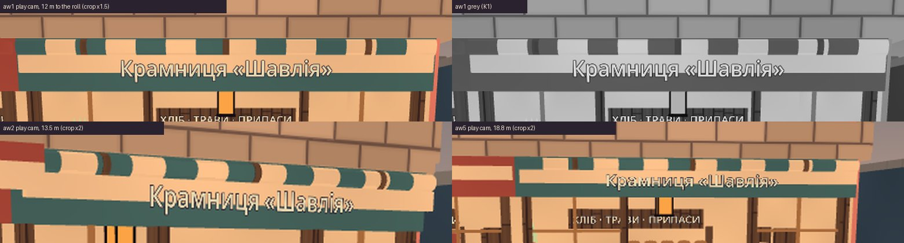
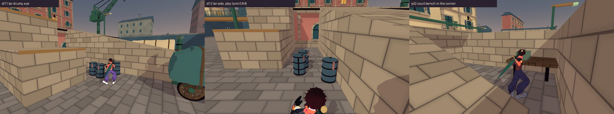
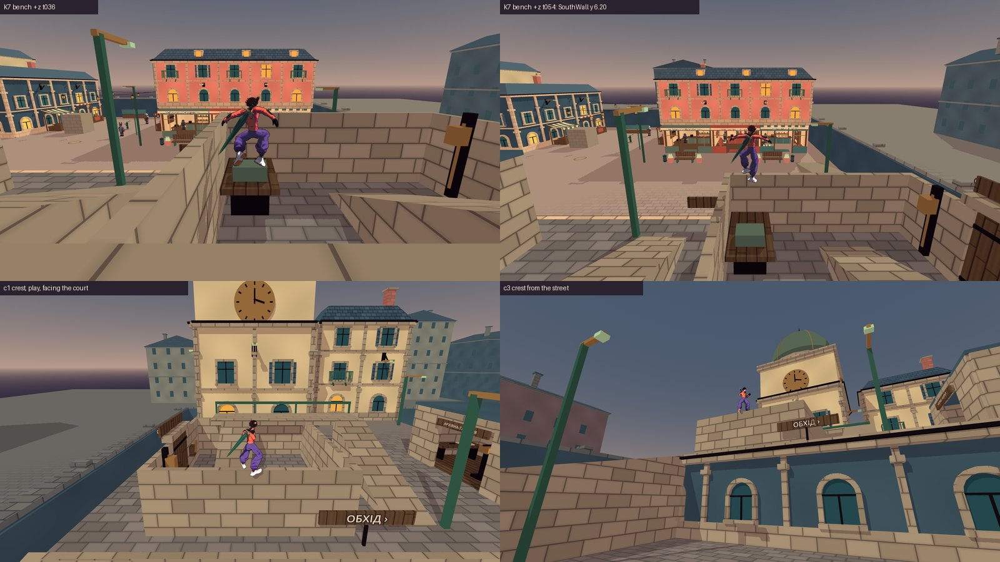
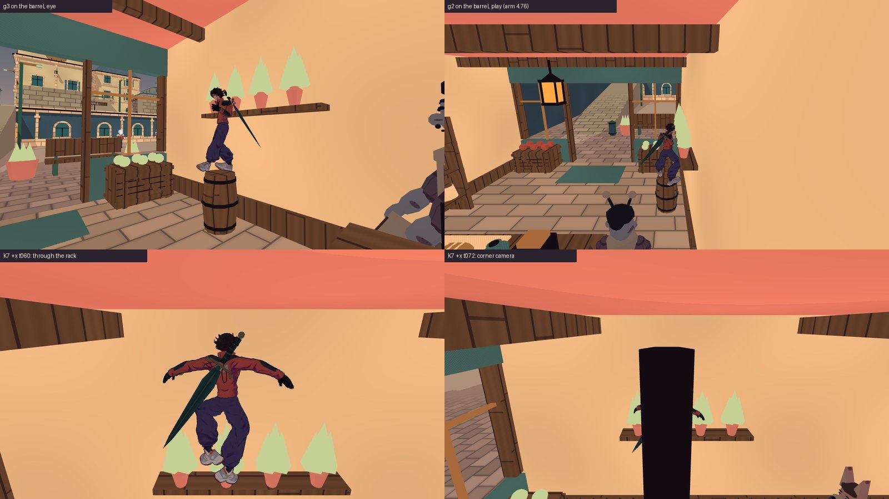
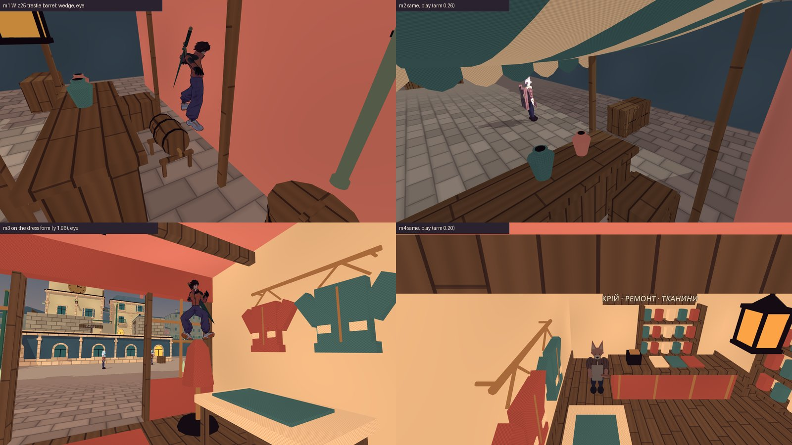

# T6 — приймання правок геометрії T2: тент, бочка дьогтю, верстак двору, глечики, 9 OPEN

**Дата:** 2026-10-15 · **Роль:** T6 Аполлон · **Що приймаю:** рядки 1–5 таблиці «Що переробити і хто» з
[[2026-10-14-T6-Acceptance]], виконані в [[2026-10-14-T6-Acceptance-Geometry-Fix]] · **Дерево:** `scratchpad/t6c-tree`,
detached `87a85dc` (`git log --oneline -1` → `87a85dc Fix the step-prop wedges and awning look…`) · **Кредити:** 0,
`generate_*` не викликала. Продукт не змінювала: у дерево записала лише цю сторінку й 5 кадрів
`docs/assets/screenshots/2026-10-15-t6-*.jpg`.

## Підсумок

| # | пункт | вердикт | що переробити | хто |
|---|---|---|---|---|
| 1 | Тент «Шавлії»: 14 смуг, зав'язки 0,10 м, лиштва нижче й на 6,5 см назад | **GREEN** | нічого. Відхилення T2 (лиштва на 6,5 см назад) приймаю | — |
| 2 | Бочка дьогтю (15,69; −3,40) впритул до рампи | **GREEN** | нічого | — |
| 3 | Верстак у куті двору; Choko з нього на гребінь `SouthWall` (y 6,20) | **GREEN** | маршрут приймаю. Нового виходу за межі кварталу немає. Але старий вихід є: стрибок із самої тераси через `WestBoundary` (§ 3.3) | вихід за межі — рішення T1, поза цією правкою |
| 4 | Глечики й дошка полиці без колайдера | **YELLOW** — як є не приймаю | бочку «Шавлії» прибрати з-під полиці (варіант 2 ТЗ) | T2 (0 кр.), кадр — T6 |
| 5 | 9 OPEN, які знайшов гард | **RED 1 з 9, решта 8 — як є; поруч YELLOW (манекен)** | **бочка на козлах ятки W z25, бік −x — soft-lock**: перестановка. Решту 8 сторін приймаю як є, зокрема заклинювання біля розкрійного столу. Але **з краю столу герой стає на манекен** (y 1,96) — манекен не має тримати героя | T2; стілець — T1 «після M3», як і було |
| — | Картка QUEST (питання до T8) | питання | § 6 | T8 |

Кадри, які вирішують кожен пункт, — у розділах. Усі шляхи `scratchpad/…` — у scratchpad головної сесії, мої зонди —
`scratchpad/t6c-accept/`.

## Як перевіряла і чим обмежено

- Godot `4.7.stable.official.5b4e0cb0f`, Compatibility, **llvmpipe без GPU**. Рядок кожного нативного прогону:
  `T6_INFO renderer=gl_compatibility adapter=llvmpipe (LLVM 20.1.2, 256 bits) window=(1920, 1080) scale3d=1.00 msaa=2`.
  Кольори — з подвійним альбедо (крок 5 плану), M3/Forward+ не бачила.
- **Продукт на моєму дереві той самий, що знімав T2.** Дерева T2 `t2c-tree` уже немає (`ls scratchpad/t2c-tree` → «No such
  file»), тому я імпортувала `t6c-tree` (`godot --headless --path game --import` → rc 0, 94 с) і переганяла сама:
  - К7 (копія T2 `k7_steps_t6fix.gd` без змін): 88 рядків `T6_K7`. Після заміни автоімен тіл
    `diff` з `t6fix/after/k7_steps.log` → **порожньо**;
  - гард: `city_tidy_check.gd` на `t6c-tree` → `CITY_TIDY_INFO V+ wedge sides=128 wedges=0 open=9 blocked_sides=5`,
    `CITY_TIDY_COMPLETE checks=506 failures=0 mutation=none`, rc 0 (`logs/city-tidy.log`);
  - кадри тенту `aw1`–`aw5`, `rp1` моїм `run_t6.sh` на `t6c-tree`. Від кадрів T2 вони відрізняються на 0,05–1,9 % пікселів
    (`py/imgdiff.py`). Усі області різниці (`getbbox`) лежать нижче рядка 357 і рулона не торкаються; на `aw1` це мешканці у
    вітринах (переглянула кроп). `T6_ROPE` збігається рядок у
    рядок (`diff` → порожньо).
- **«До»** — `a4b542a`, витягнутий `git archive a4b542a game` у `t6c-accept/base-a4b542a/` (744 файли, як і в `t6c-tree`) та
  імпортований окремо.
- Нові зонди (усі headless, справжні клавіші, обидва герої):

  | зонд | що робить |
  |---|---|
  | `crest_probe.gd` | гребінь `SouthWall`/`EastWall`: 5 точок × 8 напрямів × хода/стрибок; карта верхніх поверхонь навколо двору |
  | `escape_probe.gd` | розбіг і стрибок із тераси, галереї, гребеня, перемички воріт, скрині; `--set=new\|old\|tar` |
  | `open_probe.gd` | 9 OPEN: герой на верху сходинки йде до стіни (3 точки), три виходи; досяжність верху з 8 напрямів |
  | `stuck_probe.gd` | заклинювання OPEN: 9 способів вийти (S, A, D, Space, Space+S, Shift+S, Alt+S, X+S, E) |

- Кадри — `t6c_frames.gd`: це копія `t6-accept/accept_frames.gd`, у якій змінено лише список станцій.
- К1 «3 з 3» — тут лише мій погляд, 1 з 3. Кадри — зі станцій, а не з ручної гри. Повну `make check-playable` не
  переганяла: числа T2 — у його журналі § 6.

## 1. Тент «Шавлії» — GREEN



**Що в коді** (`CityInteriors.gd:11–15`, `:98–126` на `87a85dc`):
- рулон — `ROLLED_STRIPES` = 14 смуг по 0,464 м, через одну `cloth_cream` і акцент;
- зав'язки `ROLLED_TIE` = 0,10 м;
- лиштва: центр y 3,60, верх 3,73 = низ рулону, z −0,335;
- колайдер `RolledAwning` той самий.

**Що бачить гравець** (відстань від камери до рулону — `math.dist` за `T6_SHOT cam=`):

| кадр | відстань | що видно |
|---|---|---|
| `aw1` | 12,1 м | над лиштвою окрема смугаста форма, у сірому — чергування світлих і темних блоків на рівній смузі перемички (К1). Три зав'язки — по 7–8 px: темно-коричневі смуги в рядках 248–260 на x 792, 956, 1121 (`py`, поріг кольору `wood`). Це відповідає П4: 0,10 м ≈ 7 px з 12 м і ≈ 14 px із 6 м |
| `aw2` | 13,5 м | у ракурсі рулон читається як циліндр: заокруглені сегменти, зав'язки обгортають його |
| `aw5` | 18,8 м | пунктирна смуга над назвою. Від розгорнутих тентів сусідів її видно здалеку |
| `aw4` | впритул | смуги й зав'язки, лиштва висить під рулоном, щілини немає |

**Мірило з мого ТЗ** — «на `aw1` і `aw2` рулон видно окремою смугастою формою з трьома зав'язками». Виконано.

Одне зауваження, не вада. На фронтальному `aw1` бірюзові смуги зливаються з бірюзовою перемичкою, тож форму несуть
кремові смуги. Так само читається і згорнутий тент ятки Н6.

**Відхилення T2.** Лиштва зсунута на 6,5 см назад, щоб не висіти в повітрі під 16-кутником. Приймаю: з вулиці видно весь
рулон, на `aw4` між лиштвою й рулоном немає щілини.

**Трос на якорі 16.** `rp1` на `t6c-tree`: t30–t80 `phase=3 attached=true anchor=(-24.0, 6.8, 10.6)`, t110 — відпущено.

## 2. Бочка дьогтю — GREEN



- **Choko більше не на ободі.** К7 (14,45; 0,90) +x: `end_y=0.000`, `end_on=Ground@0.00` (було 0,764 на ободі).
- **Шлях Skea на рампу є.** К7 +x: `end_on=EastRamp@2.67`, `max_y=2.80` (`logs/k7_steps.log`).
- **Третя бочка** (`escape_probe.gd --set=tar`, `logs/escape_tar.log`):
  - з її верху стрибок у стіну рампи лишає героя на ній: `end_on` — та сама бочка, y 0,90;
  - в інші боки герой опиняється на підлозі, на кабіні легковика або на рампі;
  - на ободі не лишився жоден із 14 прогонів.
- **Рампа для Choko.** Косим стрибком із першої бочки Choko дістає рампу (`drum1_to_drum3` → `EastRamp@2.28`). Третьої
  бочки він при цьому не торкається; на `a4b542a` цей прогін я не ганяла. Бочки обіцяють шлях нагору, і рампа — звичайна
  поверхня для ходьби. Приймаю.
- **Кадри `st10`–`st12`.** Група читається як дві бочки плюс одна під стіною рампи. Це індустріальний край з причиною
  (К8), «розсипаними» бочки не виглядають.

## 3. Верстак двору й гребінь `SouthWall` — GREEN



### 3.1 Маршрут

- Верстак і скриня стоять у південно-східному куті, по 1 см від стін (`CityMaintenance.gd:47–55`, кадр `yd2`).
- **К7 (−21,96; 4,82) +z.** Choko — `end_on=SouthWall@6.20`, Skea — через стіну на вулицю (`end_on=Ground`), як і раніше.
- **На кадрах К7** Choko розганяється двором, стрибає на верстак, далі на скриню і з неї на гребінь, де стоїть (t054).
  Це звичайна паркур-драбина «верстак — скриня — стіна».
- **З камери міста** (`c1`, `c2`, плече 6,00) герой на стіні читається, двір і вулиця в кадрі.
- **З вулиці** (`c3`) це фігура на мурі над терасою.

### 3.2 Куди можна дійти з гребеня

`crest_probe.gd`: 160 прогонів, `logs/crest.log`, підсумок — `python3 -I py/crest_sum.py logs/crest.log`.

| | Choko | Skea |
|---|---|---|
| з гребеня зісковзнули при постановці | 0 / 80 | 0 / 80 |
| найвища поверхня, на якій стояв | `GateLintel` 6,53 (1 прогін) | `ServiceGallery` 6,30 |
| вийшли за межі кварталу | 1 / 80 | 1 / 80 |

Інші поверхні, на яких герої стояли: гребені `SouthWall`, `EastWall`, `WestSouthWall` (6,20), `ServiceGallery` (6,30),
`InnerServiceRamp` / `OuterServiceRamp`, тераса `NorthWestRoof` (4,0), вулиця й смуга землі між терасою і `WestBoundary`
(y 0, x −32…−30).

**Висота.** Поверхонь, вищих за перемичку воріт, із гребеня не дістати:
- карта верхів (`CREST_MAP`): вище за 6,53 поруч є лише навіс архіву 7,16 за 6,6 м від гребеня, верх стовпа якоря 13
  (8,30) за 3,1 м і вежа (12+). На стовпі й навісі за 160 прогонів не стояв ніхто;
- стрибок із гребеня піднімає ступні до 8,63 (Choko) і 9,00 (Skea).

**Це вже було до правки** (`escape_probe.gd --set=old` на `a4b542a`, `logs/escape_old.log`):
- Choko, розбіг до старого верстака: серед поверхонь, на яких він стояв, є `CityMaintenance/SouthWall@6.20`. Гребеня він
  уже торкався, просто не зупинявся на ньому;
- Skea зі старої скрині на захід стала на `GateLintel@6.53`.

Нового місця, куди «не можна», правка не відкрила.

**Художньо.** Гребінь 0,2 м із героєм на ньому — поза паркуру в місті, задуманому для лазіння ([[ADR-023-City-First-Exploration]]).
Шлях із двору нагору й так відкритий пандусами `OuterServiceRamp` / `InnerServiceRamp`.

### 3.3 Вихід за межі кварталу — старий, не від правки (YELLOW, до T1)

Обидва прогони «за межі» з § 3.2 — стрибок на захід із x −26,8. Герой перелітає `WestBoundary` (x −33…−32, верх y 4,0),
падає в порожнечу, і `CityWorld._physics_process` повертає його на старт (`recovered=true`, кінець (0; 0; 23)).

Той самий виліт дають місця, куди герой потрапляє без верстака (`escape_probe.gd`):

| звідки | `87a85dc` | `a4b542a` |
|---|---|---|
| тераса `NorthWestRoof` (y 4,0), z −20, розбіг на захід | обидва герої за межами (`first_out=(-32.04, 6.41, -20.00)` у Choko) | те саме |
| галерея двору (y 6,3) | Choko в 1 з 2 прогонів, Skea у 2 з 2 | те саме |
| гребінь `SouthWall`, 3 стрибки на захід | Choko 2 з 3, Skea 3 з 3 | те саме |
| перемичка воріт `GateLintel` (6,53), стрибок на захід | обидва | обидва |

**Причина.** Межова стіна заввишки 4 м стоїть за 2 м від тераси заввишки 4 м
(`CityLayout.gd:95, :104–107`; `district_bounds` −32…32). Стрибок героя дає +2,43 (Choko) / +2,80 (Skea) над точкою
відриву. У [[06-UI-UX]] записано, що падіння за межі повертає на старт. Тож це задуманий запобіжник, а не soft-lock.

Але гравець бачить, як герой летить за край міста в порожнечу, і від правки верстака це не залежить. Чи піднімати межову
стіну біля тераси, чи ставити невидиму стіну, чи лишити — рішення T1, виконує T2.

## 4. Глечики й дошка полиці без колайдера — YELLOW, бочку з-під полиці



**Що виправлено.** Глечики й дошка без колайдера (`CityMarket.gd:272–285`, `CityInteriors.gd:180–186`). Висоти 2,13 м на
глечику більше немає: К7 (−23,95) +x → `end_on=BeerBarrel@0.90` у обох героїв.

**Що натомість бачить гравець.** Герой просто стоїть на бочці — і полиця проходить крізь нього:

| кадр | що видно |
|---|---|
| `g3` (око) | дошка й глечики на рівні грудей, гілки трав навколо голови |
| `g2` (камера гри, плече 4,76) | те саме |
| К7 t060 | у стрибку ступні проходять крізь горщики |
| К7 t072 і `g1` | герой обличчям у крамницю, камера в куті між стіною і полицею (`g1`: плече 0,39): замість героя чорна плита (t072) або нічого (`g1`) |

Капсула героя на бочці займає x −24,30…−23,60, y 0,90…2,70. Дошка полиці — x −23,71…−23,41, y 1,86–1,94. Перетин 11 см
по x на висоті грудей виникає в **кожній** позі стоячи на бочці, а не лише в стрибку.

**Варіанти й погляди** (R8):

| варіант | гравець-верхолаз (лізе на все) | гравець, що лише ходить | камера й читабельність (К1) | реалізація |
|---|---|---|---|---|
| А. Прийняти як є | щоразу бачить тіло крізь полицю | нічого не помічає | у куті чорна плита | 0 |
| **Б. Бочку з-під полиці** (варіант 2 ТЗ) | бочка лишається сходинкою, над нею нічого | нічого не змінюється | кут під полицею зникає | одна координата + ключ V+ |
| В. Підняти полицю ≥ 2,8 м | полиця йде з рівня очей, і силует крамниці слабшає | — | гілки під балкою 3,83 | дві координати |
| Г. Повернути колайдер дошці | дошка знову стає «полицею-сходинкою» (К7-а п. 3) | — | — | повертає вихідну ваду |

Ще два погляди:
- «інша істота» — кіт чи дитина в бакалії: бочку сприймають як запрошення залізти, полиця такого запрошення не дає;
- продавець і лор: бочка біля вітрини з фруктами — природне місце товару.

**Вибір — Б** за мірилами К1 (силует героя) і К7-а п. 3.

**ТЗ T2** (0 кр., поведінка та сама, колайдер бочки той самий):
1. Перенести `_beer_barrel` бакалії з-під полиці. Над верхом бочки й на 0,35 м навколо неї до висоти 2,8 м — нічого без
   колайдера (полиця, ліхтар, балки).
2. Нове місце за К7-а: впритул (≤ 0,05 м) до стіни чи пропу або ≥ 0,75 м від твердого, не в смузі 0,05–0,75. Не на шляху
   продавця (`CityPlaces.gd:17–18`, `worker_path`) і не в отворі дверей (локальні x ±1,2).
3. Пропоную місце, яке рахувала, — T2 перевіряє зондом. Біля східної вітринної скрині, локально (2,65; 0; ~1,45),
   світові (−23,95; 0; ~13,45):
   - до скрині 0,10 м, до стіни 0,25 м — обидва зазори з того діапазону, де К7 знаходив героя нагорі;
   - до південного краю полиці (z 14,175) від бочки 0,43 м, від капсули героя на ній — 0,38 м.
4. Перевірка:
   - К7 нового ключа: верх або підлога;
   - `open_probe.gd`-подібна хода з верху в 4 боки: без `wedge`;
   - кадр `g3` з нової точки — на приймання T6;
   - ключ V+ у `STEP_PROPS` оновити.

Чорна плита в куті (t072) — той самий клас тісної камери, що й R1 ([[2026-10-07-Camera-Readability-Iteration-2]] крок 5).
Б прибирає її тут, але не взагалі.

## 5. 9 OPEN поза моїм списком



**Як міряла.**
- `open_probe.gd`: герой стоїть на верху 0,40 м від краю у 3 точках поперек сторони, йде за край (W 40 тиків), відпускає
  (30 тиків). Далі — три виходи: назад, убік, стрибок.
- Досяжність: 8 напрямів × 1,5 / 2,5 м × «тримати W» / «відпустити W».
- `stuck_probe.gd`: 9 способів вийти із заклинювання, щоразу заново, без телепорту в заклинювання.
- Логи — `logs/open.log`, `logs/stuck.log`.

| сторона | хода з верху (3 точки × 2 героя) | чи вийде | чи досяжний верх | вердикт |
|---|---|---|---|---|
| **ятка W z25, бочка на козлах, −x** (`SouthWestRear` 0,62 м) | **6 / 6 `wedge`**, 0,15–0,18 м під верхом, ступні в повітрі на ~0,7 м над підлогою (`m1`) | **Choko: 0 / 12 (open) і 0 / 18 (stuck) — жоден спосіб.** Skea: 1 / 12 і 3 / 18 (`Alt+S`, `Space+S`). `E` не чіпляє, `rope=false` | **так**, обидва герої: стрибок уздовж фасаду з бочки біля фасаду (−9,35; 0,90; 21,35) → на верх і на обід в одному прогоні (`90/2.5/hold:SR`) | **RED — soft-lock** |
| та сама бочка, −z (стійка 0,54 м) | 6 / 6 `floor` | — | — | приймаю як є |
| ятка W z25, ящик, −x (`SouthWestRear` 0,69 м) | 6 / 6 `floor` | — | Choko — так, Skea — ні | приймаю як є |
| ятка E z25, пивна бочка, +x (фасад 0,65 м) | 6 / 6 `between`: −0,17 м, стоїть на виступі фасаду | `Shift+S` → на верх, `Space+S` → на підлогу, `Alt+S` → на верх (Skea) або підлогу (Choko), `E` → трос | Choko 0 / 18, Skea 1 / 18 (зі стосу ящиків) | приймаю як є |
| прилавки «Шавлії», кравця, майстерні, −x (торець полиці 0,54 м) | на кожному прилавку 1 точка з 3 (обидва герої) — `wedge` −0,075; решта `floor` | S, A, D, `Space+S`, `Shift+S`, `Alt+S` → на підлогу, `X+S` → на верх (обидва герої, прилавок «Шавлії» у `stuck_probe`); в `open_probe` «назад» → на верх у Choko на всіх трьох | так (прилавок — природна сходинка) | приймаю як є: 2,5 см понад допуск 0,05, торець прилавка закриває ноги |
| розкрійний стіл, −z (манекен 0,68 м) | центр: `wedge` −0,29; край: на підніжжі манекена | A, D → на підлогу в обох; ще `Space+S`, `Shift+S` (Choko) і `Alt+S` (Skea) | так | заклинювання приймаю як є; **манекен — YELLOW**, див. нижче |
| стілець кравця, −x (стіна 0,65–0,75 м) | центр: `wedge` −0,19; боки: на підлозі | A, D, `Space+S`, `Shift+S` → на підлогу в обох; `Alt+S` — у Skea | досяжний лише обід (`stood_on_top=false`) | як є: «капсула на ободі», рішення T1 «після M3» стоїть |

**Чому бочка на козлах — RED.** З цього обода Choko не виходить жодною клавішею міста. Вихід лишається один: пауза →
`RESTART WALK & GUIDANCE · KEEP PROGRESS` (`CityHud.gd:338` → `CityWorld.restart_exploration` → `recover_to_spawn`).
Верх бочки досяжний звичайним стрибком із сусідньої бочки біля фасаду, а сходинка (К7-а) сама кличе на неї залізти.
Тож заклинювання станеться в грі. На кадрі `m1` герой висить у повітрі між бочкою і фасадом. На `m2` камера стискається
до плеча 0,26, і героя майже не видно. Вада давня: у `a4b542a` ятка та сама. Її знайшов новий гард T2, а не правка.

**Варіанти й погляди** (R8):

| варіант | гравець-верхолаз | композиція ятки (К8) | мірило гри | реалізація |
|---|---|---|---|---|
| А. Прийняти як є | soft-lock, гра «зламалась» | без змін | провал | 0 |
| **Б. Бочку на 0,13 м до прилавка**: до `SouthWestRear` ≥ 0,75 м | падає на підлогу, на козлах далі стоїть | зсув невидимий, товар лишається за прилавком | ✓ | одне число; запис OPEN гард сам зробить червоним |
| В. Впритул до фасаду (≤ 0,05 м) | стоїть нагорі | бочка виходить за задні стійки ятки, з-під навісу | ✓ | одне число |
| Г. Тверда задня завіса на всіх 4 ятках (зазор ~0,12 м) | стоїть нагорі | змінює силует усіх яток | ✓ | нова геометрія × 4 |

Ще два погляди:
- продавець (якого в ятці немає, `decorative_market`): місця за прилавком стає на 0,13 м менше, і цього не видно;
- «інша істота»: кіт, що лізе на бочку, теж застряг би.

**Вибір — Б.**

**ТЗ T2 (бочка на козлах, W z25):**
1. Посунути `_trestle_barrel` ятки в стані `trestle` до прилавка так, щоб від колайдера до `SouthWestRear` було ≥ 0,75 м.
   Від 0,624 м (гард) це ≈ +0,13 м. Між бочкою і корпусом прилавка лишиться ~0,25 м (зараз 0,38) — це зазор, де К7
   знаходив героя нагорі. Якщо зсув не влазить, бо заважають ноги козел, — В.
2. Перевірка:
   - `stuck_probe.gd` (випадки `trestle_w25`, `trestle_w25_k33`): обидва герої виходять клавішами S / A / D;
   - запис OPEN `CityMarket@(-9.06, 0.86, 24.34) (-1.00, 0.00, 0.00)` прибрати з `STEP_WEDGE_OPEN` (гард інакше
     червоний: «no longer wedges as pinned»);
   - кадр `m1` — на приймання T6.

**Манекен кравця — YELLOW (знайшла поруч із OPEN).** Колайдер тулуба `DressFormTorso` — циліндр r 0,37 з пласким
верхом на y 1,96 (`CityInteriors.gd:213–216`).
- З обода розкрійного столу стрибок у бік манекена ставить героя на манекен: `jump: wedge>top(+0.92)`, тобто 1,92 м, в
  обох героїв.
- Поставлений нагору, герой стоїть там 50+ тиків: `T6_SHOT m3 hero=(-17.8, 1.960083, 13.0)`, кадри `m3`, `m4`.
- Це порушує К7-а п. 3: з верху сходинки можна дістати те, на чому стояти не задумано. Вада давня (D21 зробив тулуб
  твердим).

**ТЗ T2 (манекен):** верх колайдера тулуба не має тримати героя — наприклад, заокруглений або звужений догори. Як саме —
вирішує T2, видимий меш той самий. Перевірка: герой, поставлений на (−17,8; 1,98; 13,0), за ≤ 30 тиків опиняється на
підлозі або на столі; стрибок із краю столу в бік манекена не закінчується вище 1,1 м.

### 5.1 Розбіжність рядка 5 — як я, авторка К7-а, її читаю

T2 збудував гард за К7-а п. 2 («не нижче верху більш ніж на 0,05 м або на підлозі») у смузі 0,05–0,75, а не за
буквальним «зазор 0,05–0,75 заборонено» ([[2026-10-14-T6-Acceptance-Geometry-Fix]] § 0). **Це правильне прочитання.**
Смуга — типова причина, правило — п. 2. Буквальне правило валить 23 сходинки, які я прийняла з героєм нагорі.

У каталозі [[2026-10-08-City-Modern-Realism-Props]] п. 2 записано буквально — це моя неточність. Запропоноване формулювання
внесу в каталог наступним заходом:
- **п. 2:** герой опиняється на сходинці (не нижче верху більш ніж на 0,05 м) або на підлозі, а не на ободі. Типова
  причина обода — зазор 0,05–0,75 м між сходинкою і стіною, у якому заклинює капсулу r 0,35;
- **п. 4 (новий):** якщо герой таки лишився на ободі, звичайні клавіші руху (S / A / D) виводять його на верх або на
  підлогу. Обід без виходу — RED.

Гард T2 статичний, і п. 4 він не міряє. Із 9 OPEN без виходу лише бочка на козлах — її видно тільки в русі
(`stuck_probe.gd`). Чи робити з п. 4 гард — рішення T1.

## 6. Питання до T8: картка QUEST і верхня третина кадру

T8, питання про картку QUEST. Картка стоїть угорі по центру, 480 логічних px (`CityQuestGuide.gd:49`, y 20). На 1080p
це x 672–1247, y 24–125, тобто 576 × 101 px — лише 2,8 % кадру, але в центрі верхньої третини, де живуть орієнтири міста
(вежа з годинником, дахи, кран № 10). На вуличних станціях S1–S4 мого приймання крана під карткою 47 / 62 / 42 / 55 %
пікселів крана, на S5–S7 — 24 / 2 / 35 % (`scratchpad/t6-crane-accept/logs/quest_card_overlap.txt`,
[[2026-10-14-T6-Crane-Winch-Acceptance]] § 5). Верхні кути зайняті: ліворуч картка стану 390 px (`CityHud.gd:178–179`),
праворуч PAUSE і DISTRICT JOURNAL 400 px з y 68 (`:255`, `:386–388`). Чи можна, на твою думку:
- (а) поставити картку внизу над рядком підказки (`hint_label`, `:264–268`);
- (б) згортати її до одного рядка зі стрілкою, поки герой рухається, а ціль не змінилась;
- (в) злити з DISTRICT JOURNAL праворуч?

Моє мірило (PLACEHOLDER): на тих самих 7 станціях під будь-яким непрозорим HUD ≤ 15 % пікселів крана. Мірило
читабельності самої картки — твоє. Рішення за тобою, виконання — T2.

## Що переробити і хто

| що | де | хто | перевірка |
|---|---|---|---|
| Бочку «Шавлії» з-під полиці з травами | `CityInteriors._grocer` (`_beer_barrel`), ключ V+ | T2 (0 кр.) | К7 нового ключа; хода з верху без `wedge`; кадр `g3` → T6 |
| Бочку на козлах ятки W z25 — ≥ 0,75 м від `SouthWestRear` (≈ +0,13 м) | `CityMarket._stall_goods` (`trestle`), `STEP_WEDGE_OPEN` | T2 | `stuck_probe.gd`: вихід S / A / D; гард без цього OPEN; кадр `m1` → T6 |
| Манекен не тримає героя | `CityInteriors._tailor` (`DressFormTorso`) | T2 | зонд: з верху ≤ 30 тиків на підлогу чи стіл |
| Вихід за межі кварталу з тераси й галереї | `CityLayout` (`WestBoundary`, тераса) | рішення T1, виконання T2 | `escape_probe.gd --set=new`: `out_ticks=0` |
| К7-а п. 2 (уточнити) і п. 4 (новий) | [[2026-10-08-City-Modern-Realism-Props]] | T6 наступним заходом; гард п. 4 — рішення T1 | `make gates-docs` |
| Картка QUEST і верхня третина | `CityQuestGuide` | рішення T8, виконання T2 | частка крана під HUD на S1–S7 |

## Відкрите

- Forward+ на M3, звук і фізичний контролер не бачила. Кольори — Compatibility/llvmpipe з подвійним альбедо.
- К1 «3 з 3» — лише T6.
- Повну батарею не переганяла: сама проганяла К7 (88 / 88 збіг із T2), гард `city-tidy` (506 / 0), кадри й 4 нові зонди.
- Камера в тісних кутах (`g1` 0,39, `m2` 0,26, `m4` 0,20) — відомий клас R1, не нове.
- Щілини між пропами однієї висоти гард не бачить (T2 § 5). Біля третьої бочки дьогтю жоден із моїх прогонів на ободі не
  закінчився.

## Відтворення

Усе з `scratchpad/t6c-accept/`, дерево — `scratchpad/t6c-tree/game` (імпорт: `godot --headless --path game --import`).

- Кадри:
  ```
  RES=1920x1080 run_t6c.sh ../t6-accept/accept_frames.gd frames_awning --groups=awning,rope16
  ```
  Решта кадрів — `frames_batch.sh` (`t6c_frames.gd`; `accept_frames.gd --ids=st10…,yd2…`; К7 `--shots --every=6`). Аркуші —
  `python3 -I py/sheets.py <scratchpad> <docs/assets/screenshots>`.
- Зонди:
  ```
  godot --headless --path <tree>/game --audio-driver Dummy --fixed-fps 60 --script <зонд>
  ```
  - `k7_steps_t6c.gd` → 88 `T6_K7`;
  - `crest_probe.gd` → 160 `CREST`, підсумок `py/crest_sum.py`;
  - `escape_probe.gd -- --set=new` / `--set=tar` на `t6c-tree`, `--set=old` на `base-a4b542a`;
  - `open_probe.gd` → 54 `T6_OPEN`, 18 `T6_OPEN_REACH`;
  - `stuck_probe.gd` → 6 випадків × 9 способів × 2 герої.
- Гард: `godot --headless --audio-driver Dummy --path game --fixed-fps 60 --quit-after 12000 --script tools/world/city_tidy_check.gd`
  → `CITY_TIDY_COMPLETE checks=506 failures=0`.
- Порівняння кадрів: `python3 -I py/imgdiff.py <мій.png> <T2.png>`.

## Related

- [[2026-10-14-T6-Acceptance]] · [[2026-10-14-T6-Acceptance-Geometry-Fix]] · [[2026-10-14-T6-Acceptance-Crane-Albedo-AB]] · [[2026-10-14-T6-Crane-Winch-Acceptance]]
- [[2026-10-08-City-Modern-Realism-Props]] · [[2026-10-07-Camera-Readability-Iteration-2]] · [[ADR-023-City-First-Exploration]] · [[06-UI-UX]]
- [[state]] · [[Style-Guide]] · [[Textures-Registry]] · [[ADR-007-Art-Style-Sketch-Cel]]
