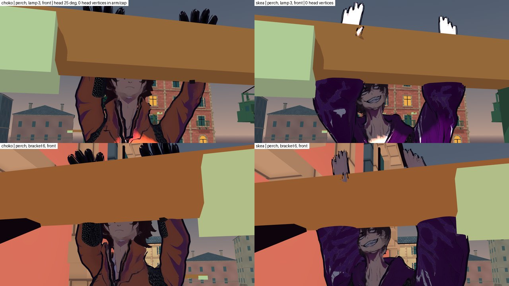
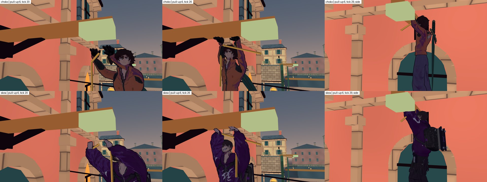
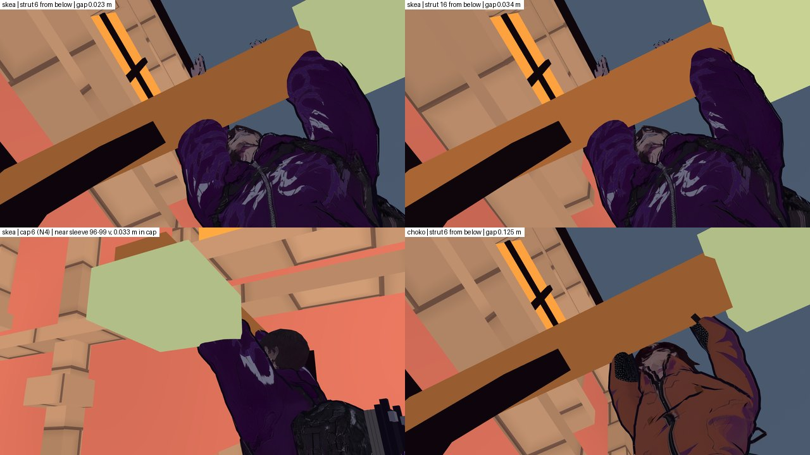
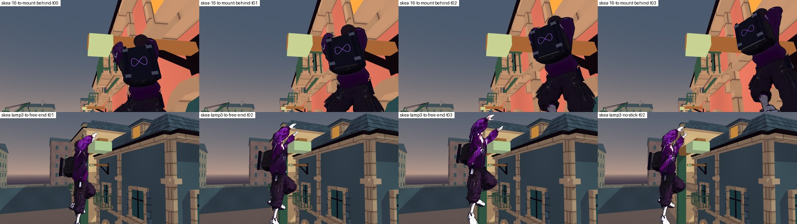

# T6: приймання кадрів троса 15а (угору, униз, звис на ліхтарі й кронштейні, зістрибування, змотування)

**Дата:** 2026-10-15 · **Роль:** T6 Аполлон · **Що приймаю:** подачу кроку 5 (15а) плану
[[2026-10-15-Rope-Climb-Perch-Release]] за моїми кліпами й позою з [[2026-10-15-Rope-Climb-Animation]]. Журнал T2-И:
`docs/Fix/2026-10-15-Rope-Climb-City-Fix.md`, 12 кадрів `docs/assets/screenshots/2026-10-15-rope-climb-*.jpg`. Обидва
є лише в дереві аудиту T4, в основному дереві їх ще немає.
**Кредити:** 0, `generate_*` не викликав. Продукт не змінював. В основному дереві записав тільки цю сторінку.

**Повторне приймання після T2-М** — розділ у кінці сторінки: RED «вхід у звис» закрито, нових RED немає, 4 YELLOW.

**Третє приймання після T2-Р і T2-С** (2026-10-16) — останній розділ: ТЗ п. 1–4 — GREEN; YELLOW — 2 (N4 і стрибок
зі звису, обидва PLACEHOLDER до M3); RED немає.

## Підсумок для T1

| стан | вердикт | одним рядком |
|---|---|---|
| угору | **YELLOW** | На кадрі читається «по мотузці». У русі цикл іде з частотою 5,5 Гц: ноги перебирають, як по драбині, а руки майже стоять (±0,02 м). Перехоплення рук не видно |
| униз | **GREEN** | Нерухоме ковзання, мотузка між стопами. Кисті Choko майже на одній висоті (0,02 м проти 0,12 у ТЗ) — не блокує |
| звис на ліхтарі | **RED** (вхід у звис) | Поза звису прийнятна. Але за 0,5 с «до опори» тіло лягає майже горизонтально, до **71,7°** від вертикалі, ногами до стовпа. Вертикаль повертається за 9 тиків уже на звисі. Маківка Skea входить у плече (зазор 0,000 м) |
| звис на кронштейні | **RED** (вхід у звис) | Той самий «прапор»: 68,8° на якорі 22 і 72,5° на якорі 16. **Хват 0,62 м на 22–24 підтверджую кадром:** від зап'ястя до осі тяги 0,139 м (Choko) і 0,105 м (Skea), між кистю й тягою видно зазор |
| зістрибування | **YELLOW** | Силует сильний: руки врозліт. Але **без стіка** («від опори») і зі стіком уздовж плеча тулуб 5–7 тиків іде крізь латунне плече й кераміку (колайдера в них немає). Упоперек плеча стрибок чистий |
| змотування | **YELLOW** | `Fish_Reel` читається, але мотузка виходить із грудей, а не з рук (0,2–0,3 м мимо). На звисі хвіст мотузки зникає за 1 тик, і +1 на HUD з'являється того ж тику. Дуги гака на пояс немає |
| *(додатково)* постріл зі звису, E | **YELLOW** | Замаху немає: обидві руки лишаються на плечі. У камері гри мотузка вилітає з-за керамічного ковпака, тобто ніби з ліхтаря |

Правки для T2 — у § 9. RED тут — художній дефект переходу, а не гри. Гарди T2 його не бачать, бо поворот за тик
лишається меншим за 30° (§ 3).

## Як перевіряв і чим обмежено

- **12 кадрів T2-И.** Розміри: `md5sum` → 12 різних хешів, `stat` → 90 542 … 139 573 байт, `PIL` → 1600 × 450
  (дві плитки 800 × 450). **Кадри кронштейна зняті на якорі 16**, а не на 22–24:
  `SP/t2i/probe/rope_frames.gd:202-207`, `_start_for(16)`, `_hang_marker(16)`. Тому хват 0,62 м на 22–24 вони не
  показують, і я перезняв.
- **Своє дерево.** `git worktree add --detach SP/t6r-tree 93ba633` + `git apply --index SP/merge-w15/combined.patch`.
  `diff -rq --exclude=.godot SP/t6r-tree/game SP/t4c-tree/game` → без різниці, так само для `tools`. Кеш імпорту
  скопійовано з `SP/t2i-tree/game/.godot`: `game` там і в `t4c-tree` теж збігаються (`diff -rq` порожній). Дерево аудиту
  T4 не чіпав: `git -C SP/t4c-tree status --short | wc -l` → 41 і до, і після. Після роботи `t6r-tree` прибрано
  (`git worktree remove --force`). Щоб перезняти, його треба створити знову тими самими двома командами: `run.sh`
  дивиться в `SP/t6r-tree/game`.
- **Зонд** `SP/t6r/probe/accept.gd`, у репо його немає. Він вантажить справжній `CityWorld` і тисне справжні клавіші:
  послідовність скопійована з `rope_frames.gd` T2-И. Далі заморожує кадр, ставить ближню камеру й знімає PNG 1280 × 720.
  Щотику пише кістки (кисті й плечі, стопи, голову, таз) і нахил тіла: вектор Hips→Head від вертикалі. Сірий прохід
  (`--grey`): unshaded, герой `#2e2e2e`, опори якорів `#7c7c7c`, місто `#c9c9c9`, небо `#e6e6e6`, HUD прихований.
- **Прогони** (`SP/t6r/probe/run.sh <герой> <тека> <частини> [--grey]`, Godot 4.7 Compatibility, **llvmpipe під Xvfb**,
  `--fixed-fps 60`):
  - Choko, лазіння, униз і змотування: `rc=143 errors=0 shots=44`. Я сам зупинив прогін після цих частин, бо він ішов
    повільно. Решту частин дозняв окремо:
  - Choko, постріл і кронштейни: `rc=0 errors=0 shots=27`;
  - Skea, усі частини: `rc=0 errors=0 shots=71`;
  - Choko, «до опори» й стрибок з інших камер: `rc=0 errors=0 shots=24`;
  - сірий прохід: Choko `rc=0 errors=0 shots=44`, Skea `rc=0 errors=0 shots=52`;
  - нахил по тиках: ліхтар, обидва герої — `rc=0 errors=0 shots=6` кожен; кронштейни 22 і 16, Choko — `shots=4`;
  - стрибок у чотири боки, кадри: `shots=12`; стрибок у чотири боки й без стіка, підрахунок кісток у брусі:
    `rc=0 errors=0 shots=0` на кожного героя;
  - зазори на звисі: по `shots=3` на героя.
- **Межі.** Це не M3 і не Forward+. Кадри не з ручного проходження: ходи поставлені з однієї точки (0; 0; 9,5) на ліхтар 3
  (8; 6,5; 8) і на кронштейни 22, 23, 24, 16. Кронштейни з підкосом 0,3 (6, 7, 9) я не знімав. Мої кадри лежать у
  `SP/t6r/out-*`, `grey-*`, `top3*`, `clear-*`, `leapx-*`, аркуші — у `SP/t6r/zoom/`. Scratchpad не постійний; у репо я
  їх не додавав, бо ТЗ дозволяє одну сторінку.

`SP` = `/tmp/claude-0/-home-user-nooneisreal/4c591b0b-bd83-5f00-bbc5-b305eb8acb26/scratchpad`.

## 1. Угору — YELLOW

**Що добре** (кадри `up-side-t12…t19`, `up-back34`, `up-front34`, сірі `up-side-t14-*-grey`):
- мотузка проходить на 0,14 м попереду грудей, між колінами й між стопами;
- хвіст висить під ногами;
- тіло вигнуте, коліна вперед, кисті над головою;
- до стовпа ліхтаря лишається видимий проміжок.

У сірому видно силует на лінії. Стовпа тіло не торкається. **«По мотузці, не по стіні» на нерухомому кадрі — так.**

**Чого немає — руху лазіння.** Заміри зонда за тики 6–33, Space утримано:

| | Choko | Skea |
|---|---|---|
| цикл `reel_cycle` за тик | 0,0923 (0,06 м / `REEL_STROKE` 0,65) → **5,5 Гц** | те саме |
| ліва кисть над плечем | 0,270…0,301 м (хід 0,03) | 0,257…0,274 (0,02) |
| права кисть над плечем | 0,200…0,244 (0,04) | 0,270…0,322 (0,05) |
| різниця висот кистей L − R | 0,063…0,142, **знака не міняє** | −0,036…0,001 |
| стопи над нулем моделі | 0,240…0,459, ліва й права **у протифазі**, повний цикл ≈ 11 тиків (0,18 с) | те саме |

Отже, руки тримаються біля маківки й лише тремтять. Перехоплення немає: руки ніколи не міняються місцями. Ноги кроками
перебирають мотузку п'ять із половиною разів на секунду. У русі це читається як «ноги біжать, руки тримають», тобто як
драбина під лебідкою. Лазіння не видно.

Що з цього підтверджено щодо T2-И:
- **перенесення висот кистей ряду Г прибрано.** `diff` чинного `AuthoredHookMotion.gd` з
  `SP/t2i/AuthoredHookMotion.remap.gd`: у чинному немає `CLIMB_HAND_LOW/HIGH` і гілки `if hook.climb_enabled`, яка
  у версії з перенесенням стоїть на `:263-267`;
- **причина справжня.** `SP/t2i/battery/shard2.out:20,32` → `t243 70.3° RightForeArm (reel)`, `t245 177.8° LeftForeArm
  (reel)`.

Але 177,8° за тик — це переворот лікті в IK, а не швидкість. Його лікує полюс ліктя, як `_solve_leg` уже робить для
колін. 70° за тик — наслідок 5,5 Гц: за кожен тик рука проходить 1/11 циклу.

**Моя помилка в ТЗ, визнаю.** У [[2026-10-15-Rope-Climb-Animation]] § «Що з цього мусить зробити T2», п. 3, я написав
«по черзі "коліна вгору" і "ноги випрямлені"». Це читається як «ліва й права по черзі». У моєму ж зонді ряду Г обидві
стопи мали одну висоту (`spec_final.py:21`, `feet={"y": 0.24 if i % 2 == 0 else 0.46}`), тобто ноги рухалися разом.
Протифаза ніг у T2 — наслідок мого формулювання, а не помилка виконання. Як треба, сказано в § 9, п. 1.

## 2. Униз — GREEN

Кадри `down-side-t05…t11`, `down-back34`, `down-game`. Поза не змінюється, стопи стоять на 0,30 / 0,37 м (як у ТЗ),
мотузка між ними, кисті біля маківки. «Плавне ковзання» читається.

У Skea кисті одна над одною: різниця 0,134–0,138 м. У Choko лише 0,02 м: досяжність рук ріже `SLIDE_HANDS` 0,30 / 0,18.
На кадрі це одна грудка рук біля лиця. Пункт бажаний, але не блокує.

## 3. Звис на ліхтарі — RED (вхід), поза — GREEN із приміткою

**Поза** (12+ тиків після хвату; кадри `perch-lamp-back / -front / -hands`, сірі `perch-lamp-*-grey`):

| | Choko | Skea | джерело |
|---|---|---|---|
| стопи (нуль моделі) під точкою | 1,320 | 1,320 | рядок `PERCH` зонда |
| зап'ястя над точкою | 0,285 / 0,272 (ціль 0,34; похибка IK 0,068 / 0,093) | 0,340 / 0,346 (похибка 0,000 / 0,013) | те саме |
| плечі над точкою | −0,012 | +0,030 | те саме |
| найближча кістка до осі стовпа | 0,296 м (LeftLeg) | 0,311 м | те саме |
| маківка (`head_end`) до бруса плеча | 0,039 м | **0,000** | рядок `CLEAR` |

Кисті на брусі читаються з обох боків. Ззаду пальці визирають над брусом. Спереду обидві кисті стоять над брусом, руки
утворюють «V»; у Skea лікті широкі. До стовпа лишається проміжок. Руки Choko на межі досяжності, зап'ястя на 6–7 см
нижче цілі, але ще всередині бруса (0,225…0,375 над точкою), тому хват видно.

**Примітка.** Маківка Skea торкається бруса (0,000 м від коробки `AnchorArm3`), у Choko лишається 0,027–0,040 м (якорі 3,
22, 16). На кадрах це видно мало: голову Skea обрамлюють об'ємні рукави, і спереду брус її ховає. Але в профіль вона
впирається в плече. Таблиця зазорів у моїй сторінці кліпів (§ 3) пари «голова — плече» не мала, і це мій пропуск. Правка
— у § 9, п. 3.

**Вхід у звис — RED.** Нахил тіла по тиках, ліхтар 3 (`TILT`, частина `top3`):

| тик «до опори» (30 тиків) | 0 | 8 | 12 | 14 | 16 | 22 | 29 | **хват** | +3 | +6 | +7 | +8 | +9 |
|---|---|---|---|---|---|---|---|---|---|---|---|---|---|
| Choko, ° від вертикалі | 11,9 | 21,8 | 41,3 | 62,7 | **71,7** | 68,5 | 67,1 | 67,1 | 50,2 | 48,0 | 32,5 | 10,8 | 5,6 |
| Skea | 11,8 | — | — | 62,8 | **71,6** | — | 67,4 | 67,3 | 50,2 | 47,9 | 32,5 | 10,8 | 5,7 |

Ступні піднімаються до 0,84 м над нулем моделі. На кадрах `top2-back-f15…grip` і `top3-profile-g00…g30` тіло лежить
уздовж плеча «прапором», ногами до стовпа: на кадрі хвату `g00` у Choko стопи заходять за лінію стовпа. Чи перетинають
вони сам стовп, я не міряв. Потім за 0,15 с тіло падає у вертикаль, до −21,7° за тик. Разом понад 45° тіло тримається
≈ 25 тиків (0,42 с), на **кожному** вході у звис. «Підтягнувся й перехопився» так не читається.

**Причина.** `HeroBodyMotion.gd:224-235`: тіло на міському тросі шикується вздовж напряму від `HAND` до якоря, з обмеженням
`ROPE_MAX_LEAN` 75° (`:353`). Під час «до опори» мотузка коротшає до 0,40 м, і `HAND` іде вбік під плече. Напрям від
`HAND` до якоря стає майже горизонтальним, а тіло слухняно лягає за ним. `HeroBodyMotion.gd` ця хвиля не змінювала
(`git diff --cached --stat` порожній). Дефект — у новому стані `CLIMB_TOP`: гравітаційний нахил з троса туди
перейшов. Гард за поворотом за тик його б і не зловив. `anim_traversal_check` за журналом T2-И дав 27 / 0 (сам я його не
переганяв), а мій замір нахилу тіла показує найбільше 12,2° за тик на вході й 21,7° на виході, обидва нижче за 30°.

## 4. Звис на кронштейні — RED (вхід), поза й хват — GREEN

**Хват 22–24 — підтверджено.** Рядки `PERCH` зонда, обидва герої на 22, 23 і 24 мають ті самі числа:

| | Choko | Skea |
|---|---|---|
| дальня кисть уздовж плеча | 0,610 (ціль 0,62) | 0,620 |
| зап'ястя → вісь тяги | **0,139 м** | **0,105 м** |
| середина передпліччя → вісь тяги | 0,215 | 0,147 |

У Choko 0,139, а не 0,105: його зап'ястя на 6 см нижче цілі. Тому найближча точка — кінець тяги на +0,35. Кадри
`perch-bracket22-back / -hands / -front` (колір і сірий): тяга сходить на брус лівіше дальньої кисті, між кистю й тягою
видно просвіт. Із 0,66 зазор був би 0,066 (`--break=tie_rod` у T2), а 0,62 дає просвіт. **Вибір T2 приймаю.**

**Підкіс знизу 0,35, якір 16** (раніше не знімав):
- зап'ястя → вісь: Choko 0,101, Skea 0,111;
- **середина передпліччя Skea → вісь: 0,088 м.** Підкіс завтовшки 0,08 м, рукав об'ємний. На кадрах `perch-bracket16-back`
  рукав іде впритул до підкосу, перетину не видно. Запас ≈ 1 см. Це спостереження, не блокер (§ 9, п. 8).

**Вхід — той самий RED:** пік нахилу 68,8° на якорі 22 і 72,5° на якорі 16 (`TOP3B`, Choko). На кадрах `top3b-22-g00` і
`top3b-16-g00` тіло лежить горизонтально, ногами до стіни.

## 5. Зістрибування — YELLOW

Кадри `leap2-wide-t00…t22`, `leap-game-t07` (колір і сірий):
- руки врозліт, тіло випрямлене, потім групування й падіння;
- у сірому силует найсильніший з усіх шести станів.

**Крізь плече.** Ліхтар 3, 14 тиків після Space. Рахую тики, коли центр будь-якої кістки тіла, крім кистей і
передпліч, лежить усередині коробки `AnchorArm3` чи `AnchorCeramic3` (рядки `LEAPY`):

| стік | перша швидкість, м/с | Choko: тиків усередині | Skea | що всередині |
|---|---|---|---|---|
| немає («від опори») | (−6,8; 7,4; 0) | **7** | **6** | Spine, neck, Head, плечі — у брусі; у Skea і в кераміці |
| S (уздовж плеча від стовпа) | (−6,68; 7,4; 1,25) | **7** | **6** | те саме |
| W (уздовж плеча до стовпа) | (6,68; 7,4; −1,25) | 5 | 5 | голова |
| A (упоперек, від бруса) | (−1,25; 7,4; −6,68) | 1 | 2 | лише маківка, що вже в брусі на звисі (§ 3) |
| D (упоперек, в інший бік) | (1,25; 7,4; 6,68) | 2 | 1 | те саме |

Тіло висить на 0,14 м від лінії бруса і йде вгору зі швидкістю 7,4 м/с ([[2026-10-15-Rope-Climb-Numbers]] З3). Коли
стрибок іде вздовж плеча, тулуб проходить висоту бруса, поки ще під ним. Найгірший саме **стрибок без стіка**, тобто
дія за замовчуванням. Упоперек плеча стрибок чистий: кадри `leap2-wide`, клавіша A, **GREEN**. Правило напряму
належить T5 / T8, мірило — мені (§ 9, п. 5).

**Виправляю себе.** Спершу, за кадрами `leapx-D-t01…t05` і грубою метрикою «кістка ближче 0,06 м», я записав сюди як
проблемний стрибок упоперек плеча. Камера там дивиться вздовж плеча, тож глибини на кадрі не видно. Суворий підрахунок
вище показав протилежне. Чинна таблиця — ця.

## 6. Змотування — YELLOW

**G біля кінця мотузки** (кадри `reel-side-t02…t34`, `reel-game-t14`, сірий `reel-side-t14-*-grey`):
- кисті разом перед поясом — `Fish_Reel` читається;
- гак летить назад уздовж лінії, як рулетка, тобто як я просив для Ф4 (б);
- **мотузка закінчується в грудях, а не в руках.** Рисується від `fighter.global_position + HAND` (1,25 м, вісь тіла;
  `GrappleHook.gd:1233, 1245`). Кисті ж нижче й на 0,2–0,3 м попереду. У сірому кадрі мотузка входить у голову й плече.

Варіант Ф4 (а) я описував як «ривок → стягує по черзі → `Fish_Reel`». Зроблено одним `Fish_Reel` — приймаю як
спрощення.

**Повернення на звисі.** Підтверджую відкрите T2-И:
- на останньому тику «до опори» мотузка й хвіст видимі, на тику хвату — ні (`rope=true tail=true hooks=6` →
  `rope=false tail=false hooks=7`, рядки `M … top038` / `perch`);
- код: `GrappleHook._grip_anchor` (`:1035-1053`) того ж тику ховає `_rope`, `_rope_visual`, `_tail_visual` і викликає
  `registry.retrieve`.

Хвіст у кілька метрів зникає за 1 тик. Дуги гака на пояс немає, +1 на HUD — того ж тику.

## 7. Постріл зі звису (E) — YELLOW

Рядки `M … eshot00…20`: на замаху (фаза 1) і в польоті (фаза 2) кисті стоять на тих самих висотах
(0,310 / 0,270 над плечима). Замаху з плеча немає, як і писав T2-И. Гак вилітає з `HAND` — точки на 0,07 м під
точкою якоря, на осі тіла.

На кадрі гри `eshot-game-t11` (обидва герої) обидві кисті на брусі, а мотузка виходить із-за керамічного ковпака. Тобто
стріляє ліхтар, а не герой. Ззаду (`eshot2-back-t12`) мотузку ховає тіло.

## 8. Поза звису: `perch_feet_below` 1,32 (моя поза) чи −1,75 (T5 Л5)

**Художньо правильно 1,32.** Тут варіанти й погляди лише стисло. Рішення змінює гру, тож за R8 спершу йде аудит
([[ADR-019-Audit-And-Many-Views-Before-Decision]]).

- **Аудит.** Зараз стоїть 1,32: `GrappleHook.gd:108`. T5 дає −1,75 з `reach_height` 2,05, щоб верх капсули (1,8 м) не
  заходив у кераміку ([[2026-10-15-Rope-Climb-Numbers]] § 1.4). Але плече й кераміка колайдера не мають
  (`CityDistrict.gd:71-92`, `_box` з `layer` 0). Виміряно: від плеча до кисті 0,37 / 0,357 м з урахуванням 0,97 у
  `apply_hands`, плечі на −0,012 / +0,030.
- **Варіанти.**
  - (а) **1,32** — як зараз;
  - (б) **−1,75**. Плечі опустилися б на 0,43 м, до −0,44 / −0,40. Зап'ястя дістане щонайбільше до −0,07 / −0,04, а низ
    бруса на +0,225. Між кистями й брусом лишилося б **≥ 0,27–0,30 м повітря**: герой висить ні на чому;
  - (в) −1,75 і малюнок, піднятий над капсулою на 0,43 м. Тоді колізія розходиться з картинкою, клас 8 у
    [[recurring_class_register]];
  - (г) окреме число на героя: Choko 1,28, Skea 1,32. Плечі обох стали б на +0,03.
- **Погляди.**
  - Гравець знизу в камері гри бачить кисті на брусі тільки в (а), (в) і (г).
  - Гравець, що стрибає зі звису, має отримати стрибок із точки, де герой видимо висить: (а) і (г). У (в) стрибок
    стартує на 0,43 м нижче за малюнок.
  - Аніматор: у (а) руки Choko на межі досяжності, у (г) — із запасом.
  - Фізика капсули: для T5 верх капсули на +0,48 у (а) — питання сміливе. За журналом T2-И (§ 3.4), гард дав на
    всіх 25 якорях для обох героїв `perched=10 blocked=0` у кожній із 5 частин. Тобто твердих тіл над плечем капсула не
    зачіпає. Цей гард я не переганяв.
  - «Інша істота» — чужий персонаж із довшими руками — потребувала б (г) і в майбутньому.
- **Вибір за мірилом гри «видно, за що тримається»:** (а) зараз, (г) — бажано (§ 9, п. 3). (б) — RED, якщо його приймуть.

## 9. ТЗ для T2 (0 кредитів; числа T6 — PLACEHOLDER до M3)

1. **Угору: каденція, руки, ноги** (YELLOW → GREEN).
   - Візуальний цикл відв'язати від реального скорочення й обмежити: `reel_cycle += min(Δ / REEL_STROKE, 2,0 Гц · dt)`,
     лише для міського лазіння. Швидкість 3,6 м/с від T5 не змінювати. Кисті, які на 3,6 м/с ковзають по тонкій
     мотузці, в камері гри не видно.
   - Повернути хід ряду Г для кистей: 0,02…0,30 м над плечем. **Ліктю дати полюс** назовні й трохи назад, як `_solve_leg`
     дає коліну, щоб IK не перевертався (177,8° у `shard2.out`). Кисті мусять мінятися місцями щопівциклу.
   - Ноги **синфазно**, як гусінь: обидві стопи разом, без зсуву 0,5. Одне «коліна вгору → ноги випрямлені» на повний
     цикл рук, стопи не далі 0,10 м одна від одної.
   - Приймання: `anim_traversal_check` `rope_turn` ≤ 30° за тик. Зонд або гард: різниця висот кистей міняє знак щопівциклу,
     амплітуда ≥ 0,20 м; |стопа L − стопа R| ≤ 0,05 м. Якщо 2,0 Гц не проходить 30°, то 1,6 Гц.
2. **«До опори» без прапора** (RED → GREEN, ліхтар і кронштейн).
   - У `CLIMB_TOP` і на звисі тіло не шикувати вздовж напряму `HAND`→якір. Нахил троса за перші 6 тиків «до опори»
     звести до вертикалі, не більше 8° за тик, і тримати ≤ 15° до кінця звису.
   - Ноги висять: ноги `Jump_Loop`. Можна підібрати коліна до ≤ 0,45 м на підтягуванні.
   - Приймання: нахил Hips→Head ≤ 15° на кожному тику `CLIMB_TOP` і `PERCH` для обох героїв на якорях 3, 22 і 16; зміна
     ≤ 10° за тик; жодна кістка ноги не ближче 0,05 м до коробки `AnchorPost<n>`.
   - Гард: нове число в `rope_climb_check` або `anim_traversal_check`. Негатив-мутант лишає нахил троса в `CLIMB_TOP` →
     червоне.
3. **Голова не в плечі** (примітка до звису).
   - На звисі голова трохи відкинута назад, 10–15°: герой дивиться на хват. Так маківка (`head_end`) стоїть ≥ 0,03 м від
     коробки `AnchorArm<n>` в обох героїв; зараз у Skea 0,000.
   - Бажано окреме `perch_feet_below` на героя: Choko 1,28, Skea 1,32. Тоді плечі обох на +0,03, а руки Choko мають
     запас. Це питання T5 / T1: число з гардом Л-б.
4. **Змотування: мотузка з рук.**
   - Поки йде `MISS_REWIND` від G, мотузку малювати від середини двох скінованих кистей. `_draw_tail` уже бере
     `skeletal.hand_world` (`GrappleHook.gd:1064-1068`). Це лише картинка: `HAND` для логіки лишається.
   - Приймання: кадр збоку, де мотузка входить між кистями.
5. **Стрибок без стіка й уздовж плеча** (§ 5).
   - Картинка: тулуб не проходить крізь брус і кераміку.
   - Мій варіант: напрям «від опори» отримує складову впоперек плеча, у бік, з якого герой висить (назад від `facing`),
     ≥ 0,3 горизонтальної швидкості. Зі стіком уздовж плеча та сама складова додається, доки голова не вийде з-під бруса,
     ≈ 3–4 тики.
   - Інший варіант для T5: перші ≈ 4 тики без підйому, тіло йде під брусом, а підйом — після.
   - Траєкторія — T5, ввід — T8, мірило — моє: 0 тиків, на яких центр кістки тіла (крім кистей і передпліч) лежить у
     коробці `AnchorArm<n>` чи `AnchorCeramic<n>`. Маківку на звисі прибирає п. 3.
6. **Повернення мотузки на звисі** (§ 6).
   - За 30 тиків «до опори» хвіст коротшає до нуля: нижній кінець підіймається до руки.
   - На тику хвату гак зіскакує з кераміки й короткою дугою ≈ 0,25 с летить до пояса. Де пояс — вирішує T2.
   - +1 на HUD — коли гак торкнувся героя; лічильник `MatchRopes` не чіпати. Чи може HUD відставати від запасу на 0,25 с —
     питання T8.
7. **Постріл зі звису: одна рука.**
   - На замаху кисть з боку цілі відпускає брус: `OverhandThrow` лише на ту руку, мотузка з цієї кисті. Друга лишається на
     брусі, тіло може нахилитися до неї ≤ 10°. Правило T5 «тіло тримається до контакту» не змінюється.
   - Якщо T5 читає «руки на плечі» як вимогу до картинки, питання до T1.
8. **Спостерігати, не правити зараз:** підкіс 0,35 на 16 і 17 — передпліччя Skea за 0,088 м від осі. Якщо на M3 рукав
   торкнеться підкосу, дальню кисть ставити на 0,62 і там.

**Порядок:** спершу п. 2 (RED), потім 1, 3, 4, 6, 7. Пункт 5 — після рішення T5 / T8. Кадри приймання — ті самі станції
й ті самі частини зонда (`SP/t6r/probe/accept.gd`, частини `climb`, `top3`, `top3b`, `clear`, `leapy`, `frames2`); T2
може взяти його за основу.

## 10. Силует у сірому

Сірий прохід обох героїв (`SP/t6r/grey-choko`, `SP/t6r/grey-skea`, аркуші `SP/t6r/zoom/grey-*.jpg`):

| стан | що видно | як читається |
|---|---|---|
| угору / униз | лінія мотузки над руками й під стопами, коліна вперед | читається. У Skea руки й голова зливаються в одну грудку: об'ємні рукави |
| звис на ліхтарі | дві руки «V», пальці над брусом спереду; ззаду — «U» рук | читається |
| звис на кронштейні 22 | діагональ тяги окремо від дальньої кисті | читається, просвіт видно |
| зістрибування | руки врозліт, коліна підібрані | найсильніший силует |
| змотування | мотузка входить у голову / плече, руки нижче | читається хибно (§ 6) |
| «до опори» | горизонтальне тіло під плечем | читається хибно (§ 3) |
| камера гри на ліхтарі (`perch-lamp-game`) | герой накладається на стовп, брус видно з торця | читається як «висить на верху стовпа». Керамічний ковпак ховає голову, коли камера дивиться вздовж плеча. Ассет старий, не 15а; кандидат на дрібну правку після M3 |

## 11. Що T2-И стверджував і що я перевірив

| твердження | чим перевірив | результат |
|---|---|---|
| перенесення ряду Г прибрано, бо перегинало передпліччя | `diff` з `SP/t2i/AuthoredHookMotion.remap.gd`; `SP/t2i/battery/shard2.out:20,32` | так; 70,3° і 177,8° за тик |
| замаху з плеча немає | зонд `eshot00…20`, кадри | так |
| дуги гака на пояс і затримки +1 немає | зонд `top038` → `perch`; `GrappleHook.gd:1035-1053` | так |
| хват 22–24 = 0,62, зазор 0,105 | `PERCH … bracket22/23/24`, кадри | так: 0,105 у Skea; у Choko 0,139 (зап'ястя нижче цілі) |
| ступні на звисі −1,32 | `PERCH … feet_below=1.320` | так |
| 12 кадрів ≤ 300 КБ | `stat` | так: 90 542 … 139 573 |
| кадр «звис на кронштейні» підтверджує 22–24 | `rope_frames.gd:202-207` | **ні**: знято якір 16 |

## Відкрите

- **T2:** § 9, п. 1–4, 6, 7. Після правок — повторне приймання тими самими частинами зонда.
- **T5 / T8:** напрям стрибка без стіка й уздовж плеча (§ 9, п. 5); окреме `perch_feet_below` на героя (§ 9, п. 3);
  HUD +1 із затримкою (§ 9, п. 6).
- **T1:** чи додавати мої кадри в репо. Зараз вони тільки в scratchpad.
- **Не перевірено:** кронштейни з підкосом 0,3 (6, 7, 9); M3 і Forward+; геймпад; суцільне ручне проходження; чи перетинають
  ноги Choko стовп на вході у звис.

## Повторне приймання після T2-М (2026-10-15)

**Що приймаю:** правки T2-М за § 9 цієї сторінки — журнал [[2026-10-15-Rope-Perch-Entry-Fix]], 18 його кадрів
`docs/assets/screenshots/2026-10-15-rope-perch-*.jpg` (переглянув усі 18). Кредити 0, продукт не змінював.

**Підсумок:** RED «вхід у звис» закрито. Нових RED немає. YELLOW — 4: голова в брусі (за поверхнею), голова крізь
ковпак на підтягуванні з-під якоря, рукав Skea на підкосі, кронштейни 6, 7, 9 (через ті самі два пункти).

**Моя помилка, визнаю.** Мірила в § 3, § 4 і § 9 п. 3, 8 я брав за центрами кісток: `head_end` і середина передпліччя.
Поверхня моделі показує інше. Я порахував CPU-скінінгом усі вершини: Choko 28 520, Skea 33 108 (`SKIN meshes=1`).
- Волосся входить у брус і там, де `head_end` ≥ 0,03 м.
- Рукав Skea торкався підкосу 16 ще до T2-М. «≈ 1 см запасу» в § 4 — хибне число.

Нижче поверхню даю окремим рядком.

### Як перевіряв

`SP` = `/tmp/claude-0/-home-user-nooneisreal/4c591b0b-bd83-5f00-bbc5-b305eb8acb26/scratchpad`.

- **Дерево:** `git worktree add --detach SP/t6s-tree 93ba633` + `git apply --index SP/merge-w15/staged-all.patch` → rc 0.
  - `git status --short` збігається з `SP/t15-tree` (72 рядки), `diff -rq --exclude=.godot` по `game`, `tools`, `docs` →
    порожньо.
  - `game` дорівнює `SP/t2m/after-tree/game`, тобто фінальному коду T2-М.
  - Кеш імпорту скопійовано з `t15-tree/game/.godot`. `t15-tree` я не чіпав: `git status --short | md5sum` → `8ad78b00…`
    до і після.
- **Зонд** `SP/t6s/probe/accept.gd` = мій `SP/t6r/probe/accept.gd` + нові частини. Їх написав сам, з зонда T2-М не брав:
  - `entry` — кожен тик від останніх 8 тиків троса до 40-го тику звису: нахил Hips→Head, зміна, найбільший поворот кістки
    за тик, маківка, ноги, хвіст, гак, HUD;
  - `swing`, `leapz`, `reelr`;
  - `mesh`, `meshentry`, `headmesh` — скінована поверхня проти коробок опори;
  - `ropethrough` — намальована мотузка проти поверхні;
  - `frames3` — кадри.
- **Режими.** Числа — headless з `--noshots`. Кадри — Xvfb + llvmpipe, Compatibility, `--fixed-fps 60`. Режими звірив:
  пік нахилу на ліхтарі 3 — 5,0 / 5,1° в обох.
- **Прогони** (`SP/t6s/probe/run.sh`): числа й поверхня — `rc=0 errors=0` на кожному прогоні; кадри — `rc=0 errors=0
  shots=126` на героя; сірий прохід — `shots=67` на героя. У логах кадрів є лише відоме попередження llvmpipe про V-Sync.
- **База** — знімок T2-М до його першої правки: `SP/t2m/base-tree/game` → копія `SP/t6s/base-game`, той самий зонд.
- `anim_traversal_check` у моєму дереві → `ANIM_TRAVERSAL_COMPLETE checks=27 failures=0 mutation=none red=none`.

### Вердикти

| пункт | було | тепер | виміряно (частина зонда) |
|---|---|---|---|
| **«Вхід у звис»: ліхтар 3, кронштейни 22 і 16** | RED | **GREEN** | Пік нахилу: Choko 5,0 / 11,6 / 8,1°, Skea 5,1 / 11,2 / 7,6°. Зміна ≤ 7,9 / 8,0° за тик. Кожен тик ≤ 15°. Ноги ≥ 0,200 м від коробки стовпа. На кадрах і в сірому тіло вертикальне, «прапора» немає (`entry`, `frames3`, `g-*`). T2-М: ≤ 11,6 і ≤ 8,0 — так |
| вхід на гойданні (відкрите T2-М) | — | GREEN, примітка | Кут троса: 33,9–46,2° (ліхтар 3, стік A/D 40 тиків) і 37,3° (кронштейни 6, 7 навіть зі станції). На k0…k2 нахил 22,6–33,2°, далі сходить ≤ 7,9° за тик, з k3 ≤ 15°. Це «за перші 6 тиків» мого § 9 п. 2. Нахил стартує нижче за кут троса — це не прапор. Skea на 22 з w0: k0 = 15,1° (`swing`) |
| голова на звисі | примітка | **YELLOW** | **Мірило ТЗ виконано:** `head_end` → брус ≥ 0,157 м (Choko) і ≥ 0,041 м (Skea). **Поверхня:** вершин голови в брусі в Choko 194–216 (глибина ≤ 0,020 м), у Skea 85–87 (≤ 0,043 м); на базі було 751 і 261. Кадри `f3-a*-headfront` і сірий `perch-lamp-front`: волосся входить у низ бруса |
| лазіння | YELLOW | **GREEN** | **Каденція:** крок `cyc` 0,033–0,034 за тик (1,98–2,04 Гц, три знаки після коми); у середньому 1,956 Гц за 45 тиків. **Кисті над плечем:** Choko 0,020–0,298 / 0,020–0,292, Skea 0,020–0,314 / 0,020–0,334; міняються місцями 2 рази за 30 тиків. **Лікоть:** на всіх тиках назовні від лінії плече — кисть на 0,031–0,129 м, згин 44–152°. **Поворот кістки:** ≤ 11,5 / 13,3°. **Стопи:** \|L − R\| ≤ 0,004 / 0,008 м. На кадрах `f3-climb-*` перехоплення читається. Полюс «уперед», а не «назад» — обґрунтування T2-М (§ 6 журналу) приймаю |
| `rope_turn` ≤ 30° за тик | — | GREEN | На станціях «до опори» ≤ 14,0° (Choko) і ≤ 15,2° (Skea); на звисі ≤ 8,0°; на гойданні ≤ 19,5°. `anim_traversal`, трос: `max_turn=28.0` — це кидок і зачеп, не лазіння |
| змотування | YELLOW | **GREEN** | Початок мотузки від середини кистей, з 6-го тику: ≤ 0,009 м стоячи, ≤ 0,028 м із W. На тиках 0–5 — 0,03–0,16 м (`down`, `reelr`) |
| повернення на звисі | YELLOW | **GREEN**, примітка N2 | **Усі 38 входів:** хвіст ≤ 0,256 м на останньому тику «до опори»; нижній кінець ні разу не опустився (`tail_drops=0`); гак летить 15 тиків; HUD +1 через 15 тиків після хвату, тобто при торканні |
| постріл зі звису | YELLOW | **GREEN**, примітка N3 | Кидає ліва: її кисть на кінці замаху за 0,352 / 0,400 м від хвату, права лишається за 0,077 / 0,000. Мотузка виходить із кидаючої кисті (0,000–0,001 м). Кадри `f3-eshot-front-*` і `-game-*`: «одна рука» читається |
| стрибок | YELLOW | **GREEN** | 40 стрибків: якорі 3, 22, 16, 6 × (W, A, S, D, без стіка) × 2 герої (`leapz`). 0 тиків із центром кістки в брусі чи кераміці, 0 — у підкосі, плиті чи стовпі. Ліхтар 3 ще раз під Xvfb (`leapy`) — те саме |
| висота ніг | бажано (г) | **GREEN** | `feet_below`: Choko 1,280, Skea 1,320 на ліхтарі 3 і на 6 кронштейнах |
| сірий силует | — | GREEN | Читаються: вертикальний вхід, «V» рук, постріл однією рукою, стрибок із руками врозліт, мотузка в руках. Спереду голова зливається з брусом — див. рядок «голова» |
| кронштейни 6, 7, 9 (мої відкриті) | не знімав | **YELLOW** | **Поза:** ноги 1,28 / 1,32; похибка кистей Choko 0,042–0,079, Skea 0,000–0,005. **Вхід:** нахил на 6 і 7 — як на гойданні (вище). **Підтягування:** голова проходить крізь ковпак (N1); рукав Skea торкається підкосу (рядок нижче) |
| запас передпліччя Skea на 16 | ≈ 1 см (хибно) | **YELLOW** | **Кістка:** середина передпліччя → вісь підкосу 0,078 (16, 17), 0,071 (6, 7), 0,080 (9). **Поверхня:** рукав у підкосі — 2 вершини на 0,002 м (16), 8 на 0,012 (6, 7), 4 на 0,002 (9); на базі 16 було 6 на 0,009. На кадрах `f3-a*-strut-*` перетину не видно |

### Нове, чого не було в § 9

- **N1. Голова крізь ковпак на підтягуванні — YELLOW.** Рахую вершини голови, що на тиках `CLIMB_TOP` лежать усередині
  `AnchorCeramic<n>` (`meshentry`).
  - Choko: на 6 — 5 тиків, глибина 0,075 м; на 9 — 10 тиків, 0,074; на 22 з w0 — 8 тиків, 0,075.
  - Skea: на 6 — 5 тиків, 0,075; на 9 — 6 тиків, 0,036; на 22 з w0 — 7 тиків, 0,074.
  - Так само в бруса: на 6 голова в брусі 7 тиків у обох героїв (до 0,067 м).
  - На станціях 3, 16, 22 голова Choko в ковпак не заходить. Голова Skea заходить у брус на 1–3 тики, до 0,029 м.
  - На базі таке було лише раз: Choko, якір 9, 2 тики, 0,015 м.
  - Кадри: `f3-pull-a6-w-1-k23-skea`, `f3-pull-a22-w0-k23-skea` — голова зникає в ковпаку.
  - Причина. Шлях підтягування такий: спершу вгору до висоти хвату, потім убік (`GrappleHook._climb_apex`). Якщо герой
    висить під ковпаком (на 9 трос 5,6°) або підходить із боку вільного кінця (6, 7, 22 на гойданні), голова на висоті
    хвату опиняється в ковпаку. Раніше «прапор» відносив голову вбік. Тепер тіло вертикальне, і голова заходить.
  - Передпліччя на передачі теж перетинають ковпак: Skea, якір 3 — 13 тиків, до 0,048 м; на базі 0 тиків.
- **N2. Гак повернення.** Гак закінчує політ на осі тіла: `WAIST` (0; 0,95; 0) від `fighter.global_position`, тобто
  всередині торса. Лінія тягнеться за ним від середини кистей над головою. Останні 5–8 тиків вона проходить крізь груди,
  у Skea ще й крізь голову (`ropethrough`: тулуб — k40–44 в обох, голова Skea — k37–44). З камери гри ззаду тіло це
  ховає: на кадрах `f3-return-a3-*` гак після k33 зникає за героєм. Спереду видно. Дрібне. Те, що мотузка на «до опори»
  торкається голови, було і на базі — це не нове.
- **N3. Зачеп після пострілу зі звису.** На тику зачепу початок лінії переходить із лівої кисті на праву. Від правої
  кисті він стає за 0,039 м у Choko і 0,051 м у Skea; від лівої — за 0,43 і 0,50 м (тики `eshot21` → `eshot22`). Дрібне.
- **N4. Ближній рукав Skea в ковпаку на звисі.** 59 вершин на 0,017 м (якір 3), 55 на 0,022 (6), 74 на 0,019 (22); на
  базі 3 було 111 на 0,043. На кадрах спереду або ковпак, або рукав, перетину не видно. Спостереження.

### ТЗ для T2 (0 кредитів; числа T6 — PLACEHOLDER до M3)

1. **Голова на звисі** (YELLOW).
   - Мірило замість `head_end`: на кожному тику звису 0 вершин групи голови (Head, neck) у коробці `AnchorArm<n>`. Обидва
     герої, якорі 3, 22, 16, 6, 9.
   - Мій варіант: плечі далі від площини хвату, `perch_body_back` 0,14 → ≈ 0,18–0,20; голова й далі відкинута на 15°.
   - Інший варіант — окремий нахил голови для Skea. Опускати плечі не раджу: Choko втратить досяг.
2. **Підтягування повз ковпак** (N1, YELLOW).
   - Мірило: на тиках `CLIMB_TOP` 0 вершин голови й тулуба в `AnchorCeramic<n>` і `AnchorArm<n>`. Якорі 3, 6, 9, 16, 22,
     старт зі станції і з w0.
   - Варіанти:
     - убік рушати раніше, ніж тіло вийде на висоту хвату;
     - або нахиляти голову вбік чи вперед, поки вона під ковпаком.
   - Якщо міняти шлях капсули — це питання до T5.
3. **Рукав і підкіс** (YELLOW). Мірило: 0 вершин рукава в `AnchorStrut<n>` на якорях 6, 7, 9, 16, 17. Мій варіант — за
   § 9 п. 8: дальню кисть і на підкосах ставити на 0,62, як на тягах 22–24.
4. **Дрібне, за нагоди** (N2, N3).
   - Гак закінчує політ на поверхні пояса спереду (≈ 0,12 м від осі), і лінія не проходить крізь голову.
   - Після пострілу лінія лишається в кидаючій кисті до кінця кидка.

### Що лишилось відкрите

- **T2:** ТЗ п. 1–3 вище; п. 4 — за нагоди.
- **T1 / T4:** гарди T2-М (`perch_head`, `leap_clear`) міряють центри кісток, поверхні вони не бачать. Мій промах вище того
  самого класу. Чи переводити гарди на вершини — вирішує T1.
- **Не перевірено:** M3 і Forward+; геймпад; суцільне ручне проходження; якорі 23 і 24 у цьому заході; якір 17 — лише
  числа, без кадрів.
- **Кадри** лежать тільки в scratchpad: `SP/t6s/s-*`, `SP/t6s/g-*`, аркуші — `SP/t6s/zoom/*.jpg`. У репо я їх не додавав.

## Третє приймання після T2-Р і T2-С (2026-10-16)

**Що приймаю:** правки T2-Р за ТЗ п. 1–4 попереднього розділу — журнал [[2026-10-15-Rope-Perch-Mesh-Clearance-Fix]].
Окремо — чи торкнулися пози й кадрів правки T2-С ([[2026-10-15-Rope-Recheck-Yellow-Fix]]). Кредити 0, продукт не змінював.

**Підсумок:** ТЗ п. 1–4 — GREEN. YELLOW — 2: ближній рукав Skea в ковпаку (N4, на 6 і 7 гірше, ніж було) і стрибок
зі звису (9 шпильок, PLACEHOLDER до M3). RED немає. T2-С гри не змінював, тож кадри й поза ті самі, що в T2-Р.

### Як перевіряв

`SP` = `/tmp/claude-0/-home-user-nooneisreal/4c591b0b-bd83-5f00-bbc5-b305eb8acb26/scratchpad`.

- **Дерево** `SP/t6v-tree`: detached `93ba633` + індексоване фінальне зведення 15а. Індекс не чіпав.
  - `git ls-files -co --exclude-standard -z game tools Makefile | sort -z | xargs -0 sha256sum` → 951 рядок. `cmp` з
    `SP/battery-w15c/src.before` і `src.after` → однакові. Тобто це ті самі джерела, що пройшли батарею T1 (488 / 0).
  - `diff -rq --exclude=.godot SP/t2r/duel-after/game SP/t6v-tree/game` → порожньо: `game` = фінальний код T2-Р.
- **T2-С позу й кадри не зачепив.** Рядки `game/` у `SP/t2s/src.before`, `SP/t2s/src.after` і в моєму знімку однакові
  (`diff` → 0 рядків). Різниця до/після T2-С — лише 6 файлів `tools/` (12 рядків `diff`). Він змінив фікстури, раннер і
  шпильки `KNOWN_LEAP_SURFACE` (додав списки «коробка:група»), але не гру.
- Godot `4.7.stable.official.5b4e0cb0f` (`--version`).
- **Зонд** `SP/t6v/probe/accept.gd` = мій `SP/t6s/probe/accept.gd` + нові частини. Помічник T2-Р
  `rope_mesh_clearance.gd` і його гард я не брав: міряю своїм повним CPU-скінінгом, без відсікання.
  - Кожна вершина належить групі своєї найважчої кістки. Групи ті самі, що в T2-Р: голова, тулуб, плече, передпліччя,
    кисть, ноги. Пальців у скелеті немає: `bones.gd` → 24 кістки в обох героїв (`SP/t6v/bones.log`).
  - Вершина «всередині» — строго всередині коробки за всіма трьома осями. Поза коробкою пишу найменший зазор.
  - `v3pull` — кожен тик «до опори» (30) і 41 тик звису. Якорі 3, 6, 7, 9, 16, 17, 22, старт зі станції (`w-1`) і з
    гойдання (`w0`), обидва герої. Коробки — усі, що є в якоря: брус, ковпак, підкіс або тяга, стовп, плита.
  - `v3leap` — 14 тиків після Space. Якорі 3, 22, 16, 6, 9 × стік уздовж до вільного кінця, уздовж до кріплення, упоперек
    (W, S) і без стіка. Камеру перед стрибком повертаю вздовж `facing`, клас стрибка беру з першої швидкості.
  - `v3ret` — політ гака повернення: кінець проти кістки `Hips` і найближча вершина; лінія проти голови й тулуба.
  - `v3frames` — кадри (нижче).
- **Прогони** (`SP/t6v/probe/run.sh`, headless, `--fixed-fps 60`): `v3pull` — `rc=0 errors=0` на героя, 994 рядки `V3P`
  (14 × 71 тик); `v3leap` — `rc=0 errors=0`, 25 стрибків на героя; `v3ret,eshot` — `rc=0 errors=0`. Зведення —
  `SP/t6v/pullagg.py`, `leapagg.py`, `retagg.py`.

### Вердикти

Обидва герої. «Вершин 0» — на кожному тику, на кожному з 14 заходів (7 якорів × 2 старти): 30 тиків «до опори» і 41 тик
звису.

| пункт | було | тепер | виміряно |
|---|---|---|---|
| **1. Голова на звисі** | YELLOW | **GREEN** | Вершин голови в брусі й у ковпаку — 0. Найменший зазор голови до бруса: Choko 0,016–0,021 м, Skea 0,014–0,020 м (на T2-М голова була в брусі: 194–216 і 85–87 вершин). Кадри спереду: обличчя під брусом, голову видно, погляд угору на кисті |
| **2. Підтягування повз ковпак (N1)** | YELLOW | **GREEN** | Вершин голови, тулуба, плеча й ніг у ковпаку й брусі — 0. Зазор голови до бруса ≥ 0,016 (Choko) і ≥ 0,030 м (Skea), до ковпака ≥ 0,099 м. Кадри спереду й збоку на 6: герой піднімається поруч із ковпаком, під брусом підтягується вертикально. Голова в ковпаку не зникає |
| **3. Рукав і підкіс** | YELLOW | **GREEN** | Вершин будь-якої групи в підкосі (6, 7, 9, 16, 17) і в тязі (22) — 0, і на підтягуванні, і на звисі. Найменший зазор передпліччя Skea до підкосу: 0,023 м (6, 7), 0,034–0,043 м (9, 16, 17). У Choko ≥ 0,120 м. Кадри знизу на 6 і 16: між рукавом і підкосом видно просвіт |
| **4. Дрібне: N2, N3** | YELLOW | **GREEN** | **N2.** Гак сідає на `Hips` + 0,120 м уперед. Найближча вершина — тулуб, 0,002–0,006 м (Choko) і 0,009–0,012 м (Skea), тобто на поверхні. +1 на HUD — на тику після посадки (k45). Лінія ближче 0,02 м до голови: Skea — 0 тиків (найближче 0,069 м); Choko — 2–3 тики на 3, 22 і 22 з гойдання (найближче 0,015 м), на 16 і 6 — 0. **N3.** Початок лінії від кидаючої кисті: 0,005 → 0,016 → 0,042 м (Choko) і 0,005 → 0,018 → 0,050 м (Skea), без стрибка |
| **N4. Ближній рукав Skea в ковпаку на звисі** | спостереження | **YELLOW** | На 6 і 7 гірше, ніж було: 96–99 вершин передпліччя, до 0,034 м, усі 41 тик (після T2-М на 6 — 55 на 0,022). На 3 краще: 32–37 на ≤ 0,008 (було 59 на 0,017). На 9 — 9–12 на ≤ 0,006 (було 0). На 16, 17 — 1 вершина на 0,001. На 22 зі станції — 0 (було 74 на 0,019), з гойдання — 24 на 0,011. Причина — дальня кисть 0,56: хват зсунувся на 0,05 м до точки ([[2026-10-15-Rope-Perch-Mesh-Clearance-Fix]] § 4). Те саме число 93 / 0,032 є й у логах T2-Р (`GEOMESH skea a6`), але в журналі не назване. На кадрі ковпака зап'ястя ховається в ковпаку. З камери гри цього не видно |

**Поза.** Кисті на брусі: Choko — 0,035–0,080 м від цілі (як і було, відкрите T2-Р № 6), Skea — 0,006–0,034 м. Нахил
тіла на звисі ≤ 5,4°. Ноги: Choko 1,280, Skea 1,320. Голова відкинута на 25°, а не на мої 10–15°. На кадрах спереду це
читається як «дивиться на руки», а не «задер голову». **Приймаю 25°** як PLACEHOLDER до M3.

### Стрибок зі звису — YELLOW, відповідь на питання T2-Р (§ 6 і § 10 п. 5 його журналу)

**Що бачу** (`v3leap`, 25 стрибків на героя; «у брусі» — вершини голови, тулуба, плеча чи ніг у брусі або ковпаку; W і S
дають той самий стрибок, що й без стіка):

| | уздовж до вільного кінця | уздовж до кріплення | без стіка / упоперек |
|---|---|---|---|
| Skea, якорі 3, 22, 16 | 3 з 3: плече в брусі чи ковпаку 1–3 тики, до 0,065 м; тулуб у ковпаку 1–2 тики, ≤ 0,012 м | 3 з 3: плече, до 0,063 м | 2 з 3 (22, 16): плече, 1 тик, ≤ 0,008 м |
| Skea, якорі 6, 9 (гард їх не судить) | 2 з 2: плече в брусі й ковпаку, до 0,046 м | 2 з 2: плече до 0,060 м | 2 з 2: плече, 1 тик, ≤ 0,019 м |
| Choko, якорі 3, 22, 16, 6, 9 | 3 з 5 (16, 6, 9): ноги в ковпаку, тик 7, ≤ 0,012 м | 1 з 5 (22): 2 вершини ноги, 0,000 м | 0 з 5 |

На 3, 22, 16 у Skea це рівно ті 8 стрибків, що пришпилені в `KNOWN_LEAP_SURFACE`; у Choko — шпилька `16|along+`
(0,011 м, у шпильці 0,012). Глибини трохи інші, бо я підходжу до опори зі станції, а гард — своїм шляхом. Ще стрибок
Choko на 22 «до кріплення» (0,000 м) у гарді нульовий. Кронштейни 6 і 9 гард не судить (`LEAP_ANCHORS` — 3, 22, 16), а клас
там той самий.

**Це два різні класи.**
- **А. Плече Skea проходить брус на відпусканні.** 1–3 тики, у будь-якому напрямку, навіть без стіка. Кисті ще на
  брусі (тик 0), тіло йде вгору на 7,4 м/с, а руки летять угору-вперед повз нижнє заднє ребро бруса. На кадрах t01–t03 руки
  підняті над головою біля бруса.
- **Б. Тулуб або ноги в ковпаку**, лише «уздовж до вільного кінця». 1–2 тики, ≤ 0,012 м. Це траєкторія.

**Аудит важелів** (копія `game` у scratchpad, продукт не змінював):
- *Правило T5 / T8.* `PERCH_LEAP_ACROSS` 0,6 / 0,7 / 0,8 / 1,0 (`SP/t6v/exp/run_across.sh`, якорі 3, 22, 16 × уздовж ± і без
  стіка). Choko — 0 з 9 уже з 0,6. Skea — 7, 7, 6, 6 з 9; на 0,5 було 8 з 9. Навіть на 1,0 (45°) плече лишається, до 0,021 м.
  Стрибок без стіка на 22 і 16 правило не змінює взагалі: він і так іде прямо від бруса.
- *Поза: Skea висить далі.* `perch_back()` 0,19 → 0,22 → 0,24 (`--body_back_add`, якорі 3, 22, 16, 6, 9 × 3 напрямки).
  Стрибків із тілом у брусі — 14 → 9 → 6 з 15. Без стіка — 0 з 5 уже на 0,24. Найглибше на 0,24 — 0,042 м («до кріплення»).
  Ціна: похибка кистей Skea 0,006–0,034 → 0,038–0,057 м (рівень Choko). Зазор голови росте до 0,065–0,070 м. Ковпак на 6 —
  76 вершин на 0,029 м.
- *Поза: руки на відпусканні.* Не міряв. T2-Р перевірив два варіанти (кисті лишаються на хваті; руки відпускаються за
  0,05 с), обидва гірші. Обидва ведуть руки вгору-вперед, тобто через брус.

**Варіанти:** (1) правило ≥ 0,6; (2) Skea висить на 0,24; (3) руки на перших 3 тиках ідуть угору й **убік-назад від бруса**,
а не вперед; (4) 2 + 3; (5) лишити шпильки до M3.

**Погляди.**
- Гравець у камері гри: 1–3 кадри при 60 fps, тіло затуляє брус ззаду. З торця видно, як піднята рука проходить повз ковпак,
  але перетин на кадрі не читається.
- T8: стік уздовж бруса має давати стрибок уздовж. Правило ≥ 0,6 зсуває його до діагоналі, а клас А не лікує.
- T5: траєкторія і 7,4 м/с — його числа. Варіанти 2 і 3 їх не чіпають.
- Аніматор: «відштовхнувся й розкинув руки» читається краще, коли руки йдуть назад від опори, а не вгору крізь неї.
- T4: гард бачить лише 3, 22, 16. Клас А на 6 і 9 поза покриттям.

**Моя позиція — поза, а не правило.** Клас А — мій: варіант 4 (Skea на 0,24 і руки на відпусканні вбік-назад). Правило
T5 / T8 для картинки міняти не треба: клас Б — ≤ 0,012 м на 1–2 тики, на кадрі не видно. Якщо T5 / T8 змінять правило зі
своїх причин, ≥ 0,6 прибирає шпильку Choko. **До M3 — PLACEHOLDER:** шпильки лишаються, гард стежить, щоб не стало гірше.
RED немає.

### Кадри

`v3frames`, Xvfb + llvmpipe, Compatibility, `--fixed-fps 60`: `rc=0 errors=0 shots=116` на героя. У логах лише відоме
попередження llvmpipe про V-Sync. Оглянув сам: звис спереду, у профіль і ззаду (3, 16, 6), ковпак, підкіс знизу, камеру
гри, підтягування на 6, 22 з гойдання і 9 (спереду й збоку), стрибки на 3 і 16 (ззаду й з торця). Кадри —
`SP/t6v/f-{choko,skea}`, аркуші — `SP/t6v/zoom/`. У репо — 4 аркуші, `stat -c %s` → 111 888 … 178 852 байт; рядки — у
[[Screenshots]].

### Що лишилось відкрите

- **T2, за нагоди:** N4 — ближній рукав Skea в ковпаку на 6 і 7. Мірило — 0 вершин рукава в `AnchorCeramic<n>` на звисі.
  Мій варіант — ближню кисть на 0,03–0,05 м далі від ковпака. Skea на 0,24 тут майже не допомагає: на 6 — 76 вершин на
  0,029 м.
- **T2 за рішенням T1:** стрибок, клас А — Skea на 0,24 і руки на відпусканні вбік-назад від бруса. Мірило — 0 вершин
  голови, тулуба, плеча й ніг у брусі й ковпаку на 14 тиках, якорі 3, 22, 16, 6, 9.
- **T1 / T4:** гард `leap_mesh` судить 3, 22, 16. На 6 і 9 той самий клас без шпильок. Розширювати чи ні — вирішує T1.
- **T5:** стрибок «до кріплення» на стінному кронштейні 16 на 4-му тику впирається в перешкоду. Швидкість уздовж бруса
  6,2 → −1,86 м/с (`SP/t6v/leapv-skea`). Це гра, не картинка; я не міряв, у що саме.
- **Не перевірено:** M3 і Forward+; геймпад; суцільне ручне проходження; якорі 23, 24 і решта 25-ти, крім 3, 6, 7, 9, 16,
  17, 22; кадри на 7, 17 і 22 зі станції; сірий прохід цього заходу; гард і батарею T1 я не переганяв (488 / 0 — за
  `SP/battery-w15c`, `tail` трьох шардів).

## Related

- [[2026-10-15-Rope-Climb-Animation]] · [[2026-10-15-Rope-Climb-Perch-Release]] · [[ADR-028-Rope-Climb-Perch-And-Retrieval]]
- [[2026-10-15-Rope-Perch-Entry-Fix]] · [[2026-10-15-Rope-Climb-City-Fix]] · [[2026-10-15-Rope-Perch-Mesh-Clearance-Fix]] · [[2026-10-15-Rope-Recheck-Yellow-Fix]]
- [[2026-10-15-Rope-Climb-Numbers]] · [[2026-10-15-Rope-Climb-Input]] · [[04-Grapple-System]] · [[Screenshots]]
- [[2026-10-09-Animation-Feel-Landing-Rope-Stop-Wall]] · [[ADR-019-Audit-And-Many-Views-Before-Decision]] · [[recurring_class_register]]
- [[Style-Guide]] · [[ADR-007-Art-Style-Sketch-Cel]] · [[Textures-Registry]] · [[2026-10-14-T6-Acceptance]] · [[state]] · [[constitution]]
