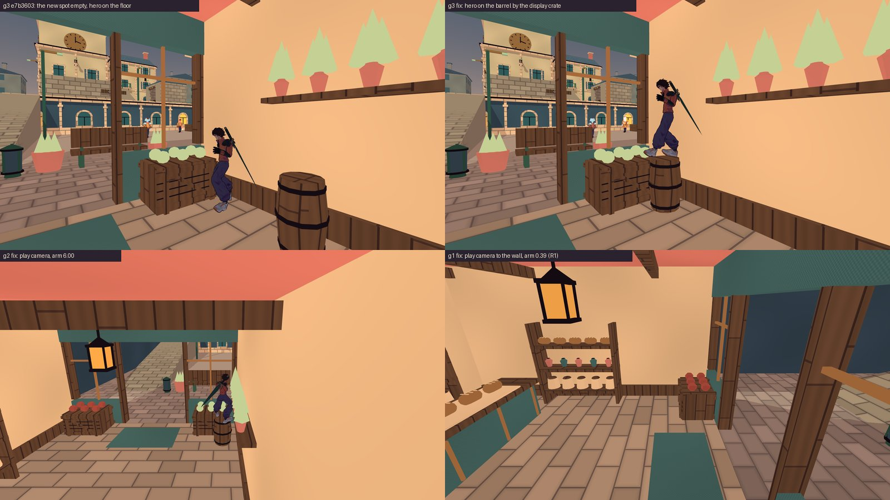
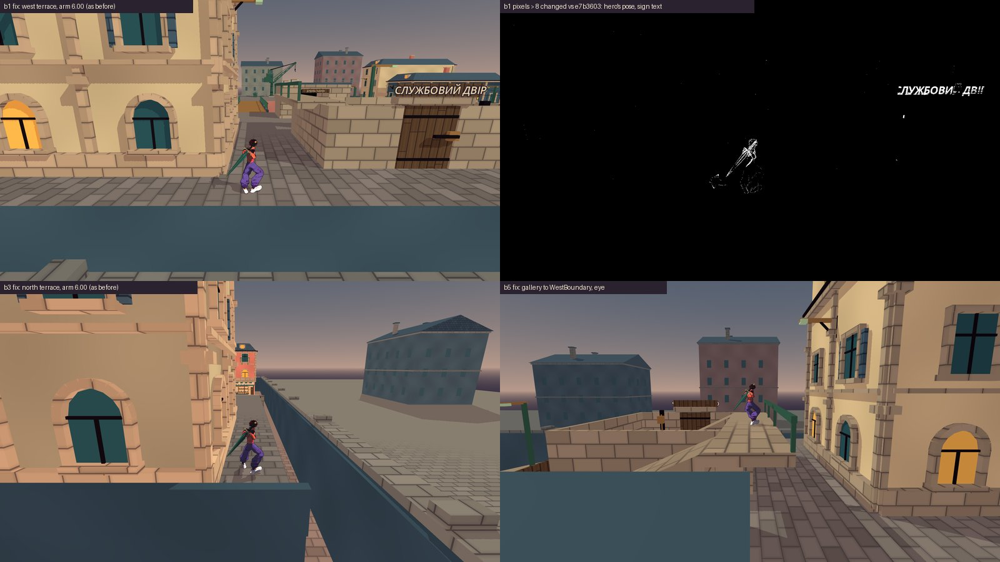
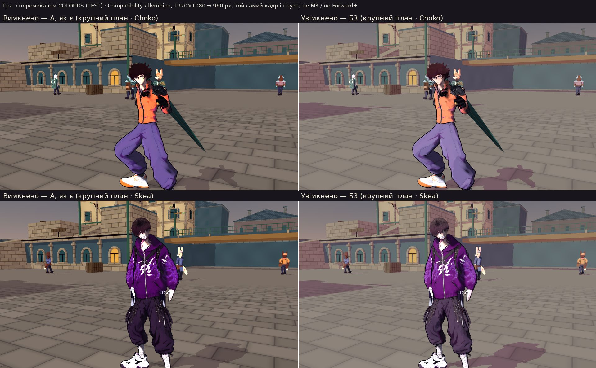

# T6 — приймання: бочка на козлах, бочка «Шавлії», манекен, межі кварталу, перемикач кольорів А / Б3

**Дата:** 2026-10-15 · **Роль:** T6 Аполлон · **Що приймаю:** геометрію за моїм ТЗ ([[2026-10-15-T6-Geometry-Fix-Acceptance]]),
виконану в [[2026-10-15-Stall-Wedge-Boundary-Fix]], і крок 9 плану [[2026-10-14-T6-Acceptance-Crane-Albedo-AB]] (кадри
перемикача з [[2026-10-15-Colour-Switch-Fix]]) · **Дерево:** scratchpad `t6-acc-tree`, detached `407595d`
(`git -C t6-acc-tree log --oneline -1` → `407595d Fix the stall wedge, close the district edge and add the A/B3 colour
switch`) · **Кредити:** 0, `generate_*` не викликала. Продукт не змінювала; у репо записала лише цю сторінку.

Мої зонди, логи й аркуші кадрів лежать у scratchpad головної сесії, тека `t6d-accept/` (далі `Т6/`). Повний шлях:
`/tmp/claude-0/-home-user-nooneisreal/4c591b0b-bd83-5f00-bbc5-b305eb8acb26/scratchpad/t6d-accept/`. У `docs/` я їх не
клала. Чи комітити аркуші `Т6/sheets/*.jpg`, вирішує T1.

## Підсумок

| # | пункт | вердикт | що переробити | хто |
|---|---|---|---|---|
| 1 | Бочка на козлах ятки W z25 зсунута на 0,13 м: 0 / 18 → 18 / 18 виходів, запас 0,07 м | **GREEN** | нічого. Запас тримає негатив `city-rim-exit-negative-near` у батареї | — |
| 2 | Бочка «Шавлії» біля вітринної скрині, фрукти в кільці 0,35 м | **GREEN** | нічого. Читається як бочка товару біля ящика з городиною | — |
| 3 | Манекен: косий верх, невидима оболонка до 3,10 м | **GREEN** | нічого. Ковзання крізь плечі триває ≈ 0,12 с, камеру оболонка псує в 4 з 35 ракурсів, а в 18 покращує | — |
| 4а | Межі — функція: виходів 0 / 58; зі смуги біля межі є вихід пішки; стоячи біля межі нічого не видно | **GREEN** | нічого | — |
| 4б | Межі — як виглядає стрибок на межу | **YELLOW, merge не блокує** | герой зупиняється в повітрі над лінією стіни, а за стіною видно рівну бруківку до горизонту, тож зупинка читається як «скло». Чернетка ТЗ (перила) — § 4.4, рішення T1 після M3 | T1 → T2 (0 кр.), специфікація й кадри — T6 |
| 5 | Перемикач: кадр «увімкнено» = кадр Б3 інструмента | **GREEN** | — | — |
| 6 | Кадр «вимкнено» = А | **GREEN** | — | — |
| 7 | На героях і в місті нічого не з'їхало | **GREEN** | — | — |
| — | Художній ризик Б3 (темні ключі біля лінії, `iron_paint` 9,2 < 20) | фіксую, не вирішую | § 8 | Santos після M3 |

## Як перевіряла і чим обмежено

- Godot `4.7.stable.official.5b4e0cb0f` (`Godot_v4.7-stable_linux.x86_64 --version`). Нативні прогони — Compatibility,
  **llvmpipe без GPU**: `T6_INFO renderer=gl_compatibility adapter=llvmpipe (LLVM 20.1.2, 256 bits) window=(1920, 1080)
  scale3d=1.00 msaa=2`. M3 / Forward+ не бачила.
- Дерево: `git worktree add --detach … HEAD`, імпорт `godot --headless --path game --import` → rc 0, у лозі 0 рядків з
  `error` (`grep -c -i error Т6/logs/import.log` → 0). Після роботи дерево прибрано (`git worktree remove --force`).
- Що переганяла сама на `407595d` (headless: `--audio-driver Dummy --fixed-fps 60`; кейси батареї ще й з
  `--quit-after 12000`):

  | що | команда | вихід |
  |---|---|---|
  | гард меж | `--script tools/world/city_bounds_check.gd` | `CITY_BOUNDS_COMPLETE checks=75 failures=0 mutation=none`, rc 0 |
  | гард манекена | `--script tools/world/city_perch_check.gd` | `CITY_PERCH_COMPLETE checks=19 failures=0`, rc 0 |
  | гард обода бочки | `--script tools/world/city_rim_exit_check.gd` | `CITY_RIM_EXIT_COMPLETE checks=8 failures=0`, rc 0 |
  | той самий, негатив запасу | `… city_rim_exit_check.gd -- --break=near` | rc 1, `failures=2`: k = +0,33 в обох героїв `S:rim>rim`, `A:rim>rim`, `D:rim>rim` |
  | зонд заклинювань T2 (копія мого `stuck_probe.gd`) | `--script t2e/probes/stuck_probe_after.gd` | `trestle_w25`, `trestle_w25_k33`: обидва герої `floor`, 9 / 9 способів → підлога (разом 18 / 18 на героя) |
  | зонд виходів T2, 4 межі | `--script t2e/probes/escape4_probe.gd -- --set=all4` | 58 рядків `ESCAPE`, `out_ticks` ≠ 0 — 0, `recovered=true` — 0. З логом T2 `diff` (без поля `stood`) — 1 рядок, округлення `settle` 3,86 / 3,85 |
  | зона над бочкою «Шавлії» | `--script t2e/probes/zone_probe.gd` | `ZONE MarketBatch_marker tris=13 y=0.93..1.02 nearest=0.56 m`, `groups=1` |
  | **мій:** зі смуги біля межі є вихід пішки? | `Т6/probes/strip_flood.gd` | § 4.1 |
  | **мій:** оболонка манекена і камера | `Т6/probes/dressform_cam.gd` | § 3 |
  | **мій:** кадри руху (межа, манекен, бочка) | `Т6/frames/run_frames.sh <дерево> <out> --groups=edge,dressform,grocer` (`t6d_frames.gd` — копія `t2e_frames.gd` T2 з режимами `run` / `drop`) | rc 0, `T6_FRAMES_COMPLETE`, `ERROR` 0, 1 `WARNING` драйвера (V-Sync) |
  | перемикач на голові | `tools/art/albedo_ab_capture.sh … --switch --ref-shaders=colour-switch/dump/shaders` (`Т6/run_switch.sh`) | § 5 |
  | **мій:** арена під перемикачем | `Т6/probes/arena_switch.gd`, xvfb, Compatibility | § 7 |

- К1 «3 з 3» — лише мій погляд, 1 з 3. Кадри — зі станцій і поставлених прогонів, не з ручної гри. Повну
  `make check-playable` не запускала: її ганяє T1.

## 1. Бочка на козлах ятки W z25 — GREEN

`CityMarket.gd:115`: `_trestle_barrel(_nudged(pose, Vector3(0.62, 0, -0.42), …))`, було −0,55.

- **Soft-lock зник.** `stuck_probe_after.gd` на моєму дереві: обидва герої після сходу з верху одразу на підлозі
  (`floor`, y 0,00, x −9,65), і всі 9 способів лишають їх на підлозі. A / D ведуть героя вздовж щілини 0,75 м
  (z 25,76 / 23,82). Це підлога-прохід, а не обід.
- **Кадр `m1`** ([[2026-10-15-Stall-Wedge-Boundary-Fix]] § 7): герой стоїть на підлозі між бочкою і фасадом. Бочка
  лишилась на козлах під навісом ятки, зсуву на 0,13 м на кадрі не видно. Товар і далі за прилавком.
- **Запас 0,07 м** (на 0,68 м до стіни вже одна точка з трьох без виходу). Приймаю, бо його тримає батарея:
  `playable_check.sh:441` — негатив `city-rim-exit-negative-near`. Мій прогін `--break=near` дав rc 1, `failures=2`. Якщо
  бочку колись посунуть ближче до стіни, батарея почервоніє.

## 2. Бочка «Шавлії» біля вітринної скрині — GREEN



`CityInteriors.gd:177`: `_beer_barrel(… Vector3(2.65, 0, 1.45))`, світові (−23,95; 0; 13,45), як у моєму ТЗ.

| кадр | що видно |
|---|---|
| `g3` (T2, око) | герой на бочці біля скрині з городиною. Полиця з травами — вище й праворуч, над героєм її вже немає |
| `g2` (T2, камера гри, плече 6,00) | силует героя на бочці читається повністю. Горщик полиці стоїть ближче до камери і в перспективі поруч із героєм, але не перетинає його: зона-зонд не бачить нічого, крім фруктів |
| `g4` (мій, око впритул, герой на осі) | кросівки на кришці, фрукти поруч із лівою ногою, перетину немає |
| `g5` (мій, герой на 0,20 м ближче до скрині, z 13,25) | підошва поруч із фруктами, перетину не видно |
| `g1` (T2, плече 0,39) | героя не видно, камера в куті біля стіни: це відомий клас R1 ([[2026-10-07-Camera-Readability-Iteration-2]] крок 5). Так само було й на старому місці (0,39) |

Аркуш `g4` / `g5`: `Т6/sheets/t6d-grocer.jpg`.

**Чи читається.** Так. Бочка біля вітрини з фруктами — природне місце товару (погляд продавця з мого ТЗ). Фрукти
стирчать на 3–12 см над верхом бочки, але стоять за 0,56 м від осі (зона-зонд) і на кадрі виглядають як сусідній ящик, а
не як предмет під ногами. Над героєм на бочці нічого не проходить крізь тіло — те, заради чого бочку переносили.

## 3. Манекен кравця — GREEN

**Гард.** `city-perch` 19 / 0 на моєму дереві: постава, скидання і стрибки зі столу закінчуються не на манекені.

**Як виглядає ковзання.** Мій прогін `drop`: героя поставлено на (−17,8; 2,15; 13,0) над віссю. Кадри з ока T6 (`d1`) і
збоку із заходу (`d2`), аркуш `Т6/sheets/t6d-dressform.jpg`. Позиції — з рядків `T6_MOTION`:

| тік | y героя | що видно |
|---|---|---|
| 1–5 | 2,19 → 2,07 | падає над манекеном |
| 8–11 | 1,96 → 1,79, x −17,89 → −18,02 | ступні на верху манекена, на мить ніби стоїть |
| 14–18 | 1,57 → 1,19, x −18,19 → −18,49 | з'їжджає на захід, ноги проходять крізь західне плече (`d2` t018) |
| 24 | 0,03 | на підлозі біля вікна |

Прохід крізь плече — тіки 11–18, ≈ 0,12 с при 60 Гц. Читається як «зісковзнув, стояти не можна». Приймаю: на манекен
потрапляють лише навмисним стрибком із краю столу або згори, а стрибки зі столу (`city-perch` P3) і так закінчуються
на підлозі.

**Невидима оболонка і камера.** Оболонка заповнює щілину 0,63 м, куди капсула 0,70 не влазить, тож гравець її тілом не
відчуває. Над видимим манекеном вона йде на 1,38–2,32 м (`CityInteriors.gd:246–271`). На висоті камери з повним плечем
(≈ 2,83 м над ступнями: `T6_SHOT b1` — герой y 4,00, камера y 6,83) вона займає ≈ 0,25 м перед стіною. Це розраховано з
коду: верх = 1,85 + (x − 2,2) · tan 52° у локальних координатах крамниці.

Чи забирає вона камеру, я поміряла: `Т6/probes/dressform_cam.gd`. Герой на підлозі у 5 точках навколо манекена, 7 поворотів
лицем від −60° до +60° від заходу (камера — на сході, до оболонки й стіни), справжній `CityCamera`. Плече з оболонкою
продукту порівнюю з плечем, коли `DressFormTorso` у рантаймі замінено старим циліндром r 0,37 до 1,96:

| | випадків |
|---|---|
| оболонка коротша за циліндр > 0,05 м | **4 / 35** (найгірше S @ −60°: 0,15 проти 0,66) |
| оболонка довша > 0,05 м | 18 / 35 |
| ± 0,05 м | 13 / 35 |

(`python3` по `Т6/logs/dressform_cam.log`). У цьому куті крамниці камера тісна за будь-якої форми (клас R1). Оболонка
загалом її не погіршує, тож «тримає й камеру» приймаю.

**Заклинювання біля столу** (мій прогін, `table_dressform`): Choko — A, D, `Space+S` → підлога, як у T2. Приймаю, як і
раніше.

## 4. Межі кварталу

### 4.1 Функція — GREEN

- **Виходів немає.** `city-bounds` 75 / 0, `escape4_probe --set=all4` — 58 / 58 прогонів `out_ticks=0`, жодного
  повернення на старт (таблиця вище).
- **Зі смуги, куди падає герой, є вихід пішки.** Після удару об край герой падає на землю біля межі (\|x\| або
  \|z\| = 31,65). Якби смуга була глухою, це був би новий soft-lock. Мій `strip_flood.gd`: сітка 0,25 м, клітина вільна,
  якщо капсула r 0,35, h 1,8 на землі не торкається нічого в масці міського героя (`mask=65`). Від старту (0; 0; 23)
  заливка йде лише кроком: без сходинок, рамп, лазіння й тросу.
  - `reachable_cells=35951` з 65 536;
  - **17 / 17** точок приземлення з прогонів T2 (W ×5, N ×3, E ×5, S ×4) — `walk_to_spawn=yes`;
  - смуги вздовж усіх чотирьох меж (2,5 м від стіни) досяжні суцільно: `STRIP_BAND W/E/N/S` — `#` лише в кутовій клітині,
    де капсула впирається в сусідню стіну, далі всі `.`.
- **Стоячи біля межі, нічого не видно.** Кадри T2 `b1`–`b5` до / після: я перерахувала пікселі, що змінились більше ніж
  на 8 рівнів (`python3`, `numpy`): 0,09–1,69 %. Рамки змін лежать на позі героя й на тексті вивіски, маску на аркуші T2
  переглянула. Плече камери те саме: `T6_SHOT b…` у лозі «до» і «після» T2 — 6,00 / 6,00 / 6,00 / 1,26 / 6,00.



### 4.2 Як виглядає стрибок на межу (мої кадри)

Аркуш `Т6/sheets/t6d-edge.jpg`; ще `Т6/frames/out_choko/e3…e6`. Choko, розбіг і стрибок, справжні клавіші W / Space:

| прогін | що в рядках `T6_MOTION` | що бачить гравець |
|---|---|---|
| `e1` тераса W (y 4), камера гри | стрибок на 39-му тіку; t070 x −31,649, **y 6,36** — рух уперед зупинено на 2,36 м над верхом стіни; t084 y 4,94 — падає вертикально; t110 y 0,00, плече 1,51 | за межовою стіною — рівна сіра бруківка до горизонту з будинками-кулісами. Ніщо не каже, що далі не можна. Герой зависає над лінією стіни й сповзає вниз невидимою площиною — **читається як скло** |
| `e2` той самий, око збоку | ті самі позиції | видно, як фігура зупиняється в повітрі за 2 м від краю тераси |
| `e3` галерея двору (y 6,31) | пік 8,68 (t070); площина на спуску, після t100 (x −31,03, y 5,61); t150 на землі, плече 1,51 | падіння з 8,7 м уздовж невидимої площини |
| `e4` тераса E | t070 x 31,649, y 6,36 — зупинка на піку, як `e1`; t150 на землі, плече 1,51 | те саме на сході |
| `e5` тераса N | пік 6,39 ще до площини (t066 z −29,86); площину герой зустрічає на спуску (t080 z −31,16, y 5,10); t150 на землі, плече 1,51 | на півночі «скло» помітне менше: удар припадає на падіння |
| `e6` кінець ринку → південна стіна (з землі) | зупинка на z 31,649, y 2,41 | це вже видима стіна (верх 4 м), не край. На t070 героя закриває ліхтар гірлянди біля камери — до цієї правки не стосується, див. «Відкрите» |

**Після приземлення** герой стоїть лицем до межової стіни у смузі 2 м, камера стиснута до 1,51 м. У кадрі сланцева стіна
на весь екран і спина героя (`e1` t110, `e3`–`e5` t150) — клас тісної камери R1. Коли гравець повертає камеру, видно
прохід уздовж смуги до вулиці (кадр T2 `b4`, плече 1,26).

**Порівняно з тим, що було.** До правки герой вилітав у порожнечу, і гра повертала його на старт (0; 0; 23), тобто він
втрачав місце. Тепер місце лишається, а вихід є пішки. Це краще за старе і нічого не ламає.

### 4.3 Вердикт

- **4а GREEN:** край тримає на всіх чотирьох межах; падіння в смугу не замикає; кадр біля межі без змін.
- **4б YELLOW, merge не блокує:** зупинка в повітрі без видимої причини. T1 прийняв ціну «невидима стіна в повітрі» у
  варіанті (а), і я цього не скасовую. Кадри показують, де вона б'є найсильніше: стрибок з терас і галереї на захід, північ
  і схід, де за стіною видно рівнину, що виглядає прохідною.

### 4.4 Аудит і погляди для 4б (R8) — чернетка ТЗ на після M3

**Аудит:** кадри § 4.2; T1 відкинув вищі видимі стіни, бо вони міняють силует
([[2026-10-14-T6-Acceptance-Crane-Albedo-AB]], «Рішення T1»). Фарбований чавун `iron_paint` `#577368` — мова міста
([[2026-10-08-City-Modern-Realism-Props]]). Справжні маршрути до краю є лише з терас NW / NE, галереї й гребеня двору,
лебідки й крана. Через південну межу маршруту немає (T2 § 4).

| варіант | що дає | що коштує |
|---|---|---|
| А. Як є | 0 змін | «скло» над стіною, рівнина за нею кличе стрибнути |
| **Б. Ковані перила на межових стінах уздовж досяжних ділянок, без колайдера** | видима лінія збігається з площиною, де край зупиняє; лінія «тут кінець» видна до стрибка | трикутники (оцінка ≤ 2000, не виміряно); тонка лінія в силуеті над сланцем |
| В. За межею замість рівнини — вода каналу чи набережна з обривом | рівнина вже не кличе | правка кулис; сама зупинка в повітрі лишається без причини |
| Г. Підняти видимі стіни біля терас | чесно для ока | T1 відкинув: міняє силует |

| погляд | що виграє / що втрачає |
|---|---|
| новачок | бачить перила до стрибка, і зупинка вже не схожа на баг |
| верхолаз (лізе на все) | лінія зупинки збігається з видимою перешкодою; падіння в смугу те саме, але очікуване |
| змагальник | межа та сама; перила без колайдера, тож ні опори, ні нового маршруту |
| художник | кований чавун уже є в кварталі (стовпи, перила, лавки) і продовжує сецесію ADR-027 |
| той, кому шкодить (FPS) | + трикутники на M3 не виміряні: бюджет записую явно |
| доступність (К1 у сірому) | перила мусять читатися лінією на тлі неба або рівнини |
| «інша істота» | птах чи кіт на перилах — звичний реквізит міста, а не загадкова стіна |

**Вибір — Б** за мірилами К1 (силует читається) і К8 (у кожної межі є причина в кадрі), без жодних змін тросу й камери.
В — можливе доповнення, окремим кроком.

**ТЗ T2 (0 кр.), лише після рішення T1:**
1. Перила на верху межових стін там, де герой дістає край стрибком: W z −32…−8, N x −32…−8 і 8…32, E z −32…−8. Межі
   ділянок — PLACEHOLDER: T2 уточнює їх прогонами `escape4_probe`.
2. Форма: стійки 0,04 × 0,04 м кожні 1,5 м, два поручні на +0,55 і +1,10 м над верхом стіни, верхній 0,05 м. Стоять по
   внутрішньому краю стіни, ≤ 0,10 м від площини, на якій зупиняє край. Ключ `iron_paint`.
3. Без колайдера: тіло тримає край, камера, трос і мотор паркуру перил не бачать (як зараз край).
4. Перевірка:
   - `city-bounds` без змін (75 / 0);
   - кадри `e1`, `e2`, `e4`, `e5` з тих самих станцій — на приймання T6;
   - `CITY_TIDY_INFO triangles` до / після — приріст ≤ 2000.

## 5–7. Перемикач кольорів А / Б3



### Що міряла

- **Файли перемикача на голові ті самі, що в серії T2.** `sha256sum` п'яти шейдерів, `GraphicsSettings.gd`,
  `albedo_ab_capture.gd` / `.sh` на `407595d` збігаються з `colour-switch/logs/switch_tool_sha.txt` T2. Різниться лише
  `project.godot`. `git diff 54208e1 407595d -- game/project.godot` показує два додавання: секцію `[shader_globals]`
  `colour_b3` = `false` (сама правка T2-Е) і рядок `3d_physics/layer_7="district_bound"` (T2-Д). Назва шару фізики на
  рендер не впливає.
- **Сирі кадри T2** (`colour-switch/sw2/`, 8 станцій). Мій перерахунок `python3 -I Т6/py/sw_eq.py`: OFF ≠ refA — **0**,
  ON ≠ refB3 — **0**, OFF2 ≠ OFF — **0** на 8 / 8; ON ≠ OFF — 1 815 588 … 2 073 600 px.
- **Мій нативний прогін на `407595d`** (`Т6/run_switch.sh`). Станції: ринок, штукатурка, крупний план Choko, крупний план
  Skea. rc 0, `errors=0`, `ALBEDO_AB_COMPLETE mode=switch … failures=0`. OFF ≠ refA — **0**, ON ≠ refB3 — **0**,
  OFF2 ≠ OFF — **0** на 4 / 4.
- **Між деревами й серіями** (`python3 -I Т6/py/cross.py`):

  | станція | мій OFF проти OFF T2 | мій ON проти ON T2 | мій ON проти кадру Б3 із серії, яку бачив Santos (`albedo-b3/raw/…_B3.png`) |
  |---|---|---|---|
  | ринок | 0 | 0 | **0** |
  | штукатурка | 0 | 0 | **0** |
  | крупний план Choko | 35 880 | 35 872 | 33 162 |
  | крупний план Skea | 20 256 | 20 399 | 21 085 |

  На крупних планах різниця лише в мешканцях (`python3 -I Т6/py/cross_hero.py`). Маска героя — ID-прохід еталона T2,
  звужена на 2 px (158 696 / 198 124 px). **Усередині героя різних пікселів 0** для OFF / A і для ON / B3, в обох героїв.
  На картинці різниці (`Т6/view/hero_diff.jpg`) пурпурові лише мешканці, що стоять інакше, і їхні тіні. Що мешканці
  між процесами стоять інакше, T2 уже показав контролем ([[2026-10-15-Colour-Switch-Fix]], «Чому два еталони»).

### 5. «Увімкнено» = Б3 інструмента — GREEN

ON = refB3 піксель у піксель на 8 / 8 (T2) і на 4 / 4 (моя голова). На ринку й штукатурці ON дорівнює ще й тому кадру
Б3, який Santos бачив у [[2026-10-15-Albedo-B3-Fix]], — 0 px. Отже на M3 він порівнюватиме саме те Б3, яке обирав.

### 6. «Вимкнено» = А — GREEN

OFF = refA (код шейдерів `54208e1` у тому самому процесі) на 8 / 8 і 4 / 4. OFF2 = OFF — перемикач повертається без сліду.
Типове значення — А (`[shader_globals] colour_b3 … false`).

### 7. Нічого не з'їхало — GREEN

- **Герої:** 0 різних пікселів усередині маски Choko і Skea між моїм деревом і еталоном T2 в обох станах.
- **Місто:** ринок і штукатурка — 0 px між `407595d` (з правками T2-Д) і деревом T2-Е. Перемикач міняє лише колір, а
  геометрія T2-Д у ці станції не потрапляє.
- **Арена** (не в ТЗ, і кадрів її досі ніхто не знімав, хоча перемикач діє й там). `Т6/probes/arena_switch.gd`: справжня
  `Arena.tscn`, Choko проти Skea, пауза, `set_colours` продукту. Аркуш `Т6/sheets/t6d-arena-switch.jpg`.
  - річка: `off2_equals_off=true`, ON ≠ OFF 19 251 px — лише герої; вода й мальована куліса до п'яти шейдерів не належать;
  - базар: `off2_equals_off=true`, ON ≠ OFF 782 110 px;
  - rc 0, `ERROR` 0. HUD однаковий, нічого не зламалось. Художньо арену не оцінюю (§ 8).

## 8. Художній ризик Б3 — фіксую, не вирішую

Рішення про Б3 — за Santos після M3. Мірило T6 «тінь фарбованого чавуну ≥ 20 від лінії» я не міняю. Ризики, які стоять
([[2026-10-15-Albedo-B3-Fix]], таблиця «Темні ключі й лінія», формула Forward+):

| ключ | ΔE тіні до лінії `#2B2230`, А | Б3 |
|---|---|---|
| `iron_paint` | 22,7 | **9,2** (< 20) |
| `iron` | 10,9 | 7,0 |
| `glass` | 16,1 | 7,8 |
| `slate` | 14,0 | 10,3 |
| `wood` | 19,8 | 17,3 |

Ще чотири ризики:
- кадри Compatibility показують тінь Б3 світлішою й сірішою, ніж дає формула Forward+, тож на M3 Б3 буде темнішим
  (там само, «Відкрите» 1);
- лампи крамниць у Compatibility рожевлять тіньові стіни, що видно на аркушах `street` і `market`. Це вада `light()` для
  omni, на M3 не перевірено;
- тінь тіла героїв не доходить до цілі: tint синюватий, стайл-гайд відкладає це на фазу 2;
- на арені «базар» у Б3 тіньові боки ящиків майже чорні — той самий клас темних ключів.

## Що переробити і хто

| що | де | хто | коли | перевірка |
|---|---|---|---|---|
| Видима причина зупинки на межі (перила, § 4.4) | `CityLayout` / `CityDistrict`, межові стіни | рішення T1, виконання T2 (0 кр.), специфікація й кадри — T6 | після M3 | `city-bounds` 75 / 0; кадри `e1`, `e2`, `e4`, `e5` → T6; трикутники ≤ +2000 |
| Чи комітити аркуші `Т6/sheets/*.jpg` | `docs/assets/screenshots/` | T1 | з цим заходом або ніколи | реєстр їх не стосується (`game/assets/` не змінюю) |

Пункти 1, 2, 3, 4а, 5, 6, 7 правок не потребують.

## Відкрите

- Forward+ на M3 не бачила, кольори — Compatibility / llvmpipe. FPS гілки перемикача на M3 ніхто не міряв.
- К1 «3 з 3» — лише T6.
- Тісна камера: у смузі біля межі після падіння (1,51), у куті манекена (0,15–0,8) і в `g1` (0,39). Це клас R1,
  [[2026-10-07-Camera-Readability-Iteration-2]] крок 5, не нове.
- Регдол (шар 16) края не бачить. Як і T2, не перевіряла: бій у місті йде лише в кишені на центральному дворі.
- Нове спостереження, не від цієї правки: на `e6` (стрибок у південну стіну з кінця ринку, плече 6,00) героя закриває
  ліхтар гірлянди біля камери. Чи гаснуть пропи біля лінзи так, як мешканці, — не досліджувала.
- Арену під Б3 художньо не оцінювала. Підписи рядка COLOURS (TEST) і кільце фокусу — T8.

## Відтворення

Усе з `Т6/`; дерево — `git worktree add --detach <scratchpad>/t6-acc-tree 407595d`, потім
`godot --headless --path game --import`.

- Гарди:
  ```
  godot --headless --audio-driver Dummy --path game --fixed-fps 60 --quit-after 12000 --script <абс. шлях>/tools/world/<city_bounds|city_perch|city_rim_exit>_check.gd [-- --break=near]
  ```
- Зонди:
  ```
  godot --headless --path game --audio-driver Dummy --fixed-fps 60 --script <зонд>
  ```
  `Т6/probes/strip_flood.gd`, `Т6/probes/dressform_cam.gd`, `t2e/probes/{stuck_probe_after,escape4_probe,zone_probe}.gd`.
- Кадри руху:
  ```
  bash Т6/frames/run_frames.sh <дерево> Т6/frames/out_choko --groups=edge,dressform,grocer
  ```
  Аркуші — `python3 -I Т6/py/sheet.py <out.jpg> <стовпців> <ширина> <мітка>=<png> …`.
- Перемикач: `bash Т6/run_switch.sh`; порівняння — `python3 -I Т6/py/sw_eq.py Т6/sw`, `Т6/py/cross.py`,
  `Т6/py/cross_hero.py` (аргумент — шлях scratchpad).
- Арена: `xvfb-run … godot --path game --rendering-method gl_compatibility --script Т6/probes/arena_switch.gd -- --out=Т6/arena --stage=0|5`.

## Related

- [[2026-10-15-Stall-Wedge-Boundary-Fix]] · [[2026-10-15-Colour-Switch-Fix]] · [[2026-10-15-T6-Geometry-Fix-Acceptance]] · [[2026-10-14-T6-Acceptance-Crane-Albedo-AB]]
- [[2026-10-15-Albedo-B3-Fix]] · [[2026-10-08-City-Modern-Realism-Props]] · [[2026-10-07-Camera-Readability-Iteration-2]] · [[ADR-027-City-Modern-Props-Style-And-Path]]
- [[state]] · [[Style-Guide]] · [[Textures-Registry]] · [[ADR-007-Art-Style-Sketch-Cel]] · [[ADR-019-Audit-And-Many-Views-Before-Decision]]
