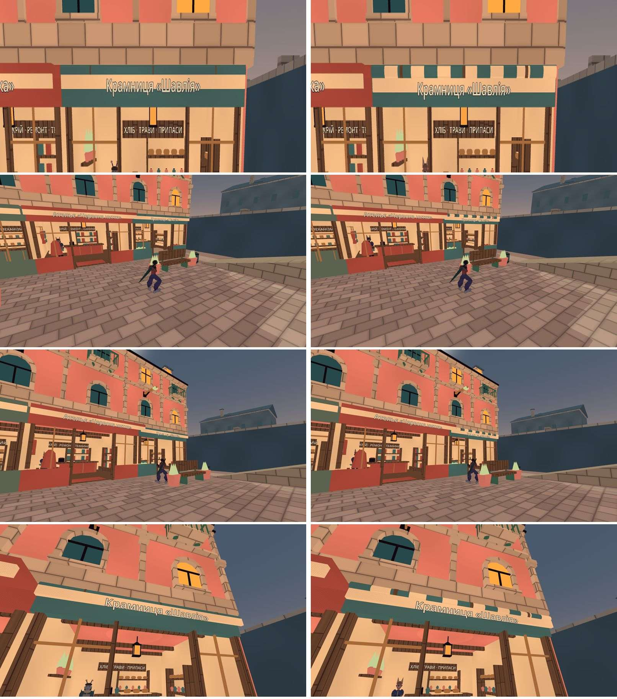

# Приймання T6: згорнутий тент, сходинки й гард V+ — журнал виконання

**Дата:** 2026-10-14 · **Роль:** T2 Гефест (T2-В) · **Статус:** рядки 1–4 зроблено, гард рядка 5 стоїть. `make check` і
`make gates` — rc 0, `city-*` — 152 / 0 (§ 6). Рядок 5 зроблено за К7-а п. 2, а не за буквальним «немає зазору». Це
розбіжність для T1 (§ 0). Ще 9 OPEN поза списком T6 і кадри — для T1 і T6 (§ 8).

Рядки 1–5 розділу «Що переробити і хто» з [[2026-10-14-T6-Acceptance]], план [[2026-10-14-T6-Acceptance-Crane-Albedo-AB]].
Лише геометрія й гард, 0 кредитів. Ізольоване дерево `scratchpad/t2c-tree` (detached `a4b542a`, кран і лебідка вже є).
Не комічу й не пушу, diff забирає T1. Godot `4.7.stable.official.5b4e0cb0f`. Сирі логи — `scratchpad/t6fix/` сесії
(далі `FX/`). Знімок бази до правок — `FX/base-tree/` (копія `game/` з імпортом і `tools/`).

Кейси ганяю двома раннерами. `FX/run_case.sh` — один кейс, `FX/run_cases.sh` — набір: копія `playable_check.sh` із
фільтром назв, згенерована так само, як `scratchpad/crane/bin/mk_runner.sh` у T2-А. В обох командний рядок той самий, що
в `tools/gates/playable_check.sh`: headless, Dummy audio, `--fixed-fps 60`, `--quit-after 12000`, окремий XDG на кейс. Зонди T6 з `scratchpad/t6-accept/` не міняю.
Ганяю їх із `--path t2c-tree/game`. У копії К7 `FX/k7_steps_t6fix.gd` відрізняються лише три ключі зсунутих сходинок
(`diff … | grep -c '^>'` → 3).

## 0. Звірка ТЗ із кодом

| факт ТЗ | де | що в коді `a4b542a` |
|---|---|---|
| рулон Ø 0,24 на y 3,73–3,97, z −0,40…−0,16; три зав'язки 0,04 `wood` | `CityInteriors.gd:97–107` | ✓ (r 0,12, вісь y 3,85, z −0,28; зав'язки `radius + 0.008`, 0,04) |
| лиштва y 3,53–3,79, z −0,455…−0,345; назва | `CityInteriors.gd:110–111` | ✓ (центр 3,66, 0,26 × 0,11; `_sign` на y 3,59) |
| перемичка того самого акценту, y 3,2–4,0 | `CityInteriors.gd:47` | ✓ `ShopLintel`, `accent` |
| згорнутий тент ятки Н6: 8 смуг по 0,445 | `CityMarket.gd:169–182` | ✓ `_rolled_canopy`, `cloth_cream` / колір через одну |
| бочка (15,18; −4,30), стіна рампи x 16,0 → 0,52 м | `CityProps.gd:134`; `CityLayout.gd:39` | ✓ рампа x 18 ± 2; `what_under` → `EastRamp` AABB x від 16,0 |
| глечики полиці з колайдером r 0,11, h 0,27 | `CityInteriors.gd:167–169`; `CityMarket.gd:272–281` | ✓ `CounterPottery` з `_jar`; `what_under` → S (0,22; 0,27; 0,22) |
| верстак (−22,25; 4,75; −12,4), 1,3 × 2,1; `SouthWall` грань z −10,8 → 0,55 м | `CityMaintenance.gd:16, 47–50` | ✓. Ще: до `EastWall` (грань x −21,3) 0,30 м, скриня — 0,55 м (у ТЗ немає, § 4) |
| гард V+ без правила зазору | `city_tidy_check.gd` `_v_steps` | ✓ лише список сходинок |
| рекордери гарда перевизначають `_jar` з трьома аргументами | `city_tidy_check.gd:303, :347` | новий аргумент іде і туди |

**Розбіжність для T1 (рядок 5).** ТЗ T6 і задача T1 кажуть «сходинка не має зазору 0,05–0,75 м до стіни». Я поміряв
буквальне правило зондом `FX/step_gaps.gd`. Він тягне слід верху кожної сходинки на ±x, ±z над верхом, лог
`FX/before/step_gaps.log`. Буквальне правило валить 27 з 32 сходинок. 23 з них T6 прийняла як GREEN: героя К7 там
знайдено нагорі, бо сходинки стоять 0,07–0,45 м від стін. Серед них розкрійний стіл: 0,449 м до стіни крамниці,
`end_y=0,975`, GREEN. Тож смуга 0,05–0,75 — це, за словами T6, «типова причина провалу», а не саме правило. Правило —
К7-а п. 2: «не нижче за верх більш ніж на 0,05 м або на підлозі».

Гард я будую за цим правилом і обмежую смугою T6 (§ 5). Буквальну форму не ставлю: вона вимагала б переставити 23
прийняті пропи, а це поза межами задачі. Якщо T1 хоче саме буквальну форму, потрібне окреме рішення і перелік пропів.

## 1. Згорнутий тент «Шавлії»

`CityInteriors.gd:11–15` (константи), `:98–126` (`_rolled_awning`):
- рулон — `ROLLED_STRIPES` = 14 поперечних смуг по 6,5 / 14 = 0,464 м, через одну `cloth_cream` і акцент, як `_rolled_canopy`.
  Смуга 0 (кремова) — на західному кінці, як у ятці. Колайдер `RolledAwning` той самий: r 0,12, h 6,5, та сама вісь;
- зав'язки — `ROLLED_TIE` = 0,10 м (П4), `wood`, на тих самих x −2,2 / 0 / 2,2. Середня закриває стик смуг 7/8 на x 0;
- лиштва опущена на 0,06 м: центр 3,66 → 3,60, верх 3,79 → 3,73, тобто низ рулону. Назва 3,59 → 3,53.
  **Одне відхилення від чисел ТЗ.** На z −0,345 (задня грань лиштви) 16-кутний рулон на 2,2 см вищий за свій низ.
  Лиштва там висіла б у повітрі. Тому лиштва відсунута на 6,5 см назад (центр z −0,40 → −0,335): її задня верхня
  кромка лягає під найнижчу лінію рулону (z −0,28). Перед рулону (z −0,40) виступає на 1 см перед лиштвою, і з вулиці
  видно весь рулон над нею. Назва — на 1,5 см перед лиштвою, як і була (z −0,47 → −0,405).

Трикутники (`city_tidy` `CITY_TIDY_INFO triangles`): `CityInteriors` 20292 → 21540, район 112256 → 113504
(+1248 = 13 нових циліндрів × 96).

## 2. Бочка дьогтю

`CityProps.gd:132–141`. Третя бочка стоїть упритул до стіни рампи, за 1 см від неї: (15,18; −4,30) → (15,69; −3,40).
- ≥ 0,75 м від рампи не виходить: на x ≤ 14,95 вона налазить на дві інші бочки;
- z −4,30 поруч із рампою відкрив би між ободами однієї висоти щілини 0,57 і 0,68 м (капсула 0,70 там теж
  заклинює). На z −3,40 до двох інших — 0,78 і 1,11 м;
- першим я пробував z −5,60 (0,80 і 1,42 м). Там рампа 3,02 м заввишки, і зник шлях Skea на рампу, який T6 прийняла.
  К7 (`FX/k7_alt.gd`, z −3,40): Skea з бочки (14,45; −4,00) знову на `EastRamp@2.67`, `max_y=2.80`, як до правки.
  Choko на землі, `end_y=0.000`.

## 3. Глечики полиці з травами

`CityMarket.gd:272–285`: `_jar` отримав `solid: bool = true`. За `false` колайдера немає. `CityInteriors.gd:180–186`:
чотири глечики полиці — `false`. Решта глечиків (прилавок, полиці товару, ятки) без змін. Рекордери гарда
(`city_tidy_check.gd:348, :392`) передають новий аргумент далі.

## 4. Верстак двору

`CityMaintenance.gd:47–55`. Верстак разом із ногами і скринею зсунуто на (+0,29; 0; +0,54) у південно-східний кут
двору, по 1 см від `SouthWall` і `EastWall`. Скриня їде разом із ним (ТЗ). Ось чому також по x. Скриня стояла 0,55 м від
`EastWall`, і новий гард знайшов там те саме заклинювання: 0,069 м нижче кришки, 9 з 9 точок, § 5. Тепер скриня
0,26 м від `EastWall`, і герой, притиснутий до стіни, стоїть на кришці.

## 5. Гард V+ — «сходинка не заклинює героя на ободі»

Предмет: для всіх сходинок `STEP_PROPS` і кожної точки їхнього краю: герой, що дійшов по верху до тіла, яке
піднімається над верхом не далі 0,05–0,75 м від краю, і зійшов, стоїть на верху (≤ 0,05 м нижче) або поза
сходинкою — ніколи на її ободі з ногами в повітрі.

**Як міряє.** Константи — `city_tidy_check.gd:174–210`, функції `_v_wedges` / `_step_walk` — `:1513–1675`, виклик у фазі
`places` — `:2903`:
- кожна сходинка `STEP_PROPS` (кандидат V+, не перескок), кожна сторона ±x, ±z, 9 точок поперек неї;
- капсула героя (`Fighter.tscn`: r 0,35, h 1,8) стоїть на 3 см над верхом, тілом усередині краю. Якщо там тісно, вона
  пробує зсуви на 6 і 12 см, лишаючи вісь над верхом. Так проба стає на бочку впритул до стіни;
- капсула йде назовні, доки не зустріне тіло, що піднімається над верхом. Далі ніж вісь на 0,75 − 0,35 м за краєм вона
  не йде: це смуга T6;
- там капсулу опускають. Не нижче верху на 0,05 м — `top`; нижче і торкається сходинки — `wedge` (обід); інакше —
  `off` (підлога, інше тіло);
- `blocked` — стати ніде (навіс над товаром, скриня на верстаті). Таку точку я рахую, але не суджу.

**Літерали з джерелом** — у коментарі над `STEP_GAP_BAND`:
- `STEP_GAP_BAND` 0,05–0,75 і `STEP_RIM` 0,05 — К7-а п. 2 у [[2026-10-14-T6-Acceptance]] § 2.1;
- журнал зонда `scratchpad/t6-accept/logs/what_under.log`: `EastRamp` і бочка 0,52 м → 0,764 з 0,90; `SouthWall` і
  верстак 0,55 м → 0,760 з 0,825; стіл 0,45 м → 0,975, GREEN;
- `STEP_SAMPLES` 9 і зсуви 6 / 12 см — це зерно, а не поріг.

**Той самий гард на продукті до правок** (`FX/base-tree`, ключі старі, лог `FX/before/city-tidy-newguard-on-base.log`):
rc=1 і рівно три заклинювання:
- бочка (15,18; −4,30), бік +x, `EastRamp`: 0,110 м під верхом, 9 з 9 точок. К7 T6 — Choko 0,136 м під верхом;
- скриня, бік +x, `EastWall` за 0,550 м: 0,069 м, 9 з 9;
- верстак, бік +z, `SouthWall` за 0,550 м: 0,063 м, 9 з 9. К7 T6 — 0,065 м.

**Після:** `CITY_TIDY_INFO V+ wedge sides=128 wedges=0 open=9 blocked_sides=5`, `CITY_TIDY_COMPLETE checks=506 failures=0`
(`FX/work/city-tidy-6.log`, той самий рядок і `FX/final/city-tidy.log`). Бочка біля рампи: +x `top 9/9`, зазор 0,010. Скриня: +x `top 9/9`, 0,259. Верстак: +x
і +z `top`, 0,010.

**OPEN — 9 сторін, які гард знайшов поза трьома випадками T6** (`STEP_WEDGE_OPEN`, `:200–210`). T6 прийняла ці сходинки
за розбігом: розбігу немає, або герой нагорі. Хід по верху дістає боки, до яких розбіг не веде. Переставляти їх — поза
рядками 1–5, тому кожна запінена на свій зазор ± 2 см і мусить заклинювати так, як поміряно. Зникла — червоне.

| сходинка, бік | об що | точок | під верхом | вирішує |
|---|---|---|---|---|
| ятка W z25, бочка на козлах, −x | `SouthWestRear` 0,62 м | 9 / 9 | 0,18 | T1 |
| та сама, −z | стійка ятки 0,54 м | 1 / 9 | 0,07 | T1 |
| ятка W z25, ящик, −x | `SouthWestRear` 0,69 м | 2 / 9 | 0,34 | T1 |
| ятка E z25, пивна бочка, +x | фасад сходу 0,65 м | 3 / 9 | 0,18 | T1 |
| прилавки «Шавлії», кравця, майстерні, −x | торець бічної полиці 0,54–0,62 м | 5 / 9 | 0,15 | T1 |
| розкрійний стіл кравця, −z | тулуб манекена 0,68 м | 2 / 9 | 0,28 | T1 |
| стілець кравця, −x | стіна крамниці 0,65–0,75 м | 7 / 9 | 0,30 | T1: «капсула на ободі» — рух, після M3 з числами T5 |

**Негативи** — по одній формі предмета, у `playable_check.sh` +7 рядків (`diff … | grep -c '^<'` → 0 видалених). Лог —
`FX/neg1/`, rc 1 у кожного, інших `ERROR` немає:

| негатив | форма | червоне |
|---|---|---|
| `wedge_wall` | до сходинки приходить стіна: 0,55 м від урни (−11,45; 8,25) | `failures=3`: урна 9 / 9 (0,106 м) і сусідній вазон |
| `wedge_round` | у сходинки круглий обід: ящик вітрини «Шавлії» з циліндром r 0,425, стіна 0,32 м від пласкої кромки | `failures=2`: ящик −x, 5 / 9 (0,115 м) |
| `wedge_deep` | глибокий край смуги: стіна 0,66 м від розкрійного столу, трохи вужче за капсулу | `failures=2`: стіл −x, 9 / 9 (0,213 м) |
| `wedge_open` | запінений OPEN зник: бічна полиця «Шавлії» без колайдера | `failures=1`: «OPEN … no longer wedges as pinned» |

Старі негативи V+ `step_new`, `step_low`, `step_moved` — rc 1, як і були.

**Чого гард не бачить:**
- щілини між двома пропами однієї висоти: обидва ободи нижче за ноги, і хід їх не зустрічає. Третю бочку я поставив
  так, щоб щілин не було (§ 2), але гардом цього не доведено;
- обода без стіни: стілець з боку +x, спинка лавки. Це рух героя, T1 вирішив — після M3;
- 5 сторін, де стати ніде: штабель під навісом ятки (4) і верстак −z (скриня);
- руху героя: це геометрична проба, а не К7. Сам К7 — зонд T6 (§ 6).

## 6. Перевірка: до → після

«До» — `a4b542a` (`FX/before/`, знімок `FX/base-tree/`), «після» — дерево з правками (`FX/after/`, `FX/work/`).

| що | до | після |
|---|---|---|
| К7 (14,45; 0,90) Choko +x | `end_y=0.764`, `Ground`, на ободі | `end_y=0.000`, `Ground` |
| К7 (14,45; 0,90) Skea +x | `EastRamp@2.67`, `max_y=2.80` | те саме |
| К7 (−23,95) обидва +x | 2,130 / 2,127 — на глечику | 0,900 — `BeerBarrel` |
| К7 (−23,95) обидва −z | `vault=0`, на землі | `vault=27`, на землі: глечики більше не закривають перескок уздовж стіни |
| К7 (4,82) Choko +z | 0,760, на ободі | 2,205 — на гребені `SouthWall@6.20` (§ 8) |
| К7 (4,82) Skea +z | −3,999, через стіну на вулицю | те саме |
| К7, рядків `T6_K7` | 90 | 88; решта рядків без змін, крім автоімен тіл |
| `city-tidy` | `368 / 0` | `506 / 0` |
| `CITY_TIDY_INFO triangles district` | 112256 | 113504 (`CityInteriors` 20292 → 21540) |
| `rope-pull` | `19290 / 0`, `red=none` | те саме |
| `rope-choice` × 10 | лічильники всіх частин | ті самі; рядок якоря 16 (choko, ч. 2) без змін |
| дуель (`living_body_check -- --dump`, `cmp`) | — | `identical=8 different=0` |
| родини `city-*` (`FX/run_cases.sh`, фільтр `^city-`, три непересічні частини) | — | 152 / 0: `city-tidy` і 63 негативи 64 / 0, решта 53 / 0 і 35 / 0 |
| `tight-station`, `parkour-motion`, `living-body`, `traversal`, `auto-hook`, `anim-traversal`, `anim-ground`, `anchor-coverage`, `parkour-moves` | — | 9 / 0; `AUTO_HOOK 236 / 0`, `ANCHOR_COVERAGE 57 / 0 t8=3876/3969`, `TIGHT_STATION 31 / 0` |

**Одна зміна траси поза лічильниками.** У `rope-choice` частина 1 обох героїв один натиск тепер обирає якір 20
(кронштейн над двором, −24; 10,2; −19,6) замість якоря 13 (стовп −18; 8; −9,6). Гістограма `picked`: 13: 6 → 5 і
7 → 6, 20: 20 → 21. Підвісів, обривів, OPEN і перемотувань стільки ж. Причина — верстак. Бісекція: база тільки з
новим `CityMaintenance.gd` (`FX/bench-tree`) дає ту саму гістограму, що «після» (`FX/bisect/`). Тобто це точка
кільця над двором, де стоїть зсунутий верстак. Число `frames=` у `rope-*` гуляє і на тому самому продукті (6930 /
6968 у двох прогонах `rope-pull` до правок), тому за мірило його не беру.

**`make check`** на фінальному дереві (`FX/final/make_check.log`; перший прогін — `FX/make_check.log`, 118 с): rc 0. Імпорт без рядків error/warning; GDS `перевірено: 144 · не
парсяться: 0`, канарка `FAIL як треба`; smoke `ALL OK (165 checks) in 19847 frames`.
**`make gates`** (`FX/final/make_gates.log`): rc 0, «БАТАРЕЯ ЗЕЛЕНА». Wikilinks: 534 сторінки, 8840 лінків, зламаних 0. Реєстр 187 / 187,
GDS 144 / 0.

## 7. Кадри для T6

`FX/run_t6fix.sh` — копія `scratchpad/t6-accept/run_t6.sh`. Змінено лише дерево (`t2c-tree/game`), шлях до бінаря й
`nice -n 19`. Скрипт кадрів той самий: `t6-accept/accept_frames.gd`. Команда:
`RES=1920x1080 FX/run_t6fix.sh t6-accept/accept_frames.gd FX/frames/awning_rope16 --groups=awning,rope16` → rc 0,
`ERROR` 0, одне відоме попередження llvmpipe про V-Sync. Рядок `T6_INFO renderer=gl_compatibility adapter=llvmpipe …
window=(1920, 1080) scale3d=1.00 msaa=2`.
- Сирі PNG і їхні сірі копії `aw1`–`aw5`, `rp1_anchor16_t006…t110` — у `FX/frames/awning_rope16/`;
- `T6_ROPE` на якорі 16 рядок у рядок збігається з прогоном T6 (`diff` 7 рядків → порожньо): t30–t80 `phase=3
  attached=true`, t110 — відпущено;
- аркуш для вікі — нижче. Ліворуч кадри T6 «до» (`t6-accept/frames_awning/`, дерево `e6379ed`; код тенту там той
  самий, `git diff --stat e6379ed a4b542a -- CityInteriors.gd CityMarket.gd` → порожньо). Праворуч «після». Кран на тлі
  «після» — з `a4b542a`, не з цієї правки. `aw1` обрізано до тенту, `aw2`–`aw4` — цілі кадри.

Мірило T6: на `aw1` і `aw2` рулон видно окремою смугастою формою з трьома зав'язками. На `aw1` і `aw4` смуги й зав'язки
видно. На `aw2` з 6 м смуги читаються пунктиром. Приймає T6.

Додатково, для рядків 2–4 (не замовлено, щоб T6 не знімала вдруге):
- `FX/frames/steps_yard/` — станції `st10`–`st14`, `yd1`, `yd2` з тими самими id. `yd3`/`yd4` ставлять героя на стару
  скриню (−22,25; 5,19; −12,8), тому їх не знімав;
- `FX/frames/k7_grocer/` — К7 Choko на бочку «Шавлії», кадр кожні 6 тиків, 1280 × 720, rc 0. На t060, у верхній точці
  стрибка (`max_y 2.20`), ноги героя проходять крізь глечики й трави на полиці. На t072 він уже на бочці, а камера в
  кутку між стіною і полицею впирається в нього: герой стає темним силуетом. Це той самий клас тісного кута
  ([[2026-10-07-Camera-Readability-Iteration-2]] крок 5).

## 8. Відкрите

- **Розбіжність рядка 5 (T1).** Гард міряє К7-а п. 2 у смузі T6, а не буквальне «немає зазору 0,05–0,75 м» (§ 0).
  Буквальне правило валить 27 з 32 сходинок, з них 23 прийняті T6.
- **9 OPEN-заклинювань поза списком T6 (T1, потім T6)** — таблиця § 5: товар двох яток біля фасадів, три прилавки біля
  бічних полиць, розкрійний стіл біля манекена, стілець кравця. Кожне виправляє перестановка впритул або на ≥ 0,75 м,
  як у рядках 2–4. Стілець — рішення T1 «після M3».
- **Траса біля змінених пропів (для T6, К7-а п. 3):**
  - Choko з верстака тепер вилазить на гребінь `SouthWall` (y 6,2; 0,2 м завтовшки; К7 `end_y=2.205`). Skea, як і
    раніше, переходить через стіну на вулицю. З двору й так є виходи пандусами `OuterServiceRamp`/`InnerServiceRamp`,
    тож сюжетного обходу немає. Але гребінь стіни — не задумане місце стояння;
  - бочку «Шавлії» тепер можна перестрибнути вздовж стіни (−z, `vault=27`, обидва герої);
  - глечики і дошка полиці не мають колайдера. Герой на бочці «Шавлії» (К7 +x, `end_y=0.900`) і в перескоці проходить
    плечем крізь полицю з травами. Дошка — x −23,71…−23,41 на y 1,86–1,94, глечики — до y 2,22. Капсула героя,
    притиснутого до стіни (`past=0.20`), — x −24,10…−23,40, до y 2,70. Кадри — `FX/frames/k7_grocer/`. Якщо T6
    це не приймає, лишається другий варіант ТЗ: бочку з-під полиці;
  - `rope-choice` ч. 1: один натиск над двором обирає якір 20 замість 13 (§ 6).
- **Не перевірено:** M3/Forward+ (кольори, FPS); кадри — Compatibility/llvmpipe, з подвійним альбедо (крок 5 плану);
  повна `make check-playable` (її проганяє T1); щілини між пропами однієї висоти гард не бачить (§ 5).
- `state.md` не правлю: рядок стану внесе T1 під час зведення.

## Related

- [[2026-10-14-T6-Acceptance]] · [[2026-10-14-T6-Acceptance-Crane-Albedo-AB]] · [[2026-10-08-City-Modern-Realism-Props]]
- [[2026-10-14-Steam-Crane-Winch-Fix]] · [[2026-10-14-Lamp-Posts-Awning-Anchor-5-Fix]] · [[2026-10-14-Quality-Debt-Posts-Awning-Guards]]
- [[state]] · [[Textures-Registry]]
