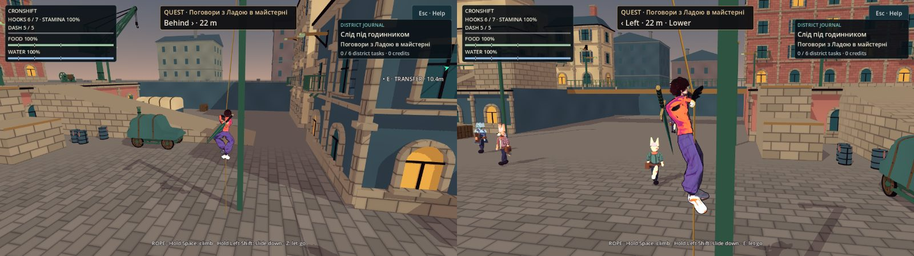
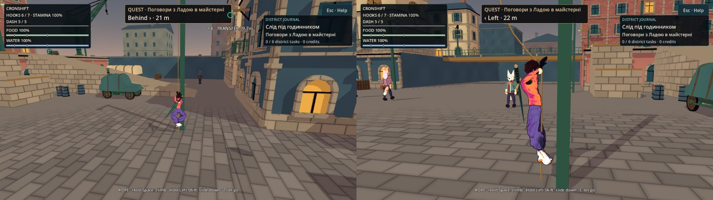
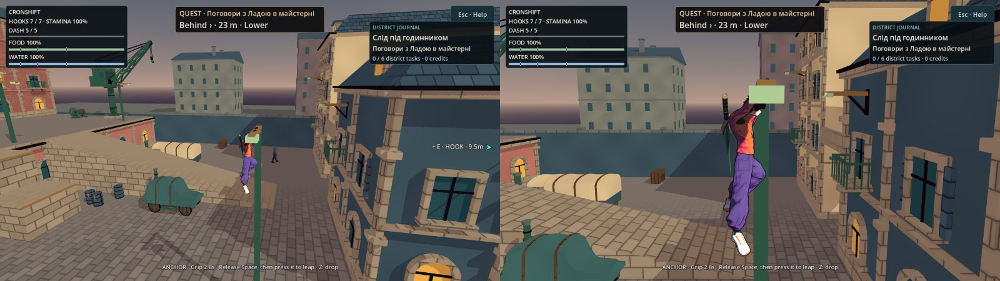
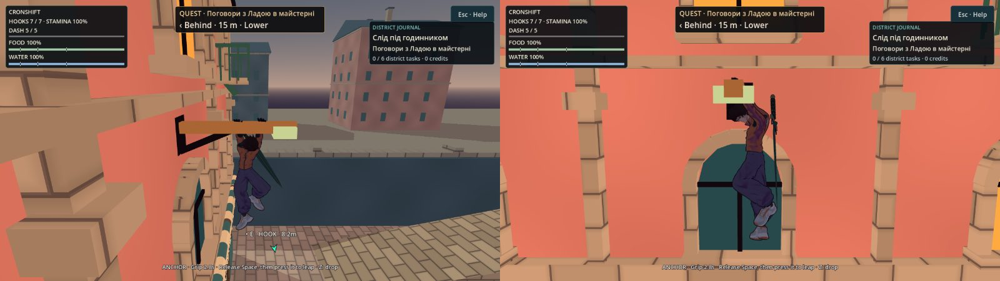
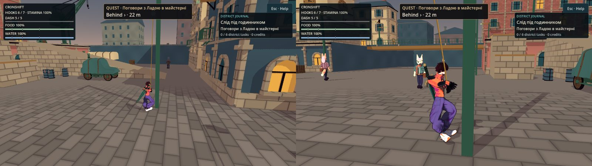
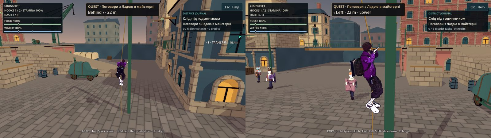
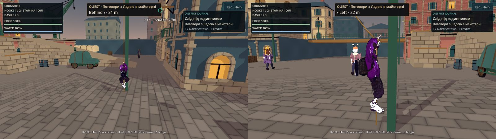
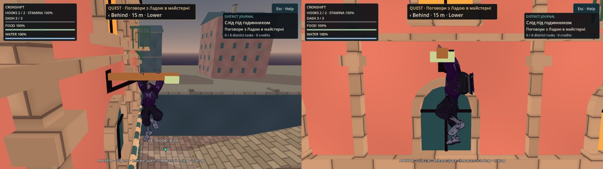
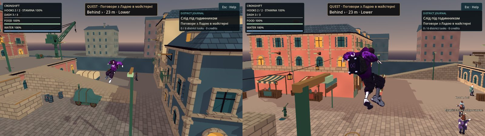
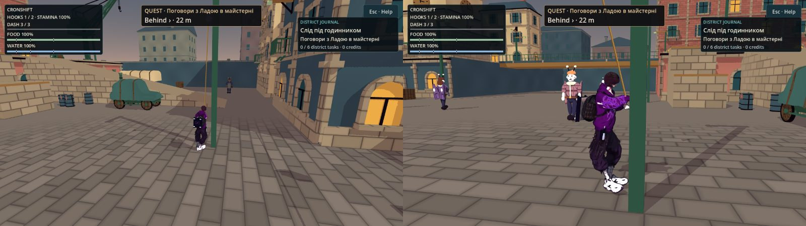

# Трос у місті: лазіння, спуск, звис на якорі, повернення мотузки, E відпускає — журнал виконання (15а)

**Дата:** 2026-10-15 · **Роль:** T2 Гефест (T2-И) · **Статус:** зроблено в дереві без коміту — § «Де зупинився», далі
§ «Після батареї T1» (T2-Л). Решта 15а — у журналах [[2026-10-15-Negative-Families-Runner-Fix]] (T2-К),
[[2026-10-15-Rope-Perch-Entry-Fix]] (T2-М), [[2026-10-15-Runner-Rule-Bypass-Fix]] (T2-О), [[2026-10-15-Rope-Input-Acceptance-Fix]]
(T2-П), [[2026-10-15-Rope-Perch-Mesh-Clearance-Fix]] (T2-Р), [[2026-10-15-Rope-Recheck-Yellow-Fix]] (T2-С). Повторний аудит
T4 — [[2026-10-15-Rope-Climb-15a-Recheck]]: YELLOW, RED немає. Статус оновив T2-С за Y-G того аудиту; текст нижче — як
писався по ходу.
Крок 5 (15а) плану [[2026-10-15-Rope-Climb-Perch-Release]]; рішення [[ADR-028-Rope-Climb-Perch-And-Retrieval]] п. 1–5 і 8;
числа T5 [[2026-10-15-Rope-Climb-Numbers]], ввід T8 [[2026-10-15-Rope-Climb-Input]], кліпи й поза T6
[[2026-10-15-Rope-Climb-Animation]]. 0 кредитів.

Дерево — `scratchpad/t2i-tree` (detached `93ba633`, `git log --oneline -1` → `93ba633 Record Santos's rope forks in
ADR-028 and approve the rope climb plan`). Не комічу й не пушу. Godot `4.7.stable.official.5b4e0cb0f`
(`$GODOT_BIN --version`). Сирі логи — `scratchpad/t2i/` сесії (далі `ТИ/`). «До» — знімок `ТИ/base-tree/` (`cp -a`
імпортованого `game/`, `tools/`, `Makefile` до першої правки).

## 0. Звірка плану з кодом `93ba633`

| факт плану / ТЗ | де | що в коді |
|---|---|---|
| місто примусово SOLO, `CityFighter` ставить `responsive_parkour` | `CityFighter.gd:38`, `CityWorld.gd:64-65` | ✓ |
| Shift на тросі = ухилення | `Fighter.gd:1792` (`_tick_grapple`), `:785-791` (`_start_dodge` дозволяє `GRAPPLE`) | ✓ |
| Space на тросі = ще 1,2 м | `GrappleHook.gd:63` (`reel_distance`), `:215-219` (`reel_remaining`), `:733-736` | ✓ |
| E на тросі = `retarget()`, без цілі — `_deny`, герой висить | `GrappleHook.gd:279-328`, `_deny` на `:297` | ✓ |
| розвішена мотузка не повертається | `MatchRopes.gd:42-47` (`refund` відкидає `deployed`) | ✓ |
| G біля мешканця не дивиться на трос | `CityNpcDirector.gd:145-154` (`can_talk`) | ✓ дефект є |
| довідка HARPOON | план: `ComfortPanel.gd:194` | **дрейф рядка:** текст на `:209`; зміст той самий |
| літерали в гардах | `SmokeTest.gd:429`; `rope_pull_check.gd:281-282`; `auto_hook_check.gd:621` | ✓ |
| якорі: 10 ліхтарів, 15 кронштейнів, плече на +0,30 | `CityLayout.gd:49-84`; `CityDistrict.gd:171-187` | ✓ (`arm_y = point.y + 0.3` для `post`, `mount.y` для `bracket`) |
| плече й кераміка без колайдера, стовп 0,18 — колайдер | `CityDistrict.gd:71-83` (`_box`: `layer 0` → `Node3D`), `:175` | ✓ |
| `KNOWN_CUTS` 11, `KNOWN_DENIED` 18, `OPEN_AIR` 2 | `rope_choice_check.gd:61-100`; `rope_pull_check.gd:84-87` | ✓ |
| кліпи UAL у кеші пози | `AuthoredHookMotion.gd:5-7` | `Fish_Reel` у кеші немає (додаю для змотування) |
| кнопка змотування — G (`interact`), на землі, ≤ 14 м, вільна лінія, останньою в ланцюжку G | T8 § 1, § 2.4; T5 § 4.2 | ✓ ланцюжок — `CityWorld._update_story_interaction` `:324-349` |

### Розбіжності, що не міняють рішення ADR-028 (записані, не обійдені)

1. **Висота тіла на звисі: T5 Л5 проти пози T6.** T5 (Л4, Л5, гард Л-б): кисті на `y_якоря + 0,30`, ступні на
   `y_якоря − 1,75` — з `reach_height` 2,05 (`CityParkourProfile.gd:5`) як «досяжності рук». Зонд T6 міряє руки героїв:
   плече → кисть 0,382 / 0,368 м, плечі на 1,34 / 1,38 м над ступнями, тобто кисть дістає ≈ 1,72 м над ступнями, а не
   2,05. З ступнями на −1,75 намальовані кисті не дістали б плеча ліхтаря на ≈ 0,4 м. T6 § 3: плечі героя на
   `точка + 0,02`, тож ступні ≈ `точка − 1,32` (Choko) / `− 1,36` (Skea). Наявний звис на краю теж ставить ступні на
   1,42 м під хватом (`hang_height`, `CityParkourProfile.gd:7`), а не на 2,05.
   ТЗ каже «Поза й кліпи — за T6», ADR п. 3 — «руки на точці якоря». Тому капсула стоїть за позою T6: одне число
   `GrappleHook.perch_feet_below = 1.32` (PLACEHOLDER, джерело T6 § 3), кисті (логічна точка хвату) — на +0,30 за T5 Л4.
   Гард Л-б перевіряє саме це число ± 0,01. **Для T5 / T1:** якщо T5 наполягає на −1,75, це одне число, але тоді
   намальовані руки не дістануть плеча без підйому малюнка над капсулою (невідповідність колізії й картинки, клас 8).
   Наслідок для З2 («ціль не нижче руки»): рука `HAND` на звисі — на `точка − 0,07` замість T5-го `− 0,50`;
   `python3 -I ТИ/probe/perch_reach2.py game/scripts/world/CityLayout.gd` → 37 з 56 пар (T5 мав 45), без цілі — лише
   звис 9, як і в T5. Рішення («17 з 25 без цілі» знято) не змінюється.
2. **Де руки вздовж плеча.** T5 § 1.4: центр хвату на 0,10 м від точки до опори. T6 § 3 (зняв кадри й зазори): кисті на
   0,26 і 0,66 м від точки до кріплення, плечі на 0,14 м позаду середини хвату, герой упоперек плеча. Поза — T6: беру
   0,26 / 0,66 і 0,14. Зазор до власного стовпа вуличного ліхтаря рахую sweep-ом шляху «до опори» (§ 3).

## 1. Код (крок 1 сесії)

Прапор лазіння — `GrappleHook.climb_enabled`, ставить лише `CityFighter._ready` (`grep -rn "climb_enabled = true"
game/scripts` → 1 рядок, `CityFighter.gd`). Без нього `drive()` іде старою гілкою (1,2 м, ухилення, `_deny`).

| що (ТЗ п.) | де | як |
|---|---|---|
| 1. Space угору 3,6 м/с до 2,0, далі «до опори» 0,5 с | `GrappleHook.drive`, `_begin_climb_top`, `_drive_climb_top` | `climb_input` (+1/−1/0) пише `CityFighter._climb_input`; крок `min(climb_speed·dt, L − 2,0)`; `max(тяга; лазіння)`, не сума; на 2,0 з утриманим Space — 30 тиків до пози звису з sweep-ом капсули кожного тику (`_body_path_clear`, правило `CityParkourMotor._clear`); заблоковано — `climb_blocked`, герой на 2,0 |
| 2. Shift униз 2,0 м/с; підлога → відчепитись | `GrappleHook.drive` | крок `min(slide_speed·dt, record.length − L)`, ніколи під час тяги; `_hang_start_length` іде за спуском, щоб тяга його не забрала; ноги на підлозі (`is_on_floor` після руху) → `_release`, запис мотузки без змін |
| 2. Ухилення з троса прибрано, буфер забирається | `CityFighter._tick_grapple` | на тросі (`HANG`, `CLIMB_TOP`) такт бере `dodge` і `dash` з буфера щотакту (T8 § 2.1, § 3); на замаху / в польоті — як було |
| 2. Зачеп скидає `_dodge_air_used` | `CityFighter._track_rope` | T5 § 2: одне повітряне ухилення на трос |
| 3. Звис на якорі | `GrappleHook.Phase.PERCH`, `perch_pose_for`, `_drive_perch`; `CityFighter._tick_perch` | поза — § 0 п. 1–2; 3,0 с + «Сила» (`CityFighter.perch_limit` = `parkour.hang_limit`); Z / F / L / X — відпустити; Shift — ухилення, як з краю; E — `perch_shot` (замах 10 тиків, руки на плечі до контакту, `_perch_hold`), без показаної цілі 15 тиків — відпустити; Space (новий натиск) + стік ≥ 0,4 — 6,8 / 7,4 м/с, без стіка — від опори; малюнок стрибка — фаза `wall_kick` мотора (`CityParkourMotor.begin_leap`, `leap = true`, нічого не витрачає) |
| 3. Ціль «не нижче руки» | `GrappleHook.target_min_rise`, `HarpoonAim._capture_traversal` | 0,0 на звисі й на замаху з нього, інакше 1,5 |
| 4. Повернення на звисі | `GrappleHook._grip_anchor`, `MatchRopes.retrieve` | на останньому тику «до опори» запис знято, +1 власнику (`record.owner`), той самий тик |
| 4. Змотування G | `CityWorld._update_reel`, `GrappleHook.reel_candidate` / `begin_reel`, `MatchRopes.begin_reel`, `in_use` | своя мотузка, ніхто не висить, рука → якір ≤ 14 м, вільна лінія; останнім у ланцюжку G; запис `deployed → issued`, далі чинний `MISS_REWIND` (9 м/с, × 0,35, пауза від удару й ухилення, `refund` біля руки) |
| 5. E на тросі | `CityFighter.rope_e_lets_go`, `HarpoonAim.last_target_tick` / `ticks_since_target` | мотузка в 0,70 м або показана ціль → `retarget()` як зараз; ціль не показувалась ≥ 15 тиків → `let_go()`, швидкість не чіпається |
| 6. Перехід не рветься об попередній стовп | `GrappleHook.retarget` (`_transfer_skip`), `drive` | лише в місті: новий трос не рветься об власну опору щойно покинутого якоря, поки тягне героя до нового якоря (V4); після тяги — звичайне правило. Окремого числа немає |
| 7. G на тросі | `CityNpcDirector.can_talk` | `grapple.busy()` → розмови немає (і на звисі, і поки мотузка змотується) |
| 8. HUD і довідки | `CityHud._rope_hint`, `_perch_hint`, `exploration_help`, `HOOK_REASONS`; `ComfortPanel` HARPOON; `SmokeTest.gd:429` | тексти T8 § 4; «let go» називає E лише коли E справді відпустить; на звисі — ще `Grip N.Ns` (T5 З1, як на краю); маркер на звисі — `HOOK`, на тросі — `TRANSFER` (`hook.attached`, для чинних фаз те саме, що `busy()`) |
| 9. COMFORT «ROPE CLIMB» | `ComfortPanel.rope_climb_choice`; `InputRouter.rope_climb`, `set_rope_climb` | `settings.cfg [input] rope_climb`, типово `hold`; невідоме значення → `hold`, файл, що не читається, не переписується; рядок перед RESTORE |

Розбіжність T8 усередині документа: COMFORT-текст § 4 — «City rope: hold jump to climb…» (мала літера), а таблиця
гардів § 4 — літерал `Hold jump to climb`. Текст лишив дослівно, літерал smoke — `hold jump to climb`.

**Зонд** `ТИ/probe/climb_probe.gd` (справжній `CityWorld`, Choko, SOLO, справжні клавіші; логи `ТИ/probe/out/*.log`):
- `climb.log`: якір 3 (8; 6,5; 8) з (0; 0; 9,5) — тяга 8/60 = 0,1333 м за тик, далі лазіння рівно 0,0600 за тик, L 2,000
  на 53-му тику, `CLIMB_TOP` 30 тиків, `PERCH` на 83-му: ступні −1,3200 від точки, v = 0, заряди 6 → 7, `deployed` 1 → 0;
  20 тиків із затиснутим Space — без стрибка, рядок `ANCHOR · Grip 2.7s · Release Space, then press it to leap · Z: drop`;
  новий Space + W — v (6,68; 7,40; −1,25), |v_гор| = 6,80.
- `timer.log`: звис тримається 181 тик (3,0 с = 180, зрив на наступному), далі `JUMP`, v = 0.
- `slide.log`: спуск рівно 0,0333 м за тик, на 17-му тику ступні на бруківці → `IDLE`, `deployed=1`, заряди 6; рядок
  `G · Reel in your rope · 0.6m`; G → `issued=1 deployed=0`, 35 тиків (5,28 м / 9 = 35,2), заряди 7.
- `e_empty.log`: 0 гаків, ціль була 2 тики тому — E лишає на тросі (`NO HARPOONS · reel in a left rope, or grab one`);
  через 19 тиків — відпускає, v до = v після.
- `s7b.log` (випадок T3: з якоря 2 на 17): обидва варіанти (`still`, `swing_W`) висять на 17 усю тягу (до 51-го тику) і
  далі — обриву немає (у T3 — `JUMP` на 14-му / 15-му тику, блокер `AnchorPost2`).

Перша спроба спуску гойдалась між 4,750 і 4,783: тяга V4 забирала кожен крок спуску назад. Виправлено одним рядком
(`_hang_start_length` іде за спуском); зонд вище — після виправлення.

## 2. Подача (крок 2 сесії)

`AuthoredHookMotion.gd` — лише нові стани міста, чинні фази троса й дуелі не змінено:
- угору (ряд Г T6): лінія хвату на 0,14 м попереду плечей (кисті — чинний IK троса, затиск 0,72–0,95 досягу); ноги
  затискають лінію (±0,05 м убік, 0,06 м позаду, 0,24…0,46 м над точкою ступень у фазі перехоплення) — лише коли трос
  справді коротшає лазінням чи спуском, з наростанням і спадом 0,1 с (`_clamp_mix`) і на «до опори»;
  **перенесення висот кистей ряду Г (−0,07…0,29 → 0,02…0,30 м над плечем) прибрано**: `anim_traversal_check`
  `rope_turn` зловив перегин передпліч (Choko 70°, Skea 178° за тик) — відкрите для T6, § 7;
- IK ніг затиску — власний двокістковий розв'язок із коліном до напрямку тіла (`AuthoredHookMotion._solve_leg`):
  `AuthoredCombatMotion._solve_chain` бере згин із пози, і майже пряма нога Skea перекидала коліно — `rope_turn`
  `t267 70.4° LeftLeg`, `t268 41.3°` (§ 3.9);
- униз (ряд В): верх `Climb_Idle`, кисті одна над одною (0,30 / 0,18 м над плечем), стопи 0,37 / 0,30;
- «до опори»: один хід `Climb_Up`, права кисть на плече першою, ліва слідом;
- звис: руки `Climb_Idle`, IK на дві точки плеча (+0,04 м зап'ястя), корпус — як на тросі; на кронштейнах 22–24, де
  тяга сходить на середину плеча згори, дальня кисть на 0,62 м замість 0,66 (`GrappleHook.perch_tie_rod_far`,
  PLACEHOLDER; мета `tie_rod` у `CityDistrict`): зап'ястя від осі тяги 0,066 → 0,105 м — як на підкосах знизу (0,111),
  які T6 прийняв (T6 § 3: «зсунути хват на кілька сантиметрів від тяги … вирішує T2»);
- змотування: `Fish_Reel` (додано в кеш `SOURCES`), без IK кисті до гака;
- стрибок зі звису — фаза `wall_kick` мотора (`WallRun_Jump_L/R`, як відскок від стіни).
`GrappleHook._draw_tail`: хвіст мотузки висить з нижньої кисті на залишок довжини, не крізь підлогу (T6 п. 2).
Невідкрите для T6: кліп на замаху з плеча (зараз руки лишаються на плечі, гак летить з `HAND`); гак, що «дугою йде на
пояс» при поверненні (зараз мотузка зникає на тику хвату); затримка +1 на HUD до торкання гака.

## 3. Гарди (по ходу)

### 3.1 `weighted_swing_check.gd`

Дуельні рядки (Space ≤ 1,2 м, «не лізе безкінечно») — без змін. Старі міські рядки (1,2 м за 20 тиків, L 4,8) тепер
описують профіль `responsive_parkour` без лазіння — тобто дуель після 15в — і лишились. Додано тіло `CityFighter` (сцена
героя з `set_script`, як у `CityWorld`) і якір із плечем: Л-а, Л-б, Л-в, Е-1…Е-6 (T5 § 8), родини в окремому рядку
`WEIGHTED_SWING_FAMILIES … red=…` (позитивний sentinel не змінився).
Е-4 у формулюванні T5 («дотична швидкість після кроку ≤ до + 0,03») ловить і гравітацію (до g·dt = 0,4 м/с за тик) —
тому кожен тик проганяється двічі з одного стану, без лазіння і з ним, і лазіння може бути не більш ніж на 0,03 швидшим.
Е-1 рахується від світового нуля (T5).

Предмет: для всіх тиків міського троса: Space скорочує ≤ 3,6/60, до 2,0, потім рівно 30 тиків до пози, де стоїть, і
жодна дія троса не додає енергії, якої не дав рух стіка.

| негатив | злам (`tools/grapple/rope_climb_mutants.gd` або експорт) | вихід `WEIGHTED_SWING_FAMILIES` |
|---|---|---|
| позитив | — | `failures=0 mutation=none red=none`, `checks=55` |
| `fast` | `climb_speed × 2` | `red=climb_rate` |
| `lift` | `perch_feet_below − 0,5` | `red=perch` |
| `noreq` | лазіння з `climb_input 0` | `red=e1,e2,noreq` |
| `perpetual` | `v × 1,01` за тик | `red=e1,e2` |
| `twosided` | підкачка вздовж руху за будь-якого стіка, k 24 | `red=e2` |
| `boost` | +1 м/с на відпусканні | `red=e6` |

Команда: `$GODOT_BIN --headless --audio-driver Dummy --path game --fixed-fps 60 --quit-after 12000 --script
tools/grapple/weighted_swing_check.gd [-- --break=<m>]`, логи `ТИ/ws*.log`, rc 0 / 1.

### 3.2 `rope_pull_check.gd`

- Довідка: пауза — `pulls you up` (рядок `:616`) + `hold Space / A up` (T8 § 4); COMFORT — як було
  (`In the city the parkour hook pulls you up`, `up to 1.2 m` — обидва літерали лишились у новому тексті).
- Стоячий натиск + Space: кінець — 2,0 (Л-а), «до опори» рівно 30 тиків, потім `PERCH`; повітря цього натиску не
  міряється (трос лишається раніше за пів періоду; лазіння — `rope_climb_check`).
- `lengthen` без змін: без Shift мотузка не подовжується ніколи. Новий огляд `_slide` (справжній LShift): a — від
  усталеного гойдання до підлоги (≤ 2/60 + 1e-6 за тик, не далі `record.length`, на тику дотику підлоги — `IDLE`, запис і
  запас ті самі, ухилення не було, `dodge_stamina` та сама); b — Shift натиснутий під час тяги: під час тяги не
  подовжує; c — Shift + Space: довжина стоїть; d — запис укорочено до L + 0,5 (як мотузка, кинута згори): спуск стає
  на цій довжині в повітрі (`rope_end`).
- Помилка першої версії гарда (не продукту): b тиснув Shift до E — на землі Shift = ухилення, постріл не стався. Тепер
  Shift — після зачепу.

| прогін | вихід |
|---|---|
| Choko | `ROPE_PULL_COMPLETE checks=9472 failures=0 mutation=none red=none`, `OPEN air` 61 (закріплено 61) |
| Skea | `checks=10112 failures=0 … red=none`, `OPEN air` 58 (закріплено 58) |
| `overlong` (спуск без межі довжини) | `failures=2 … red=slidelength` |
| `stuck` (на підлозі не відпускає) | `failures=450 … red=slidefloor` |
| `lengthen` / `sum` / `help_reel` | `red=lengthen` / `red=rate` / `red=help` |

`OPEN_AIR` переміряно: 61 / 58 — ті самі числа, перезакріплювати нічого.

### 3.3 `traversal_check.gd`, `contact_check.gd`

Дуельні рядки («зайнятий якір», «порожній запас», «поза дальністю», «застаріла ціль», T4 `.701`) — без змін: у дуелі
правило «невдалий перехід лишає опору» лишається. Місто — тіло `CityFighter`, справжні натиски E через
`CityFighter._tick_grapple`, пакет камери виставлено так, як його публікує камера (`published`, `last_target_tick`):
показана ціль (рядки 97, 104, 105) — висить, довжина, швидкість і запас ті самі; ціль 3 тики тому, зараз немає —
висить; ціль не показувалась 20 тиків і порожній запас (рядок 101) — відпускає, швидкість та сама, стара мотузка
`deployed`, запас той самий; `contact_check` — показана мотузка за 0,701 м (APPROACH ROPE) тримає, без показу 20 тиків —
відпускає. Родини — рядок `TRAVERSAL_FAMILIES`.

Помилка першої версії гарда: у випадках «застаріла» і «3 тики тому» якір `next` лишався в досяжності, і натиск
продукту чесно перевибирав його (T8 Г: «той самий натиск один раз перевибирає від руки») — тобто ціль насправді була.
Тепер у цих випадках якоря поруч немає. `contact_check` мусив дочекатися аудіо (звук відпускання) перед виходом, інакше
`ERROR: 2 resources still in use at exit`.

| прогін | вихід |
|---|---|
| `traversal` | `TRAVERSAL_FAMILIES failures=0 mutation=none red=none`, `TRAVERSAL_COMPLETE checks=76 failures=0` |
| `drop_on_flicker` | `failures=1 … red=flicker` |
| `stay_on_empty` | `failures=2 … red=empty` |
| `contact` | `ROPE_CONTACT_COMPLETE checks=96 failures=0`, 0 рядків `ERROR` |

### 3.4 `rope_climb_check.gd` (новий) — лазіння на кожному якорі

Предмет: для всіх 25 якорів і обох героїв: трос, по якому лізуть із утриманим Space, доходить до 2,0 не швидше
3,6/60 за тик, рівно 30 тиків підтягується на плече, тримається на ньому в позі (хват +0,30, ступні −1,32, нерухомо),
мотузка на цьому тику в запасі власника рівно +1, інваріант запасу щотику, утриманий Space на звисі нічого не піднімає.

Старт — перші точки кілець 2,5…8 м навколо якоря на підлозі з запасом над головою, з яких рука бачить якір; постріл —
шлях продукту із записаним пакетом (реплей), далі справжній Space.

Перший прогін (`ТИ/rc-[1-5].log`, до правки): якір 10 (16; 6,7; 10,6) — «до опори» заблоковано в обох героїв;
зонд `ТИ/probe/blocked_probe.gd`: пряма лінія від верху мотузки до пози б'ється об `ArchitectureSolid621` на y 4,50
(балкон / карниз під кронштейном — те, про що попереджав T5 § 1.4), сама поза вільна. Якір 21 — перший старт не дав
зачепу (старт перебирав лише одну точку). Виправлено:
- продукт: «до опори» тепер двома відрізками, як `mantle` уступу (угору під мотузкою до висоти пози, потім на плече) —
  `GrappleHook._climb_apex`;
- гард: перебирає до 6 стартів.
Після: частини 1/5 і 2/5 — `ROPE_CLIMB_COMPLETE checks=91 failures=0 … anchors=10/10 perched=10 blocked=0 red=none`
обидві; `KNOWN_BLOCKED` порожній.

Зазор до підкосу / тяги (T6 § 3, додано після зсуву хвату 22–24): на кожному кронштейні обидва зап'ястя (точка хвату
+ 0,04) — не ближче 0,10 м до осі збудованого `AnchorStrut<n>` (вузол сцени, не формула). Виміряно (рядок
`ROPE_CLIMB … brace=`): 4, 5, 6, 7, 9, 10, 16, 19, 20, 21 — 0,111; 8 — 0,188; 22, 23, 24 — 0,105, обидва герої.
Частини 1…5 → `checks=103 / 103 / 103 / 99 / 107 failures=0 … anchors=10/10 perched=10 blocked=0 red=none`;
`--part=3/5 --hero=choko --break=tie_rod` (дальня кисть знову 0,66) → `failures=1 … red=perch`, `the left wrist 0.066 m
off the brace's axis` на якорі 22.

### 3.5 `rope_climb_check.gd --part=rules` і `--part=duel`

`rules` (на героя): P9 (Space, затиснутий через зачеп, не лізе; новий натиск — лізе; затиснутий з лазіння не стрибає
20 тиків), звис 3,0 с і 4,0 с із «Силою» (181 / 241 тик ± 1, далі `JUMP`, горизонтальна швидкість 0), Z і X —
відпустити, стрибок зі стіком (6,8 уздовж стіка, 7,4 угору) і без стіка (від опори), E на звисі без цілі 15 тиків —
відпустити, E на звисі по показаному якорю (2 → 17) — замах 10 тиків з руками на плечі, −1 гак, звис на тому якорі,
P7 (Shift на тросі + Z — ухилення немає) і P8 (свіжий Shift у повітрі — ухилення), P12 TOGGLE (дотик лізе, дотик
стоїть, Shift спускає, пауза зупиняє), P10 (G біля мешканця на тросі — розмови немає; на землі біля того ж — є), П-3
(змотування за d / 9 ± 1 тик, рух ≤ ходи × 0,35, ухилення ставить на паузу), П-4 (за 14 м, за стіною, хтось висить,
чужа мотузка — відмова, нічого не змінюється), P13 (кожен новий рядок — один рядок, шрифт мітки 18, ≤ 1552 px; найширший
`ROPE · Pulling you up · Hold Space: climb · Hold Left Shift: slide down · Z: let go` — 676 px).
`duel`: Space зупиняється за 1,2 м від довжини гойдання, Shift на тросі — `DASH`, E без цілі — герой на тросі.

Помилки першої версії гарда: P8 відпускав героя на 0,5 м над бруківкою — він приземлявся раніше за перевірку (тепер
спершу лізе 10 тиків); П-3 зараховував швидкість тику, на якому змотування вже скінчилось; канарка дуелі ставила лише
`climb_enabled` — без швидкого профілю він інертний (лазіння йде тільки з `responsive_parkour`), тепер канарка ставить
обидва, як принесе 15в.

| прогін | вихід `ROPE_CLIMB_COMPLETE` |
|---|---|
| `rules` Choko / Skea | `checks=56 failures=0 … red=none` обидва |
| `duel` | `checks=7 failures=0 … red=none` |
| `--part=1/5 --hero=choko --break=double` (хват повертає 2) | `failures=10 … red=inventory` |
| `rules --break=far` (змотує з 20 м і крізь стіну) | `failures=3 … red=reel_refuse` |
| `rules --break=hung` (змотує мотузку, на якій висять) | `failures=1 … red=reel_refuse` |
| `duel --break=duel_flag` (міське лазіння в дуелі) | `failures=1 … red=duel` |
| `--part=3/5 --hero=choko --break=tie_rod` (кисть біля тяги) | `failures=1 … red=perch` |

### 3.6 `rope_choice_check.gd --transfer` — «вибрав — не обірвав» для переходів

Предмет: для всіх переходів, які камера позначає з висіння на кожному якорі (обидва герої), новий трос не обривається
на першому тику звису твердою геометрією на лінії рука → новий якір (власний стовп нового якоря — виняток, як було).
Плюс випадок T3 дослівно (`S7B`: E на якорі 2 з (0; 0; 9,5), через 40 тиків E на позначений 17, стоячи і з W): новий
трос мусить пережити всю тягу (вікно виправлення) і тик після неї.

Режим: висіння на A через записаний пакет (реплей) з першого старту, що чіпляє; через 40 тиків після зачепу (час T3)
камера обертається через 8 азимутів, кожен позначений якір B натискається один раз справжнім E зі свіжого висіння на A.
Відмови й перемотки друкуються й рахуються, не провалюють (нічого не вибрано).

Виміряно (`ТИ/tf/<герой>-<частина>.log`): 21 натиск переходу на героя, 2 обриви на першому тику в кожного — 22 → 19
(`ArchitectureSolid1569` @ (−15,24; 7,70; −25,15), карниз вежі) і 14 → 22 (`NorthWestRoof` @ (−10,00; 2,97; −24,13), край
тераси). В обох лінія **вже в мить контакту** закрита: це клас `KNOWN_CUTS` (вибір не передбачає руку в мить контакту,
варіант Т2 відкладено), а не стовп, з якого герой щойно перейшов. Закріплено в `KNOWN_TRANSFER_CUTS` з точкою (допуск
`BLOCKER_TOLERANCE` 0,1 м), як `KNOWN_CUTS`. `S7B` обидва варіанти — тримає (38 / 36 тиків тяги).

| прогін | вихід |
|---|---|
| Choko / Skea частини 1…5 | `failures=0`, `cut_first` 0 / 0 / 1 / 0 / 1, `open` = `cut_first`, `S7B … held=true` |
| `--part=3/5 --break=transfer_skip` (виправлення прибрано мутантом) | `S7B still held=false ticks=2 by=AnchorPost2`, `swing_W … ticks=1 by=AnchorPost2`, `red=cut` — дефект T3 відтворено |
| `--part=1/5 --break=late_wall` (пластина на лінії в мить контакту) | `failures=1 … red=cut` |

### 3.7 Закріплені OPEN переміряно

`ONLY='rope-choice-.*'` у дві шарди (`ТИ/choice/`), новий код: усі 10 позитивних частин PASS, `OPEN` Choko 1+0+2+1+0 = 4,
Skea 2+0+2+1+2 = 7 (= 11 у `KNOWN_CUTS`), `DENIED` Choko 5+1+2+1+2 = 11, Skea 4+0+0+1+2 = 7 (= 18 у `KNOWN_DENIED`),
негативи `awning`, `late_wall` — PASS (червоні). `OPEN_AIR` — 61 / 58 (§ 3.2). Свіжі натиски з землі цю хвилю не
зачіпає, тож усі три закріплення — ті самі числа; перезакріплювати нічого. Нове закріплення — лише `KNOWN_TRANSFER_CUTS`
(§ 3.6).

### 3.8 Батарея: нові кейси в `playable_check.sh` і клас 18

Додано лише в кінець блоку кейсів (після `city-perch-negative-*`) і в кінець переліку префіксів помилок негативів:
- позитиви: `rope-climb-1…5`, `rope-climb-rules-choko`, `rope-climb-rules-skea`, `rope-climb-duel`,
  `rope-transfer-{choko,skea}-{1…5}`;
- негативи, кожен з `red=<родина>` у sentinel: `rope-climb-negative-{double,far,hung,duel_flag,tie_rod}`,
  `weighted-swing-negative-{fast,lift,noreq,perpetual,twosided,boost}`, `traversal-negative-{drop_on_flicker,stay_on_empty}`,
  `rope-pull-negative-{overlong,stuck}`, `rope-transfer-negative-{transfer_skip,late_wall}`;
- префікси: `rope-climb-negative-` → `ERROR: ROPE_CLIMB: `, `weighted-swing-negative-` → `ERROR: WEIGHTED_SWING: `,
  `traversal-negative-` → `ERROR: TRAVERSAL: `, `rope-transfer-negative-` → `ERROR: ROPE_CHOICE: ` (без них навмисні
  `push_error` негативів раннер рахує неочікуваними).

Разом `python3` з тілом раннера (`ТИ/bin/list_cases.py`) → 448 кейсів, імена унікальні (до хвилі 413 за `state.md`;
+35 мої: 18 позитивів, 17 негативів).
**Для злиття з T2-К (правило класу 18, `playable_unfamilied_negatives.txt`):** sentinel жодного наявного негатива я не
переписував — `rope-pull-*`, `rope-choice-*`, `auto-hook-*` та інші лишились як були, тож прибирати з його списку нічого.
Усі 17 нових негативів мають `red=` від початку, у список не потрапляють. Позитивні sentinel `weighted-swing`,
`traversal`, `rope-contact` не змінені (родини негативів — окремими рядками `*_FAMILIES`). У раннері T2-К я торкнувся
тільки двох місць: кінця блоку кейсів і кінця кортежу префіксів.

Помилка моїх родин (знайдена батареєю, не продукт): `rope-pull-negative-nopull` (наявний кейс, регекс
`red=[a-z,]*\btarget\b[a-z,]*`) упав, бо без тяги не стартує й спуск, і рядок став `red=air,slide_floor,slide_length,target`
— `[a-z,]` не проходить крізь `_`. Регекс наявного кейсу не чіпав; мої родини `rope_pull_check` перейменовано одним
словом: `slidelength`, `slidefloor`, `sliderate` (і в моїх двох кейсах). Родини з `_` лишились тільки в нових рядках
(`ROPE_CLIMB_COMPLETE` — `reel_refuse`, `WEIGHTED_SWING_FAMILIES` — `climb_rate`), де всі регекси мої й беруть `_`.

### 3.9 `anim_traversal_check` — «нога не повертається > 30° за тик»

Перший прогін батареї: `ERROR: ANIM_TRAVERSAL: [rope_turn] skea_rope: … "t267 70.4° LeftLeg (reel)", "t268 41.3° LeftLeg
(reel)"`. Ні згасання затиску через «до опори», ні 0,1 с спаду не прибрали — стрибок давав сам розв'язок
`_solve_chain` (згин з пози: нога майже пряма → площина коліна перекидається). Заміна на `_solve_leg` (коліно до
`forward` тіла): `anim_traversal_check.gd` → `ANIM_TRAVERSAL_COMPLETE checks=27 failures=0 mutation=none red=none
open=ledge_land,rope_post`, rc 0 (`ТИ/at3.log`).

## 4. Кадри для T6

`ТИ/probe/rope_frames.gd` (не в репо), Compatibility / llvmpipe під Xvfb 1280 × 720; аркуш = камера гри | бічна камера
на замороженому кадрі (для звису — від стіни). 12 файлів `docs/assets/screenshots/2026-10-15-rope-climb-{up,down,
perch-lamp,perch-bracket,leap,reel}-{choko,skea}.jpg`, `stat -c %s` → 90 542 … 139 573 байт (≤ 300 КБ), рядки в
[[Screenshots]]; перевірка сторінки (`for f in …; grep -q -F`) — без пропусків.














Перша зйомка показала дефект продукту: на звисі маркер `• E · HOOK · 0.5m` указував на **власний** якір (фільтр «не
нижче руки» пропускав і його: рука на 0,07 м під точкою). Виправлено: `GrappleHook.is_own_perch`, вибір у
`HarpoonAim._capture_traversal` його пропускає; гард `rope_climb_check --part=rules` — «the gripped anchor is never
marked» (0 тиків із 20). Повторна зйомка — без цього маркера.

## 5. `make check` і `make gates`

Фінальний прогін — після останньої правки коду (зсув хвату 22–24):
- `GODOT_BIN=… make check` → rc 0: `перевірено: 144 · не парсяться: 0 · не виміряно: 0`, `[smoke] ALL OK (165 checks)
  in 19847 frames`, `SMOKE ЗЕЛЕНИЙ` (`ТИ/make_check3.log`). Smoke «до» (`ТИ/duel/base/smoke.log`) — той самий рядок.
- `GODOT_BIN=… make gates` → rc 0, `БАТАРЕЯ ЗЕЛЕНА`: wikilinks 553 сторінки / 9273 лінки / 0 зламаних, реєстр 187 / 187,
  ролі 8 / 0, GDS 144 / 0 (`ТИ/gates3.log`).
- Моя помилка запуску по дорозі: перший `make gates` без `GODOT_BIN` → rc 2 «ВІДМОВА виміряти» GDS; `make check`, поки
  дуель «після» бігла на тій самій теці `game` (симлінк), → rc 2 «на … уже працює Godot». Обидва — повторено правильно.

## 5а. Батарея-підмножина: трос, паркур, дуель, зачеплене місто

`ONLY="$(cat ТИ/bin/only.txt)" SHARD=i/3 GODOT_BIN=… PLAYABLE_LOG_DIR=ТИ/battery/playable python3
battery-w14s/run_subset.py <дерево>` (тіло раннера дослівно, фільтр за іменем; регекс — `rope-.*`, `weighted-swing.*`,
`traversal.*`, `auto-hook.*`, `harpoon.*`, `anim-*`, `authored-*`, `parkour-*`, `city-*` троса й керування, `comfort-*`,
`combat-*`, `match-lifecycle*`, `free-movement*`, `camera`, рух тіла, `npc-*`, `ui*`, `glyph-coverage*` та ін.) →
**244 кейси**: шарди 82 / 81 / 81, **240 PASS, 4 FAIL** — усі чотири пояснені й перегнані:
- `anim-traversal` — ще з `_solve_chain` (§ 3.9);
- `rope-pull-negative-nopull` — родини з `_` (§ 3.8);
- `rope-pull-negative-{overlong,stuck}` — раннер прочитав регекс о 15:17, родини перейменовано о 15:25.

Перегін (`ТИ/rerun/`, регекс `ТИ/bin/rerun.txt`): усе, що зачіпає `AuthoredHookMotion` (змінено о 15:22, посеред
прогону), `rope_climb_check` (15:18) і перейменовані родини — **40 кейсів, 40 PASS, rc 0 / 0 / 0**: `anim-traversal`
`checks=27 failures=0 … open=ledge_land,rope_post`; `anim-traversal-negative-*` 7, `anim-ground*` 10, `authored-*`,
`city-hook-gear`, `rope-visual`, `rope-recovery`, `hero-gear`; `rope-climb-1…5` — `checks=91 failures=0 anchors=10/10
perched=10 blocked=0` кожна; `rules` Choko / Skea `checks=56 failures=0`; `duel` `checks=7 failures=0`; негативи —
`double` `red=inventory`, `far` / `hung` `red=reel_refuse`, `duel_flag` `red=duel`, `nopull`
`red=air,slidefloor,slidelength,target`, `overlong` `red=slidelength`, `stuck` `red=slidefloor`.

Скан логів (`grep -l` по 244 + 40): `leaked` / `still in use` — 0, `SCRIPT ERROR` — 0, `warning` (без регістру) — 0;
рядків `ERROR:` у позитивах з rc 0 — 0 (у негативах — лише навмисні, з префіксом родини).

## 6. Дуель: `cmp` до / після

`ТИ/bin/duel_run.sh <дерево> <вихід>` на `ТИ/base-tree` (знімок `93ba633`) і на «після» (`game` цієї хвилі + `tools`
бази — ті самі фікстури): smoke, зонд T3 `duel_rope_probe.gd` × (Choko, Skea) × (SOLO, SHARED), 40 дуельних кейсів
батареї. Три прогони «після», бо код ще мінявся: `after` (до IK ніг із полюсом), `after2` (до зсуву хвату 22–24) і
фінальний `after3` — `ТИ/after3-tree`, копія `game` після останньої правки. Усі rc 0 (`ТИ/duel/*/rc.txt`), 40 / 40 PASS.
- `after3` проти `base`, `cmp`: `smoke.log` і `duel_{choko_shared,skea_solo,skea_shared}.log` — однакові байт у байт;
  40 логів батареї — після заміни шляху дерева в стек-трейсах навмисних `push_error` негативів (`sed`) 40 / 40 однакові
  (без заміни 6 відрізнялись лише шляхом).
- `duel_choko_solo.log` в `after3` (і `skea_solo` в `after`, обидва SOLO в `after2`) — та сама поведінка, плюс хвіст
  `N ObjectDB instances were leaked at exit` / `resources still in use`. `--verbose`: `res://assets/audio/sfx/whoosh.ogg`
  — звук dash ще грає, коли зонд робить `quit(0)` через 2 тики після Shift. Повтори на тих самих деревах
  (`ТИ/duel/leak/`): Skea SOLO — витік у base 5 / 8, у «після» 3 / 8, тіло логу без цих рядків — md5 `1ed1f77f` у всіх 16;
  Choko SOLO base — 5 / 8, тіло `32834fd1`, те саме, що в «після». Гонка аудіопотоку зонда з `quit`, і в базі теж.
- Хвіст мотузки (`_tail_visual`), затиск ніг і хват на плечі створюються / працюють тільки з `climb_enabled`, який
  ставить лише `CityFighter`; `perch_tie_rod_far` читає лише `perch_pose_for` (міський звис).

## 7. Відкрите

Для T6 (кадри § 4 — для приймання):
1. Ряд Г угору: висоти кистей кліпу на плече не перенесено — з чинним IK троса це перегинало передпліччя (§ 2); темп
   `Climb_Up` іде за реальним скороченням (`reel_cycle`), окремо його ніхто не міряв.
2. Замах з плеча на звисі: руки лишаються на плечі, гак летить з `HAND` — свого кліпу немає.
3. Змотування: гак не «йде дугою на пояс», мотузка зникає на тику хвату; +1 на HUD — на тому ж тику, без затримки до
   торкання.
4. Хват 22–24 зсунуто на 0,04 м (0,62) — T2-ий вибір із T6 § 3, підтвердити кадром; кронштейни 6, 7, 9, 16, 17 T6 не
   знімав, мій замір осі — 0,111 м.

Для T5 / T1:
5. `perch_feet_below` 1,32 (поза T6) проти −1,75 (T5 Л5) — одне число, § 0 п. 1; З2 від цього — 37 з 56 пар.

Для T8 / T4:
6. Геймпад P3 (Y + X на звисі) гардом не покритий — лише клавіатура (Z / X).

Для T1 / T2-К:
7. Переходи: 2 обриви на першому тику на героя (22 → 19, 14 → 22) закріплено в `KNOWN_TRANSFER_CUTS` — лінія закрита вже
   в мить контакту, клас `KNOWN_CUTS` (варіант Т2 відкладено), не стовп попереднього якоря.
8. Раннер: я дописав кейси в кінець блоку і 4 префікси в кінець кортежу (§ 3.8) — до того, як прийшло «сам файл раннера не
   чіпай»; логіку раннера й правило класу 18 не змінював.
9. `state.md` не правлю (ризик конфлікту злиття) — рядок пропоную T1 у звіті.

## Де зупинився

Готово до приймання T1, не закомічено (ТЗ: не комітити, не пушити). Код, подача, гарди, кадри (§ 1–4), фінальні
`make check` / `make gates` rc 0 (§ 5), батарея-підмножина 244 + перегін 40 (§ 5а), дуель `cmp` (§ 6), відкрите (§ 7).
`git status --short` у `t2i-tree` (detached `93ba633`), фінальний:

```
 M docs/Art/Screenshots.md
 M game/scripts/core/HarpoonAim.gd
 M game/scripts/core/InputRouter.gd
 M game/scripts/core/SmokeTest.gd
 M game/scripts/fighter/AuthoredHookMotion.gd
 M game/scripts/grapple/GrappleHook.gd
 M game/scripts/grapple/MatchRopes.gd
 M game/scripts/npc/CityNpcDirector.gd
 M game/scripts/ui/ComfortPanel.gd
 M game/scripts/world/CityDistrict.gd
 M game/scripts/world/CityFighter.gd
 M game/scripts/world/CityHud.gd
 M game/scripts/world/CityParkourMotor.gd
 M game/scripts/world/CityWorld.gd
 M tools/gates/playable_check.sh
 M tools/grapple/contact_check.gd
 M tools/grapple/rope_choice_check.gd
 M tools/grapple/rope_pull_check.gd
 M tools/grapple/traversal_check.gd
 M tools/grapple/weighted_swing_check.gd
?? docs/Fix/2026-10-15-Rope-Climb-City-Fix.md
?? docs/assets/screenshots/2026-10-15-rope-climb-{down,leap,perch-bracket,perch-lamp,reel,up}-{choko,skea}.jpg (12)
?? tools/grapple/rope_climb_check.gd
?? tools/grapple/rope_climb_fighter.gd
?? tools/grapple/rope_climb_mutants.gd
```

## Після батареї T1: кільце фокусу

**Дата:** 2026-10-15 · **Роль:** T2 Гефест (T2-Л) · **Статус:** фікстуру приведено до коду. Дерево T1
`scratchpad/t15-tree` (база `93ba633` + індексовані зміни T2-К і T2-И), правка лише в робочому дереві, без коміту.
Порядок кільця вирішує T8; тут лише фікстура й заміри. Логи — `scratchpad/t2l/` (далі `ТЛ/`).

### Що впало і чому

Батарея T1 (`scratchpad/battery-w15/playable/blood-content.log`) → `BLOOD_CONTENT_COMPLETE checks=74 failures=3`.
Три асерти: десктопне кільце, «Down from DRUGS reaches RESTORE», кільце телефона. Відтворено на копії дерева до правки
(`ТЛ/base-tree`, `ONLY='blood-content'` через `battery-w14s/run_subset.py`, `ТЛ/before/playable/blood-content.log`):
ті самі 3 асерти, rc 1.

Причина: рядок `RopeClimb` (§ 1 п. 9) додав зупинку в `_focus_order` між DRUGS і RESTORE. Повне літеральне кільце T8
перевіряє лише `tools/fx/blood_content_check.gd`. У підмножину § 5а ця фікстура не входила: регекс брав `comfort-*`
і `ui*`, а `blood-*` — ні. Хто читає `_focus_order`: `grep -rln _focus_order tools/` → `blood_content_check.gd`,
`colour_switch_check.gd`, `display_auto_check.gd`.

### Чи логічне місце (порядок — за T8)

| варіант | місце | що дає | що коштує |
|---|---|---|---|
| **В1 (чинне, T2-И)** | … DRUGS → ROPE CLIMB → RESTORE | MASTER не зсувається (замір нижче). Кроки T8 GRAPHICS ↔ COLOURS ↔ MASTER, RESTORE → довідка, BACK ↔ DISPLAY ті самі. До довідки CONTROLS, яка описує трос, — один крок через RESTORE | рядок вводу стоїть одразу за групою «зміст» (BLOOD, DRUGS), без розділювача |
| В2 | RESTORE → ROPE CLIMB → довідка | рядок вводу впритул до довідки | ламає крок T8 «RESTORE → довідка»: мутант `after_restore` → `comfort-ui` `[help] Tab reaches controls from restore defaults` |
| В3 | над MASTER, після COLOURS | рядок видно при відкритті | MASTER з'їжджає на 134 px при запасі 24 px: мутант `above_master` → `comfort-ui` `[master_slider]`, `[master_title]` на 1600×900 і 1948×900 |
| В4 | між BLOOD і DRUGS | — | розриває групу «зміст» Д3 |

Погляди:
- гравець, якому важко тримати кнопку, шукає перемикач серед налаштувань. Знаходить його останнім рядком перед RESTORE,
  а під ним — довідку CONTROLS про трос;
- клавіатура / геймпад: від MASTER (фокус при відкритті) до ROPE CLIMB — 7 натисків ↓ або 7 ↑ на десктопі, 6 ↑ на
  телефоні;
- опікун: BLOOD і DRUGS лишились поруч, Д3 не порушено;
- чутливий до спалахів: HIT FLASH біля CAMERA SHAKE, як було;
- тестер / CI: повне кільце літералами — одна фікстура (`blood_content_check`), MASTER — гард `comfort_ui_check`;
- виконавець: RESTORE рядок не скидає (коментар у `ComfortPanel.gd`, підпис кнопки «SOUND & SHAKE»).

Погляд T2: В1 — єдиний із чотирьох, що не міняє жодного кроку, зафіксованого T8 у Д3, і не чіпає MASTER. Місце
логічне. **Порядок має прийняти T8:** літерал кільця в [[06-UI-UX]] § «Випадки міста: COMFORT і HUD» п. 1 — сторінка
T8, я її не правлю.

Спостереження для T8 (не змінював):
1. Заголовок `ROPE CLIMB` без `· CITY ONLY`, хоча лазіння є лише в місті: `grep -rn "climb_enabled\s*=" game/scripts`
   → тільки `CityFighter.gd:56`. У DRUGS такий суфікс є. T8 § 5 називає рядок `ROPE CLIMB · HOLD / TOGGLE`.
2. Справжніми клавішами й геймпадом ROPE CLIMB не вибирає жодна фікстура. `rope_climb_check.gd:601–619` знаходить
   рядок за іменем і шле `item_selected.emit`, а `blood_content_check` тепер доводить лише, що фокус до рядка доходить.
   Вибір клавішами я не додав: фікстура не перенаправляє `InputRouter` на власний `settings.cfg`, і це поза «+1 зупинка».

### Що змінено — лише `tools/fx/blood_content_check.gd`

`diff -u ТЛ/orig/blood_content_check.gd tools/fx/blood_content_check.gd`:
- `_ring()`: `panel.get("rope_climb_choice")` між `drugs_choice` і `restore_button`, з коментарем-джерелом. Через `get`,
  як `colour_choice`: якщо рядка немає, буде `null`, і кільце червоне;
- коментар-літерал кільця: `… → DRUGS → ROPE CLIMB → RESTORE …`; рядок у шапці фікстури;
- крок «Down from DRUGS reaches RESTORE» став двома: «Down from DRUGS reaches ROPE CLIMB» і «Down from ROPE CLIMB
  reaches RESTORE (the old RESTORE → help step stays)».

Жодну перевірку не прибрано, жодну умову не послаблено: `checks` 74 → 75. Продукт не чіпав: `sha256sum
game/scripts/ui/ComfortPanel.gd` до і після — `5a060641…`.

### Інші фікстури з кільцем — що вони бачать

| фікстура | що перевіряє в кільці | бачить RopeClimb? |
|---|---|---|
| `blood_content_check.gd` | усе кільце літералами (десктоп, телефон); ↓ HIT FLASH → BLOOD → DRUGS → ROPE CLIMB → RESTORE | так (після правки) |
| `colour_switch_check.gd:354–359, 416–419` | відрізок GRAPHICS → COLOURS → MASTER (десктоп, телефон) | ні: рядок поза відрізком |
| `graphics_ui_check.gd:58–63, 93` | ↑ з MASTER: COLOURS, GRAPHICS; RESTORE через `grab_focus` | ні: те саме |
| `display_auto_check.gd:500–503, 647` | `focus[0..1]` = DISPLAY, GRAPHICS; BACK ↔ DISPLAY; на телефоні `focus[0]` | ні: те саме |
| `comfort_ui_check.gd:54–80, 92–109` | MASTER у фокусі й у видимій частині при відкритті; RESTORE → Tab → довідка; D-pad до останнього рядка довідки | прямо ні, але червоніє, якщо рядок стане над MASTER (`above_master`) або між RESTORE і довідкою (`after_restore`) |
| `city_controls_check.gd:202–236` | MASTER у фокусі, Esc / B назад у паузу | ні |
| `rope_climb_check.gd:601–619` (T2-И) | рядок `RopeClimb` за іменем, типово HOLD, перемикання через `item_selected` | так, але не через кільце |

Мовчки вони не пропускають: три фікстури дивляться лише на верх кільця, а верх від нового рядка не змінився. Це
показує зонд нижче: порядок до DRUGS той самий, MASTER на тих самих пікселях.

### Гард «MASTER видно»: запас до і після

Зонд `ТЛ/probe/t2l_ring_probe.gd` (не гейт). Він відкриває COMFORT через MainMenu → Enter на трьох полотнах
`comfort_ui_check`, з ізольованим `XDG_DATA_HOME`. «До» — `ТЛ/pre-tree` з `ComfortPanel.gd` із `93ba633` (`git show`),
«після» — дерево T1. Логи `ТЛ/probe/out/{pre-tree,base-tree}.log`, обидва rc 0.

| полотно | видимо, y | MASTER заголовок / повзунок, y (до = після) | запас знизу, до / після | ROPE CLIMB заголовок / рядок, y (після) |
|---|---|---|---|---|
| 1600×900 | 107–726 | 613–658 / 662–702 | 24 / 24 | 1621–1666 / 1684–1737 |
| 1600×1200 | 107–1026 | 613–658 / 662–702 | 324 / 324 | 1621–1666 / 1684–1737 |
| 1948×900 | 107–726 | 613–658 / 662–702 | 24 / 24 | 1621–1666 / 1684–1737 |

Фокус при відкритті — `MasterSlider` на всіх полотнах. Рядок додає 134 px нижче MASTER: RESTORE 1621 → 1755. Вміст
скролу 6334 → 6804 px, решта приросту — довша довідка HARPOON (T2-И). Відоме відкрите T2-З (статус помилки
збереження, запас на полотнах 900) не змінилось: −24 / −24.

### Негативний контроль

**Предмет: для всіх розміщень рядка ROPE CLIMB, крім «між DRUGS і RESTORE у `_focus_order`», `blood_content_check`
червоний.**

П'ять мутантів `ComfortPanel.gd` (`ТЛ/bin/make_mutants.py`), кожен у власній копії дерева `ТЛ/mut/<m>`; дерево T1 не
чіпав. Кейси `blood-content` і `comfort-ui`, логи `ТЛ/mutlogs/<m>/`. У батарею не додано — це разовий доказ. Після
прогону копії дерев (`ТЛ/mut/*`, `ТЛ/pre-tree`, `ТЛ/base-tree`) видалено: диск дійшов до 94 % (`df -h`). Їхні
`ComfortPanel.gd` лежать у `ТЛ/mut-src/`, а `make_mutants.py` відтворює копії з дерева T1.

| мутант | форма | `blood-content` | `comfort-ui` |
|---|---|---|---|
| `no_row` | рядка немає (`ComfortPanel.gd` з `93ba633`) | FAIL, 4: обидва кільця, обидва кроки ↓ | PASS |
| `not_in_ring` | рядок є, але не зупинка фокуса | FAIL, 4: те саме | PASS |
| `above_drugs` | між BLOOD і DRUGS | FAIL, 10: кільця, ↓ BLOOD → DRUGS, вибір DRUGS, обидва нові кроки | PASS |
| `after_restore` | між RESTORE і довідкою | FAIL, 4 | FAIL: `[help] Tab reaches controls from restore defaults` |
| `above_master` | після COLOURS, над MASTER | FAIL, 4 | FAIL: `[master_slider]`, `[master_title]` на 1600×900 і 1948×900 (MASTER y 747–836) |

### Перевірка

1. Підмножина батареї: `ONLY='(blood-content|graphics-ui|display-auto|comfort-ui|ui|city-controls|colour-switch).*'
   SHARD=i/3 GODOT_BIN=… PLAYABLE_LOG_DIR=ТЛ/after/playable python3 battery-w14s/run_subset.py scratchpad/t15-tree`
   → 17 + 16 + 16 = **49 кейсів, 0 failures**, rc 0 / 0 / 0 (`ТЛ/after/shard*.out`).
   - Позитиви: `BLOOD_CONTENT_COMPLETE checks=75 failures=0`, `COMFORT_UI PASS`, `GRAPHICS_UI_COMPLETE checks=17
     failures=0`, `DISPLAY_AUTO_COMPLETE checks=187 failures=0`, `CITY_CONTROLS_COMPLETE checks=48 failures=0`,
     `COLOUR_SWITCH_COMPLETE checks=146 failures=0 … red=none`, `UI_LAYOUT PASS`.
   - Негативи: blood-content 13, comfort-ui 8, display-auto 5, city-controls 4, colour-switch 9, ui 3. Усі rc 1 зі
     своїм sentinel. У `graphics-ui` негативів у батареї немає: `grep -c graphics-ui-negative
     tools/gates/playable_check.sh` → 0.
   - `ERROR` у 7 позитивних логах — 0; `leaked` / `still in use` / `warning` у всіх 49 — 0.
2. `GODOT_BIN=… make check` → rc 0: GDS `перевірено: 144 · не парсяться: 0 · не виміряно: 0`, `[smoke] ALL OK
   (165 checks) in 19847 frames`, `SMOKE ЗЕЛЕНИЙ` (`ТЛ/make_check.log`).
3. `GODOT_BIN=… make gates` → rc 0, `БАТАРЕЯ ЗЕЛЕНА`: wikilinks 554 сторінки / 9282 лінки / 0 зламаних, реєстр
   187 / 187, ролі 8 / 0, GDS 144 / 0 (`ТЛ/make_gates_final.log`, після цього розділу журналу).

### Відкрите

1. **T8:** прийняти В1 і дописати ROPE CLIMB у літерал кільця [[06-UI-UX]]; вирішити щодо суфікса `· CITY ONLY`.
2. **T2 / T8:** вибір ROPE CLIMB справжніми клавішами й геймпадом гардом не покритий.
3. **T1:** коли правиться `ComfortPanel.gd`, додавати `blood-content` у регекс підмножини: це єдина фікстура з повним
   кільцем.

## Related
- [[2026-10-15-Rope-Climb-Perch-Release]] · [[ADR-028-Rope-Climb-Perch-And-Retrieval]] · [[2026-10-15-Rope-Climb-Numbers]]
- [[2026-10-15-Rope-Climb-Input]] · [[2026-10-15-Rope-Climb-Animation]] · [[04-Grapple-System]] · [[02-Combat-System]]
- [[recurring_class_register]] · [[state]] · [[constitution]]
