# Трос у місті: вхід у звис без «прапора», голова, лазіння, змотування, повернення, постріл і стрибок зі звису — журнал виконання

**Дата:** 2026-10-15 · **Роль:** T2 Гефест (T2-М) · **Статус:** зроблено в дереві без коміту (§ «Де зупинився»): `make check` і `make gates` — rc 0; уся
батарея 473 / 1 (`blood-content` — RED-1 T4, у T2-Л); дуель біт у біт. Мерж — Santos.
**Задача:** ТЗ T6 § 9 сторінки [[2026-10-15-T6-Rope-Climb-Acceptance]] з рішеннями T1 (п. 7 — напрям стрибка, п. 8 — поза
звису). Продовження кроку 5 (15а) плану [[2026-10-15-Rope-Climb-Perch-Release]], журнал попередньої подачі —
[[2026-10-15-Rope-Climb-City-Fix]] (його паралельно править T2-Л, сюди не переношу). 0 кредитів.

Дерево — scratchpad `t2m-tree`: detached `93ba633` + індексовані зміни T2-К і T2-И (трос 15а) + сторінка приймання T6.
Не комічу й не пушу. Godot `4.7.stable.official.5b4e0cb0f` (`$GODOT_BIN --version`). Сирі логи — scratchpad `t2m/`
(далі `М/`). «До» — знімок `М/base-tree/` (`cp -a game tools Makefile` до першої правки; кеш імпорту скопійовано з
`t2i-tree`, `diff -rq --exclude=.godot t2i-tree/game t2m-tree/game` → порожньо).

## 0. Звірка ТЗ із кодом

| твердження ТЗ / T6 | де | що в коді дерева |
|---|---|---|
| тіло на міському тросі шикується вздовж `HAND`→якір | `HeroBodyMotion.gd:224-235` | ✓ `radial` від `HAND` до `anchor_point`, `_rope_body_up` до `ROPE_MAX_LEAN` 75° (`:353`) |
| у «до опори» тіло ще `attached`, тож нахил троса діє | `GrappleHook.gd:1035-1053` | ✓ `attached = false` лише в `_grip_anchor`; `HeroBodyMotion.update` (`:149`) рахує `hanging` за `attached` |
| мотузка змотування малюється «з грудей» (`GrappleHook.gd:1233,1245`) | `:1233-1246`, `_draw_rope` `:1285-1297` | **розбіжність:** `_tick_recovery` дає `HAND`, але `_draw_rope` (`:1290-1291`) підміняє початок на скіновану **праву** кисть. Тобто мотузка йде з правої кисті, а не з середини двох; перевіряю заміром (§ 4) |
| `_grip_anchor` ховає мотузку й хвіст того ж тику, `retrieve` того ж тику | `:1035-1053` | ✓ |
| `_draw_tail` бере `skeletal.hand_world` | `:1058-1076` | ✓; у `CLIMB_TOP` хвіст не перемальовується (`_drive_climb_top` його не кличе) — висить там, де був на останньому тику `HANG` |
| `perch_feet_below` 1,32 | `GrappleHook.gd:108` | ✓ |
| стрибок без стіка «від опори» = уздовж плеча | `CityFighter._tick_perch`, `perch_pose_for` `"away": -toward` | ✓ `away` — від кріплення до вільного кінця плеча, тобто вздовж бруса |
| зонд T6 | scratchpad `t6r/probe/accept.gd` | ✓ 831 рядок; беру за основу (`М/probe/`) |

**Звірка «до» (зонд `М/probe/accept.gd` = зонд T6 + режим `--noshots` headless і частина `entry`: кожен тик «до
опори» і 40 тиків звису на якорях 3, 22, 16; `М/probe/run.sh М/base-tree <герой> М/before entry`):**

| | Choko 3 / 22 / 16 | Skea 3 / 22 / 16 | T6 |
|---|---|---|---|
| пік нахилу Hips→Head, ° | 72,2 / 68,8 / 72,5 | 72,2 / 68,8 / 72,7 | 71,7 / 68,8 / 72,5 |
| найбільша зміна за тик, ° | 21,7 / 17,9 / 20,9 | 21,6 / 18,4 / 21,3 | 21,7 |
| маківка → `AnchorArm`, мінімум на звисі, м | 0,037 / 0,019 / 0,013 | 0,000 / 0,000 / 0,000 | 0,039 / 0,000 |
| кістка ноги → `AnchorPost3`, мінімум, м | **0,000** | 0,013 | не міряв |

Нове, чого T6 не міряв (той самий зонд, `М/bin_turns.py` — найбільший поворот кістки за тик у просторі скелета, як
`anim_traversal_check`): у «до опори» на базі передпліччя перевертається **79,2° (Choko, 3) і 103,9° (Skea, 3)** за тик;
на тику хвату герой **розвертається на 100–180° за один тик** (`forward` до хвату — напрям підходу, на звисі —
`perch_pose.facing`; поворот вузла рига поворот кісток у просторі скелета не показує).

## 1. «До опори» без прапора (RED → п. 1 задачі)

| що | де | як |
|---|---|---|
| тіло не шикується вздовж `HAND`→якір | `HeroBodyMotion._perch_body_up`, `PERCH_UPRIGHT_RATE` 8°/тик | у `CLIMB_TOP`, на звисі й на пострілі зі звису (`GrappleHook.perch_presentation()`) вісь тіла — не трос, а вертикаль; нахил, який лишив трос, сходить до неї ≤ 8° за тик (T6 § 9 п. 2). `perch_upright` — перемикач для мутанта |
| перший тик «до опори» | `TraversalBlend.signature` | `CLIMB_TOP` читається як `HANG`: передачу робить `AuthoredHookMotion`, бо змішування з пози троса тримало нахил троса (19° на гойданні) перші 2–3 тики |
| руки на передачі | `AuthoredHookMotion._track_handover`, `HANDOVER_SECONDS` 0,12 | кисті стартують там, де були намальовані на тросі (`_top_from`, відносно тіла попереднього тику), авторські кістки рук змішуються 0,12 с; права доходить до плеча за 0,7 ходу, ліва — з 0,3 до 1,0; поки йде, ціль у межах 0,95 досягу руки |
| лікоть | `AuthoredHookMotion._elbow_pole`, `_arm_memory` | IK руки на міському тросі, у «до опори» і на звисі — `_solve_leg` з полюсом ліктя (назовні, 0,5 назад, 0,3 вниз; боки — з намальованих плечей) і продовжується від розв'язку попереднього тику: дуга від пози спокою біля 180° перевертала передпліччя |
| розворот до плеча | `CityFighter._turn_to_perch` | у «до опори» `forward` повертається до `perch_pose.facing` зі швидкістю `HeroBodyMotion.BODY_TURN_RATE` (7°/тик): 180° — за 26 з 30 тиків. Шлях і капсула від цього не залежать |
| висота стегон | `HeroBodyMotion._perch_hips`, 0,25 с | на тросі стегна на висоті спокою, на звисі — авторська поза на 5 см нижче; перехід тепер за час «до опори», а не на перших тиках звису (тоді маківка Skea 4–9 тиків проходила крізь брус) |

**Після** (`М/after6/`, той самий зонд):

| | Choko 3 / 22 / 16 | Skea 3 / 22 / 16 |
|---|---|---|
| пік нахилу, ° (≤ 15) | 5,0 / 11,6 / 8,1 | 5,1 / 11,2 / 7,6 |
| найбільша зміна за тик, ° (≤ 10) | 6,9 / 7,5 / 7,9 | 6,6 / 7,5 / 8,0 |
| нога → стовп, м (≥ 0,05) | 0,202 | 0,200 |
| найбільший поворот кістки, «до опори» / звис, ° | 14,0 / 7,9 (`М/final`, після § 11; до нього 21,8) | 15,2 / 7,8 (до § 11 — 20,5) |
| розворот на тику хвату | 0° (повернувся за «до опори») | 0° |

Хват на плечі не змінився (`brackets`, рядки `PERCH`): Choko — похибка IK 0,070 / 0,084, як і до; Skea — 0,000 / 0,000
(до — 0,000 / 0,035–0,043).

## 2. Голова на звисі (п. 2 задачі)

`HeroBodyMotion.perch_head_back` 15° (PLACEHOLDER, T6 10–15°): у «до опори» і на звисі погляд — 15° угору від
горизонту, без 30 % на якір. Авторський погляд на звисі дивився на 15° униз, тому +12° до нього лишали маківку Skea в
брусі (`head_end` у системі бруса z −0,055 при півтовщині 0,08, `CLEAR_LOCAL`). Після (`М/after6`, `clear` і `entry`):
маківка → `AnchorArm` у сталому звисі — Choko 0,148, **Skea 0,042–0,043**; мінімум за кожен тик звису — Choko 0,157,
Skea 0,041.

## 3. Поза звису: окремо на героя (п. 8 задачі, рішення T1)

Поза — T6-ова, `perch_feet_below` 1,32 лишається базою; число T5 −1,75 знято (T1). `GrappleHook.PERCH_FEET_RAISE`
(`{"choko": 0.04}`) і `perch_feet()`: **Choko 1,28, Skea 1,32** (PLACEHOLDER, поза T6). «Просто» — бо герой уже
розрізняється за `data.id` у презентації (`HeroGarmentMask`, `HeroGearPresentation`), а `.tres` T5 не чіпаю. Кисті на
плечі тримаються в межах 0,97 досягу (`AuthoredHookMotion.PERCH_REACH`, біля повного випрямлення лікоть стрибав на
32–39° за тик). Після (`brackets`): Choko — похибка IK 0,050 / 0,066…0,073, зап'ястя 0,29–0,30 над точкою (до 0,27–0,28,
ціль 0,34); Skea — 0,003 / 0,000. Маківка Choko → брус 0,109 (найближча кістка `headfront`). Гарди: `rope_climb_check`
`FEET_BELOW` — `{"choko": 1.28, "skea": 1.32}`; `weighted_swing_check` (тіло Choko) — 1,28.

## 4. Гард пози: `rope_climb_check` (родини `perch_tilt`, `perch_legs`, `perch_head`, `perch_turn`)

Предмет: для всіх 25 якорів і обох героїв, від останнього тику на тросі до 40-го тику звису: нахил тіла змінюється ≤ 10°
за тик; з 6-го тику «до опори» — ≤ 15°, а до нього — не більше, ніж лишив трос; нога ≥ 0,05 м від коробки стовпа (з 6-го
тику); маківка на звисі ≥ 0,03 м від коробки плеча; кістка ≤ 30° за тик у просторі скелета; `forward` ≤ 10° за тик.

Чому «з 6-го тику», а не з першого: на гойданні трос угорі стоїть до **41,7°** (50 лазінь гарда, `entry` у рядках
`ROPE_CLIMB_POSE`), і тіло на тросі йде за ним. Перший тик «до опори» не може бути ≤ 15° і водночас ≤ 10° від попереднього.
Це та сама вимога T6 (§ 9 п. 2: «за перші 6 тиків … звести до вертикалі»). Літерально ≤ 15° на **кожному** тику виконано
на станціях T6 (якорі 3, 22, 16 зі стартів її зонда, обидва герої — § 1).

| прогін (`М/mrun.sh`, `М/g/`) | вихід |
|---|---|
| `--part=1/5` … `5/5` | `checks=173 / 173 / 173 / 169 / 177 failures=0 … anchors=10/10 perched=10 blocked=0 red=none` |
| 50 лазінь, крайні (`ROPE_CLIMB_POSE`) | нахил після 6 тиків ≤ 5,9°, зміна ≤ 8,0°, кістка ≤ 27,5°, `forward` ≤ 7,0°, нога ≥ 0,111 м, маківка Choko ≥ 0,157 / Skea ≥ 0,041 |
| `--part=1/5 --hero=choko --break=flag` | `failures=17 … red=perch_legs,perch_tilt,perch_turn` |
| `--part=1/5 --hero=skea --break=head` | `failures=5 … red=perch_head` |
| `--part=1/5 --hero=choko --break=snap` | `failures=8 … red=perch_head,perch_turn` |
| `--part=3/5 --hero=choko --break=elbow` | `failures=2 … red=perch_turn` |

Злами від предмета, не від прикладу: `flag` — сам дефект T6 (нахил троса), `head` — інша причина (голова), `snap` —
третя (розворот на тику хвату, якого T6 не міряла), `elbow` — четверта (переворот ліктя). Батарея: чотири негативи
`rope-climb-negative-{flag,head,snap,elbow}` додано в кінець блоку кейсів, кожен із `red=<родина>`; префікс помилок
`rope-climb-negative-` уже є, кортеж префіксів не чіпав.

## 5. За аудитом T4 15а

Додаток T1 до задачі: сторінка T4 scratchpad `t4-w15/page.md` (RED-2 і тросові YELLOW), мутанти T4 — `t4-w15/mut/matrix.out`.
RED-1 (`blood-content`) — T2-Л, не чіпаю. Мутанти T4 відтворені на копії мого дерева: `М/mut.py` = `t4-w15/bin/mut.py` з
`SRC = t2m-tree`, `MUT = М/mut-tree` (`python3 -I М/mut.py check` → кожен рядок мутанта знайдено рівно раз), кейси —
`М/matrix.sh` (ті самі, що в матриці T4).

| пункт T4 | що зроблено | де |
|---|---|---|
| RED-2 (а) «змотати з ≤ 14 м» | П-4 far: герой на вільній лінії за 14,5 м (`_reel_spot`: підлога з запасом над головою, рука → якір = 14,5 ± 0,02, `line_clear` — передумова, перевіряється окремим рядком); контроль — 13,5 м: пропонується і змотує (+1). Негатив `reel_range` (межа 16 м, лінію не чіпає) | `rope_climb_check._reel`, `rope_climb_mutants.gd` |
| RED-2 (б) «швидкість зберігається» | кожен міський рядок `traversal` стартує зі швидкістю (3; 0; 1), саме натиск E через `CityFighter._tick_grapple`; рівність точна й ненульова — окрема родина `letgo_v`. Негатив `zero_v` (`rope_climb_fighter.gd`: після відпускання на тросі v = 0) | `traversal_check.city_transfer` |
| Y1 вікно липкості | рядки 14 тиків (висить, `flicker`) і 15 тиків (відпускає, `empty`). Негатив `short_window` (вікно 5) | те саме |
| Y3 HOLD за замовчуванням | `climb_default` читається на початку `_run`, до першого `set_rope_climb` фікстури | `rope_climb_check` |
| Y4 `rewinds=0 denied=0` | закріплено в самому гарді переходу (`transfer_rewind`, `transfer_denied`, заміряно 0) — регекс наявного кейсу батареї не чіпав | `rope_choice_check` |
| Y9 коментар `:45` | «(none so far)» → «4: 22 → 19 і 14 → 22 на героя» | те саме |
| Y8 геймпад P3 | на тросі Y + X 20 тиків — довжина та сама, `DASH` немає; контроль — X сам спускає (> 0,5 м за 20 тиків); родина `pad` | `rope_climb_check --part=rules` |

| прогін (`М/mrun.sh`, `М/g/`) | вихід |
|---|---|
| `traversal_check` | `TRAVERSAL_FAMILIES failures=0 mutation=none red=none`, `checks=83` (було 76) |
| `--break=zero_v` / `short_window` | `failures=3 … red=letgo_v` / `failures=1 … red=flicker` |
| `rope_climb_check --part=rules`, Choko / Skea | `checks=63 failures=0 … red=none` обидва (було 56) |
| `--part=rules --hero=choko --break=reel_range` | `failures=1 … red=reel_refuse` |
| `--break=far` (наявний негатив) | `failures=3 … red=reel_refuse` |
| `rope_choice_check --transfer`, 10 частин | усі `failures=0 … rewinds=0 denied=0 red=none`, `presses` 4 + 2 + 7 + 3 + 5 на героя, як у T2-И |

**Мутанти T4, що були зелені** (`М/matrix.sh …`, `М/mut-matrix1.out`):

| мутант T4 | тепер |
|---|---|
| `reel_20m` | `rules-choko` rc 1, `red=reel_refuse` |
| `reel_16m` | `rules-choko` rc 1, `red=reel_refuse` |
| `e_letgo_zero_v` | `traversal` rc 1, `red=letgo_v` |
| `sticky_5` | `traversal` rc 1, `red=flicker` |
| `climb_toggle_default` (у T4 — лише `pull`) | ще й `rules-choko` rc 1, `red=comfort` |

Батарея: негативи `rope-climb-negative-reel_range`, `traversal-negative-{zero_v,short_window}` — у кінець блоку, кожен із
`red=<родина>`; префікси `rope-climb-negative-` і `traversal-negative-` уже є.

## 6. Лазіння: каденція, хід кистей, ноги синфазно (п. 3 задачі)

| що | де | як |
|---|---|---|
| каденція | `AuthoredHookMotion.CLIMB_CADENCE_HZ` **2,0** | `reel_cycle += min(Δ / REEL_STROKE, 2,0 · dt)`, лише з `climb_enabled`; швидкість 3,6 м/с T5 не змінено. 1,6 Гц не знадобилось (нижче) |
| хід кистей ряду Г | `CLIMB_HAND_LOW` 0,02 / `CLIMB_HAND_HIGH` 0,30 | висота кисті над своїм плечем на лінії мотузки, друга — на пів циклу далі; хід поглиблюється разом із поворотом полюса ліктя (0,3 с від початку лазіння) |
| полюс ліктя | `ELBOW_HANG` (назовні 1, назад 0,5, униз 0,3) / `ELBOW_CLIMB` (назовні 1, **вперед** 0,6, униз 0,2), `_pole_mix` 0,3 с | «назовні й трохи назад» (T6) на лазінні стоїть майже навпроти руки, що тягнеться через груди до мотузки на висоті плеча (`pole·dir` = −0,98): лікоть перекидався 30–47° за тик. Полюс лазіння — назовні й трохи вперед, перпендикулярно і до цього досягу, і до кисті над головою; тримається через «до опори», до висячого переходить за 0,3 с. Перевірив і відкинув: «униз» для низької кисті (101–177° за тик — навпроти кисті над головою) |
| межа повороту кістки руки | `ARM_TURN_CAP` 14°/тик | у просторі скелета, від руки попереднього тику (`_arm_previous`, знімок раз на фізичний тик в `update()`): де шлях кисті проходить біля плеча, лікоть міняє бік за кілька тиків (кисть на ці тики відстає від цілі). Лише на лазінні / спуску (`_clamp_mix > 0`), у «до опори» і на звисі — на простому висінні кисті тримають мотузку точно |
| ноги синфазно | `_clamp_feet` | обидві стопи з однією фазою: одне «коліна вгору → ноги випрямлені» на цикл |
| перемикачі мутантів | `climb_cadence_hz`, `climb_stroke`, `feet_in_phase` | — |

**Зонд** (`climb`, лампа 3 з точки T6, 34 тики з утриманим Space; `М/climb_stats.py`):

| | до (`М/climb0`) Choko / Skea | після (`М/climb20`) Choko / Skea |
|---|---|---|
| каденція | 5,58 / 5,58 Гц | 2,04 / 2,04 (крок `cyc` друкується з 3 знаками; гард рахує точно ≤ 2,0) |
| ліва кисть над плечем | 0,270…0,301 / 0,257…0,308 | 0,033…0,298 / 0,033…0,314 |
| права | 0,200…0,292 / 0,270…0,334 | 0,020…0,292 / 0,020…0,334 |
| різниця кистей L − R, знак міняється | −0,022…0,142, 0 разів / −0,057…0,001, 2 | −0,129…0,293, 3 / −0,225…0,302, 3 |
| \|стопа L − R\| за висотою | 0,220 / 0,220 | 0,004 / 0,008 |
| найбільший поворот кістки за тик | 16,8 / 16,2 | 11,5 / 13,3 |

На 1,6 Гц, до полюса лазіння, Skea мав 33,6° (передпліччя біля низької точки) — тобто причиною була не швидкість, а
полюс; з полюсом лазіння 2,0 Гц дає 13,3°, тому лишив 2,0.

**Гард** — `rope_climb_check` (усі 25 якорів, обидва герої): `cadence` (крок `reel_cycle` ≤ 2,0/60 на кожному тику
лазіння), `feet_phase` (\|L − R\| ≤ 0,05 м, коли затиск ніг повний), `hand_stroke` (на лазінні з ≥ 25 тиків після перших
15: розмах різниці кистей ≥ 0,40 м, знак міняється). Скільки лазінь судилось за ходом, гард друкує й вимагає ≥ 1 на
частину: 8 + 6 + 4 + 6 + 6 = 30.

| прогін | вихід |
|---|---|
| `--part=1/5` … `5/5` | `checks=202 / 200 / 198 / 196 / 204 failures=0 … red=none` |
| `--break=cadence` / `stroke` / `antiphase` (1/5, Choko) | `red=cadence` / `red=hand_stroke` / `red=feet_phase` |
| мутанти пози після правок рук (`flag`, `head`, `snap`, `elbow`) | `red=perch_legs,perch_tilt,perch_turn` / `perch_head` / `perch_head,perch_turn` / `perch_turn` |
| `anim_traversal_check` | `ANIM_TRAVERSAL_COMPLETE checks=27 failures=0 mutation=none red=none open=ledge_land,rope_post`; трос: `max_turn=28.0` (обидва, `load_throw` — кидок, не лазіння) |

Батарея: `rope-climb-negative-{cadence,stroke,antiphase}` — у кінець блоку, з `red=<родина>`.

## 7. Змотування: мотузка з рук (п. 4 задачі)

Звірка (§ 0): мотузка йшла не «з грудей», а з **правої** кисті — `_draw_rope` підміняв `HAND` на `hand_world("Right")`.
Зонд `down` (G біля залишеної мотузки, Choko, `М/reel0`): початок мотузки від правої кисті 0,004–0,009 м, від середини
кистей 0,044–0,055 м (з 7-го тику); на перших тиках — 0,22 м від середини (поза ще входить у `Fish_Reel`).

- `GrappleHook._draw_rope`: поки змотування (`reeling_in`, `MISS_REWIND`) — початок між двома скінованими кистями.
- `GrappleHook._physics_process` + `RopeVisual.move_start`: тик бійця малює мотузку (`tick_regen`) до того, як тіло
  зрушило; хук (дочірній вузол) після тику бійця переносить лише початок лінії між кистями. Лише змотування; у дуелі
  `reeling_in` не ставиться ніколи.

Після (`М/reel1`, обидва герої): з 7-го тику — 0,003–0,008 м від середини кистей; тики 0–4 — 0,05–0,13 м (поза входить
за попереднім тиком; гард їх не судить, `REEL_HANDS_SETTLE` 6). Гард — `rope_climb_check --part=rules`, П-3 зі
справжнім W: `reel_hands` (≤ 0,03 м після 6 тиків). До перенесення в `_physics_process` гард із W давав 0,043 / 0,045 м
— зсув на рух тіла за тик; тепер Choko / Skea `checks=64 failures=0`. Негатив `reel_right` (мутант малює з правої кисті й
не переносить початок) → `failures=1 … red=reel_hands` (0,056 м). Батарея: `rope-climb-negative-reel_right`.

## 8. Повернення мотузки на звисі (п. 5 задачі)

**Рішення (з дозволу T1): заряд для гри — миттєво на тику хвату (як і було, T5 П1, гард П-2 не змінюється), відстає лише
HUD і картинка.** Так чесніше: лічильник `MatchRopes` і запас не мають «напівстану», а гравець бачить +1 тоді, коли гак
торкнувся героя. Чи може HUD відставати від запасу на 0,25 с — питання T8 (T6 § 9 п. 6); до його слова це PLACEHOLDER.

| що | де | як |
|---|---|---|
| хвіст за 30 тиків «до опори» | `GrappleHook._drive_climb_top` → `_draw_tail(delta, _climb_tail · (1 − progress))` | довжина хвоста на початку «до опори» сходить до нуля; вільний кінець лише піднімається (`_climb_tail_low`): якщо кінець лежав на бруківці, перші тики він на ній і лишається, далі йде до руки. До цього в «до опори» хвіст узагалі не перемальовувався й висів там, де був на останньому тику троса |
| гак дугою до пояса | `_grip_anchor` → `_draw_return`, `RETURN_SECONDS` 0,25, `RETURN_ARC` 0,35 м, `WAIST` +0,95 м | на тику хвату гак рушає з точки якоря, дуга з підйомом 0,35 м, 15 тиків до пояса; лінія за ним — від середини кистей. Новий постріл / перемотка (фаза не `PERCH` / `IDLE`) завершує політ одразу; стрибок і відпускання — ні |
| +1 на HUD у мить торкання | `GrappleHook.pending_return()`, `CityHud._on_rope` | поки гак летить, HUD показує запас − 1; на торканні `changed` → HUD +1. Дуельний `Hud.gd` не змінено |

Зонд (`entry`, лампа 3, Choko, `М/ret1`): хвіст 4,684 м на першому тику «до опори» (лежить на бруківці), до 8-го тику
кінець на бруківці (видима частина росте до 5,636, бо рука йде вгору), далі 5,380 → 0,256 на 29-му; на хваті запас 7, HUD
`HOOKS 6 / 7`, гак летить 15 тиків від (−0,42; 0,31; 0,24) до (0,03; −0,03; 0,10) від стегон, на 16-му тику HUD `7 / 7`.

Гард — `rope_climb_check` `--part=1…5`: `retrieve_tail` (кінець хвоста ніколи не опускається, ≤ 0,30 м на останньому
тику), `retrieve_hook` (15 ± 1 тик, остання точка ≤ 0,20 м від пояса), `retrieve_hud` (на хваті — старе число, на
торканні — +1). Помилка першої версії гарда (не продукту): цикл польоту «з'їдав» 15 тиків вікна Л-в і вибірки пози —
`noreq` 165 < 170 і `perch_turn` 41° (поворот, порахований через 15 тиків); тепер політ рахується у вікні звису й поза
вибирається на кожному його тику. Друга: кінець хвоста опускався на 7–10 мм, коли нижньою ставала інша кисть — правка в
продукті (`_climb_tail_low`), не в гарді.

| прогін | вихід |
|---|---|
| `--part=1/5` … `5/5` | `checks=242 / 240 / 238 / 236 / 244 failures=0 … red=none` |
| `--break=tail_stays` / `instant` (1/5, Choko) | `failures=5 … red=retrieve_tail` / `failures=5 … red=retrieve_hud` |
| `--part=rules` Choko / Skea | `checks=64 failures=0` обидва |

Батарея: `rope-climb-negative-{tail_stays,instant}`.

## 9. Постріл зі звису: одна рука (п. 6 задачі)

- `GrappleHook.perch_shot` запам'ятовує `throw_hand`: кисть з боку цілі (`aim_intent.point` відносно `facing × UP`);
  `perch_throw_side()` віддає її лише на замаху й у польоті з хвату. Мотузка малюється з цієї кисті (`_draw_rope`).
- `AuthoredHookMotion`: на кістках цієї руки (`*_r` / `*_l`) — `OverhandThrow` (час — як у звичайного замаху: 0…0,40
  на замаху, 0,40…0,80 у польоті); її кисть іде до цілі (як гілка замаху), її IK — не «опора»; друга лишається на брусі.
  Тіло нерухоме до контакту (правило T5 не змінено: перевірка «still» гарда). Нахил тіла до другої руки (≤ 10°, «може»)
  не робив.
- Зонд `eshot` (`М/eshot1`, лампа 3): кидає ліва; її кисть 0,35 (Choko) / 0,40 (Skea) м від точки хвату на кінці замаху;
  права — 0,077 / 0,000; мотузка в польоті — 0,001 м від лівої кисті.
- Гард — `rope_climb_check --part=rules`, наявний випадок «E на звисі по показаному якорю (2 → 17)»: `perch_throw` —
  кидаюча кисть ≥ 0,20 м від своєї точки на кінці замаху, друга ≤ 0,10 м від своєї на замаху й у польоті, мотузка ≤ 0,05 м
  від кидаючої кисті. Choko / Skea `checks=65 failures=0`; `--break=two_hands` (обидві кисті лишаються на брусі) →
  `failures=1 … red=perch_throw` (0,067 м). Батарея: `rope-climb-negative-two_hands`.

## 10. Стрибок зі звису (п. 7 задачі, рішення T1)

Звірка: без стіка напрям був `perch_pose.away` — уздовж плеча від кріплення. Зонд T6 `leapy` на базі
(`М/leap0`) — тулуб у брусі й кераміці 5–7 тиків, як у T6.

Знайдено ще одну причину, якої T6 не називала: на тику стрибка `forward` розвертається на 180° (від бруса), а поза звису
не запам'ятовувалась для перехідного змішування стрибка (`HeroBodyMotion._remember` — лише в `JUMP`). Без нього розворот
вузла віддзеркалював тіло навколо стоп, і голова за один тик стрибала на 0,2 м у брус (зонд `LEAPT`: `Head` у системі
бруса z −0,22 → −0,007) — навіть у стрибку геть від бруса. Тепер поза звису запам'ятовується, змішування несе стегна в
кадрі намальованого курсу (як настінний відскок).

`CityFighter.perch_leap_direction` (PLACEHOLDER `PERCH_LEAP_ACROSS` 0,5; правило — T5 / T8, мірило — T6):
- **без стіка** — перпендикулярно плечу / кронштейну, геть від нього (−`facing`, бік, з якого герой висить);
- **стік** — проєкція, що сходить із вертикальної площини бруса: частина вздовж плеча — як дав стік, частина впоперек —
  геть від бруса щонайменше 0,5. Так і вздовж плеча в обидва боки, і **до бруса** (D у T6: після першої правки тулуб
  проходив брус 1–3 тики — стрибати «крізь» брус чисто не можна). Стік упоперек геть від бруса — без змін. **Для T5 / T8:**
  стік до бруса тепер дає стрибок від нього під кутом; якщо перестрибування через брус потрібне — окреме рішення.

Зонд `leapy` (`М/leap1`, лампа 3, W / A / S / D / без стіка): **0 тиків** з кісткою в `AnchorArm3` / `AnchorCeramic3` на
кожному напрямі, обидва герої. До (`М/leap0`, той самий зонд на базі), Choko / Skea: без стіка 7 / 6, S (уздовж від
стовпа) 7 / 6, W (уздовж до стовпа) 5 / 5, A (упоперек від бруса) 1 / 2, D (упоперек до бруса) 2 / 1 — збігається з T6.

Гард — `rope_climb_check --part=rules`: правило напряму (`_leap_expected`, рядок «the leap … square to the arm, away from
it»), і `leap_clear` на якорях 3, 22, 16: без стіка, уздовж плеча в обидва боки, упоперек в обидва боки (камера дивиться
вздовж плеча; передумова — стік справді вздовж / упоперек, ≥ 0,9), 14 тиків — 0 тиків з центром кістки тіла (крім кистей і
передпліч) у коробці бруса чи кераміки. Choko / Skea `checks=92 failures=0` (усі 15 стрибків `inside=0`);
`--break=leap_along` (правило 15а) → `failures=13 … red=leap,leap_clear`. Батарея: `rope-climb-negative-leap_along`.

## 11. Що впіймала батарея по дорозі (правки продукту)

`city-hook-gear` (перший запуск підмножини, 18:1x UTC) → `failures` у двох формах, обидві мої:
- `repeated render keeps supported pose and cycle` (218 рядків): `_arm_memory` переписувався кожним викликом `apply_hands`,
  тож повторний рендер того самого тику стартував уже з нового розв'язку й межа повороту зсувала руку ще раз. Тепер рука
  стартує зі знімка попереднього тику (`_arm_previous`, береться в `update()` раз на тик) — повтор дає той самий кадр.
- `actual physical rope grip remains within4cm` (15 рядків, тики 26–30 `city_low` / `city_transfer`): межа повороту 14°/тик
  на простому висінні не давала кисті встигнути за мотузкою під час тяги 8 м/с. Межа тепер лише там, де кисть іде своїм
  шляхом (лазіння / спуск, «до опори», звис).
Після: `city_hook_gear_check` → `CITY_HOOK_GEAR_COMPLETE checks=2978 failures=0 samples=276`; перепрогін `rope_climb_check`
1…5 / `rules` × 2 / `duel`, `traversal_check`, `anim_traversal_check` і всі 14 мутантів — зелені / червоні у своїх
родинах, як у § 4–10 (`М/g2/`). Зонд (`М/final`): найбільший поворот кістки «до опори» тепер 14,0–15,2° (раніше 17–25 —
повторний рендер подвоював крок межі), лазіння 11,5 / 13,3°, нахил і маківка — як у § 1–2. Прогін батареї, що йшов під час
правки, зупинено й запущено заново на фінальному коді (§ 14).

## 12. Кадри для повторного приймання T6

Зонд T6 `accept.gd` (копія `М/probe/accept.gd`: + режим `--noshots`, частини `entry`, `--anchors`, `--ring`; кронштейни —
22 і 16), Compatibility / llvmpipe під Xvfb, частини `climb,down,eshot,frames2,top3b,brackets,clear`, обидва герої, на
фінальному коді (після § 11): `М/shots3-{choko,skea}` → `rc=0 errors=0 shots=92` кожен. (Перша зйомка, до § 11, —
`М/shots-*`, замінена; у ній у Choko був один рядок `ERROR: Condition "header != String(shader_file_header)"` — кеш
шейдерів llvmpipe у `М/xdg`, не продукт.) Аркуші — `М/sheets.py` (плитки 640 × 360 з підписом, JPEG q 85): 18 файлів
`docs/assets/screenshots/2026-10-15-rope-perch-{entry-lamp,entry-bracket,hang-lamp,hang-bracket,head,climb,reel,shot,
leap}-{choko,skea}.jpg`, `stat -c %s` → 79 282 … 275 911 байт (≤ 300 КБ); рядки — у [[Screenshots]].

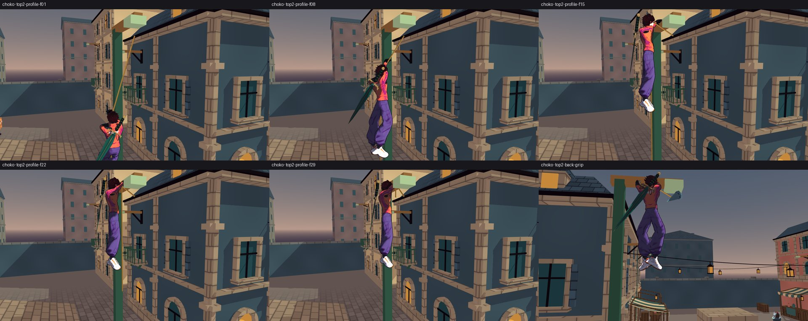
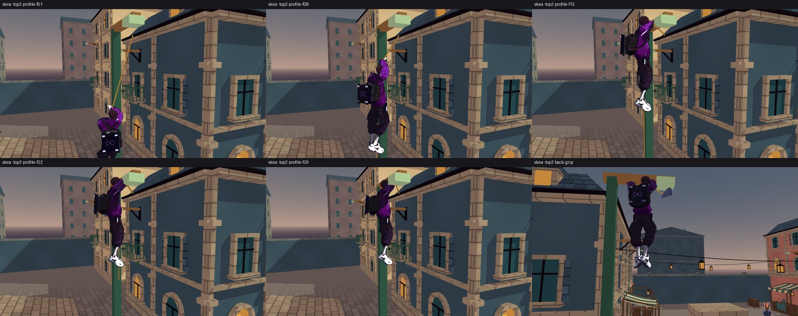
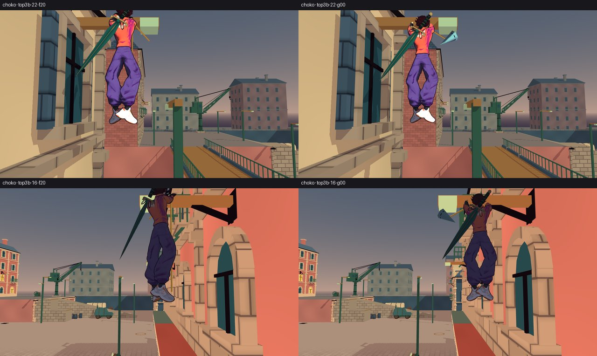
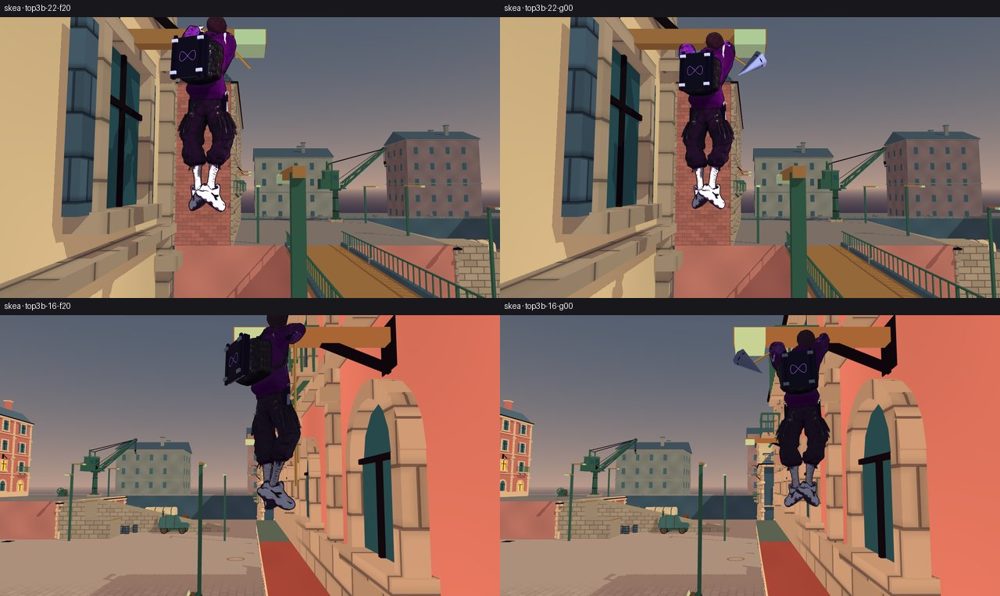
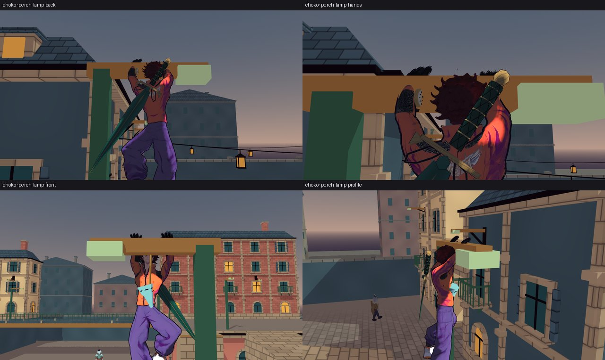
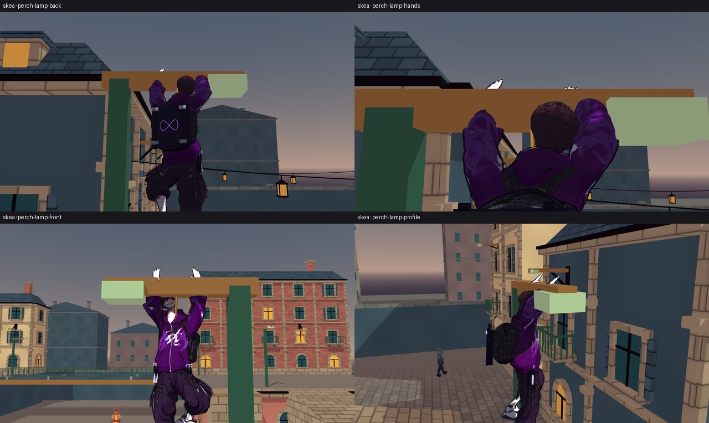
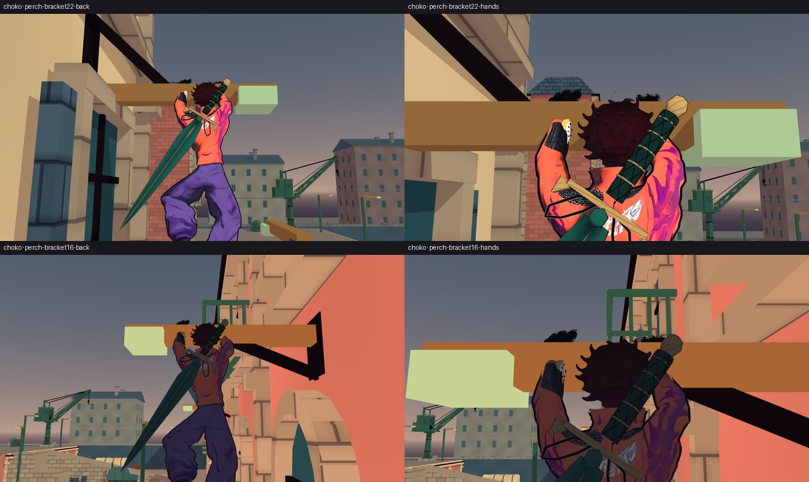
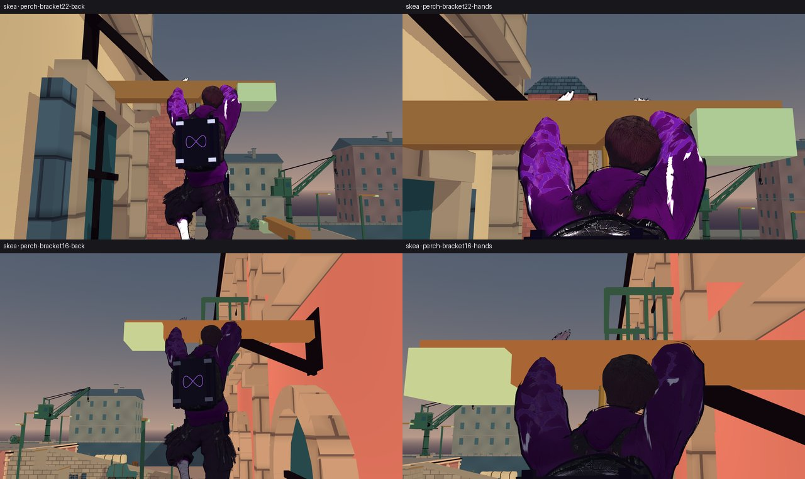
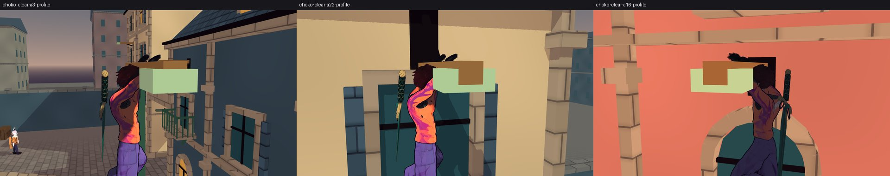
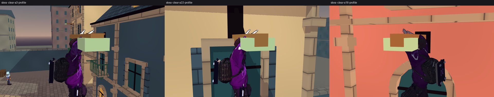
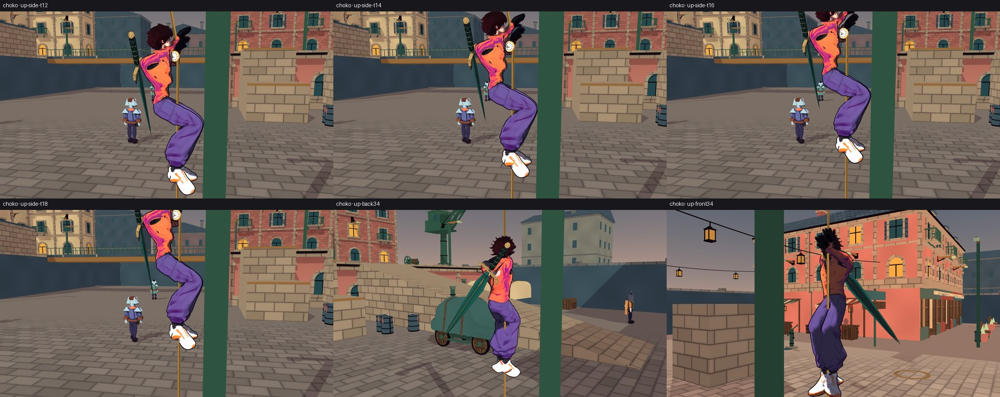
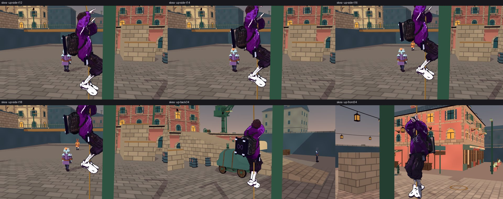
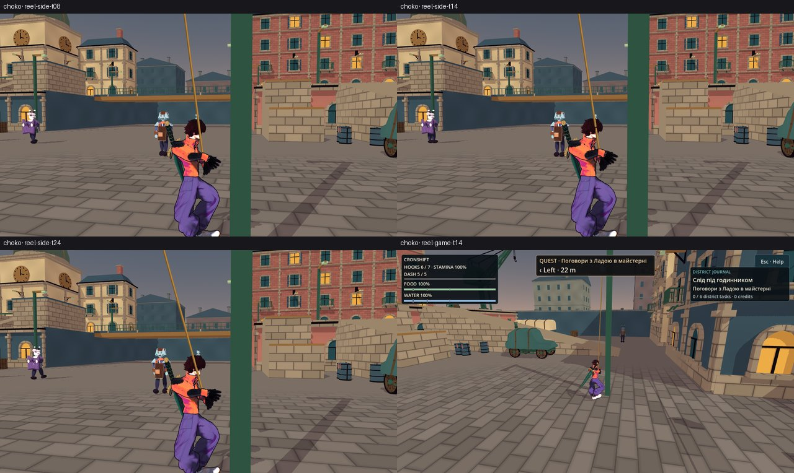
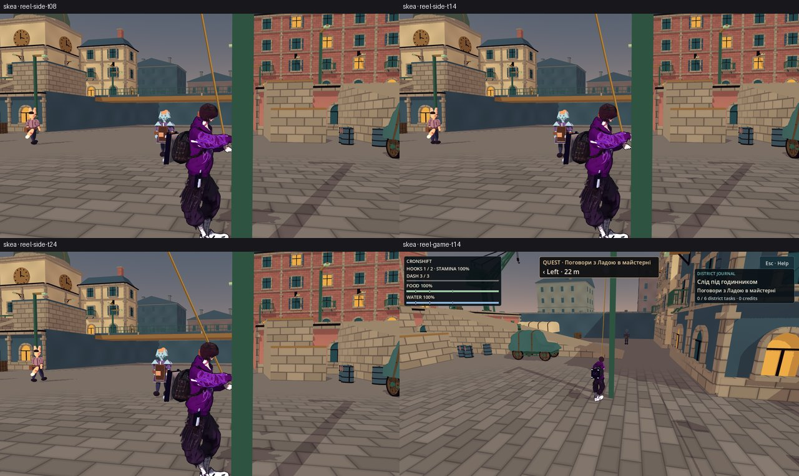
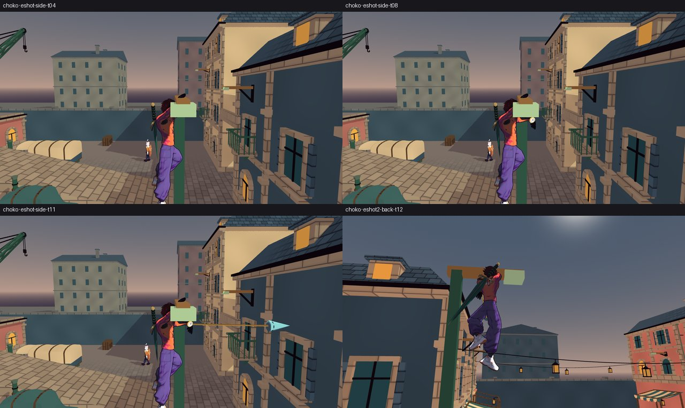
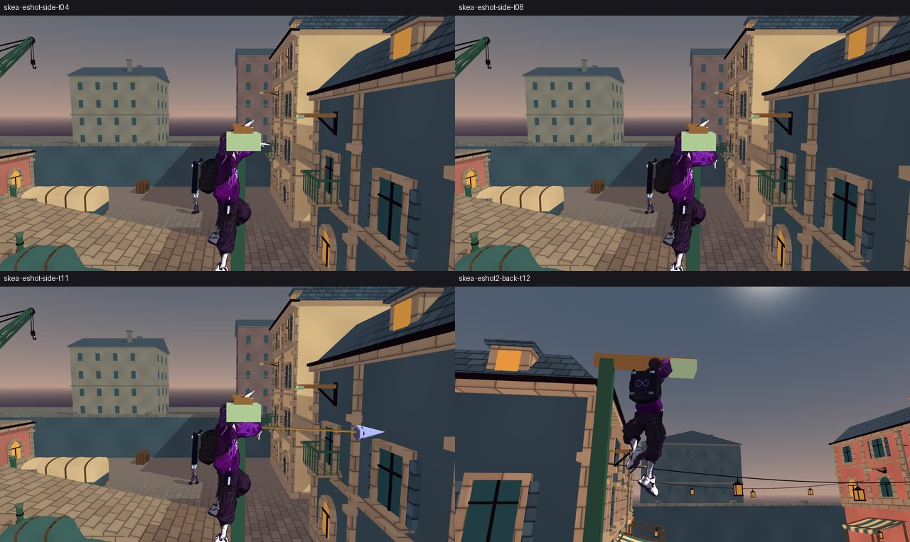
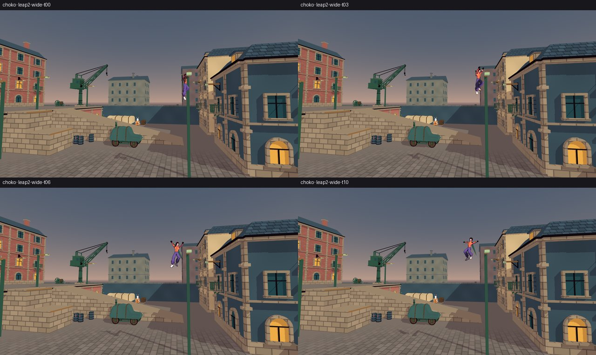
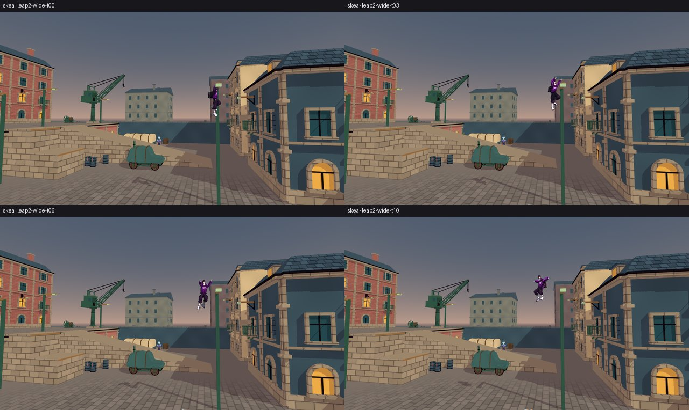

## 13. Дуель біт у біт

`М/duel_run.sh` = скрипт T2-И (`t2i/bin/duel_run.sh`): smoke, зонд T3 `duel_rope_probe.gd` × (Choko, Skea) × (SOLO,
SHARED), дуельні кейси батареї. База — `М/base-tree` (знімок до першої правки); «після» — `М/after-tree`: `game` мого дерева
(фінальний, `diff -rq --exclude=.godot t2m-tree/game М/after-tree/game` → порожньо) + `tools` і `Makefile` бази (ті самі
фікстури). Зі списку T2-И прибрав `traversal` і `weighted-swing`: у них є міські рядки, які я свідомо змінив (поза Choko
1,28, швидкість (3; 0; 1)), тож база-фікстура на новому продукті там має розійтися не через дуель. Решта — 38 кейсів:
`authored-combat`, `authored-evasion`, `authored-hook`, `camera`, `combat-{control,identity,intent,presentation}`,
`comfort-input`, `dodge-stamina`, `foot`, `free-movement` + 3 негативи, `gait`, `ground-contact`, `harpoon`, `harpoon-aim`,
`idle`, `impact`, `limb-combat`, `limb-input`, `living-body`, `locomotion-states`, `match-lifecycle` + 3 негативи, `motion`,
`physics-motion`, `rope-contact`, `rope-recovery`, `rope-visual`, `sword-presentation`, `sword-state`, `ultimate-wave`,
`whole-body-motion`.

| що | вихід (`М/duel/base`, `М/duel/after2`) |
|---|---|
| усі прогони | `rc=0` (`rc.txt` обох) |
| `smoke.log`, `duel_{choko,skea}_{solo,shared}.log` | `cmp` → однакові, 5 / 5 |
| 38 логів батареї | `PLAYABLE CHECK: 38 scenarios, 0 failures` обидва; `cmp` після заміни шляху дерева (`sed`) → 38 / 38 однакові |

Чому дуель не зачеплено (за кодом): усе нове стоїть за `climb_enabled` (лише `CityFighter`) — `perch_presentation()`,
`perch_throw_side()`, `reeling_in`, `_return_elapsed`, міська рука (`city_arm`), каденція, хід кистей, полюс ліктя; у
`HeroBodyMotion` вертикаль і стегна — лише з `follow` (міський трос), голова — лише з `perch_presentation()`, `_remember` на
звисі — лише у фазі `PERCH`; сигнатура `TraversalBlend` для дуелі порожня.

## 14. Батарея, `make check`, `make gates`, скан логів

**Підмножина** (вимога задачі: тросові, паркурні, дуельні й нові кейси) — регекс T2-И (`М/battery/only.txt` =
`t2i/bin/only.txt`: `rope-.*`, `weighted-swing.*`, `traversal.*`, `parkour-.*`, `combat-.*`, `match-lifecycle.*` та ін.),
`run_subset.py` з тілом раннера дослівно, `SHARD=i/3`, фінальний код (запуск після § 11): `PLAYABLE CHECK: 87 / 87 / 86
scenarios, 0 failures` — **260 / 0**.

**Уся батарея** (клас-кандидат 19 T4: підмножина вже раз пропустила червоний позитив) — `ONLY='.*'`, `SHARD=i/3`:
`PLAYABLE CHECK: 158 / 158 / 157 scenarios, 0 / 1 / 0 failures` — **473 / 1**. Єдиний FAIL — `blood-content`
(`BLOOD_CONTENT_COMPLETE checks=74 failures=3`: кільце фокусу COMFORT із рядком `RopeClimb`) — це RED-1 аудиту T4, його
виправляє T2-Л в іншому дереві; я його не чіпав. Кейсів 473 = 458 бази + 15 моїх негативів (`python3 -I t2i/bin/list_cases.py
tools/gates/playable_check.sh` → 473; у `М/base-tree` → 458). Правило раннера T2-К (`PLAYABLE FAMILIES … canary refused`)
нових негативів не відмовило: у кожного `red=<родина>`.

**Скан логів** (`М/full/playable/*.log`, розбір рядків `PLAYABLE … PASS rc=…` шардів): 136 позитивів з rc 0 — `SCRIPT ERROR`
0, `ERROR:` 0, `warning` (без регістру) 0, `leaked` 0, `still in use` 0. 336 негативів — `ERROR:` лише навмисні (раннер
звіряє префікси), `SCRIPT ERROR` 0, витоків 0; `warning` у 4: `city-substances-negative-{jump,water,vault}` — `WARNING: Jolt
Physics job system exceeded the maximum number of jobs` (клас 15, під навантаженням 3 шардів + зйомки; у позитивах 0),
`city-tidy-negative-refuse_warning` — слово в імені мутації (`form=refuse_warning`).

**Фінальні перевірки** (після останньої правки коду, на тому самому дереві, коли інших процесів Godot на ньому не було —
`pgrep -af Godot_v4.7` → 0):
- `GODOT_BIN=… make check` → rc 0: `перевірено: 144 · не парсяться: 0 · не виміряно: 0`, `[smoke] ALL OK (165 checks) in
  19847 frames`, `SMOKE ЗЕЛЕНИЙ` (`М/make_check_final.log`);
- `GODOT_BIN=… make gates` → rc 0, `БАТАРЕЯ ЗЕЛЕНА`: wikilinks 556 сторінок / 9337 лінків / 0 зламаних, реєстр 187 / 187,
  ролі 8 / 0, GDS 144 / 0 (`М/make_gates_final.log`).

## 15. Відкрите

Для T6 (повторне приймання, кадри § 12):
1. Числа T6 лишаються PLACEHOLDER: 8°/тик вертикалі, голова 15°, каденція 2,0 Гц, хід 0,02…0,30, полюс ліктя, повернення гака
   0,25 с / дуга 0,35 м, `PERCH_REACH` 0,97, `ARM_TURN_CAP` 14°.
2. Перші 2–3 тики «до опори» на гойданні мають нахил троса (до 41,7° у гарді на 50 лазіннях); ≤ 15° — з 6-го тику (§ 4).
   На станціях T6 (3, 22, 16) ≤ 15° з першого тику.
3. Нахил тіла до другої руки на пострілі зі звису (≤ 10°, «може») не робив.
4. Хвіст, що лежав на бруківці, перші ~8 тиків «до опори» лишається на ній (видима частина росте, бо рука йде вгору).

Для T5 / T8:
5. Стрибок зі звису: стік **до** бруса тепер дає стрибок від нього під кутом (§ 10); `PERCH_LEAP_ACROSS` 0,5 — правило T5 / T8.
6. +1 на HUD відстає від запасу на 0,25 с (запас — миттєво, § 8) — питання T8.
7. Окреме `perch_feet_below` на героя (Choko 1,28) зроблено в коді (`PERCH_FEET_RAISE`), не в `.tres` T5.

Для T1 / T2-Л:
8. `blood-content` червоний і в цьому дереві — RED-1 T4, у T2-Л.
9. `state.md` не правлю (ризик конфлікту злиття з паралельними деревами) — рядок пропоную T1 у звіті. Журнал зустрічі хвилі —
   T1.

## Де зупинився

Готово до приймання T1 / T6, не закомічено (ТЗ: не комітити, не пушити). `git status --short` у `t2m-tree`, фінальний
(`М/git_status_final.txt`, 64 рядки; 18 моїх кадрів `?? docs/assets/screenshots/2026-10-15-rope-perch-*.jpg` згорнуто в один
рядок):

```
MM docs/Art/Screenshots.md
A  docs/Fix/2026-10-15-Negative-Families-Runner-Fix.md
A  docs/Fix/2026-10-15-Rope-Climb-City-Fix.md
A  docs/assets/screenshots/2026-10-15-rope-climb-*.jpg (12)
M  game/scripts/core/HarpoonAim.gd
M  game/scripts/core/InputRouter.gd
M  game/scripts/core/SmokeTest.gd
MM game/scripts/fighter/AuthoredHookMotion.gd
 M game/scripts/fighter/HeroBodyMotion.gd
 M game/scripts/fighter/TraversalBlend.gd
MM game/scripts/grapple/GrappleHook.gd
M  game/scripts/grapple/MatchRopes.gd
 M game/scripts/grapple/RopeVisual.gd
M  game/scripts/npc/CityNpcDirector.gd
M  game/scripts/ui/ComfortPanel.gd
M  game/scripts/world/CityDistrict.gd
MM game/scripts/world/CityFighter.gd
MM game/scripts/world/CityHud.gd
M  game/scripts/world/CityParkourMotor.gd
M  game/scripts/world/CityWorld.gd
MM tools/gates/playable_check.sh
A  tools/gates/playable_unfamilied_negatives.txt
M  tools/grapple/contact_check.gd
MM tools/grapple/rope_choice_check.gd
AM tools/grapple/rope_climb_check.gd
AM tools/grapple/rope_climb_fighter.gd
AM tools/grapple/rope_climb_mutants.gd
M  tools/grapple/rope_pull_check.gd
MM tools/grapple/traversal_check.gd
MM tools/grapple/weighted_swing_check.gd
M  tools/world/city_bounds_check.gd
M  tools/world/city_perch_check.gd
M  tools/world/city_tidy_check.gd
?? docs/Audit/2026-10-15-T6-Rope-Climb-Acceptance.md
?? docs/Fix/2026-10-15-Rope-Perch-Entry-Fix.md
?? docs/assets/screenshots/2026-10-15-rope-perch-*.jpg (18)
```

Друга літера (`M` у другому стовпці, `??`) — мої зміни поверх індексу T2-К / T2-И; індекс не чіпав.

## Related
- [[2026-10-15-T6-Rope-Climb-Acceptance]] · [[2026-10-15-Rope-Climb-City-Fix]] · [[2026-10-15-Rope-Climb-Perch-Release]]
- [[ADR-028-Rope-Climb-Perch-And-Retrieval]] · [[2026-10-15-Rope-Climb-Animation]] · [[2026-10-15-Rope-Climb-Numbers]]
- [[04-Grapple-System]] · [[recurring_class_register]] · [[state]] · [[constitution]]
