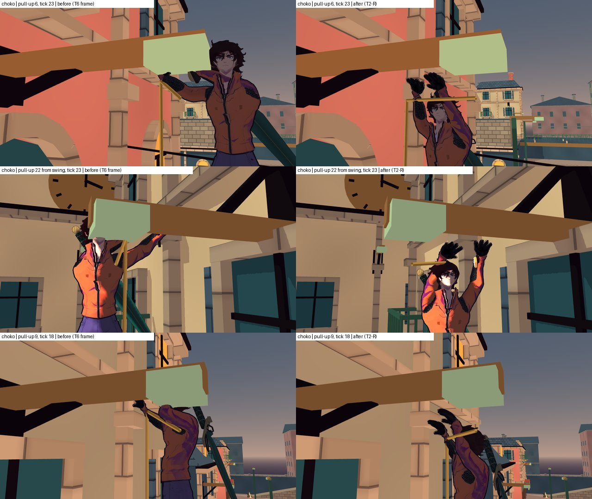
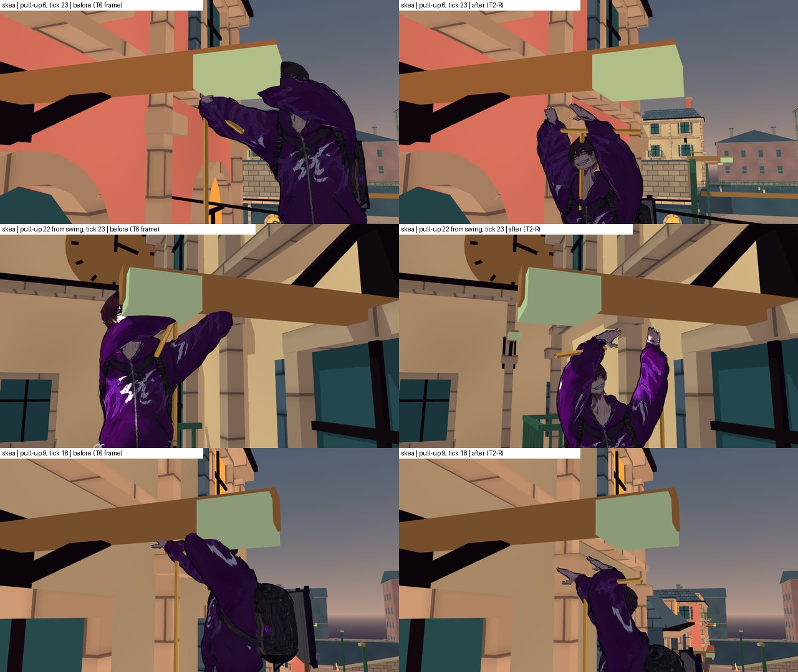
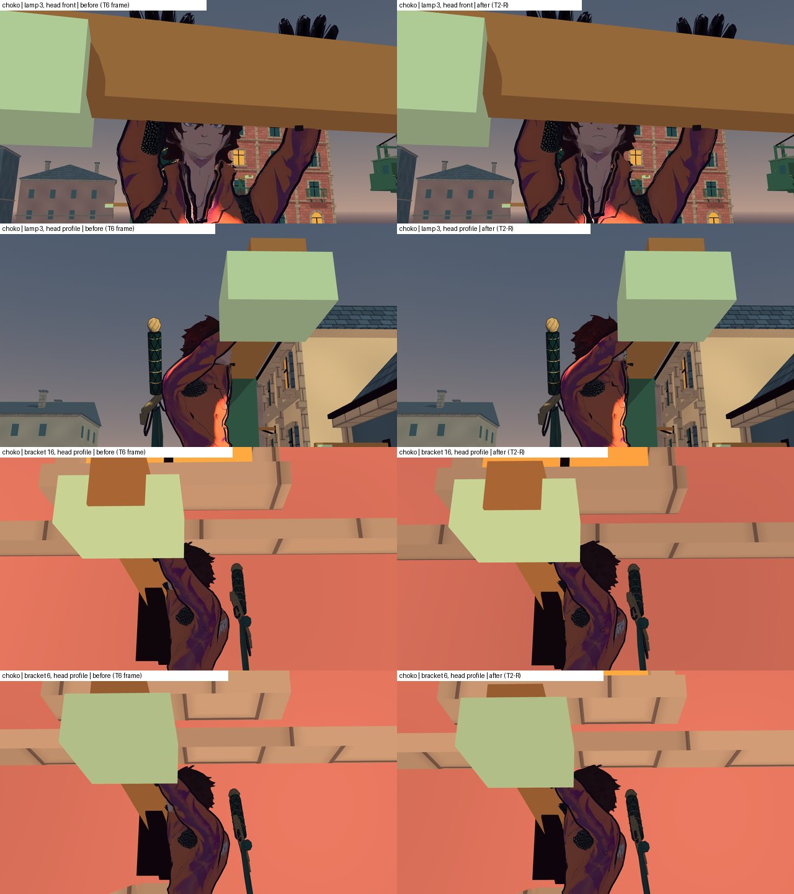
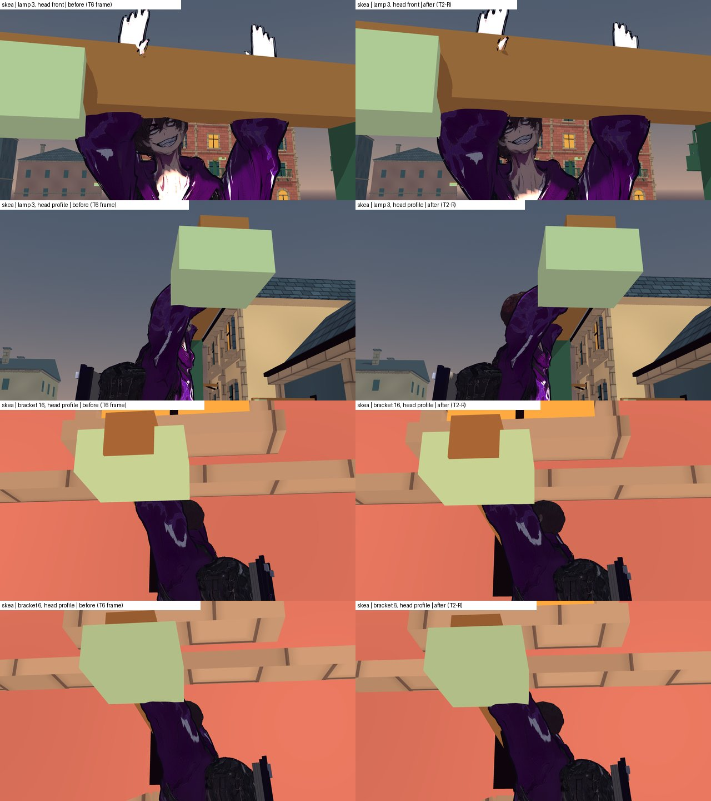
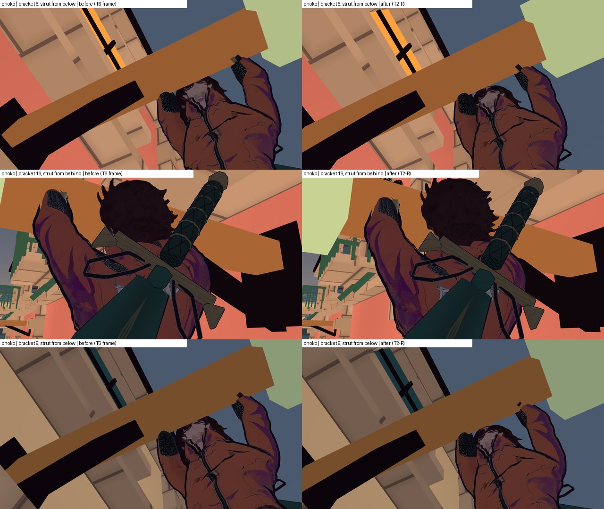
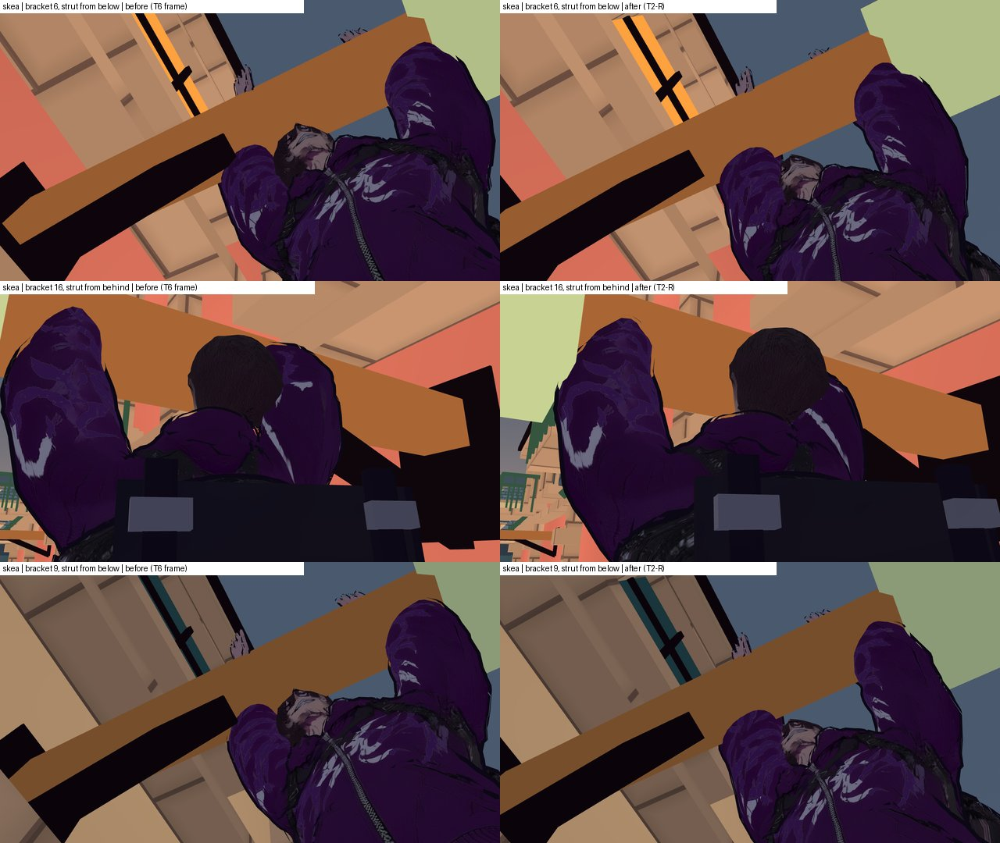

# Трос у місті: поверхня моделі повз брус, ковпак і підкіс — журнал виконання

**Дата:** 2026-10-15 · **Роль:** T2 Гефест (T2-Р) · **Статус:** зроблено в дереві без коміту (§ «Де зупинився»):
`make check` і `make gates` — rc 0; підмножина батареї 270 / 0; дуель біт у біт. Мерж — Santos.
**Задача:** YELLOW повторного приймання T6 — розділ «Повторне приймання після T2-М (2026-10-15)» сторінки
[[2026-10-15-T6-Rope-Climb-Acceptance]]. Попередня подача — [[2026-10-15-Rope-Perch-Entry-Fix]] (T2-М). 0 кредитів.

Дерево — scratchpad `t2r-tree`: detached `93ba633` + індексоване зведення хвилі 15а (T2-К … T2-П). Не комічу, індекс не
чіпаю. Сирі логи — scratchpad `t2r/` (далі `Р/`).

## 0. Звірка

**Дерево.** `git status --short | wc -l` → 76 рядків до першої правки (`Р/git_status_start.txt`). `game` дорівнює
фінальному коду T2-М (`t2m/after-tree/game`) плюс правки T2-П у `ComfortPanel`, `CityEventDirector`, `CityFighter`
(`_take_rope_presses`), `CityWorld` (`events_script`) — `diff -rq --exclude=.godot`. Поза й шлях підтягування від них не
залежать. Кеш імпорту скопійовано з `t15-tree/game/.godot`. Godot `4.7.stable.official.5b4e0cb0f` (`$GODOT_BIN --version`).
Знімок «до» — `Р/base-tree/` (`cp -a game tools Makefile` до першої правки).

**Зонд T6 на моєму дереві.** `Р/probe/accept.gd` = `t6s/probe/accept.gd` + мої частини (§ 1). Частини T6 `mesh,meshentry,
headmesh`, обидва герої (`Р/b0-*`): `rc=0 errors=0`, і числа T6 відтворились дослівно — Choko `Arm3 head:194/0.014`,
`Arm16 head:216/0.016`, `Arm6 head:250/0.019`; Skea `Arm3 head:85/0.037`, `Arm6 head:95/0.043`, підкіс Skea `Strut16
forearm:2/0.002`, `Strut6 forearm:8/0.012`, `Strut9 forearm:4/0.002`; N1 — Choko `a6` k 23–29 і `a9` k 14–24 у
`Ceramic` до 0,075 м, Skea `a22-w0` k 22–29 до 0,075 м.

| твердження ТЗ T6 | де | що в коді дерева |
|---|---|---|
| шлях підтягування «спершу вгору, потім убік» | `GrappleHook._climb_apex` / `_drive_climb_top` | ✓ дві ноги по 15 тиків: `(from.x, to.y, from.z)`, потім до `perch_pose.origin`; обидві перевіряються `_body_path_clear` |
| брус, ковпак, підкіс без колайдерів | `CityDistrict._anchor_support` | ✓ `AnchorArm` (довжина + 0,33 × 0,15 × 0,16, центр `point.y + 0,3`), `AnchorCeramic` (0,35 × 0,15 × 0,3, центр `point + 0,25`, без повороту), `AnchorStrut` (0,08 × 0,08, від `mount − drop` до середини бруса на `arm_y − 0,05`); капсула їх не бачить, тому голова проходить крізь |
| дальня кисть 0,62 «як на тягах» | `GrappleHook.perch_pose_for` | 0,62 лише при `tie_rod` (22–24); на підкосах 6, 7, 9, 16, 17 — 0,66, а верх підкосу на 0,725 від точки (бруси 1,45 м) |
| `perch_head`, `leap_clear` міряють центри кісток | `rope_climb_check._pose_sample` (`head_end` → `AnchorArm`), `_leap_clear` (кістки без кистей і передпліч) | ✓ — поверхні не бачать (той самий промах, що визнала T6) |

**Звідки різниця героїв.** Частина `geo` (координати в системі бруса: x уздовж, y угору, z поперек; півтовщина бруса
0,08) на звисі: при однаковому `origin z −0,140` голова Choko на `z −0,219`, стегна на `−0,241`; голова Skea — на
`−0,098`, стегна на `−0,130`. Намальоване тіло Choko стоїть на 0,10 м далі від бруса, ніж капсула (це дає клип
`Climb_Idle` разом зі стегнами з пози стрибка, у ригу); у Skea — майже на капсулі. Тому в Skea волосся заходить у брус
на 0,057–0,063 м поперек, у Choko — на 0,014–0,019, і тому кисті Choko не дотягуються (`gL/gR` 0,042–0,081). Риг не
чіпаю: дуель біт у біт, а позиція звису на героя вже є прецедентом (`PERCH_FEET_RAISE`).

**Перебір** (частина `tune`: `perch_body_back` і `perch_head_back` ставляться перед лазінням; якорі 3, 16, 6, 9, 22;
`Р/tune/t-<герой>-<back>-<голова>`; `headband_z` — найменший поперечний зазор вершин голови, що лежать у смузі бруса за x
і y; мінус — усередині):

| back / голова | Choko `headband_z` | Choko кисті `gL/gR`, м | Skea `headband_z` | Skea `gL/gR`, м |
|---|---|---|---|---|
| 0,14 / 15° (зараз) | −0,019…−0,014 | 0,042…0,081 | −0,063…−0,057 | 0,000…0,007 |
| 0,14 / 25° | +0,018…+0,022 | так само | −0,034…−0,027 | так само |
| 0,17 / 15° | +0,011…+0,016 | 0,060…0,102 | −0,033…−0,027 | 0,000…0,020 |
| 0,17 / 25° | +0,048…+0,052 | 0,060…0,102 | −0,004…+0,003 | 0,000…0,020 |
| 0,20 / 15° (варіант T6) | +0,041…+0,046 | 0,080…0,125 | −0,003…+0,003 | 0,016…0,035 |
| 0,20 / 25° | +0,078…+0,082 | 0,080…0,125 | +0,026…+0,033 | 0,016…0,035 |
| 0,23 / 15° | +0,071…+0,076 | 0,101…0,148 | +0,027…+0,033 | 0,037…0,051 |

Кожні +0,03 м назад дають +0,03 м зазору; +10° голови — +0,030…0,036 м і досягу не коштують. Варіант T6 (0,20 / 15°)
у Skea лишає 2–5 вершин на 0,001–0,003 м (якорі 6, 22), а Choko відводить кисті від бруса ще на 4 см.

## 1. Зонд

`Р/probe/accept.gd` — зонд T6 і мої частини. Скінінг — її `_skin_setup` (CPU, усі вершини, `SKIN meshes=1`, Choko 28 520,
Skea 33 108). Групи за домінантною кісткою: голова — `Head`, `head_end`, `headfront`, `neck`; тулуб — `Hips`, `Spine*`,
`*Shoulder`; плече — `LeftArm` / `RightArm`; передпліччя; кисть; ноги. «body» T6 = тулуб + плече + ноги; на підтягуванні
в ковпаку в неї був саме `RightArm` (плече), тулуба й ніг там 0 (моя `pull` на базі, `Р/g0-*`).
- `geo` — кістки в системі бруса на звисі; `pull` — кожен тик «до опори» (k 0–29) і 13 тиків звису, групи проти
  `Arm` / `Ceramic` / `Strut` / `Post`, старти — станція (`w-1`) і гойдання (`w0`), якорі 3, 6, 7, 9, 16, 17, 22;
- `tune` / `tune40` — звис із `--set=body_back:…,head_back:…,far:…`, один тик або всі 40.
- Зведення `pull` — `Р/pullagg.py`.

## 2. Голова на звисі (п. 1 задачі)

**Аудит і погляди.** Мірило T6 — 0 вершин голови в `AnchorArm` на кожному тику звису; мірила гри поряд — кисті на брусі
(похибка, яку T6 прийняла: Choko 0,042–0,079) і числа T6 (голова 10–15°, плечі 0,18–0,20).

| варіант | голова: найменший зазор | кисті Choko / Skea, м | ціна |
|---|---|---|---|
| В1 — T6: 0,20 / 15° обом | Choko +0,041, Skea −0,003 (не проходить) | 0,080–0,125 / 0,016–0,035 | Choko гірше на 4 см |
| В2 — 15° обом, плечі на героя: Choko 0,17, Skea 0,21 | +0,011 / +0,006 | 0,055–0,100 / 0,021–0,037 | Choko гірше на 2 см, у Skea зазор 6 мм |
| **В3 — 25° обом, плечі на героя: Choko 0,14, Skea 0,19** | **+0,017 / +0,015** | **0,037–0,080 / 0,008–0,027** | голова за межею 10–15° T6 |
| В4 — плечі 0,17 обом, голова на героя: Choko 15°, Skea 30° | +0,011 / +0,009 | 0,055–0,100 / 0–0,017 | Choko гірше на 2 см; два кути |
| В5 — 0,17 і 25° обом | +0,048 / −0,004 (не проходить) | 0,055–0,100 / 0–0,020 | — |

(`Р/tune40/`, усі 40 тиків звису, якорі 3, 16, 6, 7, 9, 17, 22, дальня кисть 0,62.)

Погляди: **T6** — нуль вершин і силует (кут голови — її число); **T5** — позиція звису не його число, 30 тиків і 3,6 м/с
не зачеплені; **гравець на M3** — кисть, що висить у повітрі на 8–12 см, читається гірше, ніж голова, задерта на 10°
більше; **T4** — число на героя є додатковою поверхнею, але прецедент уже є (`PERCH_FEET_RAISE`); **T1** — менше гілок
краще; В3 — одна гілка (`skea`) і одне спільне число голови. Кут: від `headfront` до середини хвату (`geo` на фінальній
позі, `Р/fin-*`, якір 16) — Choko 58°, Skea 63° над горизонтом погляду, тож 25° ще «дивиться вгору на руки», а не повз.

**Вибір — В3.** Він єдиний не погіршує кисті Choko і дає найбільший зазор обом. Кут 25° — PLACEHOLDER, на суд T6 за
кадрами. **На фінальному коді** (з кистю 0,56 на підкосах, § 4; `tune40`, 40 тиків звису, якорі 3, 16, 6, 7, 9, 17, 22, 19;
`Р/fin-*`): голова — 0 вершин, найменший поперечний зазор Choko 0,017, Skea 0,015 м; кисті Choko 0,033–0,080 м (база
0,040–0,081), Skea 0,008–0,026 (база 0,000–0,008).
- `HeroBodyMotion.perch_head_back` 15° → **25°**;
- `GrappleHook.PERCH_BODY_BACK_MORE = {"skea": 0.05}`, `perch_back()` (`perch_body_back` 0,14 лишається базою): Skea
  висить на **0,19**, Choko на 0,14.

## 3. Підтягування повз ковпак (N1, п. 2 задачі)

**Розрахунок шляху капсули** (числа — `CityDistrict._anchor_support`, `GrappleHook`, `geo`):
- ковпак: низ на `point + 0,175`, у плані ±0,175 × ±0,15 навколо точки; брус: низ на `point + 0,225`, ±0,08 поперек;
- стоп на звисі — `point − 1,32` (Skea) / `− 1,28` (Choko); маківка там — `point + 0,29…0,31` (Skea `head_end` +0,077 над
  `Head` +0,093; верх волосся Choko — `Head + 0,216`, `Head` на +0,090);
- верх троса: кисть (`origin + 1,25`) за 2,0 м від точки, тож `origin.y = point.y − 1,25 − 2,0·cos θ`; при прямовисному
  тросі — `point − 3,25`, і перша нога підіймає капсулу на 1,93 м.

15а: нога 1 (тики 1–15) — угору до висоти звису під тросом, тобто голова приходить у ковпак (маківка +0,29 при низі
ковпака +0,175); нога 2 (16–30) — убік, і голова на висоті бруса проходить його кінець.

Тепер три ноги (`GrappleHook._climb_path`, `_climb_point`):
1. угору під тросом до `to.y − PULL_UP_DUCK` (**0,30**): маківка ≤ `point + 0,01`, на 0,165 нижче ковпака;
2. убік до місця звису на тій самій висоті — голова проходить під ковпаком і під кінцем бруса;
3. останні 0,30 м угору поруч із брусом — уже з поперечним зазором п. 2.

Час — ті самі 30 тиків (T5 Л3): частки 0,5 / 0,3 / 0,2 (15 / 9 / 6 тиків); 3,6 м/с лазіння не зачеплене. Швидкість ноги 1
— ≈ 1,63 м за 15 тиків (6,5 м/с; у 15а 1,93 м, 7,7 м/с), ноги 2 — ≈ 0,5 м за 9 тиків, ноги 3 — 0,3 м за 6. Кожна нога
перевіряється `_body_path_clear` до старту і щотику, як раніше. Якщо шлях «під ковпаком» перекритий, а шлях 15а вільний —
береться шлях 15а (гравець не застрягає на верху троса через презентацію); якщо обидва — `climb_blocked`, як і було. Якщо
верх троса вже вищий за `to.y − 0,30` (трос майже горизонтальний: `1,25 + 2·cos θ < 1,28…1,32 + 0,30`, тобто θ > 79°),
перша нога нульова. Перемикач мутанта — `pull_up_duck` (0 → шлях 15а). У гарді по 25 якорях (§ 5) жодне підтягування
не перекрите (`blocked=0` у частинах 1–5), і запасний шлях 15а не брався ніде: рядок `ROPE_CLIMB_MESH … way=` (кількість
кутів шляху) у частинах 1–5 — `way=4` у 50 підтягуваннях із 50 (`Р/battery2/playable/rope-climb-[1-5].log`).

Зонд `pull` з першою глибиною 0,20 (`Р/a1-*`): на всіх 11 підтягуваннях обох героїв (якорі 3, 6, 7, 9, 16, 17, 22; станція
й `w0`) голова, тулуб і плече — 0 вершин у `Ceramic` і `Arm` на кожному тику k 0–29. На базі (`Р/g0-*`) було: Choko `a6/a7`
k 23–29 до 0,075 м, `a9` k 14–24 до 0,074, `a22-w0` k 21–29; Skea — те саме плюс плече до 0,059 м.

**Чому 0,30, а не 0,20.** Гард по всіх 25 якорях (§ 5) знайшов кронштейн 19 (стіна годинникової вежі, підкіс знизу з
`BRACE_DROP` 0,75 — крутий, 46°). Там верх троса систематично на 0,61 м у бік стіни, під внутрішньою половиною бруса
(`PULL … a19-w0 k=00 rel=(-0.608, -3.155, 0.000)`). Тож перша нога піднімає героя поруч із верхом підкосу: Choko — головою
(`w15`: 117 вершин / 0,022 м), Skea — рукавом (`w10`–`w20`: до 84 / 0,022) (`Р/a19-*`). Глибина 0,30 / 0,40 / 0,50
(`Р/duck-*`): підтягування на 19 чисте вже з 0,30 в обох героїв; на 6, 9, 22, 3 N1 так само 0.

## 4. Рукав і підкіс (п. 3 задачі)

Підкіс знизу кріпиться до середини бруса: на 0,725 м від точки (бруси 1,45 м), на `arm_y − 0,05`; дальня кисть на 0,66 —
за 0,065 м від його верху, і рукав під зап'ястям торкається кута коробки. Зонд `pull`, Skea, якорі 6, 7 (станція, `w0`),
16, 9, 17 з дальньою кистю (`Р/far-*`):

| дальня кисть | рукав у `Strut` |
|---|---|
| 0,66 (база, `Р/g0-skea`) | 6 / 7: до 11 вершин на 0,018 м; 9, 16, 17: до 9 на 0,007 |
| 0,62 (варіант T6) | 6 / 7: k 28–41 до 5 вершин на 0,007 м |
| 0,60 | 6 / 7: 1 вершина на 0,000 (на грані), один тик |
| 0,58 | 6, 7, 9, 16, 17: 0; але крутий підкіс 19: 1–2 вершини на ≤ 0,004 м на перших 10 тиках звису (`Р/sf-0.58`) |
| **0,56** | **0 на всіх 12 кронштейнах із підкосом** (4, 5, 6, 8, 10, 16, 19, 20, 21 у зонді, решта — гардом § 5) |

`GrappleHook.perch_strut_far` **0,56** — для кронштейнів із підкосом знизу; тяги згори (22–24) лишаються на
`perch_tie_rod_far` 0,62 (там T6 дала GREEN, і наявний негатив `tie_rod` значить те саме). Хват звужується з 0,40 до
0,30 м (близько до ширини плечей), середина хвату зсувається на 0,05 м до точки. Гард `BRACE_CLEARANCE` (зап'ястя
≥ 0,10 м від осі підкосу) від цього лише віддаляється: `brace` у рядках `ROPE_CLIMB` (`Р/g3/`) — 0,188 на всіх
підкосах (0,280 на 8), 0,105 на тягах 22–24 (без змін). Ціна: ближнє плече Skea в ковпаку на звисі
(5, 8, 20 — це N4 T6, «спостереження», у мірилах ТЗ його нема) з 0,022 до 0,024 м (`Р/sf-*`).

## 5. Гард на поверхні (п. 5 задачі)

**Помічник** `tools/grapple/rope_mesh_clearance.gd`: CPU-скінінг усіх вершин видимих скінованих мешів героя за формулою
зонда T6 (`skeleton global × bone global pose × bind pose × vertex`, сума за вагами); вершина всередині — строго на всіх
трьох осях; групи — як у § 1. **Відсікання без вибірки:** вершини з однаковим набором кісток — один кошик; кожна вершина
кошика лежить в опуклій оболонці куль своїх кісток (центр — початок кістки, радіус — |вершина в bind-просторі| × верхня
межа розтягу базису, корінь із межі Гершгоріна на BᵀB; скелет має масштаб 0,01), тож у кулі навколо них; кошик, чия куля
не зачіпає жодної коробки, не скінується. Вершини з сумою ваг ≠ 1 не відсікаються ніколи.
- **Звірка з повним скінінгом T6** (частина `cmp`, дефектні налаштування, щоб було що рахувати: `body_back 0,10`, голова
  0°, шлях 15а, кисть 0,66; якорі 6, 22-w0, 3, 16; `Р/cmp-*`): **`mismatches=0`** на 172 тиках × 3 коробки × 6 груп у
  кожного героя; 91,2 / 108,0 мс на тик повного скінінгу проти 15,1 / 17,4 мс помічника.

**Родини в `rope_climb_check.gd`** (лише додані; `perch_head` і `leap_clear` на центрах кісток лишились):

| родина | предмет | тики |
|---|---|---|
| `pull_ceramic` | для всіх 25 якорів і обох героїв: 0 вершин голови, тулуба й плеча в `AnchorCeramic<n>` і `AnchorArm<n>` | кожен тик «до опори» (29) |
| `perch_head_mesh` | 0 вершин голови в `AnchorArm<n>` і `AnchorCeramic<n>` | 41 тик звису (0…40) |
| `sleeve_strut` | на кронштейні: 0 вершин будь-якої групи в `AnchorStrut<n>` (підкіс або тяга) | «до опори» і звис, 70 тиків |
| `leap_mesh` | якорі 3, 22, 16 × 5 напрямів стіка: 0 вершин голови, тулуба, плеча й ніг у брусі й ковпаку; пришпилені стрибки (§ 6) — не гірше за пришпилення і мусять відбуватись | 14 тиків |

Перевіряється, що тиків стільки, скільки обіцяно (`pull_ticks ≥ 29`, `head_ticks ≥ 40`, `strut_ticks ≥ 69`), інакше та
сама родина червона. **Вартість** (рядок `ROPE_CLIMB surface`, `Р/g3/`): частини 1–5 — 700 тиків поверхні, 4,2–7,2 с
(6,0–10,3 мс на тик); `rules` — 210 тиків, 2,1 / 3,1 с; кейс цілком — 17–21 с (`rules` 27–28 с) проти 13 с до гарда
(`Р/time-base-1of5.log`) і ліміту батареї 180 с. Вибірку тиків не обмежував: не було потреби.

**Гард на грі «до»** (`Р/mixed-tree` = `Р/base-tree/game` + нові `tools`, `Р/g0m/`): частини 1–5 — `red=perch_head_mesh,
pull_ceramic,sleeve_strut` (`perch_head_mesh` — 50 пар герой×якір із 50, `pull_ceramic` — 38, `sleeve_strut` — 12, серед
них Choko a19 — голова в підкосі на підтягуванні, 365 вершин / 0,022 м), `rules` — `leap_mesh` на 30 стрибках із 30.
Тобто гард бачить і дефекти T6, і ті, яких вона не міряла.

**Негативи** (предмет кожної родини — рядок таблиці вище; три форми від предмета, не від прикладу; `Р/mut/`):

| мутація | що ламає | вихід |
|---|---|---|
| `body_near` (Skea на 0,14 T2-М) | розташування тіла | 1/5 Skea: `red=perch_head_mesh,pull_ceramic,sleeve_strut`; 2/5: `perch_head_mesh,pull_ceramic`; `rules`: `leap_mesh` |
| `head` (наявна, голова 0°) | кут голови | 1/5 Skea: `red=perch_head,perch_head_mesh,pull_ceramic` |
| `flag` (наявна, нахил троса на підтягуванні) | нахил тіла | 1/5 Choko: `red=perch_head_mesh,perch_legs,perch_tilt,perch_turn` |
| `pull_first` (`pull_up_duck` 0, шлях 15а) | шлях капсули | 2/5 Choko: `red=pull_ceramic`; 5/5 Choko: `pull_ceramic,sleeve_strut`; 1/5 Skea: `pull_ceramic` |
| `strut_far` (кисть 0,66 на підкосах) | хват | 2/5 Skea: `red=sleeve_strut`; у Choko рукав до підкосу не дістає (`red=none`) |
| `leap_along` (наявна, правило 15а) | напрям стрибка | `rules` Choko: `red=leap,leap_clear,leap_mesh` |
| `tie_rod` (наявна) | — | 3/5 Choko: `red=perch` (на тязі рукав чистий і з 0,66) |
| `perch_lift` (хват на 0,10 вище) | висота | 1/5 Choko: `red=perch` — голову в брус не заводить (зазор поперечний), тож це не форма злому; мутацію прибрав. На `rules` — `leap_mesh,perch_throw` |

Форми: `perch_head_mesh` — розташування (`body_near`), кут голови (`head`), нахил (`flag`); `pull_ceramic` — шлях
(`pull_first`), розташування, кут голови; `sleeve_strut` — хват (`strut_far`), шлях (`pull_first` на 19), розташування;
`leap_mesh` — напрям (`leap_along`), розташування (`body_near`), висота старту (`perch_lift`, лише як вимір).
У батарею — `rope-climb-negative-{body_near,pull_first,strut_far,body_near_leap}`, кожен із `red=<родина>`
(`perch_head_mesh`, `pull_ceramic`, `sleeve_strut`, `leap_mesh`).

Предмет: для всіх 25 якорів, обох героїв і кожного тику «до опори», 41 тику звису та 14 тиків стрибка: скінована поверхня
не заходить у коробки опори, крім пришпилених стрибків § 6 у межах пришпилення.

## 6. Стрибок уздовж бруса — пришпилено, рішення за T1

Новий гард `leap_mesh` бачить те, чого не бачили ні `leap_clear`, ні `leapz` T6 (центри кісток): 9 стрибків із 30
(`Р/g4/`, два прогони біт у біт однакові):

| стрибок | тиків із 14 | найглибше | що |
|---|---|---|---|
| Choko 16, уздовж до вільного кінця | 1 | 0,012 | ноги в ковпаку (тик 7) |
| Skea 3 / 22 / 16, уздовж до вільного кінця | 4 / 4 / 2 | 0,066 / 0,063 / 0,044 | плече в брусі (тик 1–2), тулуб у ковпаку (тик 4) |
| Skea 3 / 22 / 16, уздовж до кріплення | 3 / 2 / 3 | 0,030 / 0,036 / 0,064 | плече в брусі (тики 1–3) |
| Skea 22 / 16, без стіка | 1 / 1 | 0,001 / 0,004 | плече в брусі (тик 1) |

На базі таких стрибків було 30 із 30 (`Р/g0m/rc.log`, `rs.log`). Причина — траєкторія: уздовж бруса горизонтальна швидкість
від нього — лише `PERCH_LEAP_ACROSS` 0,5 від повної, а вгору тіло йде на 7,4 м/с; лікоть Skea на звисі стоїть біля нижнього
заднього ребра бруса, і за 1–3 тики плече входить у брус. Перевірив і відкинув дві презентаційні правки (обидві відкочено,
`AuthoredHookMotion.gd` дорівнює базі, `cmp`):
- кисті на час відпускання лишаються на точках хвату («відштовхнувся») — 41 / 0,038 м проти 41 / 0,035 (`Р/g2/`);
- руки відпускаються за 0,05 с замість 0,14 — 0,066…0,072 м (`Р/g5/`).

Лікувати тут — означає міняти правило стрибка (`PERCH_LEAP_ACROSS`, T5 / T8) або позу ліктя на звисі (T6). Це не моє число,
тож пришпилюю: `rope_climb_check.KNOWN_LEAP_SURFACE` — «герой|якір|стік» → [тики, глибина] на цьому коді. Пришпилений
стрибок, що став гіршим (більше тиків або глибше ніж на `LEAP_PIN_SLACK` 0,003 м) чи зник, — `leap_mesh` червоний.
Решта 21 стрибок — строго 0.

## 7. N2 і N3 (за нагоди)

**N2 — гак повернення.** Летів у `fighter.global_position + WAIST`, тобто на вісь капсули всередину торса, а в Choko —
ще й за 0,10 м перед намальованим тілом. Тепер `GrappleHook._return_point()`: намальована кістка `Hips`
(`SkeletalRig.bone_world`, нова функція поряд із `hand_world`) + `RETURN_FRONT` 0,12 м уперед по пласкому `forward`; без
рига — як було. Гард `retrieve_hook` (остання точка ≤ 0,20 м від `hero + 0,95`) — зелений у частинах 1–5. Частина T6
`ropethrough` (вершини ближче 0,02 м до намальованої лінії, тики звису k 30–44; до — `Р/n23b-*` на `mixed-tree`, після —
`Р/n23-*`):

| | голова до → після | тулуб до → після |
|---|---|---|
| Choko, якорі 3 / 16 / 22 / 6 / 22-w0 | 8 / 3 / 8 / 5 / 9 тиків, мін. 0,001–0,018 → 2 / 0 / 3 / 0 / 2, мін. 0,015–0,026 | 4–5 тиків → 4 |
| Skea, ті самі | 4–15 тиків, мін. 0,000–0,003 → **0**, мін. 0,069–0,074 | 7–11 тиків → 3–5 |

Тулуб на останніх 3–5 тиках лишається ближче 0,02 м до лінії: гак тепер сідає на поверхню пояса, тож лінія біля тіла
наприкінці мусить бути. У Choko чуб виступає на 0,14–0,15 м перед `Head`, і лінія від кистей до пояса проходить біля
нього на 0,015–0,019 м на 2–3 тиках. Далі виносити гак уперед — значить садити його в повітря перед худим Choko. Лишаю
це на суд T6 за кадром.

**N3 — лінія на зачепі після пострілу зі звису.** На контакті (`_flight`) запам'ятовується кидаюча кисть; у `_draw_rope` на
`ROPE_REACH` / `HANG` початок лінії за `LINE_HANDOVER_SECONDS` 0,12 с (міський catch, `PARKOUR_CATCH_SECONDS`) переходить
до правої кисті за `smoothstep`, а не за один тик. Зонд `eshot` (рядки `M2 … rope_start`): до — на `eshot22` від лівої
кисті 0,005 → 0,429 (Choko) / 0,005 → 0,498 (Skea) за тик; після — 0,005 → 0,016 → 0,042 (Choko), 0,005 → 0,018 → 0,050
(Skea). Гард `perch_throw` (лінія з кидаючої кисті в польоті) — зелений у `rules`.

**Дуель.** Усе нове стоїть за міськими умовами: шлях підтягування, `perch_back()`, `perch_strut_far` — лише в
`CLIMB_TOP` / `perch_pose_for` (`climb_enabled`); нахил голови — лише при `perch_presentation()`; `_return_point()` — лише
в `_draw_return` (`_return_elapsed ≥ 0` тільки з `climb_enabled`); `_line_handover` озброюється тільки при `_perch_hold`
(звис буває лише в місті); `SkeletalRig.bone_world` у дуелі не викликається. Перевірка біт у біт — § 8.

## 8. Батарея, дуель, `make check`, `make gates`

**Підмножина батареї** — регекс T2-И / T2-М (`Р/battery/only.txt` = `t2m/battery/only.txt`: `rope-.*`, `weighted-swing.*`,
`traversal.*`, `parkour-.*`, `combat-.*`, `match-lifecycle.*` та ін.; нові негативи `rope-climb-negative-*` входять),
`run_subset.py` з тілом раннера дослівно, `SHARD=i/3` (`Р/battery/shard*.out`): `PLAYABLE CHECK: 90 / 90 / 90 scenarios,
0 failures` — **270 / 0**, `rc` 0 / 0 / 0. Правило раннера нових негативів не відмовило: `PLAYABLE FAMILIES: 346 negatives in
the battery, 156 of them without a family and listed (ceiling 156); canary 12/12 forms as expected`. Чотири нові негативи —
`PASS rc=1`. Під час прогону змінились лише коментарі в `HeroBodyMotion.gd` і `SkeletalRig.gd` (`git diff` — тільки рядки
`##`). `rope_climb_check.gd` після прогону отримав рядок `way=` (лише друк), тож усі `rope-climb-.*` прогнано ще раз на
фінальному файлі (`Р/battery2/`): `12 / 12 / 11 scenarios, 0 failures` — **35 / 0**.

**Скан логів** (`Р/scan.py`, рядки `PLAYABLE … rc=… log=…` шардів):
- 92 позитиви (rc 0): `SCRIPT ERROR` 0, `ERROR:` 0, `warning` (без регістру) 0, `leaked` 0, `still in use` 0;
- 178 негативів (rc 1): `SCRIPT ERROR` 0, `warning` 0, витоків 0; усі 1989 рядків `ERROR:` мають префікс `ERROR: <РОДИНА>: `
  (рядків без нього — 0), тобто навмисні;
- повтор `rope-climb-.*`: 8 позитивів — усе 0; 27 негативів — `SCRIPT ERROR` 0, `warning` 0, витоків 0.

**Дуель біт у біт** (`Р/duel_run.sh` = `t2m/duel_run.sh` без видалення тимчасових каталогів: smoke, зонд T3
`duel_rope_probe.gd` × (Choko, Skea) × (SOLO, SHARED), 38 дуельних кейсів батареї). База — `Р/duel-base` (знімок до першої
правки); «після» — `Р/duel-after`: `game` мого дерева (`diff -rq --exclude=.godot` → порожньо) + `tools` і `Makefile` бази.
- усі прогони `rc=0` (`Р/duel/{base,after}/rc.txt`); `PLAYABLE CHECK: 38 scenarios, 0 failures` обидва;
- 38 логів батареї після заміни шляху дерева (`sed`) — 38 / 38 однакові (`cmp`);
- `smoke.log`, `duel_choko_shared`, `duel_skea_{solo,shared}` — однакові;
- `duel_choko_solo`: перші 20 рядків (усі дані зонда) однакові; у «після» було ще 4 рядки виходу — `WARNING: 6 ObjectDB
  instances were leaked at exit` / `ERROR: 3 resources still in use at exit`. Повтор по два рази на дерево (`Р/duel/rerun/`):
  база — є в 2 з 2, «після» — в 1 з 2, дані зонда однакові з першим прогоном бази. Тобто це випадкове завершення зонда T3,
  не продукт.

**Фінальні перевірки** — див. «Де зупинився».

## 9. Кадри для T6

Частина T6 `frames3` (ті самі ракурси й тики, що в її повторному прийманні), фінальний код, Compatibility / llvmpipe під Xvfb,
`--fixed-fps 60`: `Р/s-{choko,skea}` → `rc=0 errors=0 shots=108` кожен; у логах лише відоме попередження V-Sync llvmpipe.
Аркуші `Р/sheets.py`: ліворуч — кадр T6 до правок (`t6s/s-<герой>`, код T2-М = моя база), праворуч — після; плитка
640 × 360 із підписом. 6 файлів `docs/assets/screenshots/2026-10-15-rope-mesh-{head,pull,strut}-{choko,skea}.jpg`,
`stat -c %s` → 171 250 … 186 856 байт (≤ 300 КБ); рядки — у [[Screenshots]].
- `pull` — «до опори» на 6 (тик 23), 22 з гойдання (тик 23), 9 (тик 18): до — голова в ковпаку, після — під ним, руки
  вгору до бруса.
- `head` — спереду ліхтар 3, у профіль 3, 16, 6. Спереду маківку ховає брус (і до, і після), у профіль — частково ковпак;
  видно нахил 25°. Нуль вершин дає замір (§ 2), а не кадр.
- `strut` — підкіс 6 і 9 знизу, 16 ззаду. Дотику на міліметри не видно ні до, ні після (T6 писала так само); рішення — за
  заміром (§ 4).








**Побачене на кадрах, чого ТЗ не міряло:** на тику 23 мотузка (від правої кисті до якоря під ковпаком) іде над самою
маківкою — герой уже зміщений убік, а якір лишився на місці. Частина T6 `ropethrough`, тики «до опори» k 0–29, вершини
голови ближче 0,02 м до лінії (до — `Р/n23b-*`, після — `Р/n23-*`): Choko — a3 15 → 11 тиків, a16 10 → 14, a22 8 → 8,
a6 2 → 7, a22-w0 3 → 4; Skea — a3 3 → 2, a16 3 → 3, a22 8 → 7, a6 4 → 0, a22-w0 3 → 1. T6 вже відзначала, що мотузка на
«до опори» торкається голови й на базі; у Choko на 6 і 16 після правки частіше. Для T6.

## 10. Відкрите

Для T6 (числа — PLACEHOLDER до її кадрів і M3):
1. Голова на звисі 25° (її діапазон був 10–15°) і Skea на 0,19 замість 0,14 (§ 2); дальня кисть на підкосах 0,56 (§ 4);
   шлях підтягування з пірнанням 0,30 (§ 3) — як читається «пірнув під ковпак і підтягнувся» на кадрах.
2. N4 (ближнє плече / рукав Skea в ковпаку на звисі) не входило в ТЗ і лишилось: кронштейни 5, 8, 20 — плече до 11 вершин
   на 0,024 м (`Р/sf-0.56`), 22-w0 — 2 на 0,004.
3. N2 у Choko: лінія біля чуба на 0,015–0,019 м на 2–3 тиках (§ 7).
4. Мотузка над маківкою Choko на «до опори» на 6 і 16 частіше, ніж на базі (§ 9).

Для T1 / T5 / T8:
5. **Стрибок уздовж бруса** (§ 6): 9 стрибків пришпилено в `KNOWN_LEAP_SURFACE` (плече Skea до 0,066 м, ноги Choko в ковпаку
   0,012 м). Лікування — правило `PERCH_LEAP_ACROSS` 0,5 (T5 / T8) або поза ліктя на звисі (T6). Це рішення, а не правка тут.
6. Кисті Choko на брусі й далі за 0,033–0,080 м (його намальоване тіло на 0,10 м позаду капсули, риг). Не погіршено,
   але й не виправлено.

Для T4: клас «міряли центри кісток замість поверхні» (визнаний T6). У `rope_climb_check` центри кісток лишились у
`perch_head`, `perch_legs`, `leap_clear`; поряд тепер поверхневі родини § 5 на помічнику `rope_mesh_clearance.gd` (точний,
без вибірки, звірений із повним скінінгом T6). Чи переводити `perch_legs` (нога → стовп ліхтаря) — не міряв.

## Де зупинився

Готово до приймання T1 / T6, не закомічено, індекс не чіпав (ТЗ). Після останньої правки коду, коли інших процесів Godot
на дереві не було:
- `GODOT_BIN=… make check` → rc 0: `перевірено: 144 · не парсяться: 0 · не виміряно: 0`, `[smoke] ALL OK (165 checks) in
  19847 frames`, `SMOKE ЗЕЛЕНИЙ` (`Р/make_check_final.log`);
- `GODOT_BIN=… make gates` → rc 0, `БАТАРЕЯ ЗЕЛЕНА`: wikilinks — 561 сторінка / 9437 лінків / 0 зламаних, реєстр 187 / 187,
  ролі 8 / 0, GDS 144 / 0 (`Р/make_gates_final.log`; прогнано ще раз після цього рядка — `Р/make_gates_final2.log`).

`git status --short` (`Р/git_status_final.txt`, 84 рядки; 76 — зведення 15а без змін у першому стовпці, моє — друга літера
`M` або `??`):

```
MM docs/Art/Screenshots.md
MM game/scripts/fighter/HeroBodyMotion.gd
 M game/scripts/fighter/SkeletalRig.gd
MM game/scripts/grapple/GrappleHook.gd
MM tools/gates/playable_check.sh
AM tools/grapple/rope_climb_check.gd
?? docs/Fix/2026-10-15-Rope-Perch-Mesh-Clearance-Fix.md
?? docs/assets/screenshots/2026-10-15-rope-mesh-{head,pull,strut}-{choko,skea}.jpg (6)
?? tools/grapple/rope_mesh_clearance.gd
```

`AuthoredHookMotion.gd` дорівнює індексу: обидві спроби § 6 відкочено. `state.md` не правлю (паралельні дерева); рядок для
T1 — у звіті. Нові файли T1 візьме через `git add -N`.

## Related
- [[2026-10-15-T6-Rope-Climb-Acceptance]] · [[2026-10-15-Rope-Perch-Entry-Fix]] · [[2026-10-15-Rope-Climb-City-Fix]]
- [[2026-10-15-Rope-Climb-Perch-Release]] · [[ADR-028-Rope-Climb-Perch-And-Retrieval]] · [[04-Grapple-System]]
- [[recurring_class_register]] · [[Screenshots]] · [[state]] · [[constitution]]
