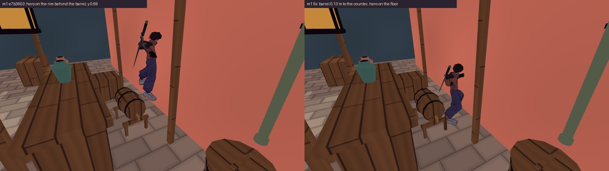
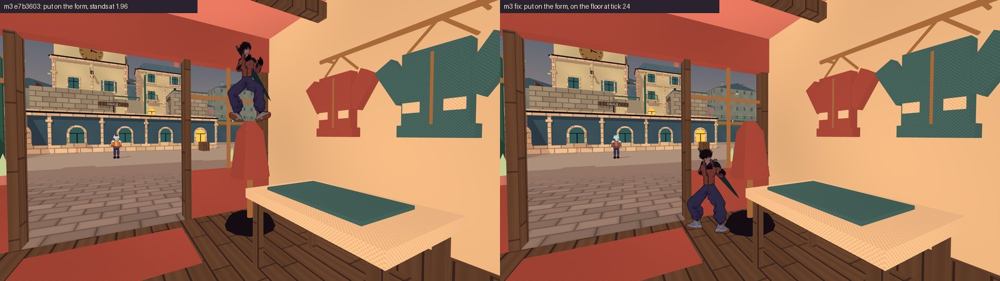

# Бочка на козлах, бочка «Шавлії», манекен і межі кварталу — журнал виконання

**Дата:** 2026-10-15 · **Роль:** T2 Гефест (T2-Д) · **Статус:** §§ 1–5 виконано; `make check` і `make gates` — rc 0, `city-*` 168 / 0, трос і камера до й після тотожні, крім `anchor-coverage` (§ 6).
Чотири пункти рішення T1 «Рішення T1 після приймань T6 (2026-10-15)» з [[2026-10-14-T6-Acceptance-Crane-Albedo-AB]] за
прийманням [[2026-10-15-T6-Geometry-Fix-Acceptance]] і додаток T1 за аудитом T4 (клас 17, § 5). 0 кредитів.

Дерево — `scratchpad/t2e-tree` (detached `e7b3603`, `git log --oneline -1` → `e7b3603 Decide on the stall wedge and the
west boundary escape`). Не комічу й не пушу, diff забирає T1. Godot `4.7.stable.official.5b4e0cb0f`. Сирі логи —
`scratchpad/t2e/` сесії (далі `ТЕ/`). «До» — знімок `ТЕ/base-tree/` (`cp -a` імпортованого `game/` і `tools/` до
першої правки). Кейси ганяю копією `playable_check.sh` з фільтром назв (`ТЕ/bin/batch.sh`, `ТЕ/bin/mk_runner.sh`), той
самий командний рядок: headless, Dummy audio, `--fixed-fps 60`, `--quit-after 12000`, окремий XDG на кейс. Зонди T6 з
`scratchpad/t6c-accept/` не міняю; копії з новими ключами — `ТЕ/probes/*_after.gd` (`diff` — лише ключі).

## 0. Звірка ТЗ із кодом

| факт ТЗ | де | що в коді `e7b3603` |
|---|---|---|
| бочка на козлах ятки W z25, 0,62 м до `SouthWestRear` | `CityMarket.gd:112`; гард `STEP_WEDGE_OPEN` | ✓ `_trestle_barrel` у локальних (0,62; −0,55); колайдер 0,98 × 0,86 × 0,6; гард `gap 0.624`, 9 / 9, 0,183 м під верхом |
| «≈ 0,13 м до прилавка» = +x світу | поза ятки повернута на +90° | ✓ локальна +z — світова +x; прилавок — локальна z 0,125…0,975 |
| бочка «Шавлії» під полицею, нове місце ≈ (−23,95; 0; 13,45) | `CityInteriors.gd:174` | ✓ локальні (2,65; 0; 3), двері «Шавлії» (−26,6; 0; 12); вітринна скриня (2,25; 0; 0,62), 1,25 × 0,85 |
| манекен: циліндр r 0,37, плаский верх 1,96 | `CityInteriors.gd:213–216` | ✓ `DressFormTorso`, y 0,91–1,96, вісь (−17,8; 13,0) |
| межі: стіна 4 м за 2 м від тераси | `CityLayout.gd:95, :104–107` | ✓ чотири `*Boundary` 1 × 4 м, `district_bounds` −32…32; повернення на старт за \|x\|, \|z\| > 36 (`CityWorld.gd:187`) |
| камера, трос, променi світу — маска 1 | `CityCamera.gd:50`, `GrappleHook.gd:524, 623, 785` | ✓ рука камери `mask 1`; трос `8 \| 1 \| 4`, `8 \| 1`; тіло героя `mask 1` (`Fighter.gd:206`) |
| паркур бере стіни променями з маскою тіла | `CityParkourMotor.gd:455` | ✓ `_ray` → `actor.collision_mask`; `_wall` — будь-яке `StaticBody3D` з \|n.y\| ≤ 0,15 |

Одна розбіжність, вирішена тут, а не планом: колайдер у маску тіла робить його і «стіною» для паркур-мотора (біг по стіні
Skea, бічний біг, відштовх — у повітрі над межею). Тому промені мотора його пропускають (§ 4). Це рядок у
`CityParkourMotor.gd`, не в коді тросу чи камери.

## 1. Бочка на козлах ятки W z25 — RED

`CityMarket.gd:112–115`: `_trestle_barrel` у локальних z −0,55 → −0,42 (0,13 м до прилавка, світова +x). Насіння ятки
те саме, тож наступні зсуви (ящик, глечики) не змінились.

**Гард** (`city_tidy_check.gd`, лог `ТЕ/work/city-tidy-5.log`):
- бік −x: `{"open":9,…,"wedge":0} narrowest=none` — у смузі 0,05–0,75 м від краю стіни більше немає (було 9 / 9, 0,624);
  запис OPEN прибрано, у коментарі над `STEP_WEDGE_OPEN` — чому;
- бік +x (до прилавка): `top 9/9`, зазор 0,191;
- бік −z: заклинювання по задній стійці лишилось, але змінилось: 1 / 9, `gap 0.520`, 0,061 м під верхом (було 0,410,
  0,070). Перезакріпив виміряним; T6 цей бік прийняла «як є» (6 / 6 на підлозі);
- ключ `STEP_PROPS` — `CityMarket@(-8.93, 0.86, 24.34)`.

**Зонд T6 `stuck_probe.gd`** (`trestle_w25`, `trestle_w25_k33`; до — оригінал на `ТЕ/base-tree`, після — копія з
новим ключем; `ТЕ/before/stuck.log`, `ТЕ/work/stuck.log`):

| | до | після |
|---|---|---|
| Choko, обидві точки | `wedge` 0,69–0,71 м, 0 / 18 способів виходу | `floor` одразу, 18 / 18 на підлозі |
| Skea, обидві точки | `wedge`, виходить 3 / 18 (`Alt+S`, `Space+S`) | `floor` одразу, 18 / 18 |

`open_probe.gd` (`ТЕ/work/open_trestle.log`): −x і −z — `walk=floor` у 3 / 3 точках обох героїв.

**Регресія `city-rim-exit`** (`tools/world/city_rim_exit_check.gd`, нова).
Предмет: для всіх точок поперек заднього боку бочки на козлах: герой, що зійшов з верху за край, стоїть на підлозі чи
верху, а з обода S, A або D виводять його туди.
Правило — `stuck_probe.gd` T6 (0,40 м від краю, W 40 тиків, відпустити 30; спосіб 90 + 40), точки −0,33 / 0 / +0,33,
обидва герої. Після: `CITY_RIM_EXIT_COMPLETE checks=8 failures=0`, усі шість — `step_off=floor`.

| негатив | форма | результат |
|---|---|---|
| `old` | бочка на старому місці, 0,62 м від `SouthWestRear` (буквальне ТЗ) | rc 1, `failures=6`: усі точки обох героїв на ободі, S / A / D → обід |
| `wall` | бочка на новому місці, до неї підсунуто стіну 2,2 м на 0,62 м | rc 1, `failures=6` |
| `near` | бочка на 0,074 м ближче до `SouthWestRear`: 0,68 м, трохи вужче за капсулу 0,70 | rc 1, `failures=2`: точка +0,33 в обох без виходу |

Форма «0,55 м від стіни» (−0,20 м) — не злам: там S → верх, A → підлога (`ТЕ/work/neg/rimdeep_*.log`), тому її немає.
Це також запас правки: між 0,62 і 0,68 м обід без виходу. На новому місці (0,624 + 0,13 ≈ 0,75 м, розраховано; гард у смузі
до 0,75 м стіни вже не зустрічає) герой падає на підлогу.

## 2. Бочка «Шавлії» — до вітринної скрині

`CityInteriors.gd:174–177`: `_beer_barrel` у локальних (2,65; 0; 3) → (2,65; 0; 1,45), світові (−23,95; 0; 13,45) — місце
T6. До скрині 0,105 м, до східної стіни 0,25 м, до південного краю полиці 0,425 м. Від шляху продавця (`CityPlaces.gd:17–18`)
≥ 3,2 м, з отвору дверей (локальні x ±1,2) — поза ним (x 2,35…2,95).

| перевірка | результат |
|---|---|
| ключ V+ | `CityInteriors@(-23.95, 0.90, 13.45)` у `STEP_PROPS` |
| гард, 4 боки (`city-tidy-5.log`) | +x `top 9/9` (стіна 0,250); −x, ±z — `open 9/9`; заклинювань 0. Скриня поруч: +z `top 5 / open 4`, без заклинювань |
| К7 нового ключа (`ТЕ/work/k7.log`) | +x: обидва на бочці (0,90). −z: обидва на скрині (0,80 / 0,84). Старий −z «перескок уздовж стіни» (`vault=27`) зник: бочка вже не під стіною |
| хода з верху в 4 боки (`open_probe` копія, `ТЕ/work/open_grocer.log`) | +x `top`, −x і +z `floor`, −z `between` −0,10: на кришці скрині, а не на ободі бочки (торкається скрині, не бочки); `back`, `jump` → підлога |
| зона T6 «над верхом і 0,35 м навколо до 2,8 м — нічого без колайдера» (`ТЕ/probes/zone_probe.gd`) | до: дошка, глечики й гілки полиці 1,86–2,70 м, за 0,23 м від осі. Після: лише 13 трикутників фруктів на скрині (`marker`), y 0,93–1,02, за 0,56 м від осі — на висоті ступнів, над колайдером скрині |

Фрукти скрині стирчать на 3–12 см над рівнем верху бочки в кільці 0,35 м — на кадрі вирішує T6 (§ 7).

## 3. Манекен кравця — верх не тримає героя

**Що міряв** (`ТЕ/probes/dressform_probe.gd`: підміняє форму колайдера в рантаймі, продукт не чіпає; логи `ТЕ/work/df/`):
постава T6 на (−17,8; 1,98; 13,0); скидання з y 2,15 над диском r 0,75 кожні 0,1 м; 31 розбіг зі столу, з підвіконня й
з підлоги.

| форма колайдера тулуба | постава T6 | скидання, тримає | розбіги, тримає > 30 тиків |
|---|---|---|---|
| циліндр r 0,37 до 1,96 (`e7b3603`) | лишається на 1,96 | 113 / 147 | 9 / 31 |
| конус до шиї 0,37 → 0,25 → 0,10 («звужений догори», ТЗ T6) | лишається на 1,96 | 38 / 147 | 2–3 / 31 |
| верх, що падає на захід від власного східного краю, 50° | 24–25 тиків | 54 / 147 | 5 / 31 |
| **верх, що падає на захід від високого краю біля стіни, 52°** | **24–25 тиків** | **0 / 91** | **0 / 31** |

Чому так. Для героя «підлога» — будь-який дотик у межах 45° від вертикалі (`floor_max_angle`, `Fighter` його не міняє). Будь-
яка опукла форма має найвищу точку. Герой над нею стоїть: на конусі — над вершиною, на косому верху — до ~0,27 м від
високого краю (виміряно: «косий від свого краю» тримав скидання за 0,27 м від вершини). Єдине місце, де цей край не досяжний, —
впритул до стіни: вісь капсули тримається за 0,35 м від стіни.

**Зроблено** (`CityInteriors.gd:216`, `:235–271`): `_dress_form_torso()` — опукла оболонка, видимий меш той самий.
- `DRESS_FORM_SLOPE` 52° — на 7° крутіше за кут підлоги;
- верх над віссю `DRESS_FORM_AXIS_TOP` 1,85 (на 0,11 м нижче шиї);
- високий край — за `DRESS_FORM_WALL_GAP` 0,02 м від східної стіни крамниці, на 3,10 м;
- над видимим манекеном площина 1,38–2,32 м. Тіло героя, що йде (капсула 0,35–1,45 м), упирається в оболонку з 0,91 м;
- південний бік прямо до стіни: підвіконня за 0,49 м. Косий південний бік відкривав щілину 0,64–0,71 м, де герой
  заклинював на 0,76 м (`df_wall.log`: `window x2.4…3.0 → y 0.76–0.81`);
- північний бік звужується до 0,10 м біля стіни: зазор до розкрійного столу як у круглого тулуба (0,68 над віссю);
- `DRESS_FORM_SIDES` 32. З 16 гранями герой, що зійшов зі столу, зісковзував з кута багатокутника до підніжжя (0,07 м) і
  втрачав вихід D, який T6 прийняла (`df_keep.log`). З 32 він стоїть там само, де тримав циліндр (0,71 м), і A, і D ведуть
  на підлогу (`df_n32.log`, `stuck32.log`).

Ціна, яку видно: падаючи на манекен згори, герой ковзає на захід крізь західну половину плечей і шиї (площина нижча за
них), кілька тиків. Невидима оболонка між манекеном і стіною (щілина 0,63 м, куди капсула 0,70 і так не влазить) тримає
також камеру (шар 1 | 8, як усі меблі).

**Заклинювання біля розкрійного столу** (T6: «як є, A, D → на підлогу»), `stuck_probe.gd` `table_dressform`:

| | до | після |
|---|---|---|
| де стоїть після сходу | `wedge` 0,71 м | `wedge` 0,71 м |
| Choko: на підлогу | A, D, `Space+S`, `Shift+S` | A, D, `Space+S` |
| Skea: на підлогу | A, D, `Alt+S` | A, D, `Space+S`, `Alt+S` |
| стрибок з обода до манекена (`open_probe` / `dressform_probe`) | на верх манекена, 1,92 м | на підлогу |

Гард: OPEN стола тепер `gap 0.682`, 2 / 9, 0,289 м під верхом (було 0,680, 0,281), перезакріплено.

**Регресія `city-perch`** (`tools/world/city_perch_check.gd`, нова).
Предмет: для всіх способів потрапити на манекен (постава, скидання над ним, стрибок зі столу) герой на ньому не стоїть,
а обід столу поруч зберігає вихід.
Після: `CITY_PERCH_COMPLETE checks=19 failures=0`:
- P1 — 24 / 25 тиків;
- P2 — 0 / 45 скидань;
- P3 — усі 10 стрибків закінчуються на підлозі;
- P4 — A, D: 0,71 → 0,00 в обох.

| негатив | форма | результат |
|---|---|---|
| `flat` | старий циліндр | rc 1: P1 ×2, P2 (48 / 72), P3 ×6 |
| `cone` | верх, звужений до шиї | rc 1: P1 ×2, P2 (22 / 72), P3 ×2 |
| `edge` | верх, що падає від власного краю | rc 1: P2 (24 / 72), P3 ×2; P1 зелений — тому постава T6 сама по собі не мірило |

## 4. Межі кварталу — невидимий колайдер (варіант «а» T1)

**Зроблено:**
- `CityLayout.gd:112–137`: `BOUNDARY_VEIL_LAYER` = 64 (шар 7, `project.godot:273` `district_bound`),
  `BOUNDARY_VEIL_TOP` = 28 м, `boundary_veils()`. Один колайдер на межову стіну: її план, від її верху (y 4) до 28 м.
  Верх 28 = найвища тверда точка кварталу (купол вежі, 21,90, виміряно) + стрибок Skea 2,80 (T6 § 3.2) + капсула 1,8 →
  26,50, з запасом. PLACEHOLDER;
- `CityDistrict.gd:51–52, :94–108`: `_boundary_veils()` — `StaticBody3D` без мешу, маска 0, після всього, що район малює;
- `CityFighter.gd:35–36`: тіло міського героя додає собі цей шар у маску. Дуельний `Fighter` не змінено;
- `CityParkourMotor.gd:455–456`: промені мотора не бачать цей шар. Без цього Skea бігала б по повітрю над межею. Перевірки
  простору для перелізання (`_clear`) лишились з повною маскою. Верх межової стіни накритий краєм: кидок капсули на висоті
  верху стіни (y 4) лінію не перетинає (B2 нижче).

Камера (`arm.collision_mask = 1`), трос (`8 | 1 | 4`, `8 | 1`), мешканці й усі промені світу мають маску без шару 7 —
код камери й тросу не змінено.

**Зонд T6 `escape_probe.gd`, усі чотири межі.** Моя копія `ТЕ/probes/escape4_probe.gd --set=all4`: західні прогони T6 без
змін плюс північ, схід, південь і місця біля кожної межі, на які героя ставлю. Логи: до — `ТЕ/before/escape_all4.log`,
після — `ТЕ/work/escape_all4.log`.

| межа | прогони на героя | до: за межами (Choko / Skea) | після |
|---|---|---|---|
| захід | 9 прогонів T6 (тераса ×3, галерея ×2, гребінь `SouthWall` ×3, перемичка воріт) + дах SW-блоку (поставлено) | 6 / 10 і 8 / 10 | 0 / 20 |
| північ | тераса на захід від вежі ×3 (через парапет), мансарда високого дому (поставлено); 2 прогони T6 на північ (не стрибали: дім і вежа) | 4 / 6 і 4 / 6 | 0 / 12 |
| схід | тераса z 22, z 12, z 28; лебідка; кабіна крана й мансарда SE-крила (поставлено) | 5 / 6 і 5 / 6 | 0 / 12 |
| південь | карнизи 3,86 м ×2, кінець ринку, смуга проходу; мансарда SE і дах SW (поставлено); гребінь на південь (у двір) | 2 / 7 і 2 / 7, лише поставлені | 0 / 14 |

Усі 58 прогонів після: `out_ticks=0`, `recovered=false`. Герой падає на смугу між будинками й межею (y 0, \|x\| або \|z\| =
31,65), звідки є вихід (смуга вздовж західної рампи — шлях, яким T6 уже ходила). Справжніх маршрутів через південну межу не
знайшов і до правки: карниз 3,86 м стрибка не дає, решта — стіна 4 м.

**Трос і камера, до → після.** «До» — `ТЕ/before/ropecam/` (21 / 0). «Після» — фінальне дерево, `ТЕ/final/ropecam/`:
56 / 0, разом із негативами `tight-station` ×8, `auto-hook` ×5, `rope-pull` ×17, `rope-choice` ×4 — усі rc 1. Порівнюю
логи цілком, з нормалізацією автоімен тіл (`ТЕ/bin/norm.sh`):
- `rope-choice` ×10, `rope-pull`, `auto-hook`, `city-camera`, `tight-station`, `parkour-moves`, `city-parkour`,
  `city-tricks`, `tricks-independent`, `traversal`, `parkour-motion` — 0 різних рядків;
- `living-body` — `61 / 0`. Перший прогін «після» (`ТЕ/after/ropecam/`, ще до перенесення колайдерів у кінець `_ready`) дав
  ті самі нулі, крім 2 рядків попередження Jolt «job system exceeded the maximum number of jobs» у `city-tricks` —
  навантаження машини;
- жоден із цих кейсів не гойдає героя на краю, тому окремий зонд `ТЕ/probes/rope_edge_probe.gd` (`ТЕ/before/rope_edge.log`,
  `ТЕ/after/rope_edge.log`). Від стін біля трьох меж: E, потім W до межі, 150 тиків, обидва герої. З тераси біля вежі
  гра обирає якір 21 (−29,4; 10,2; −25):
  - до — гойдання виносить героя за лінію (`reach=32.22`, 32 тики за межею);
  - після — зупиняє на краю (`reach=31.65`, 0 тиків). Трос тримається ті самі 146 тиків, на краю гра його не відпускає
    (`let_go_at_edge=0`).

  Якір 12 на східній терасі (148 тиків) і решта прогонів — ті самі числа до й після;
- `anchor-coverage` — `real=2658/2981 → 2663/2986`, `t8=3876/3969` і непокриті `indoor=110/114 strip=151/247 open=62` ті
  самі. Дамп сітки (`--dump`, `diff`): +5 клітин (16…20; 8) — промінь донизу точно по нижньому краю `EastRamp` (z 8), що
  лежить на `Ground` (y 0): нічия між двома тілами, яку Jolt розв'язує порядком у broadphase. Бісекція (`ТЕ/bisect/`):
  дає лише додавання тіл меж, від місця їх створення не залежить. Ще ±1: (−24; 15) стала досяжною (там стояла бочка
  «Шавлії»), (−17; 13) зникла (щілина між манекеном і стіною, тепер без 1,8 м над головою).

**Гард `city-bounds`** (`tools/world/city_bounds_check.gd`, новий).
Предмет: для всіх чотирьох меж і всіх висот, яких дістає герой: герой лишається в кварталі, а край — колайдер лише для
його тіла (не малюється, не бачать камера, трос і паркур).
Після: `CITY_BOUNDS_COMPLETE checks=75 failures=0`:
- B1 — чотири колайдери, план стіни до 1 мм, верх 28 ≥ 26,50;
- B2 — 1696 кидків капсули на межу (кожні 2 м, кожні 0,5 м висоти від 0 до 26,2), жоден не перетнув лінію;
- B3 — промені з масками камери, тросу й світу проходять крізь край;
- B4 — мотор не бере край за стіну (9 точок на межу);
- B5 — 9 прогонів × 2 героя, `out_ticks=0`.

| негатив | форма | червоне |
|---|---|---|
| `gap` | немає колайдера над північною межею | B1 ×2, B2 північ (1440 кидків крізь), B5 північ ×4 |
| `low` | верх кожного колайдера на 8 м | B1 ×4, B2 ×4, B5 ×9 (поставлені на мансарди й дахи) |
| `world` | колайдери ще й на шарі світу (бачать камера, трос, мотор) | B1 ×4, B3 ×4, B4 ×4 |
| `mesh` | колайдер малюється | B1 |
| `hero` | маска героя без шару краю | B2 ×4, B3, B5 ×18 |

**Паркур на краю живими клавішами** (`ТЕ/probes/edge_wallrun_probe.gd`, Space тримаю). П'ять розбігів на межу, обидва
герої. Фази мотора, коли герой вище 4 м і за 1,4 м від лінії:
- з правкою — жодної (`ТЕ/after/edge_wallrun.log`);
- з рядком мотора, тимчасово поверненим до `actor.collision_mask` (`ТЕ/work/neg/edge_wallrun_motor_reverted.log`), Skea
  біжить угору по невидимому краю (`wall_run: 39` тиків із західної і східної тераси) і вздовж нього (`wall_side: 39`).

Файл після проби повернуто (`cmp` → однаково).

Ще одна форма, не внесена в кейс: я повернув рядок мотора до `actor.collision_mask`. B4 червоний лише на ній —
`failures=4` (`ТЕ/work/neg/city-bounds-scratch-motor.log`); файл повернуто, `git diff` показує саме правку § 4.

## 5. За аудитом T4, YELLOW 1 (клас 17): OPEN закріплено повністю

Запит T1: `STEP_WEDGE_OPEN` тримав лише найвужчий зазор ± 0,02. Мутант T4 — стіна за 0,55 м уздовж −x прилавка «Шавлії».
Він переводив бік з 5 / 9 у 9 / 9 точок, а гард лишався зеленим (`failures=0`).

`city_tidy_check.gd`:
- `:201–221`: кожен запис отримав `points` і `depth` — виміряні на цьому дереві, з `city-tidy-5.log`; `STEP_OPEN_SLACK` = 0,02;
- `:1559–1563`: нова перевірка `counts.wedge ≤ points` і `depth ≤ pinned + 0,02`;
- шапка V+ і коментар над списком.

Нові значення бочки на козлах (−z) і стола (§ 1, § 3) закріплено вже виміряними.

Предмет: для всіх закріплених OPEN-боків заклинювання не зникає, не ширшає і не глибшає.

| негатив | форма | результат |
|---|---|---|
| `wedge_open` (був) | зникло | rc 1: «no longer wedges as pinned (0 of 9 points, gap 0.723)» |
| `wedge_more` (новий, мутант T4 зі стіною 0,55 м) | ширшає | rc 1: «9 of 9 points, pinned 5; 0.078 m under» |
| `wedge_deeper` (новий) | глибшає: бічна полиця «Шавлії» на 0,018 м далі | rc 1: «5 of 9 points, pinned 5; 0.171 m under, pinned 0.147 + 0.02», зазор 0,562 — у межах допуску |

Позитив: `CITY_TIDY_COMPLETE checks=513 failures=0` (+8 перевірок, по одній на OPEN).

## 6. Перевірка: до → після

«До» — `ТЕ/base-tree/` (`e7b3603`), «після» — фінальне дерево правки.

| що | до | після |
|---|---|---|
| `make check` (`ТЕ/final/make_check.log`) | — | rc 0. Імпорт без рядків error/warning; GDS `перевірено: 144 · не парсяться: 0`, канарка `FAIL як треба`; smoke `ALL OK (165 checks) in 19847 frames` |
| `make gates` (`ТЕ/final/make_gates.log`) | — | rc 0, «БАТАРЕЯ ЗЕЛЕНА». Wikilinks: 538 сторінок, 8921 лінк, зламаних 0. Реєстр 187 / 187. Ролі 8 / 0. GDS 144 / 0 |
| родини `city-*` (`ТЕ/before/city.out`; `ТЕ/after/city-tidy.out`, `ТЕ/after/city-rest.out`) | 152 / 0 | 168 / 0 — ті самі 152 і 16 нових (`city-bounds` ×6, `city-rim-exit` ×4, `city-perch` ×4, `wedge_more`, `wedge_deeper`) |
| підсумкові рядки 152 спільних кейсів (`ТЕ/bin/cmp_city.py`) | — | 111 тотожні. 41 — `city-tidy` і його негативи: `checks` +7 (506 → 513; § 5), `failures` у кожного негатива ті самі |
| трос, камера, паркур (`ТЕ/before/ropecam.out`, `ТЕ/final/ropecam.out`) | 21 / 0, позитиви | 56 / 0: ті самі 21, `living-body` і 34 негативи; логи 21 спільних тотожні, крім `anchor-coverage` (§ 4) |
| дуель (`living_body_check -- --dump`, `cmp` кожного файла; `ТЕ/before/duel/`, `ТЕ/after/duel/`) | — | `identical=8 different=0` |
| `CITY_TIDY_INFO triangles` (`ТЕ/before/city/city-tidy.log`, `ТЕ/work/city-tidy-5.log`) | `district=113504 mesh_instances=266` | те саме, по модулях теж |
| К7 T6 (`ТЕ/before/k7.log`, `ТЕ/work/k7.log`) | 88 рядків `T6_K7` | 88. Після нормалізації автоімен різняться лише змінені місця: ключ бочки на козлах; бочка «Шавлії» (+x на бочці, −z тепер на скрині, а не перескок уздовж стіни); розкрійний стіл −z `end_y` 0,728 → 0,719 (біля манекена) |

**Траса міста поза зміненими місцями не змінилась.** Що змінилось, і де:
- бочки й манекен — К7 вище, зонди §§ 1–3;
- край — прогони на межу (§ 4), гойдання з якоря 21 до західної межі;
- `anchor-coverage` — нічия на ребрі `EastRamp` (z 8) і ±1 біля бочки «Шавлії» та манекена (§ 4).

`rope-choice` (усі 10 частин) — до рядка ті самі, тобто вибір якорів і обриви тросу колайдер не зачепив.

**Один мій огріх, виправлений.** Пробу «рядок мотора повернуто» (§ 4) я ганяв 11 с, поки на тому самому дереві йшли
партії «після». П'ять кейсів, чий запуск перекрив це вікно (за часом файлів, `ТЕ/final/rerun.out`), я перегнав після
повернення файла:
- `city-tidy-negative-wedge_round`;
- `city-tidy-negative-wedge_deep`;
- `city-alley-negative-sword`;
- `auto-hook-negative-nopull`;
- `rope-pull-negative-nopull`.

Результат: 5 / 0, rc 1, як треба. Вище стоять числа з перегону.

## 7. Кадри для T6

`ТЕ/frames/t2e_frames.gd` — копія T6 `t6c_frames.gd`, змінено лише список кадрів. Раннер `ТЕ/frames/run_frames.sh` —
копія `run_t6c.sh` з деревом як аргументом. Ті самі кадри зняв на `ТЕ/base-tree` («до») і на дереві правки («після»):
rc 0, `ERROR` 0, рядок `T6_INFO renderer=gl_compatibility adapter=llvmpipe (LLVM 20.1.2, 256 bits) window=(1920, 1080)
scale3d=1.00 msaa=2`. Сирі PNG і сірі копії — `ТЕ/frames/before/`, `ТЕ/frames/after/`. Кадри «після» зняті до того, як
створення колайдерів меж перенесено в кінець `_ready` (§ 4). Колайдери не малюються, тож на кадр це не впливає.

- **m1** (око T6, бочка на козлах). До: герой висить на ободі, y 0,69. Після: стоїть на підлозі за бочкою, y 0,00.
- **g3, g2, g1** (бочка «Шавлії»). Після: герой на бочці біля скрині з фруктами, полиця з травами вже не над ним.
  - g2 — плече 6,00;
  - g1 — камера впирається в стіну за 0,25 м, плече 0,39. Це той самий клас тісного кута R1
    ([[2026-10-07-Camera-Readability-Iteration-2]] крок 5), що T6 знімала на старому місці (там теж 0,39).
- **m3** (око T6, манекен). До: поставлений на верх стоїть на 1,96. Після: на 24-му тіку він на підлозі біля вікна.
- **b1–b5** (межі). Кадри до й після на тих самих станціях різняться на 0,08–1,5 % пікселів (`py/imgdiff.py` T6). Усі
  області різниці — поза героя (фаза idle) і згладжування тексту вивіски «СЛУЖБОВИЙ ДВІР» (маска на аркуші). Плече камери
  те саме: 6,00 / 6,00 / 6,00 / 1,26 (`T6_SHOT … arm=`). Невидимий край у кадрі не з'являється.

## 8. Відкрите

- **M3 / Forward+ не бачив.** Кадри — Compatibility / llvmpipe з подвійним альбедо, FPS не міряв.
- **Манекен (T6).** Падаючи на манекен згори, герой кілька тиків ковзає крізь західну половину плечей і шиї. Невидима
  оболонка заповнює щілину 0,63 м між манекеном і стіною до 3,10 м і тримає також камеру. На кадрі вирішує T6.
- **Бочка «Шавлії» (T6).** Фрукти скрині (y 0,93–1,02) стирчать у кільці 0,35 м навколо бочки, на висоті ступнів.
- **Бочка на козлах.** Запас від смуги без виходу — 0,07 м: на 0,68 м до стіни вже одна точка з трьох без виходу
  (негатив `near`). Бік −z лишився OPEN: 1 / 9, 0,061 м, T6 його прийняла «як є».
- **Межі.**
  - На верх межових стін (y 4, 1 м) герой більше не стає: там тепер край.
  - Справжнього маршруту через південну межу немає ні до, ні після; гард тримає її поставленими прогонами й кидками.
  - Ragdoll (шар 16, маска 1) краю не бачить. Відкинутий за межу безвладний герой повернеться на старт, як і раніше.
    Не перевіряв: бій у місті йде лише в кишені на центральному дворі, далеко від меж.
- **Повну `make check-playable` не ганяв**, її проганяє T1. Ганяв `city-*` (168), трос, камеру й паркур з негативами
  (56) і 5 перегонів.
- **Гард п. 4 К7-а** («з обода є вихід») загалом не робив: це рішення T1 «після M3». `city-rim-exit` міряє лише бочку на
  козлах.
- **`state.md` не правлю.** Зведення робить T1, паралельно працює T2-Г. Журнал зустрічі не пишу, бо це sub-сесія.

## Related

- [[2026-10-15-T6-Geometry-Fix-Acceptance]] · [[2026-10-14-T6-Acceptance-Crane-Albedo-AB]] · [[2026-10-14-T6-Acceptance-Geometry-Fix]]
- [[2026-10-08-City-Modern-Realism-Props]] · [[2026-10-07-Camera-Readability-Iteration-2]] · [[06-UI-UX]]
- [[state]] · [[Textures-Registry]] · [[recurring_class_register]]
